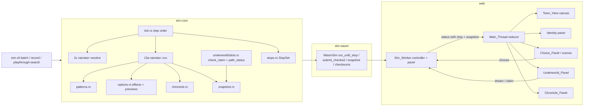

# Design Document: first-playable

## Overview

Spec 6 makes the loop playable in the browser with rules only: a mid-life adult with a family, a debt and a grudge; stops with concrete Stakes; death; one template-text dream; a rebirth path chosen from slots whose status is spelled out; a second life that keeps running. No model call anywhere.

The design adds four things and changes as little else as possible:

1. **Narrator** (`sim-core/src/narrator/`): a step after the last life-sim step of tick t that builds Narrator_Candidates, fires at most one Player_Node, auto-resolves the rest, and a resolution step in tick t+1. Its state (pending node, Chronicle, life budget) is World state inside the Checksum. A first-life onboarding rule, the Intro_Debt with its Intro_Grace (`sim-core/src/intro.rs`), protects the first-stop candidate. The core never waits and branches on no execution mode; the interactive advancement gate is in the Sim_Worker alone (P-1 execution scope, decided; "Interactive advancement gate" below).
2. **Underworld additions** (`sim-core/src/underworld/`): Customization on the Rebuilt_Body claim, Base_Traits fixed per Player_Wait, and Path_Status computed by the same checks a claim runs.
3. **Seams for the UI**: an extended Snapshot, stop reasons returned from `Sim::step`, checked submission (`Sim::try_submit_all`), and new `WasmSim` methods. Replay format 5.
4. **Web_App**: clock-paced play in the Sim_Worker that stops after any stop tick, a Canvas Town_View behind a small sprite interface, an identity panel, the Choice_Panel, four Scene_Templates, the Chronicle_Panel and the Underworld_Panel; a playthrough Smoke_Test.

Code facts from the current repository at the commit where this spec starts (baseline only; target values are defined below in the task boundaries):

| Baseline fact | Where |
|---|---|
| `World::step_with_outcomes` runs steps 1, 2a (`apply_inputs`), 2b (`underworld::resolve_pending`), 3 to 13, 14 (advance), 15 (checksum) | `crates/sim-core/src/tick.rs` |
| `Nodes { ids: IdCounter, pending: BTreeMap<NodeId, PendingNode>, resolved: Vec<NodeRecord> }`; `pending` is empty at every tick boundary; `NodeRef::Trigger { seq }` | `underworld/nodes.rs` |
| `InputPayload` has `Act`, `ClaimSlot { slot: SlotRef }`, `Haunt`, `Bribe`, `CarryOver`, `Dream`, `Choose`; `RejectReason::ALL` has 21 entries with canonical tags 0..=20 | `input.rs` |
| Existing canonical version is 3 and existing replay version is 4; versions 2 and 3 are rejected | `canon.rs`, `replay.rs` |
| `WasmSim` exposes `new`, `submit`, `step`, `tick`, `run_ticks`, `snapshot`; the controller runs Speed ticks per Frame and throttles status | `crates/sim-wasm/src/lib.rs`, `web/src/worker/controller.ts` |
| Measured baseline batch/full-gate times | `docs/kiro-log.md` |

The target changes are not facts about the current code. Canonical boundaries are task 1.1 (v3→v4 Narrator), task 3.1 (v4→v5 IntroDebt), and task 4.1 (v5→v6 Rebuilt_Draw), each with same-task fixture regeneration. Replay stays v4 through task 4.1; task 6.1 alone raises it to v5 and rejects v2, v3 and v4.

| Target boundary | Canonical change | Fixture rule |
|---|---|---|
| task 1.1 | `World.narrator`, narrator Params, Chronicle state | regenerate fixtures as Canon v4 |
| task 3.1 | `World.intro_debt` and its Canon encoding | regenerate fixtures as Canon v5 |
| task 4.1 | `PlayerWait.rebuilt_draw` and its Canon encoding | regenerate fixtures as Canon v6 |
| task 6.1 | replay DTO migration and `REPLAY_VERSION = 5` | migrate/re-record all replay fixtures |

### Scope guard

- The offering economy, Params prices, Yearly_Cap, Relation decay and OP-U15 are unchanged (decision 5). During Intro_Grace only the Intro_Debt skips repayment rolls in step 10 and `inheritance` `pay_debts` targets another Debt or is absent (selected P-1 protection); its eligible `debt_due` candidate has first priority over same-tick candidates. Death settlement remains unchanged.
- `dream_interpretation` and `magistrate_ruling` keep same-tick resolution, `NodeRef::Trigger`, the `Choose` payload and the empty-at-boundary `Nodes::pending` (Requirement 1.11). Player_Nodes live in a separate store and share only the Node ID counter.
- Player_Nodes build no Frozen_Context and call nothing in `sim-core/src/llm/` (Requirement 15.6).
- No haunting or Bribe UI, no settings page, no replay gallery, no generated text.

## Architecture



### Tick step order

The existing 15 steps keep their numbers; two steps are inserted with letter suffixes so existing documentation stays valid.

| Step | Name | Change |
|---|---|---|
| 1 | Reset flows | unchanged |
| 2a | Apply inputs in `(tick, seq)` order | new payload `ChoosePlayer`; `ClaimSlot` carries `customization` |
| 2b | `underworld::resolve_pending` | unchanged: dream and ruling nodes fire in 2a and resolve here, same tick |
| **2c** | **`narrator::resolve`**: resolve the Player_Node fired in tick t−1 by its accepted External_Choice, else by its Rules_Default, then `intro::update` | new |
| 3 | Outsider releases, Player_Soul forced placement | unchanged |
| 4 | Deaths | unchanged (first step that can end a life), then `intro::update` checks actual end conditions; a transfer of the still-open Debt with the first life ongoing does not end Grace |
| 5–9 | Offerings, slot births, announcements, marriage, loans | unchanged |
| 10 | Repayments | skips the Intro_Debt while `IntroDebt::Grace` holds (Requirement 5.9); otherwise unchanged |
| 11–13 | Social events, economy, relation decay | unchanged |
| **13a** | **`narrator::run`**: build candidates from tick t, give eligible Intro_Debt `debt_due` first priority during Grace, fire at most one Player_Node, auto-resolve the rest, then `intro::update` and clear the crossing buffer | new |
| 14 | Advance tick | unchanged |
| 15 | Checksum | unchanged (covers the new state) |

`social::move_relation` gains one side effect for the feud trigger: when the Relation is between the Player_Soul's body and another Resident and the move takes affinity from `>= grudge_threshold` to `< grudge_threshold`, it pushes `Crossing { event, from, to }` onto `narrator.crossings` (see "Feud first crossing"). The buffer is filled during the tick and emptied at the end of 13a, so it is empty at every tick boundary and never encoded.

Why this order meets Requirement 1.2: 13a runs after step 13, the last life-sim and underworld step; 2c runs after 2a (inputs accepted) and 2b, and before step 3 and step 4. Step 3 can only start a life (placement) and step 4 is the first step that can end one, so the chooser of a node fired at 13a of tick t is always alive at 2c of tick t+1 in a normal run. Requirement 1.10 (`chooser_absent`) is still implemented and tested with a constructed World; the interactive Worker cannot reach it, because it never advances an unanswered node and 2c precedes step 4.

Why the underworld nodes are untouched: 2b still drains `Nodes::pending` completely; Player_Nodes are stored in `World::narrator.pending`, not in `Nodes::pending`; `attach_choice` (the `Choose` handler) never looks at the narrator store; the invariant "`Nodes::pending` empty at every boundary" and its existing tests stay as they are. The only shared item is `world.nodes.ids.next()`, so Node IDs stay unique across all three families (Requirement 1.1).

### Choice timing

```mermaid
sequenceDiagram
  participant W as Sim_Worker
  participant S as sim-core
  W->>S: run tick t (run_until_stop)
  S-->>W: stop {player_node}, world.tick() = t+1
  Note over W: Run_State paused; status + Snapshot posted
  W->>S: try_submit_all([ChoosePlayer{node, option}]) for tick t+1
  S-->>W: Ok(seq) or Err(reason)
  W->>S: run tick t+1 (allowed: the node now has an accepted choice)
  Note over S: 2a accepts choice, 2c resolves node
```

After tick t has run, `World::tick()` is t+1, which is the Choice_Tick. The UI submits for `world.tick()`; Requirement 8.7's "the tick after the current tick" refers to the last tick run (t) that the page displays.

The sequence shows the only interactive order: the Worker gate of Requirement 8.9 refuses `run` and `step` between the stop and an accepted choice, so interactive play reaches tick t+1 only on the branch drawn here. Headless, CLI and replay runs take the same core path with no accepted choice and resolve by Rules_Default (Requirement 1.4); the core itself branches on no execution mode.

An input that names the node at any other tick finds no pending node and is rejected `unknown_node`: at tick t (inputs apply in 2a, before the node exists at 13a) and at t+2 or later (the node resolved at 2c of t+1). So Requirement 1.6's "tick other than the Choice_Tick" needs no new reason.

## Components and Interfaces

### sim-core: `narrator/` module

New module `crates/sim-core/src/narrator/` with `mod.rs`, `patterns.rs`, `options.rs`, `salience.rs`, `chronicle.rs`. `structure.md` gets the new row.

```rust
// narrator/mod.rs
pub(crate) fn resolve(world: &mut World);   // step 2c
pub(crate) fn run(world: &mut World);       // step 13a
```

**`run` (step 13a), at tick T:**

1. Update the life budget: if the Player_Soul is in `SoulPlace::Body(b)` and `narrator.life.body != b`, start a new Player_Life `{ body: b, start: T, first_fire: None, last_fire: None }` (Requirement 3.7). If the Player_Soul is waiting, return (Requirement 2.9).
2. Collect the new Events of tick T: walk the Event_Log backwards while `event.tick == T`, skipping IDs listed in `appended` of the Chronicle_Entries of tick T (Events the Narrator itself appended in 2c of this tick; this stops a node's effect from triggering a chain of candidates).
3. Call each Pattern (family order `family_death`, `inheritance`, `debt_due`, `feud`, `life_stage`) to get candidates (Requirement 2.1, 2.2). Event-triggered Patterns produce at most one candidate per (family, Event); Clock_Triggers use equality (`T == due − debt_due_lead`, `age_days == stage_age`), so each holds on exactly one tick and fires at most once with no extra state (Requirement 2.10). The `feud` Pattern reads `narrator.crossings` instead of re-checking affinity (Requirement 2.11, 2.12).
4. For each candidate compute options, effect parts, Option_Previews, Stakes, Rules_Default and Salience (`options.rs`, `salience.rs`). Drop candidates with Salience below `min_salience` (Requirement 2.8).
5. Sort with a stable sort by `(Reverse(salience), trigger_key, family_rank)` where `trigger_key = (0, event_id)` for Event triggers and `(1, 0)` for Clock_Triggers (Requirement 2.6). Among Clock_Triggers of equal Salience the family rank then the clock key (loan Event ID or body ID) break the tie; both are globally unique, so the ordinary order is total. During Intro_Grace only, if the Intro_Debt's `debt_due` candidate is eligible and no first node has fired, put it first before walking candidates, preserving the relative order of all other candidates (Requirement 5.16); do not change its Salience or defensibility.
6. Walk the resulting list. The first candidate that is defensible and passes the budget (Requirement 3.2) fires; every other candidate is auto-resolved in list order: apply its Rules_Default parts now with the skip rule, append one Chronicle_Entry with source `AutoResolved` (Requirement 3.3, 3.4, 3.8). An eligible Intro_Debt `debt_due` candidate does not lose to a same-tick competitor and get auto-resolved while Intro_Grace holds (Requirement 5.16); if it is no longer eligible, including after a death transfer away from the body, do not invent a candidate.

Budget check for a candidate at tick T in the current life L: `L.first_fire.is_none() && T − L.start ≥ first_interrupt_min` or `L.last_fire.is_some_and(|f| T − f ≥ interrupt_gap_min)`. A pending node is impossible at 13a (it resolved at 2c), so only the same-tick "another candidate fired" case blocks; the code still checks `pending.is_none()`. The check has a lower bound only: `first_interrupt_max` is **not** a firing condition, so a first node that becomes eligible after offset 899 still fires. The band's upper bound is asserted by the `first_stop_band` gate (Requirement 13.5), which compares `offset < first_interrupt_max`, so a late first stop is a reported gate failure rather than a suppressed node.

Firing: `id = NodeId(world.nodes.ids.next())`; store `PlayerNode` in `narrator.pending`; set `L.first_fire`/`L.last_fire = T`. If the Node ID counter is exhausted (unreachable), the candidate is auto-resolved instead.

**`resolve` (step 2c), at tick T+1:** take `narrator.pending`; if the chooser is not a living Resident, the applied option is the Rules_Default with every part naming the chooser skipped and `chooser_absent = true` (Requirement 1.10); otherwise apply `external.unwrap_or(rules_default)`. Apply parts in order with the skip rule, append one Chronicle_Entry, leave `pending = None` (Requirement 1.3, 1.4, 1.7, 1.9). This is the single default-resolution contract for every Player_Node, including the first, with no execution-mode branch; the interactive Worker reaches it only with `external` set (Requirement 8.9).

**Skip rule** (Requirement 1.9): before each part, re-validate it against the current World (`EffectPart::check`). A part that fails is recorded in `skipped` with its index and reason; applied parts are never rolled back.

**Input handler** `narrator::attach_choice(world, node: NodeId, option: PlayerOption)`: checks in order `unknown_node` (no pending node or a different ID), `option_not_in_set`, `already_chosen` (Requirement 1.6). Reuses the existing reasons and labels.

### Pattern families

All amounts are integers. `chooser` is always the Player_Soul's body `b`. "Kin" means a Relation from `b` with a Kinship_Tag (`RelTags::has_kinship`).

| Family | Trigger (tick T) | Options (ID: effect parts) | Stakes (who / how much / by when) | Prior (before noise) |
|---|---|---|---|---|
| `family_death` | A `Death` Event of a Person `d` with a kin Relation `b → d` | `comfort_mourner`: `Social{Help, b→m, 60}`; `send_flowers`: `Social{Gift, b→m, 40}`; `stay_away`: none. `m` = the living Resident other than `b` with the highest affinity toward `d` (ties lower ID); if none, only `stay_away` and `send_flowers` toward the oldest living kin of `b`, and with no living kin at all the candidate is not built | `[d, m]` / largest affinity change among previews (affinity) / T+1 | comfort: warmth + loyalty; flowers: 0; stay away: −warmth |
| `inheritance` | An `Inheritance` Event with `heir == b` | `keep_it`: none; `thank_family`: `Social{Gift, b→k, 50}` for up to two co-heirs `k` (other `heir`s of the same deceased in tick T, ascending ID); `pay_debts`: `Repay{loan, a}` for `b`'s oldest open Debt as debtor other than the Intro_Debt while Intro_Grace holds, `a = min(open, inherited amount)`, offered only when such a Debt exists; target fixed when built (Requirement 5.12, selected P-1 protection) | `[deceased, co-heirs…]` / inherited amount (money) / T+1 | keep: greed; thank: warmth; pay: loyalty − greed |
| `debt_due` | Clock: an open Debt with `b` as debtor or creditor and `T == due − debt_due_lead` | Debtor: `repay_now`: `Repay{loan, min(open, b.money)}`; `ask_for_time`: `Social{Apology, b→c, 50}`; `ignore_it`: none. Creditor: `demand_payment`: `Social{Quarrel, b→d, 40}`; `forgive_debt`: `Forgive{loan}` then `Social{Help, b→d, 60}`; `wait_it_out`: none | `[other party]` / open amount (money) / `due` | repay: loyalty − greed; ask: pride·(−1); ignore: greed; demand: temper + greed; forgive: warmth; wait: 0 |
| `feud` | A Crossing in `narrator.crossings` whose `event` is an Event of tick T not appended by the Narrator (see "Feud first crossing"); `o` is the other Resident of the crossed Relation. One candidate per Event even if both directions crossed | `apologize`: `Social{Apology, b→o, 60}`; `retaliate`: `Social{Insult, b→o, 50}`; `let_it_go`: none | `[o]` / current affinity `b → o` (affinity) / T+1 | apologize: warmth − pride; retaliate: vindictiveness + temper; let go: 0 |
| `life_stage` | Clock: `age_days(b) == a` for an `a` in `life_stage_ages` with `a > age_days_at_life_start` | Fixed table per age (below): `Trait{b, name, ±1}` parts, at most two Traits per option | Requirement 4.7 | each option's prior = sum of the body's current values of the Traits it raises |

Life_Stage ages (Params `life_stage_ages: [u64; 3] = [2_190, 4_380, 5_840]`, ages 6, 12 and 16; no adult ages). Rationale: the product's "at six" example; three nodes compress childhood (Requirement 4.1); every age is under 6,570 days.

| Age | Options |
|---|---|
| 2,190 (6) | `ask_for_a_toy`: greed +1 · `visit_grandparents`: loyalty +1, warmth +1 · `ask_for_nothing`: pride −1 |
| 4,380 (12) | `stand_up_to_bully`: pride +1, temper +1 · `tell_a_teacher`: loyalty +1, vindictiveness −1 · `keep_quiet`: temper −1 |
| 5,840 (16) | `get_a_job`: greed +1, pride +1 · `help_at_home`: warmth +1, loyalty +1 · `tend_the_shrine`: piety +1 |

Effects use only card Event types (`help`, `gift`, `quarrel`, `insult`, `apology`, `repayment`, `debt_forgiven`) through the existing paths (`social::apply_social`, a new shared `economy::repay` extracted from `process_repayments`, and the death module's forgive path), plus the Trait bias (Requirement 2.5). Every appended Event cites the trigger Event in `caused_by` when there is one. No option creates money: `Repay` is the existing Repayment flow; `Forgive` removes the Debt with a `debt_forgiven` Event as death settlement already does.

**Rules_Default** (Requirement 1.8): `score(o) = 10 × prior(o) + noise(o)`, `noise(o) = in_range(draw(seed, EntityId(key), StreamTag::Narrator, T, family_rank × 8 + option_index), −5, 5)`, where `key` is the trigger Event ID, the loan Event ID (`debt_due`) or the body Person ID (`life_stage`). Highest score wins; ties go to the lower option index. It is computed once at 13a of the firing tick from World state, the chooser's Traits and the keyed stream, and stored in the node. `StreamTag::Narrator` takes the next free tag value.

**Option_Preview** (`options.rs::preview`): computed from the parts at firing with the same formulas the apply path uses: `social::effects(kind, intensity)` (made `pub(crate)`) gives the affinity change on both directed Relations, clamped exactly as `move_relation` clamps against the current value; `Repay` gives `(debtor, money, −a)` and `(creditor, money, +a)`; `Forgive` gives `(debtor, debt, −open)`; `Trait` gives `(b, trait:<name>, post-clamp delta)`. An entry with delta 0 is omitted.

**Defensible_Option_Set** (glossary): at least two options whose preview lists differ (as sorted lists of `(person, what, delta)`). `stay_away`/`ignore_it`/`wait_it_out`/`let_it_go`/`keep_it` have an empty preview, so the family is defensible as soon as one other option has a non-zero effect. A `life_stage` candidate whose Traits are all at the bounds the options push toward can be non-defensible; it then auto-resolves.

### Feud first crossing (Requirement 2.11, 2.12; Decision A-5)

"Was at or above `grudge_threshold` before the Event" is read from the value `move_relation` sees, not reconstructed later:

```rust
// narrator/mod.rs — transient, empty at every tick boundary, never encoded or checksummed
pub(crate) struct Crossing { pub event: EventId, pub from: PersonId, pub to: PersonId }
// in Narrator: pub(crate) crossings: Vec<Crossing>
```

- `move_relation` takes the cause `EventId` (its only caller, `apply_social`, has the ID of the Event it just appended). Before writing, it reads `before = affinity`; after clamping, `after`. If `before >= grudge_threshold && after < grudge_threshold` and one end of the Relation is the Player_Soul's current body and the other a living Resident, it pushes one `Crossing`. Inputs are only integer reads of World state at that call, so the record is deterministic.
- 13a builds at most one `feud` candidate per crossing Event (both directions crossing in one Event give one candidate), skips Events listed in the `appended` field of this tick's Chronicle_Entries, and clears the buffer at its end. Crossings recorded while 13a auto-resolves are discarded with it; they come from Narrator-appended Events, which never trigger candidates.
- Re-arming needs no flag: a Relation already below the threshold produces no Crossing on further grievances (`before < threshold`), and it produces one again only after some change (decay toward 0, an apology, a gift) has taken it back to `>= grudge_threshold` and a later Event takes it below. Relation decay moves affinity toward 0, so it can re-arm a Relation but never cross one downward; `dreams::change_relation` only touches Relations toward a dead body; neither needs the hook.
- Why not a per-Relation `feud_armed` flag in World state: it duplicates information that `affinity >= grudge_threshold` already holds at every moment, so the two could disagree (tech rule 9), and it adds checksummed state for no new behaviour. Why not `post − effects(kind, intensity)`: clamping and later changes in the same tick (other Events, decay at step 13) make the subtraction wrong.
- `try_submit_all` runs 2a on a clone, so crossings it records are discarded with the clone. Escalation of a feud already below the threshold is out of scope (a later spec).

### Salience

`salience.rs`, integers only, from World state at 13a of tick T (Requirement 2.7):

```
S = base(family) + Σ_{p in stakes.who, p != b} tie(p)
tie(p) = 40 if kin(b → p) or kin(p → b)
       + 20 if an open Debt has {b, p} as {debtor, creditor}
       + |affinity(b → p)| / 5        (integer division, rounds toward zero)
       + 30 if p holds a Past_Life_Tie (a Relation p → e for an earlier body e)
base = { family_death: 20, inheritance: 20, debt_due: 20, feud: 10, life_stage: 100 }
min_salience = 30 (Params)
```

Consequences: a `debt_due` candidate always scores at least `20 + 20 = 40` (Requirement 5.4); a `family_death` candidate always has the kin term (at least 60); a `feud` with a kin member, a debt partner or a Rememberer passes; a feud with a stranger passes only at affinity −100 (`10 + 20 = 30`), so a stranger at −45 (`10 + 9 = 19`) is dropped. Stops stay on people the soul is tied to, and Past_Life_Ties raise salience, so a second life stops more for the people the soul knew.

### Opening (Requirement 5)

`opening.rs` step 9 (`choose_player_soul`) changes; every other step is unchanged.

- Eligible: living, age 20..=50, Household with another living Resident (Requirement 5.1).
- **Qualifying Debt**: an open Debt with the person as debtor or creditor, the other party living, and `due − debt_due_lead ∈ [first_interrupt_min, opening_trigger_max]` = `[600, 870]`, so `due ∈ [630, 900]`. Opening loans have due ticks 60..=720, so existing loans with due 630..=720 qualify.
- Choice order (Requirement 5.3), each a `pick_adult`-style draw at its own fixed site (`WORLD_PLAYER_SOUL`, `+1`, `+2`): eligible with a qualifying Debt; else eligible with any open Debt or a Relation with affinity `< grudge_threshold`; else any eligible. If the chosen person has no qualifying Debt, step 9b adds one real `loan` at tick 0: the chosen body borrows from a living adult aged 20..=50 in another Household with balance ≥ `OPENING_LOAN_LENDER_MIN` (a draw over that pool; the age bound lowers the chance that the lender dies before the trigger), amount drawn in the existing 500..=2,000 band capped at the lender's balance, due drawn in `[630, 900]`. If no such lender exists, the body lends `min(balance, 500)` to the eligible adult with the lowest ID in another Household; if neither works generation returns `ConfigError::Generation("opening debt")` (unreachable; tested for seeds 0..=999 and every `n`).
- **Designation** (Requirement 5.8): step 9c sets `world.intro_debt = IntroDebt::Grace { loan, body }`, where `loan` is the chosen body's qualifying Debt with the lowest loan Event ID (the added one when 9b ran). This is the only place that writes `Grace` (Requirement 5.11).

  `generate` cannot construct the `World` already in `Grace`: the struct literal at the top of `generate` runs before any Debt exists, and `Grace` has to name one. The literal therefore writes `IntroDebt::Undesignated`, a third variant that names no loan and no body. Step 9c overwrites it, `intro::update` is the only writer of `Ended`, and nothing writes `Undesignated` again. `generate` returns only after 9c, so a World that escapes `generate`, and every tick boundary, is `Grace` or `Ended` and never `Undesignated`. `Undesignated` exists so the struct literal names a real variant instead of a fabricated Debt; it is not a third gameplay state.

Requirement 5.5 holds because step 9b runs only inside `opening::generate`. Determinism (Requirement 5.7) holds because every draw is keyed at fixed sites of `EntityId(0)`.

### Intro_Debt and Intro_Grace (Requirement 5.8 to 5.16; Decision A-1 and selected P-1 protection)

```rust
// sim-core/src/intro.rs — World field `intro_debt`, inside the Checksum and so inside the replay
pub enum IntroDebt {
    Undesignated,                              // only inside opening::generate, before step 9c
    Grace { loan: EventId, body: PersonId },   // set once by opening step 9c
    Ended { loan: EventId },                   // terminal; nothing writes Grace again
}
```

- **Readers**: step 10 (`economy::process_repayments`) skips the loan named by `Grace` before its roll; no draw is taken for it, so the other Debts' rolls are unchanged (keyed by their own loan IDs). The `inheritance` `pay_debts` candidate builder also reads `Grace`: it fixes the oldest other open debtor Debt at build time or omits that option (Requirement 5.12, selected P-1 protection). The `debt_due` selection reads `Grace` to place the Intro_Debt's eligible candidate ahead of other candidates at its trigger tick while the first node has not fired (Requirement 5.16). Death settlement and other Debt rules do not read it; no other Debt is exempt.
- **End** (Requirement 5.10): `intro::update(world)` turns `Grace` into `Ended` only when the first Player_Life's first Player_Node has actually resolved (a Chronicle entry with `node: Some(_)` for that life), `world.debts` no longer holds `loan`, or the first Player_Life has ended. It runs at the end of 2c (resolution or an option closing the Debt), at the end of step 4 (death settlement may close the Debt or end the first life), and at the end of 13a (an auto-resolved part may close the Debt). These are check points, not end conditions themselves: when step 4 transfers the Debt but leaves it open and the first life ongoing, Grace continues. Do not infer that `SoulPlace::Body(body)` changing by itself proves the first life ended; track that life explicitly. Step 10 skips the loan, and no other step closes a Debt or ends a life, so the Grace ends in the tick an actual condition first holds.
- **Values**: `first_interrupt_min = 600` (20 s at Speed 1), `first_interrupt_max = 900` (30 s, exclusive), so the First_Interrupt_Band is `600 <= offset < 900`, that is `600..=899`. The trigger window is `[600, 870]` (`opening_trigger_max = 870`), which leaves the offsets 871..=899 for a candidate that fires before the Intro_Debt's own trigger. The 20 to 30 s figure is the wall-clock target of Requirement 16.11 and is not a tick bound. The lower end of 600..=899 is chosen because it gives the widest window, so more existing opening loans qualify and fewer seeds need an added Debt.
- **Why the first stop lands in the band**: no Player_Node can fire before offset 600 (budget rule); at the trigger tick (≤ 870) an eligible Intro_Debt `debt_due` candidate has Salience ≥ 40 and a Defensible_Option_Set (debtor: `ask_for_time` has a non-zero affinity preview and `ignore_it` none; creditor: `demand_payment` and `forgive_debt` differ from `wait_it_out`). If no earlier first node has fired, this candidate takes priority over same-tick competitors and fires inside [600, 870]; if another candidate fired first at an offset in [600, trigger), that earlier node already satisfies the band. Death settlement can still close the Debt or transfer it away from the body before the trigger, so the guarantee remains subject to the existing gate and cause reporting.
- **Why ordinary repayment cannot clear it first**: step 10 skips the Intro_Debt, and the `inheritance` `pay_debts` option excludes it while Grace holds, whether fired or auto-resolved. A same-tick competitor cannot auto-resolve its eligible `debt_due` candidate during Grace. Ordinary death settlement can still close or transfer the Debt before its trigger.
- **Death before the trigger**: if the counterparty is creditor, `settle_debts` forgives the Debt, ending Grace because it closes; if the counterparty is debtor, the Debt may move to the first heir and stay open, in which case Grace continues while the first Player_Life continues, but the body's `debt_due` trigger may no longer apply. If the Player's body dies, the first life ends and so does Grace. Step 4 checks these conditions; step 4 itself is not a blanket Grace end.
- **Gate handling**: `first_stop_band` stays a hard check on the five Acceptance_Seeds with no seed-specific fix. When it fails, the failure line names the cause from the Chronicle and Event_Log (`intro_debt_closed_by_death tick=…`, `intro_debt_transferred_away tick=…` for an open Debt no longer involving the body, `first_life_ended tick=…`, or `no_fire`). The opening test over seeds 0..=199 (default `n`, run to tick 870) reports (report-only) how many seeds lose the Intro_Debt's trigger to closure or transfer before its trigger, so the risk is visible before the gate sees it. If an Acceptance_Seed fails this way, the result goes to the Author; the design does not lower Salience, fire late or move the trigger.
- **Check of the value** (Requirement 16.11): the playthrough Smoke_Test measures the wall time from pressing Run at tick 0 at Speed 1 to the first `player_node` stop; the task logs it in `docs/kiro-log.md` with `first_interrupt_min = 600` and the fixture's first stop tick. A time outside 20 to 30 s sends the value back to this design.

### Customization and Base_Traits (Requirement 6)

```rust
// underworld/customization.rs
pub enum Customization {
    Set { trait_name: TraitName, value: i8 },                       // value raw, checked at apply
    Adjust { first: (TraitName, i8), second: (TraitName, i8) },     // deltas raw, checked at apply
}
```

- `InputPayload::ClaimSlot { slot: SlotRef, customization: Option<Customization> }`.
- Apply-time checks, added to `slots::claim` before any existing check after `require_waiting`: Rebuilt_Body with `None`, a Set value outside −3..=3, an Adjust with equal Trait names, or a delta other than ±1 → `bad_customization`; Birth_Slot or Imported_Vessel with `Some` → `customization_not_allowed`. Both are new `RejectReason`s appended to `ALL` with canonical tags 21 and 22 (Requirement 6.5, 6.6). "No Customization", "more than one", "a number of Traits other than two" and "a name outside the seven" cannot be expressed by the Rust type; in JSON they fail to decode (`ReplayError::Malformed`, or a `submit` error in WASM), so the stream is unchanged and nothing is spent.
- **Rebuilt_Draw fixed per wait** (Requirement 6.2; Decision A-3): `PlayerWait` gains `rebuilt_draw: Traits`, drawn once in `start_wait` (called from step 4 at the death tick) with `draw_trait(draw(seed, ghost.rng_key(), StreamTag::RebuiltDraw, death_tick, i))` for `i` in 0..7, and encoded with the `PlayerWait`, so it is inside the Checksum and the replay. Nothing else writes it: the claim, Snapshot, `path_status`, `try_submit_all` previews and rejected claims only read it, and replay recomputes it only by re-running `start_wait` at the same death tick with the same key. `base_traits(world, carry: Option<TraitName>)` is `rebuilt_draw` with the carried Trait copied from the Ghost (Carry_Over first, UW-R9.1). The Snapshot lists it for `None` and each of the seven Traits (Requirement 7.6).
- **Apply** (Requirement 6.3, 6.4): the Rebuilt_Body branch of `claim_standing` calls `create_outsider` with a new `traits: Option<Traits>` argument set to `customize(base_traits(world, wait.carry_over), c)`, and skips the later `carry_over::apply` (already folded in). `customize` writes Set's value, or each Adjust Trait's base plus delta clamped to −3..=3, so on the Carry_Over Trait the Customization value is final. Age, health, Household, money, Origin, spend and cap accounting stay in `create_outsider` and `claim_standing` as they are. NPC releases and the Imported_Vessel path still draw Traits as before.
- Consequence (Decision A-3): the Player's Rebuilt_Body Traits come from `rebuilt_draw` instead of a draw at claim time. NPC Rebuilt_Bodies are unchanged. The draw happens for every Player_Wait, also when no Rebuilt_Body claim follows; it uses its own stream tag, so it shifts no other draw.

### Path_Status (Requirement 7.6, 7.7)

`slots::claim` is split into `check_claim(world, slot, customization) -> Result<Price, RejectReason>` (pure) and `apply_claim`. `path_status(world, slot)` runs the same checks at `world.tick()` (the tick a claim submitted at a stop applies) with a valid placeholder Customization for the Rebuilt_Body slot, and sorts the reasons into:

| Field | Meaning | Source check |
|---|---|---|
| `announced` | Birth_Slot is in `world.slots`; a Standing_Slot while `player_wait` is `Some` | slot lookup |
| `claimable` | every non-cost check passes | `slot_closed`, `slot_claimed`, `claim_held`, `register_wait`, `id_exhausted` |
| `affordable` | balance and Yearly_Cap allow the price | `insufficient_joss`, `yearly_cap` |
| `needed` | `WaitUntil(access_from)`, `JossShort(price − balance)`, `CapRoomShort(capped_spent + price − yearly_cap)`, `Named("claim_held" \| "claimed_by_you" \| "slot_closed")` | the failing checks |

`check_claim` evaluates every check instead of stopping at the first, but returns the first in the existing order, so rejection reasons and their order are unchanged. A property test ties `path_status` to the real claim (Property 14).

### Stops and checked submission

```rust
// sim-core/src/stops.rs — a return value, never World state, never checksummed
pub struct StopSet { pub player_node: bool, pub player_died: bool, pub dream_resolved: bool, pub player_reborn: bool }
impl Sim {
    pub fn last_stops(&self) -> StopSet;                       // of the last stepped tick
    pub fn try_submit_all(&mut self, payloads: &[InputPayload]) -> Result<Vec<InputSeq>, (usize, RejectReason)>;
}
```

- `player_node`: `narrator.pending` holds a node with `fired == T`. `player_died`: the Player_Soul's place after the tick is `Waiting { since: T }`; only the death step writes `since`, so this is a death of the Player_Soul's body in tick T. `player_reborn`: the place was `Waiting` before the tick and after it is either `Body` or `Waiting { since: T }`. The second case is a rebirth and a death inside one tick: a Standing_Slot claim at 2a or a forced placement at step 3 gives the body, and the death step of the same tick rolls its mortality like any living Person's, so the tick reports both `player_reborn` and `player_died` (C2 review, 2026-11-17; a before/after comparison of the place alone reports neither). `dream_resolved`: a `NodeRecord` of family `DreamInterpretation` with `tick == T` was appended (only the Player_Soul's Ghost can dream).
- `try_submit_all` clones the World, runs step 1 and step 2a for the inputs already submitted for the current tick, then applies the payloads in order with the next `seq`s (the same path `preview_node` uses). If every payload applies, it submits them all for the current tick; otherwise it submits none and returns the index and reason (Requirement 8.8). The preview is exact because step 2a of the real tick applies the same inputs in the same order to the same state. The Carry_Over and the claim go in one call, so a rejected claim cannot leave an accepted Carry_Over behind.

### sim-wasm

New `WasmSim` methods (each with a plain-Rust twin, as today):

| Method | Returns |
|---|---|
| `run_until_stop(max: u32) -> String` | `{"ran":n,"checksum":"hex","stops":["player_node",…]}`; runs ticks until one has a stop or `max` ran; a core method, so it resolves an unanswered node by Requirement 1.4. The interactive Worker calls it only while no Player_Node is unanswered ("Interactive advancement gate") |
| `submit_checked(inputs_json: &str) -> Result<String, JsError>` | `{"ok":true}` or `{"ok":false,"index":i,"reason":"option_not_in_set"}`; inputs are a JSON array of v5 payloads for the current tick. Text that does not decode as that array is a `JsError` value, as with the existing `submit`: nothing is queued and the `WasmSim` stays usable, so the Worker catches it and replies to that one request; it is not the fatal path of a panic |
| `checksums(from: u64, to: u64) -> String` | JSON array of hex checksums for ticks `from..=to` (read-only; Smoke_Test) |
| `snapshot()` | extended Snapshot (below) |
| `player_node_state() -> String` | `{"pending":false}` or `{"pending":true,"node":"12","answered":true｜false}`; read-only, outside the Checksum. `answered` is true exactly when the `Sim`'s input stream holds an accepted `ChoosePlayer` for the pending node's Choice_Tick, so it is true from the moment `submit_checked` accepts the choice and before 2a of t+1 writes `narrator.pending.external`. Backed by `Sim::player_node_state()`, which reads `narrator.pending` and `inputs.for_tick(world.tick())`; it takes no draw, changes no state and is never encoded |

`step`, `run_ticks`, `submit` stay for the existing smoke spec and tests and for headless callers. They are core methods and resolve an unanswered Player_Node by Requirement 1.4; the interactive advancement gate is in the Sim_Worker, not in these methods.

### sim-cli

- `auto_player.rs`: `AutoPlayer::plan` adds a fixed Customization to every Rebuilt_Body claim: Devoted uses `Set { piety, 3 }`; the Playthrough_Branch uses `Adjust { (warmth, +1), (loyalty, +1) }`, so the batch exercises both forms (Requirement 6.12). New `PlayerAnswerer` (Decision A-4, acceptance branch only): at a pending Player_Node it chooses the option whose Option_Preview has the largest sum of `Affinity` deltas on Relations `k → b` where `k` holds a Blood_Tie with `b`; ties go to the Rules_Default, then to the lowest option ID (the lowest `PlayerOption` canonical tag). It reads only the Snapshot-visible node and submits a `ChoosePlayer` for the Choice_Tick before stepping (Requirement 8.10, 13.13); it changes no Narrator rule. The answer is scripted headless input, outside the interactive Worker gate, and it counts as an accepted External_Choice once submitted.
- `batch.rs`: new flag `--playthrough` (Playthrough_Branch = `PlayerAnswerer` + `DevotedLiving` acts + `AutoPlayer` with the Adjust rule); per-life narrator lines, per-death Path_Status lines, kin decay figures, the Customization report, the new invariant checks and the new hard target `first_stop_band` under `--require-targets` (Requirement 13). The passive batch answers no Player_Node, so its first node resolves by Requirement 1.4; the Playthrough_Branch submits a choice before tick t+1. Both are headless and outside the interactive Worker gate.
- `commands.rs`: `record --playthrough --stages FILE` writes the Playthrough_Fixture and its stage list; `playthrough-search --seeds A..=B --max-ticks N [--step-fallback]` prints seeds that meet the fixture criteria (Testing Strategy "Fixture seed search", Decision A-2). Both are deterministic and print no timing.

### web

| File | Role |
|---|---|
| `src/shared/protocol.ts` | New requests `world-snapshot`, `choose {node, option}`, `choose-and-run {node, option}`, `dream {dreamer, intent}`, `claim {slot, carryOver, customization?}`, `checksums {from, to}` and `player_node_state`, with the field forms of "Request fields and reply carriers" below; `Snapshot.stop?: { reasons: PauseReason[]; world: WorldSnapshot }`, present only on the one message that reports a stop; `Snapshot.playerNode`, the controller's last `player_node_state()` read; reply `world?: WorldSnapshot` and `checksums?: string[]`; `ErrorKind` gains `rejected` with the reason label, `node_unanswered` and `invalid-tick` |
| `src/shared/world-snapshot.ts` | TypeScript types of the extended Snapshot JSON |
| `src/shared/speeds.ts` | `PLAY_RATE = 30`; Speed now means a multiplier |
| `src/worker/pacer.ts` | Pure `maxBatch(speed)` and `ticksDue(anchorMs, ranSinceAnchor, nowMs, speed) → { run, reanchor }` |
| `src/worker/controller.ts` | Run loop uses the pacer and `run_until_stop`; stop handling; new request handlers |
| `src/main/view-model.ts` | Pure Snapshot → view data: names by ID, ages in years, days from now, Rememberer count, Needed text |
| `src/main/town-layout.ts` | Pure marker positions from Household IDs and Person IDs |
| `src/main/scene-queue.ts` | Pure order of scenes and panels for one stop (Requirement 10.9) |
| `src/main/templates.ts` | Fixed template text for scene lines and Chronicle lines |
| `src/main/customization.ts` | Pure form validity and preview from the Snapshot's `base_traits` |
| `src/art/sprites.ts` | `SpriteSet` interface and the placeholder implementation |
| `src/ui/TownView.svelte`, `IdentityPanel.svelte`, `ChoicePanel.svelte`, `ChroniclePanel.svelte`, `UnderworldPanel.svelte`, `scenes/{Funeral,Inheritance,Dream,Birth}.svelte` | Components; read only the reducer state |
| `src/App.svelte` | Layout and control wiring; keeps the existing seed, config, create, run, pause, step and Speed controls |
| `tests/smoke/playthrough.spec.ts` | The playthrough Smoke_Test |

**Clock pacing** (Requirement 8.1, 8.2). The pacer state is `anchor`, a clock reading, and `ran`, the ticks run since it. The controller sets `anchor = now` and `ran = 0` at three points and at no other: when it accepts a `run` (the first one, and every one after a pause or a stop); when a `set-speed` changes the Speed while the Run_State is `running`; and when the pacer reports a backlog. A `set-speed` that repeats the current Speed or arrives while paused leaves the pacer alone, and so does a refused `run` (Requirement 8.9). A Speed change re-anchors because `ran` was counted at the old Speed: without it a lower Speed stands still until the clock catches up with the ticks already run (one second at Speed 365 and then Speed 1 would wait about six minutes), and a higher Speed is credited at the new rate for time that passed at the old one.

On each Frame the controller computes `due = floor((now − anchor) × speed × 30 / 1000) − ran`. If `due > speed × 30` (more than one second behind) it re-anchors and runs no tick on that Frame, instead of catching up. Otherwise it runs `min(max(due, 0), maxBatch)` ticks with `run_until_stop` and adds the ticks run to `ran`. `maxBatch = ceil(speed × 30 / 20)`, the ticks of 50 ms rounded up: 2, 11, 45, 135 and 548 at Speeds 1, 7, 30, 90 and 365. Rounding up is what keeps the pace independent of the refresh rate: with Frames at most 50 ms apart (20 per second or more) every Frame runs all that is due, so after each Frame `ran = floor((now − anchor) × speed × 30 / 1000)` at every Speed. Rounded down, Speed 1 would run one tick per Frame and lose pace wherever fewer than 30 Frames per second arrive. An unused cap is not carried forward: after Frame k the total is `min(target_k, total_(k−1) + maxBatch)`. With Frames further apart than 50 ms the Worker falls behind and re-anchors (Error Handling). The clock decides only how many ticks run; every call passes only a tick count, so Checksums cannot depend on pace (WS-R6.5 holds).

**Stops** (Requirement 8.3, 8.4, 8.5). A stop is reported once, in `Snapshot.stop = { reasons, world }` on one message, and no later message repeats it. When a tick has stop reasons, whatever ran it (a Frame, `step` or `choose-and-run`), the controller sets `paused`, cancels the Frame and posts one unthrottled `status` whose `stop` holds every reason of that tick and the `snapshot()` taken after it; the status also carries the tick and its Checksum. A batch stops on the stop tick itself, so tick t+1 never runs before the page sees the node. When a request ran the tick, the status is posted before that request's reply and the reply carries no `stop`: the page takes scenes from statuses only, so one stop cannot be staged twice and no consumer has to match a reply against a status. `step` uses `run_until_stop(1)`. A `pause` that ends a running period replies with `stop = { reasons: ['user'], world }` and posts no status, because that reason answers the request (Requirement 8.5); a `pause` received while already paused, including one that arrives just after an automatic stop, replies without a `stop`.

**Requests** (Requirement 8.6–8.9). `choose`, `dream` and `claim` build v5 payload JSON for `world.tick()` and call `submit_checked`; success replies with the new world Snapshot and leaves the Run_State; a rejection replies `rejected` with the reason and changes nothing. A rejection never counts as an accepted choice. `choose-and-run` is the one request that both submits and advances: it calls `submit_checked` with the choice and, only when that returns `ok`, runs one tick; when `submit_checked` rejects, it replies `rejected` and runs nothing. It is handled as one request, so there is no point at which the choice is submitted and the tick has not been decided. Like `step`, it is refused as `invalid-state` while the Run_State is `running`.

**Request fields and reply carriers** (Requirement 8.6–8.8). A request names things in the form the Snapshot gives them, and only the controller builds payload JSON. `node` is `player_node.id`, a decimal string, and `option` is one of that node's option tokens. `slot` is a slot token from `underworld_view.slots` (`birth:<n>`, `imported_vessel`, `rebuilt_body`), which the controller maps to `{"Birth":"<n>"}`, `"ImportedVessel"` or `"RebuiltBody"`. `carryOver` is a Trait name or `null`, as in `base_traits[].carry_over`: a Trait name becomes a `CarryOver` payload placed before the `ClaimSlot` in the same `submit_checked` call, and `null` submits no `CarryOver`. `dreamer` is a Person ID number as in `underworld_view.connected`, written as a decimal string in the payload. `intent` and `customization` have no Snapshot form and use the v5 tokens and JSON shape unchanged; `claim` carries `customization` exactly when `slot` is `rebuilt_body`. `checksums` takes `from` and `to` as decimal strings (WS-R2.5); they index the Checksum history, where index n is the Checksum of the tick that moved `tick()` from n to n + 1. A successful `world-snapshot`, `choose`, `dream`, `claim` or `choose-and-run` reply carries `world`, the Snapshot taken after the request's work; a successful `checksums` reply carries `checksums`; `player_node_state` replies with a freshly read `Snapshot.playerNode` and nothing else. The three failures are kept apart: `rejected` with the reason label when `submit_checked` returns `ok: false`; `sim-error` with the error text when `submit_checked` throws because the payload text does not decode, which queues nothing and leaves the World usable; and `invalid-tick`, before any `SimHandle` call, when `from` or `to` is not a decimal integer in `0..=18446744073709551615` (WS-R6.4).

**Interactive advancement gate** (Requirement 8.9; P-1 execution scope, decided). The controller keeps `this.pending` equal to the last `player_node_state()` it read, refreshed after every `run_until_stop`, every `submit_checked`, every plain `submit` (which can queue a `ChoosePlayer` too) and every successful `create-world`, and sends it to the page as `Snapshot.playerNode` on every reply and status (`{pending: false}` while no World exists). Before `run` or `step` calls `run_until_stop`, if `this.pending` is `{pending: true, answered: false}`, the controller replies `node_unanswered` and returns before any other work: no tick, no input, no Checksum, the Run_State stays `paused` and the pacer anchor is untouched, so a repeated `run` or `step` keeps failing the same way. `this.pending` comes from `player_node_state()`, which reads the accepted `ChoosePlayer` in the input stream, so it flips to `answered: true` the moment `submit_checked` accepts the choice and not before; a rejected `choose` leaves it `answered: false`. The gate covers every pending Player_Node. `set-speed` and `pause` are not gated.

**Replacing the World.** `create-world` validates and constructs the new `WasmSim` first, as it does today. On success, and before it posts the reply, it calls `#stopLoop()` (which cancels the scheduled frame or timer callback) and stamps a world id onto the new one. `#onFrame` checks that stamp and returns without touching the handle when it belongs to a World that has been replaced, so a callback already queued when `create-world` arrived cannot step the new World or post a status for it. No request is dropped (ruled 2026-11-18; an earlier text had `create-world` drop the old World's queued requests, which names nothing). Once the WASM has loaded, the controller dispatches each request to its reply before it takes the next, so no request of the old World is waiting when `create-world` is handled. Its one queue is the FIFO of requests received while the WASM loads, and that is drained in order with exactly one reply each (WS-R2.7): a request behind a `create-world` in it was sent after it and is the new World's. The new World starts with no pending node. A failed `create-world` still leaves the running World running (WS-R2.10).

The Web_App disables its run and step controls while the last `Snapshot.playerNode` it received is `{pending: true, answered: false}`; that disablement is presentation, and a direct Worker request is refused the same way. The core and `WasmSim` have no such gate and no execution-mode branch. `player_node_state` is a read the controller makes; it never reaches the simulation as an input (Requirement 8.11).

**World delivery to the page** (Requirement 9.2, 9.9; ruled 2026-11-18). The Sim_Worker sends a World Snapshot in four places and no other: the `status` that reports a stop (`snapshot.stop.world`), the reply to a `pause` that ended a running period (`snapshot.stop.world`, reason `user`), the successful replies to `choose`, `dream`, `claim` and `choose-and-run` (`world`), and the reply to `world-snapshot` (`world`). A `create-world`, `run` or `step` reply and an ordinary running `status` carry none. That is not changed: the Worker and the protocol stay as C3 released them, and the page closes the gap with reads, in `ui-state.ts` and `App.svelte`.

- The reducer takes the World from `message.world`, else from `snapshot.stop.world`, on a reply as on a status. As task 9.1 left it, it took `stop.world` from a status only, so the World in a `pause` reply was dropped and a manual pause kept showing the World of the last stop.
- The World is stale when a World exists (Run_State `paused` or `running`) and `ui.world` is null or `ui.world.tick !== ui.tick`.
- Paused: after an event is folded, if the Run_State is `paused`, the World is stale and no read is outstanding, the page sends one `world-snapshot`. Today that is the read after `create-world`, which task 9.1 already makes, and the read after a `step` that reported no stop, which the playthrough's fallback Step clicks need before they assert a panel. A read that fails is not repeated for the same tick.
- Running: the reducer counts the `status` messages without `stop` since a World was last taken or a read was last sent, and when the count is 10 or more and no read is outstanding the page sends one `world-snapshot`. Sending a read starts the count again, so a read that fails is followed by ten more statuses before the next (ratified 2026-11-18; the first text counted from the last World taken only, which after a failed read would have asked again at once). Running statuses are at least 100 ms apart, so this is at most one read per second, and with no Frames (a hidden tab) there are no statuses and no reads. The page starts no timer and reads no clock.
- One read at most is outstanding, tracked in the reducer state like `stepPending`; a reply for a replaced World is ignored by its world id, as the existing read is.
- No tick comparison is needed to keep the World from going backwards: the Worker handles one request at a time and its messages arrive in the order posted, so a read handled before a stop is delivered before that stop's status and a read handled after it returns the stop's own World.
- The reads change no Checksum and no tick: `snapshot()` takes no argument, draws nothing and changes no state (Property 15), so when they happen decides nothing in the World, and Property 22's rule that no clock reading reaches a handle call holds. `world-snapshot` is not gated by an unanswered node.
- While running, the tick and Checksum fields follow every `status` and the Town_View, the identity panel and the Underworld_Panel follow up to about a second behind; nothing on the page marks that. At a stop the stop's World replaces whatever is shown.
- Not selected: no refresh between stops, because the Joss_Balance and the Needed lines of a waiting Player_Soul change with no stop and the player would have to pause to see them; a World on the running `status`, because it changes the Worker and Property 22 for the same result. Not in this spec: moving or interpolating markers between Snapshots.
- Cost and its guard: the committed `seed1-pairwise.snapshot-500.json` is 16,834 bytes for 49 Residents. `responsive.spec.ts` still fails on any Main_Thread task longer than 50 ms at every Speed, and it now runs with these reads; if it fails, the developer reports it to the Author and changes neither the threshold nor the spec.

**Layout at 1280×720** (Requirement 9.8): a three-column grid. Left 300 px: identity panel (Soul_Marker, name, age, Origin, Rememberer count, then the scrollable tie lists) and the Chronicle_Panel below it (scrolls). Centre 620 px: the run controls bar (40 px) and the Town_View canvas (620×460); scenes overlay the canvas. Right 360 px: the Choice_Panel or the Underworld_Panel, laid out so Stakes, every option with its preview and control, Joss_Balance, the dream control, the two Standing_Slot rows and four Birth_Slot rows with their Path_Status and claim controls fit in 680 px for up to 5 options or those 6 slot rows. The Smoke_Test checks the required elements with Playwright `toBeInViewport()` at 1280×720.

**Town_View** (Requirement 9.1–9.3): `layoutTown(households)` sorts Households by ID and places them in a grid of 6 columns; members by Person ID in rows inside each cell. Positions depend only on IDs and the member lists. The canvas draws one marker per living Resident through `SpriteSet`; the Player's body gets the Soul_Marker sprite (a gold ring glyph used nowhere else); a graveyard strip lists dead Player_Life bodies.

**Sprite interface** (Requirement 12.1):

```ts
export interface SpriteSet {
  readonly id: 'placeholder' | string;
  resident(ctx: CanvasRenderingContext2D, x: number, y: number, tint: Tint): void;
  soulMarker(ctx: CanvasRenderingContext2D, x: number, y: number): void;
  house(ctx: CanvasRenderingContext2D, x: number, y: number, w: number, h: number): void;
  grave(ctx: CanvasRenderingContext2D, x: number, y: number): void;
  prop(ctx: CanvasRenderingContext2D, kind: 'coffin' | 'candle' | 'cradle' | 'cloud' | 'will', x: number, y: number): void;
}
```

The placeholder draws filled rectangles, circles and one-character glyphs in monochrome with the limited tints (`self`, `kin`, `rememberer`, `affected`, `neutral`). No image file ships. After the Author's Art_Trial decision, a `kenney.ts` implementation can be added behind the same interface without touching components.

**Art_Trial (Author checkpoint, Requirement 12.2–12.6).** This is the C4 release checkpoint in task 11, and therefore blocks the subsequent proof/close phases until the Author records a decision. Download the Kenney 1-Bit Pack outside the repository, open its license file, record the file name and finding in `docs/kiro-log.md`, render the representative screen in a scratch branch or local-only build, record coverage, legibility at 1280×720 and a screenshot path, then **stop for the Author's decision**. No pack file is committed before it. If the decision is late, the slice keeps placeholders and the task closes only with the recorded checkpoint decision.

**C4 outcome (Author, 2026-11-19): change.** The Kenney 1-Bit Pack is not adopted. This spec ends on the placeholder `SpriteSet`: no `kenney.ts`, no image file, an empty `web/assets/ASSETS.json` and no third-party row in `README.md`, so the asset gate below passes with nothing listed. The direction sentence of Requirement 12.1 stays as the record of what was tried; the interface direction is the Author's to set in a later spec.

**Asset gate** (Requirement 12.7, 12.9): `web/scripts/check-deploy.ts` already enforces the 25 MiB limit. It gains one check: every media file in `web/dist` (`.png .gif .webp .jpg .svg .ttf .otf .woff .woff2 .mp3 .ogg .wav`) must be listed in `web/assets/ASSETS.json` with `source: "project"` or a pack name, and every pack name there must appear in the `README.md` third-party table. With placeholders the list is empty and the check passes trivially.

**Scenes** (Requirement 10; the lines and their fields ruled 2026-11-18). `scene-queue.ts` turns one stop into an ordered list: `funeral` for `player_died`; `dream` for `dream_resolved`; `birth` for `player_reborn`; then for a pending node `funeral` (`family_death`), `inheritance` (`inheritance`) or `choice` (another family; it has no overlay). A scene is an overlay on the canvas with its fixed props and markers ("Scene staging" below), its fixed lines and, when it has no choice, one close button. The right column is not in the queue. It shows the Choice_Panel while the latest Snapshot has a `player_node` and the Underworld_Panel while its `player.place` is `waiting`, whatever the stop's reasons were, so a rebirth and a death in one tick play their scenes and leave the Underworld_Panel on the page (Requirement 11.9). A node's Stakes, previews and option buttons exist once, in the Choice_Panel, also while its `funeral` or `inheritance` overlay plays (Requirement 10.4); the buttons are enabled only while the node's entry is the current one and `Snapshot.playerNode.answered` is false. The reply to an accepted `choose`, not the click, ends the node's entry: the overlay goes, the Town_View returns, and the Choice_Panel stays with its buttons disabled and the recorded line until a Snapshot has no `player_node`. A rejected `choose` ends nothing and shows the reason. No scene sends `run` or `step`.

Each line below is fixed text with Snapshot values in braces, and a scene shows these lines and no other text. Names come from `residents` and `person_names`. A tick is shown only where the Snapshot gives that event's tick; `world.tick` is the next tick to run and is never shown as an event's tick (Requirement 10.11).

- `funeral`, own death. `b` is the `player.earlier_bodies` entry whose `id` is `player_wait.ghost`, and `n` the number of `player.past_life_ties` entries whose `earlier_body` is `b.id`. Lines: `{b.name} has died · tick {b.death}`; `Remembered by {n} of the living.` The scene names no one as present; the identity panel lists the Rememberers.
- `funeral`, `family_death` node. `node.stakes.who` is the deceased and then the mourner the options act toward (`patterns.rs` builds it in that order). Lines: `{who[0]} has died · tick {node.fired}`; `Also in this choice: {who[1..]}`, left out when `who` has one entry.
- `inheritance` node. `who` is the deceased and then the co-heirs the options name. Lines: `{who[0]} left you {stakes.amount} {stakes.unit} · tick {node.fired}`; `Co-heirs named: {who[1..]}`, left out when there is none. No list of the estate and no share per heir: the Snapshot has only the amount.
- `dream`. `d` is `last_dream`. Lines: `{d.dreamer} dreamt of you · tick {d.tick}`, then the one line of `d.applied`: `heed_warning` → `They took the warning to heart.`; `take_comfort` → `They took comfort from it.`; `follow_urging` → `They did what the dream urged.`; `believe_revelation` → `They believed what it revealed.`; `obey_ban` → `They obeyed the ban.`; `burn_offering` → `They burned joss paper for you.`; `burn_small` → `They burned a small bundle of joss paper for you.`; `dismiss_dream` → `They dismissed it and went on with the day.` The scene does not show the intent that was sent, which no Snapshot holds after the tick, and states no amount or effect; the Joss_Balance in the panel is where a burned offering shows.
- `birth`, embodied. `r` is the `residents` entry of `player.body`, and `h` the `households` entry that lists `r.id`. Lines: `You are {r.name} now · {r.origin} · age {r.age}`; `Household {h.id}: {the other members by ascending Person ID}`, or `Household {h.id}: no one else.`
- `birth`, not embodied (the new body died in the same tick). `b` as in the own-death funeral. One line: `You were {b.name} · {b.origin}`.
- With joined names, ", " separates them in the order given.

**Scene staging** (Requirement 10.5, 10.11; ruled 2026-11-18). Each scene component has one small canvas of its own above its lines and draws on it only through `SpriteSet`, so the Art_Trial can swap the sprites without touching a scene. The props are fixed per template: `funeral` draws `coffin` and `candle`, `inheritance` draws `will`, `dream` draws `cloud`, `birth` draws `cradle`. After the props it draws one `resident` marker for each Person the scene's lines name who is alive in `residents`, in the order the lines name them, with the tint the Town_View gives that Person in the same Snapshot; when that Person is the Player_Soul's current body it also draws `soulMarker`, as the Town_View does. A named Person who is dead gets no marker: the coffin or the will stands for the deceased. No one the lines do not name is drawn, so the scene shows no attendance. A marker's place is its index in that list, so the staging is a function of the Snapshot alone. What follows: the own-death `funeral` and the not-embodied `birth` draw props only; the `family_death` `funeral` draws the mourner; `inheritance` the named co-heirs; `dream` the dreamer; the embodied `birth` the new body with the Soul_Marker and then the household members it names. `sceneStaging(kind, world)` in `templates.ts` returns the props and that list of Person IDs beside `sceneLines`, and the components draw what it returns. The drawing never covers a line or a button.

**Scenes and the run controls** (Requirement 10.12; ruled 2026-11-18). A scene disables nothing but the option controls of its own stop (Requirement 10.9). Run and Step stay as Requirement 8.9 leaves them, and the Underworld_Panel controls stay as the Snapshot leaves them, so at a `player_died` stop the player can send a dream and press Run with the funeral still open. The reducer keeps, with the queue, the tick of the stop that built it. It drops what is left of the queue when a message shows another tick or another World, and a `status` that carries a stop replaces the queue with that stop's. The tick decides and not the reply to `run` or `step`: a `step` that runs into a stop is answered after that stop's status, and clearing on the reply would clear the new queue. After an accepted `run` the overlay therefore goes with the first status that shows a later tick. A page-only rule that held Run back until the overlays were closed is not selected: the Worker would not enforce it, and the gate of Requirement 8.9 is the only thing that stops time.

**Underworld_Panel** (Requirement 11): Joss_Balance, dream price, Connected_Persons (names), dream form (dreamer select, six intent buttons, send), one row per slot (kind, price, birth tick, three status flags, Needed lines), the Carry_Over select listing the Ghost's seven Traits with values, and, on the Rebuilt_Body row only, the Customization form (Set: Trait + value; Adjust: two Traits + ±1 each) with a preview table (Trait, base, customized, price) and the fixed override line when it names the chosen Carry_Over Trait. Claim buttons are enabled only for Executable_Paths, and the Rebuilt_Body button also needs a complete form. "Keep waiting" is the Run button. The dream send button is disabled with a reason when the balance is below the price or no Connected_Person exists.

Rulings of 2026-11-18 on the panel:

- The dream price is `underworld_view.dream_price` (Requirement 7.9). The page holds no price constant, and the dream control compares the Player_Soul's `joss` balance with it as integers (Requirement 11.10).
- Slot rows keep the Snapshot's order: the Birth_Slots by ID, then Imported_Vessel, then Rebuilt_Body. The Birth_Slot rows sit in one list as tall as four rows that scrolls by itself, under a fixed line `Birth slots: {count}`; the two Standing_Slot rows sit below it and never move. Nothing is left out and nothing is paged (Requirement 9.8). The committed `seed1-pairwise.snapshot-500.json` already lists three open Birth_Slots in a World of 50, so a fifth is not a remote case.
- After an accepted `dream` or `claim` the panel shows the fixed line `Recorded. It takes effect when time runs.` until the displayed tick changes; the reducer keeps the tick it was accepted at, as it keeps `stepPending`. The reply's World is the World before the input is applied, so the balance, the Path_Status and every control's enablement stay as that Snapshot gives them, and Property 27 is unchanged. A second dream in the same tick is sent and comes back `rate_limited`, shown under Requirement 11.12. The page does not predict a rejection.

## Data Models

### World additions (all inside the Checksum)

```rust
pub struct World { /* existing fields */ pub(crate) narrator: Narrator, /* derived */ }

pub struct Narrator {
    pub pending: Option<PlayerNode>,          // at most one by type (Requirement 1.12)
    pub chronicle: Chronicle,                 // append-only, hash-chained
    pub life: Option<PlayerLife>,             // the current Player_Life budget
}

pub struct PlayerLife { pub body: PersonId, pub start: Tick, pub first_fire: Option<Tick>, pub last_fire: Option<Tick> }

pub struct PlayerNode {
    pub id: NodeId,                           // from world.nodes.ids
    pub family: PlayerFamily,                 // FamilyDeath | Inheritance | DebtDue | Feud | LifeStage
    pub chooser: PersonId,
    pub fired: Tick,                          // Choice_Tick = resolution tick = fired + 1, derived (tech rule 9)
    pub stakes: Stakes,
    pub options: Vec<PlannedOption>,          // 2..=5, distinct IDs, in table order
    pub rules_default: PlayerOption,          // one of options
    pub external: Option<PlayerOption>,
    pub trigger: Option<EventId>,             // for caused_by
}

pub struct PlannedOption { pub id: PlayerOption, pub parts: Vec<EffectPart>, pub preview: Vec<PreviewEntry> }

pub enum EffectPart {
    Social { kind: SocialKind, doer: PersonId, target: PersonId, intensity: Intensity },
    Repay { loan: EventId, amount: u64 },     // requires the Debt open with the same debtor and debtor money ≥ amount
    Forgive { loan: EventId },                // requires the Debt open with the same creditor
    Trait { person: PersonId, name: TraitName, delta: i8 },  // delta in -1..=1; requires the person alive
}

pub struct PreviewEntry { pub person: PersonId, pub what: PreviewWhat, pub delta: i64 }
pub enum PreviewWhat { Money, Debt, Affinity, Trait(TraitName) }   // unit: money for Money/Debt

pub struct Stakes { pub who: Vec<PersonId>, pub amount: i64, pub unit: StakeUnit, pub by: Tick }
pub enum StakeUnit { Money, JossPaper, Affinity, TraitPoints }

pub struct ChronicleEntry {
    pub tick: Tick,
    pub family: PlayerFamily,
    pub node: Option<NodeId>,                 // None for Auto_Resolved
    pub stakes: Stakes,
    pub applied: PlayerOption,
    pub source: EntrySource,                  // External | RulesDefault | AutoResolved
    pub chooser_absent: bool,
    pub skipped: Vec<(u8, SkipReason)>,       // part index and why
    pub appended: Vec<EventId>,               // Events this entry appended
}

pub struct Chronicle { entries: Vec<ChronicleEntry>, digest: [u8; 32] }   // encoded as (len, digest), like EventLog
```
`PlayerFamily` is the closed enum, in canonical and family-order order: `FamilyDeath` (`family_death`), `Inheritance` (`inheritance`), `DebtDue` (`debt_due`), `Feud` (`feud`), and `LifeStage` (`life_stage`). `EntrySource` is `External` (`external`), `RulesDefault` (`rules_default`), or `AutoResolved` (`auto_resolved`). `StakeUnit` is `Money` (`money`), `JossPaper` (`joss_paper`), `Affinity` (`affinity`), or `TraitPoints` (`trait_points`). `PreviewWhat` is `Money` (`money`), `Debt` (`debt`), `Affinity` (`affinity`), or `Trait(TraitName)` (`trait:<trait_name>` in Snapshot text). `PlayerOption` has exactly these 24 IDs, in this append-only canonical tag order: `comfort_mourner`, `send_flowers`, `stay_away`, `keep_it`, `thank_family`, `pay_debts`, `repay_now`, `ask_for_time`, `ignore_it`, `demand_payment`, `forgive_debt`, `wait_it_out`, `apologize`, `retaliate`, `let_it_go`, `ask_for_a_toy`, `visit_grandparents`, `ask_for_nothing`, `stand_up_to_bully`, `tell_a_teacher`, `keep_quiet`, `get_a_job`, `help_at_home`, `tend_the_shrine` (tags 0..=23). The Playthrough tie-break compares the canonical tag, not a locale or string sort.

`SkipReason` is the closed, append-only enum `MissingPerson`, `MissingHousehold`, `MissingDebt`, `DeadPerson`, `DebtNotOpen`, `WrongDebtor`, `InsufficientMoney`, `AlreadyApplied`, and `OutOfBounds`, with Snapshot labels `missing_person`, `missing_household`, `missing_debt`, `dead_person`, `debt_not_open`, `wrong_debtor`, `insufficient_money`, `already_applied`, and `out_of_bounds`, respectively. `EffectPart::check` evaluates the named target and its required state immediately before application: Social requires both named Persons alive and distinct; Repay requires the named Debt open, its debtor equal to the doer, and debtor money at least `amount`; Forgive requires the named Debt open and the chooser the creditor; Trait requires the named Person alive and the delta in -1..=1. It returns the first applicable `SkipReason`; applying a valid part returns the Event IDs it appended.

Every enum above has an explicit `Canon` tag in the listed order. `ChronicleEntry` encodes fields in declaration order, including the skipped `(part index as u8, SkipReason)` list and appended Event IDs. `Chronicle` uses `digest_0 = [0; 32]` and `digest_(n+1) = blake3(digest_n || canonical_bytes(entry_(n+1)))`; its Canon encoding is the u32 entry length followed by the 32-byte digest, exactly as `EventLog`. The Snapshot DTO serializes `family`, `source`, `unit`, `what`, and `SkipReason` using the labels above, all project `u64` values as canonical decimal strings, with `deny_unknown_fields`; `skipped` is an array of `{part, reason}` and no field is omitted except documented optional/null fields.

`IntroDebt::Undesignated` exists only during `opening::generate` before step 9c. It must never be observed at a tick boundary, Checksum, replay, Snapshot, or test fixture; the first completed World is `Grace` or `Ended`. The task 3.1 tests own this assertion, including C1 and Property 19; task 1.1 tests only the Narrator skeleton.

`PlayerOption` is a new closed enum with snake_case IDs (the 24 IDs in the tables above), separate from the underworld `NodeOption`, so the underworld enum and its canonical tags do not change. Canonical tags are explicit and append-only, as in `nodes.rs`.

`PlayerWait` gains `rebuilt_draw: Traits` (encoded after `carry_over`).

`World` gains `intro_debt: IntroDebt` (encoded after `debts`). `Narrator` gains the transient `crossings: Vec<Crossing>`, which is not encoded (empty at every boundary; `debug_assert` in `Checksum::of`).

`Params` gains: `first_interrupt_min: 600`, `first_interrupt_max: 900`, `interrupt_gap_min: 900`, `interrupt_gap_target: 1_200`, `debt_due_lead: 30`, `opening_trigger_max: 870`, `min_salience: 30`, `life_stage_ages: [2_190, 4_380, 5_840]`. `Params::stress*` keep these defaults.

Canonical encoding advances at each state boundary, rather than hiding several incompatible layouts behind one number: task 1.1 advances `CANON_VERSION` 3→4 for `narrator` and the new Params; task 3.1 advances 4→5 for `intro_debt`; task 4.1 advances 5→6 for `PlayerWait.rebuilt_draw`. Chronicle encoding as `(len, digest)` keeps per-tick checksum cost O(new entries); `Derived` gets nothing new. A fixture committed at an earlier boundary is regenerated by the task that changes its Canon version.

`StreamTag` gains `Narrator` and `RebuiltDraw` with the next free values; existing values never change.

### Inputs and replay format 5

```rust
pub enum InputPayload {
    /* Act, Haunt, Bribe, CarryOver, Dream, Choose unchanged */
    ClaimSlot { slot: SlotRef, customization: Option<Customization> },
    ChoosePlayer { node: NodeId, option: PlayerOption },
}
```

JSON (all `u64` as decimal strings, unknown fields rejected):

```json
{"ClaimSlot":{"slot":{"Birth":"3"}}}
{"ClaimSlot":{"slot":"ImportedVessel"}}
{"ClaimSlot":{"slot":"RebuiltBody","customization":{"Set":{"trait_name":"warmth","value":2}}}}
{"ClaimSlot":{"slot":"RebuiltBody","customization":{"Adjust":{"first":{"trait_name":"greed","delta":-1},"second":{"trait_name":"piety","delta":1}}}}}
{"ChoosePlayer":{"node":"12","option":"repay_now"}}
```

`customization` is omitted when `None` (`skip_serializing_if`), so encode(decode(x)) is byte-identical (Requirement 15.3). `value` and `delta` are JSON numbers decoded as `i8`; a number outside `i8` fails to decode. `REPLAY_VERSION = 5`; versions 2, 3 and 4 decode to `UnsupportedVersion` (Requirement 15.3). The module docs list one example per payload kind.

`RejectReason` gains `BadCustomization` (`bad_customization`, tag 21) and `CustomizationNotAllowed` (`customization_not_allowed`, tag 22).

### Snapshot additions

Fields added to `SnapshotDto` (`snapshot.rs`), all lists in the orders of Requirement 7, `u64` project values as decimal strings like the existing fields:

```json
{
  "player": {
    "place": "body" | "waiting",
    "body": 17 | null,
    "earlier_bodies": [{"id": 4, "name": "…", "origin": "native", "death": "812"}],
    "blood_ties": [{"person": 9, "affinity": 55, "kinship": ["child"]}],
    "relations": [{"person": 21, "affinity": -42, "kinship": []}],
    "past_life_ties": [{"rememberer": 9, "earlier_body": 4, "affinity": 31}]
  },
  "player_node": null | {
    "id": "12", "family": "debt_due", "fired": "75", "choice_tick": "76", "resolves": "76",
    "stakes": {"who": [21], "amount": "640", "unit": "money", "by": "105"},
    "options": [{"id": "repay_now", "preview": [{"person": 17, "what": "money", "delta": "-640"}, {"person": 21, "what": "money", "delta": "640"}]}],
    "rules_default": "ask_for_time"
  },
  "chronicle": [{"tick": "76", "family": "debt_due", "stakes": {…}, "applied": "repay_now", "source": "external", "chooser_absent": false, "skipped": []}],
  "underworld_view": null | {
    "dream_price": "20",
    "connected": [9, 12],
    "ghost_traits": {"greed": 1, …},
    "slots": [{"slot": "birth:3" | "imported_vessel" | "rebuilt_body", "kind": "birth_slot", "price": "0", "birth": "1290" | null,
               "status": {"announced": true, "claimable": false, "affordable": true,
                          "needed": [{"kind": "wait_until", "tick": "1177"}, {"kind": "joss_short", "amount": "80"}, {"kind": "named", "name": "claim_held"}]}}],
    "base_traits": [{"carry_over": null, "traits": {…}}, {"carry_over": "greed", "traits": {…}}]
  },
  "last_dream": {"tick": "1304", "dreamer": 9, "applied": "heed_warning"},
  "person_names": [{"id": 4, "name": "…"}]
}
```

- `blood_ties` and `relations` (other Relations of the body) list living Residents only, from the body's outgoing Relations; `past_life_ties` lists living Rememberers' Relations toward earlier bodies, excluding the current body (Requirement 7.2, 7.3).
- `chronicle` holds at most the 100 most recent entries (Requirement 7.5: limit 100).
- `person_names` names every Person referenced by the new blocks who is not in `residents` (dead earlier bodies, a deceased in Stakes), so the UI shows names without computing anything.
- The existing `pending_nodes` (underworld) stays and remains empty between ticks.
- `underworld_view.dream_price` is `params.dream_price` as a decimal string (Requirement 7.9), so a World under other Params shows its own price. It sits inside `underworld_view` and adds nothing to a Snapshot of an embodied Player_Soul.
- `last_dream` is the last `dream_interpretation` record in `nodes.resolved`: its `tick`, its `subject` as `dreamer` and its `applied` option ID. Only the Player_Soul's Ghost sends dreams, so every such record is the player's. It is a top-level field because a dream and a Standing_Slot claim can resolve in one tick (`dream_and_rebirth_stop_together_without_an_extra_tick`), and `underworld_view` is then `null` at the stop that plays the `dream` scene. It is omitted, not `null`, while no dream has resolved (`skip_serializing_if`, as `NeededDto` does), so the committed `seed1-pairwise.snapshot-500.json` stays byte-identical. A dead dreamer is added to `person_names`. The intent is not carried: the World keeps it only on the pending node, which is gone at the tick boundary.
- The Snapshot carries no accepted-choice field. An accepted `ChoosePlayer` for the Choice_Tick lives in the `Sim`'s input stream until 2a of t+1 writes `narrator.pending.external`, so a World-only Snapshot would still read "unanswered" straight after an accepted submission. The interactive gate therefore reads `WasmSim::player_node_state()` (below), and `snapshot_json` keeps taking `&World` so Snapshot parity and Requirement 7.8 are unchanged.

### Batch report additions (deterministic text)

```text
seed 3 lives=1:start=0,origin=native,len=21450,cut=false,first=702,first_family=debt_due,nodes=19,auto=212,gap_min=903,gap_med=1407;2:start=22100,origin=possessed,…
seed 3 intro loan=41,grace_end=703,end_cause=first_node_resolved
seed 3 deaths=21450:announced=1,claimable=1,affordable=1,executable=1,two_exec=none
seed 3 kin passive created=118 nonpos=reached:40,censored:78,median:2210 zero=reached:31,censored:87,median:2400
seed 3 customization waits=1:rebuilt_affordable=false,customized=false
batch: kin pooled …   batch: customized_rebuilt_claims=2
```

`first_stop_band=pass|fail` joins the `targets` list and is hard under `--require-targets` (Requirement 13.5); a failure names the seed, the offset (or `none`), the band `600..=899` and the cause of Intro_Debt and Intro_Grace above, including a death transfer that leaves the Debt open but removes the body's trigger. An offset of 900 fails the band. The `intro` line is report-only (`end_cause` is one of `first_node_resolved`, `debt_closed`, `first_life_ended`; a transfer alone is not an end cause).

## Correctness Properties

*A property is a characteristic or behavior that should hold true across all valid executions of a system-essentially, a formal statement about what the system should do. Properties serve as the bridge between human-readable specifications and machine-verifiable correctness guarantees.*

Rust properties use `proptest` over generated worlds (`Params::stress_underworld()` plus the narrator defaults, seeds and input streams from the existing `underworld_gen/` generators extended with `ChoosePlayer` and `Customization` payloads). TypeScript properties use `fast-check` in the web Unit_Tests gate. Redundant candidates from the prework were merged: the budget rules (3.2–3.8) are one selection property, the Snapshot fields (7.1–7.6) one reference property, the UI enablement rules (11.4, 11.5, 11.10, 11.11) one property.

### Property 1: Player_Node lifecycle invariants

*For any* generated run, at the end of every tick: at most one Player_Node is pending; a pending node has `fired == world.tick() − 1` and no older node is pending; its option set has 2 to 5 distinct options containing the Rules_Default and is a Defensible_Option_Set; its Node ID differs from every underworld node ID and every other Player_Node ID ever issued; every node fired at tick t has exactly one Chronicle_Entry with that Node ID, written at tick t+1, and is never pending after t+1; and `Nodes::pending` (underworld) is empty.

**Validates: Requirements 1.1, 1.2, 1.7, 1.11, 1.12, 3.6, 13.8**

### Property 2: Applied option is the External_Choice or the frozen Rules_Default

*For any* generated run and any fired Player_Node whose chooser is alive at resolution, the applied option equals the accepted External_Choice when one was accepted at the Choice_Tick and the Rules_Default stored at firing otherwise, with the matching source; and the stored Rules_Default equals the default recomputed from a clone of the World taken at step 13a of the firing tick. The default branch covers the first Player_Node: it is the core contract of Requirement 1.4, and the interactive gate that keeps a player from reaching it is Property 22.

**Validates: Requirements 1.3, 1.4, 1.8**

### Property 3: Invalid choices change nothing but the rejection record

*For any* World with a pending Player_Node and any `ChoosePlayer` input that names another Node ID, an option outside the set, a tick other than the Choice_Tick, or a node that already has an accepted choice, the input is rejected with `unknown_node`, `option_not_in_set` or `already_chosen`, and the resulting World equals the World of the same run without that input in every field except `rejections`.

**Validates: Requirements 1.5, 1.6**

### Property 4: The skip rule applies exactly the valid parts

*For any* fired Player_Node and any subset of its applied option's parts made invalid between firing and resolution (target killed, Debt removed or repaid, debtor money lowered), resolution applies exactly the parts that are still valid, in order, lists exactly the invalid ones in `skipped`, and rolls back nothing; when the chooser is not a living Resident, the Rules_Default is applied, every part naming the chooser is skipped and `chooser_absent` is set.

**Validates: Requirements 1.9, 1.10**

### Property 5: Every Narrator_Candidate is well formed

*For any* generated World state at step 13a, every candidate the Patterns build has 2 to 5 options with distinct IDs, exactly one Rules_Default among them, one Option_Preview per option whose entries equal the change the apply path makes on a clone of the World, and Stakes naming at least one Person present at that tick, one integer amount with one unit, and a by-when tick not before the current tick.

**Validates: Requirements 2.3, 2.4, 4.7**

### Property 6: Ordering and selection follow the budget rule

*For any* list of candidates (generated Salience, trigger keys, families, defensibility) and any budget state (life start, first and last firing ticks, current tick), the Narrator's ordinary order is sorted by Salience descending, then trigger key with Clock_Triggers last, then family order, independent of input order. During Intro_Grace, an eligible Intro_Debt `debt_due` candidate goes first at its trigger tick if the first node has not fired, with every other candidate's relative order unchanged; it fires rather than losing to a same-tick candidate and being auto-resolved. Otherwise the fired candidate is the first one in the applicable order at or above minimum Salience, defensible and allowed by the first-interrupt or gap rule, or none; every other candidate at or above minimum Salience is auto-resolved exactly once, in that order, with one `AutoResolved` Chronicle_Entry; candidates below minimum produce no entry or effect. A candidate already fired earlier in the first life is not replaced.

**Validates: Requirements 2.6, 2.8, 3.2, 3.3, 3.4, 3.5, 3.8, 5.16**

### Property 7: Salience matches the reference formula

*For any* generated small World with a Player body, earlier bodies and a candidate's Stakes, `salience` equals a direct reference implementation of the formula in "Salience" (kin, Debt, affinity and Past_Life_Tie terms plus the family base), is an integer, and depends on nothing outside those Relations, Debts and the family.

**Validates: Requirements 2.7**

### Property 8: The Narrator stays inside its scope

*For any* generated run: no candidate, firing or Chronicle_Entry occurs at a tick where the Player_Soul is waiting; every Event-triggered entry names a trigger Event of its own tick that the Narrator did not append; no two entries share a family and trigger key (Event ID, or Debt and day count, or body and Life_Stage age); every Event the Narrator appends is of type `help`, `gift`, `quarrel`, `insult`, `apology`, `repayment` or `debt_forgiven`, so it creates no Debt, loan, Person or Household; and within one Player_Life consecutive firings are at least `interrupt_gap_min` apart and the first is at least `first_interrupt_min` after the life's start tick, which equals the tick the body became the Player_Soul's place.

**Validates: Requirements 2.1, 2.5, 2.9, 2.10, 3.7, 3.9, 5.5**

### Property 9: Life-stage choices bias only Traits, within bounds

*For any* Player body with any starting age, any Origin and any Traits, exactly one `life_stage` candidate is built at each Life_Stage age greater than the body's age at the start of the Player_Life and none at the others; applying any of its options changes at most two distinct Traits of that body by −1, 0 or +1 each with the result clamped to −3..=3, and the World after the application equals the World before it except those Traits and the Chronicle.

**Validates: Requirements 4.2, 4.3, 4.4, 4.5**

### Property 10: The opening gives a guaranteed first stop

*For any* seed and any valid `opening_residents`, the Player_Soul's body is a living Resident aged 20 to 50 whose Household has another living Resident and who holds an open Debt with a living counterpart whose `due − debt_due_lead` lies in `[first_interrupt_min, opening_trigger_max]` = `[600, 870]`; if any eligible Resident already held such a Debt before step 9, the body is one of them and no loan was added; `intro_debt` is `Grace` naming that body and its qualifying Debt with the lowest loan Event ID; the `debt_due` candidate built from that Debt has Salience at or above the minimum and a Defensible_Option_Set; and two Worlds from the same seed and Params are equal.

**Validates: Requirements 5.1, 5.2, 5.3, 5.4, 5.7, 5.8**

### Property 11: Customization is valid only on the Rebuilt_Body claim

*For any* waiting World and any generated claim (slot kind × Customization absent, Set with any `i8` value, Adjust with any Trait pair and any `i8` deltas), the claim is rejected with `bad_customization` exactly when it is a Rebuilt_Body claim without a well-formed Customization, with `customization_not_allowed` exactly when a Birth_Slot or Imported_Vessel claim carries one, and on either rejection the Joss_Balance, `capped_spent`, the Waiting_Queue place and the Standing_Slots are unchanged.

**Validates: Requirements 6.1, 6.5, 6.6**

### Property 12: A customized body is the Base_Traits plus the Customization

*For any* waiting World, any Carry_Over choice and any valid Customization of an affordable Rebuilt_Body claim, the new body's Traits equal `customize(base_traits(carry_over), c)` from the model (Carry_Over first, Customization last, Adjust clamped); and compared with the same World claiming with a Customization that names the same Traits at their base values, only the named Traits differ, while age, Household, money, Relations, Origin, the spend and the Yearly_Cap accounting are equal.

**Validates: Requirements 6.3, 6.4**

### Property 13: The Rebuilt_Draw is drawn once per wait and never redrawn

*For any* Player_Wait and any sequence of ticks, Snapshot requests, `try_submit_all` previews, rejected claims and Carry_Over changes inside it, `rebuilt_draw` and the Snapshot's Base_Traits for each Carry_Over choice stay equal to their values at the death tick that started the wait; a World whose `rebuilt_draw` is overwritten with any other Traits value gives a different Checksum; and replaying the recorded inputs reproduces the same `rebuilt_draw` and the same claimed body Traits.

**Validates: Requirements 6.2, 11.7, 15.1, 15.2**

### Property 14: Path_Status predicts the claim

*For any* waiting World and any slot listed in the Snapshot, the slot is an Executable_Path exactly when a claim of it (with a valid Customization for the Rebuilt_Body slot) submitted for `world.tick()` applies in the next step; a slot shown as not claimable or not affordable is rejected with a reason that matches one of its Needed items; and each Needed integer equals the shortfall the checks compute.

**Validates: Requirements 7.7, 11.3**

### Property 15: The Snapshot reports the World exactly and changes nothing

*For any* generated run and tick, the new Snapshot blocks equal a reference built directly from the World (Soul_Place, current and earlier bodies, Blood_Ties and other Relations of living Residents, Past_Life_Ties without dead Rememberers or ties to the current body, the pending Player_Node, the last 100 Chronicle_Entries in order, and the underworld view present exactly while the Player_Soul waits), every list is in the stated order, and taking the Snapshot leaves the next Checksum unchanged.

**Validates: Requirements 7.1, 7.2, 7.3, 7.4, 7.5, 7.6, 7.8**

### Property 16: Checked submission is exact

*For any* paused `Sim` and any list of current-tick payloads, `try_submit_all` either submits all of them and the next step reports `Ok` for each, or submits none, leaves the input stream equal to before, and returns the index and reason the real step would have reported for the first failing payload.

**Validates: Requirements 8.8**

### Property 17: Replay format 5 round-trips and replays exactly

*For any* generated input stream (every payload kind, both Customization forms, `ChoosePlayer`), encoding then decoding the replay file and encoding again gives byte-identical JSON; a version 2, 3 or 4 header is rejected as `UnsupportedVersion`; and verifying a recorded run from seed and inputs reproduces every per-tick Checksum, including runs where Player_Nodes resolve by External_Choice and by Rules_Default, the latter including a first Player_Node. Replay is outside the interactive Worker gate.

**Validates: Requirements 15.1, 15.2, 15.3**

### Property 18: Kin decay figures match a direct computation and observe only

*For any* generated sequence of kin Relation histories (creation tick, affinity per tick, removal), the accumulator's reached, censored and median figures for Kin_First_Nonpositive and Kin_First_Zero equal a direct computation (median = lower middle value, absent when nothing reached), and running a batch seed with and without the accumulator gives identical per-tick Checksums.

**Validates: Requirements 14.1, 14.2, 14.5**

### Property 19: Intro_Grace protects only the designated Debt and first-stop candidate

*For any* generated run: `intro_debt` is `Grace` at tick 0 and never `Undesignated` at any tick end, so the opening's pre-designation state never escapes `opening::generate`; it only ever changes from `Grace` to `Ended`, never back, naming the same loan throughout. At every tick end in `Grace`, that Debt is open, the first Player_Life has not ended, and its first Player_Node has not actually resolved; `Ended` begins in the tick one of those three conditions changes. A step-4 death that transfers the still-open Debt away from the first body while that life continues preserves `Grace`, although the body's `debt_due` candidate may no longer exist. During Grace, step 10 takes no repayment draw for the designated loan, leaves it unchanged, and has the same effects on every other Debt, balance and Event_Log as with the designated loan excluded; `inheritance` `pay_debts` fixes the oldest other open debtor Debt at build time or is not offered, for fired and auto-resolved candidates, without changing any other Debt's eligibility. If the designated loan still has an eligible `debt_due` candidate before the first firing, it takes first priority without changing Salience or Defensible_Option_Set and never loses to a same-tick competitor and gets auto-resolved. Ordinary closing Events and death settlement still apply. The first node resolves by its accepted choice when one was accepted and by its Rules_Default otherwise (Property 2).

**Validates: Requirements 2.6, 3.2, 3.4, 5.8, 5.9, 5.10, 5.11, 5.12, 5.14, 5.16, 13.8**

### Property 20: Feud candidates come only from first crossings

*For any* generated run, the set of `feud` candidates built at a tick (fired or auto-resolved) equals, one per Event, the set of non-Narrator Events of that tick that moved a Relation between the Player_Soul's body and another living Resident (either direction) from `>= grudge_threshold` to `< grudge_threshold`, computed by a reference that replays the sequence of `move_relation` calls of the tick with their before and after values; in particular a grievance on a Relation already below the threshold yields no candidate, and the same Relation yields one again after it has returned to `>= grudge_threshold`. *For any* generated sequence of integer affinity moves with clamping on one Relation, the crossing model and `move_relation`'s recorded crossings agree.

**Validates: Requirements 2.11, 2.12, 2.10**

### Property 21: Clock pacing tracks Speed × Play_Rate

*For any* Speed in the list, any anchor and any non-decreasing sequence of Frame times, `ticksDue` returns a whole number of ticks that is never negative and never more than `maxBatch = ceil(speed × 30 / 20)` (2, 11, 45, 135 and 548 at Speeds 1, 7, 30, 90 and 365); it asks for a re-anchor exactly when `due > speed × 30`, and then returns 0; between re-anchors the total after Frame k is `total_k = min(target_k, total_(k−1) + maxBatch)`, with `target_k = floor((now_k − anchor) × speed × 30 / 1000)` and `total_0 = 0`, so an idle Frame's unused cap is not carried forward; and whenever the anchor and every two consecutive Frame times are at most 50 ms apart, `total_k = target_k` after every Frame and no re-anchor occurs, so the count depends on the wall time elapsed and not on how many Frames divide it. A Frame time before the anchor returns 0.

**Validates: Requirements 8.1**

### Property 22: The controller stops on stops and never feeds the clock to the simulation

*For any* generated schedule of Frames, clock readings, Speeds and requests (`run`, `pause`, `step`, `set-speed`, `choose`, `choose-and-run`, `create-world`), and a fake `SimHandle` that reports stops and `player_node_state` at generated ticks: every handle call passes only a tick count or a request payload and never a clock reading, and the clock decides nothing but the tick counts, so two clocks that differ by a constant produce the same calls and every clock produces the reference run's Checksum for each tick; no tick runs after a stop tick until the next `run`, `step` or `choose-and-run`; each stop produces exactly one unthrottled `status` with that tick's Checksum, reasons and Snapshot, posted before the reply of the request that ran the tick when a request ran it, and no reply carries those reasons; a `pause` that ends a running period replies with the reason `user` and the Snapshot and posts no status, and a `pause` while paused reports no reason; and every request gets exactly one reply. While `player_node_state()` is `{pending: true, answered: false}`, every `run` and `step` produces exactly one `node_unanswered` reply and no call that advances, submits or reads the clock, so the tick, the input stream, the Checksum history and the pacer anchor are unchanged, and a repeated `run` or `step` fails the same way; the same holds after a `choose` the handle rejects. Once a `choose` the handle accepts has made `player_node_state()` report `answered: true`, the next `run` or `step` advances and the node resolves with that choice. A `choose-and-run` the handle rejects advances nothing and leaves the state as before the request; one the handle accepts submits and advances inside that one request. `set-speed` and `pause` are accepted and advance nothing in either state. A `create-world` that succeeds while a callback is already queued cancels that callback before its reply, and the queued callback then neither steps nor posts; a `create-world` the handle rejects leaves the running World running. Requests received while the WASM loads, a `create-world` among them, each get exactly one reply in the order received, and no reply or status of a replaced World follows the reply of the `create-world` that replaced it.

**Validates: Requirements 8.2, 8.3, 8.4, 8.6, 8.11**

### Property 23: Town layout depends only on IDs

*For any* list of Households with member Person IDs (any order), `layoutTown` returns exactly one position per living Resident, distinct positions, the same positions for any permutation of the input, and a draw list with exactly one Soul_Marker when the Player_Soul is embodied (on its body) and none otherwise.

**Validates: Requirements 9.1, 9.3**

### Property 24: Displayed values are the Snapshot's values

*For any* generated world Snapshot, the view-model shows age as `floor(age_days / 365)` (or the Snapshot's whole years), every Option_Preview entry as a sign, the exact integer and its unit, Stakes with the by-when tick and `by − tick` days from now, and every Needed item with its exact integer or name, with no other number derived.

**Validates: Requirements 9.4, 9.6, 9.7, 11.3**

### Property 25: Scene order and scene actions

*For any* stop (any subset of the four Pause_Reasons and any pending family or none), `sceneQueue` yields funeral (own death), dream, birth, then the pending node's entry (`funeral`, `inheritance`, or `choice` for a family without a scene), in that order, with exactly one entry per cause; and for any sequence of UI actions on that queue, the only messages produced are one `choose` with an option ID from the pending node's set or an Underworld input, never `run` or `step`. A close and an accepted `choose` each end the current entry and show the next or the Town_View; a rejected `choose` ends nothing; and the node's option controls are enabled only while its entry is the current one and the node is unanswered. A message that shows a tick other than the stop's ends every entry that is left, a later stop's queue replaces it, and no entry changes whether the run control, the step control or an Underworld_Panel control is enabled.

**Validates: Requirements 10.2, 10.3, 10.5, 10.9, 10.10, 10.12**

### Property 26: Template text is a pure function of the Snapshot

*For any* Snapshot, rendering every scene line and Chronicle line twice gives identical text, every rendered Person name, amount and tick appears exactly as in the Snapshot, and the Chronicle lines are ordered by descending tick, then descending position in the Snapshot list, each showing tick, family, Stakes, applied option and source.

**Validates: Requirements 10.6, 10.7**

### Property 27: Underworld controls enable only real paths

*For any* underworld view and form state, a slot's claim control is enabled exactly when the slot is an Executable_Path (and, for the Rebuilt_Body slot, one complete Set or Adjust form is set); no Customization control exists for other slots; the dream control is disabled exactly when the balance is below the Snapshot's dream price or no Connected_Person exists, with the matching reason; and the claim payload names the slot and the Carry_Over and carries a Customization only for the Rebuilt_Body slot. An accepted dream or claim that has not yet run changes none of this, because the view is the same Snapshot.

**Validates: Requirements 11.4, 11.5, 11.10, 11.11**

### Property 28: The Customization preview matches the core

*For any* Base_Traits, Carry_Over choice and complete Customization form, the preview shows for each changed Trait the Base_Traits value from the Snapshot and the same customized value the Rust `customize` function computes, the Rebuilt_Body price, and the override line exactly when the Customization names the chosen Carry_Over Trait. The two sides are tied by `fixtures/customization/golden.json`, a committed list of cases `{base, customization, expected}` (seven Traits each side; the Customization in the form the `claim` request sends): a Rust test in `crates/sim-core/tests/underworld.rs` asserts `customize(base, customization) == expected` for every case and `customization.test.ts` asserts the preview's customized values against the same file. The cases include a Set to −3 and to +3, a Set equal to the base value, an Adjust that raises a Trait already at +3 and one that lowers a Trait at −3, and an Adjust of mixed signs, on a base that is a `base_traits` entry with a carried Trait and on one without. The generated cases of this property run beside the file and do not replace it.

**Validates: Requirements 11.6**

## Error Handling

| Situation | Behaviour |
|---|---|
| Invalid `ChoosePlayer` (unknown node, wrong tick, option outside set, duplicate) | Rejected at 2a under LS-R1.5 (`unknown_node`, `option_not_in_set`, `already_chosen`); pending node unchanged |
| Invalid Customization | `bad_customization` or `customization_not_allowed` at 2a; no spend, still waiting |
| Structurally bad JSON (unknown field, Trait name outside seven, three Adjust Traits, `value` outside `i8`) | Decode error: `ReplayError::Malformed` for files, a `submit` error string in WASM; stream unchanged; worker replies `sim-error` |
| An effect part no longer valid at 2c | Skipped and listed; other parts applied; no rollback |
| Chooser not alive at 2c | Rules_Default with chooser parts skipped, `chooser_absent` |
| Node ID counter exhausted at 13a | Candidate auto-resolved instead (unreachable; `debug_assert`) |
| Opening finds no lender or borrower for the added Debt | `ConfigError::Generation("opening debt")` (unreachable; seeds 0..=999 tested) |
| Intro_Debt closed by a death, transferred away from the body while still open, or first life ends before its trigger | Death settlement stays unchanged; Grace ends only on Debt closure or first-life end, not on an open transfer. No stop is invented; if no other candidate fires in the band, `first_stop_band` fails naming the actual cause and goes to the Author |
| Crossing buffer not empty at a tick boundary | `debug_assert` in `Checksum::of` (unreachable: 13a always clears it) |
| `try_submit_all` would reject | Nothing submitted; worker replies `rejected` with the reason label; Run_State and pending node unchanged |
| `run_until_stop` panics | Existing worker fatal path (`fail`) |
| Worker falls behind its target pace (Frames more than 50 ms apart, or ticks slower than the pace) | Re-anchor after one second of backlog; no catch-up burst; Checksums unaffected |
| Playthrough_Fixture misses a required part | Native parity test fails naming which of the four parts is missing (Requirement 15.7) |
| Smoke stage mismatch | Fails naming fixture, stage, and for Checksums the first differing tick with expected and actual |
| Media file in `web/dist` not listed | `check-deploy` fails naming the file |

## Testing Strategy

### Rust

- Property tests (Properties 1–20) with `proptest`, at least 100 cases each (`ProptestConfig::with_cases(100)` or more), each tagged with a comment `// Feature: first-playable, Property N: <title>`. Run-level properties (1, 2, 8, 15, 17, 19, 20) reuse the generated short runs of `tests/underworld_gen/` (stress Params, 400 ticks, with opening loans so that the Intro_Debt and grievances occur); a new `tests/narrator.rs` holds them, `tests/narrator_gen/` the generators. Pure-function properties (5, 6, 7, 9, 12, 18, the repayment/selection halves of 19 and the single-Relation half of 20) run on small constructed inputs. Property 19 also constructs an open death transfer with an ongoing first life, a higher-Salience same-tick competitor against eligible Intro_Debt `debt_due`, and inheritance `pay_debts` fired/auto-resolution cases. Property 20's reference is a test-only trace of `move_relation` calls (before, after, cause), enabled by `test-support` and compiled out of normal builds. Property 2's generated streams include a first Player_Node resolved by an accepted `ChoosePlayer` and one resolved by its Rules_Default.
- Property 17 is the exception to the stress-Params sampling above (C2 review, 2026-11-17). A replay file names a seed, a config and inputs and no Params, and `record` and `verify` build the World with `Params::DEFAULT`, the only Params a shipped build has. Its generated cases therefore take only the input stream from a generated `tests/underworld_gen/` run, append one payload of every kind with both Customization forms, an omitted `None` and a `ChoosePlayer`, and record and verify that stream under `Params::DEFAULT`. Those 400-tick runs end before `first_interrupt_min`, so they hold no Player_Node, and their inputs were planned against another World and need not apply: they prove the byte round trip, the version rejection and that `verify` reproduces a recorded stream, not that any one payload applied. The Player_Node half is an example on Acceptance_Seeds 1..=5 at `Params::DEFAULT`, each first Player_Node replayed once by its Rules_Default and once by an accepted External_Choice, with the source and applied option asserted after the replay. Stream-level replay under stress Params stays with underworld Property 16, and a replay with an applied `Adjust` Customization is first exercised by the batch's in-process `verify` in task 12.1.
- Invariant checks (Requirement 13.8) live in `invariants.rs` as new criteria `N1` (at most one pending), `N2` (pending fired this tick, resolves next tick, none older), `N3` (gap within a life), `N4` (pending set defensible), `N5` (one Intro_Debt designated at tick 0 for the first Player_Life's body, loan and designation unchanged), `N6` (while `Grace`: loan open, first life ongoing and first node not actually resolved; no `Grace` after `Ended`). `InvariantChecker::after_tick` runs them, so batch and proptest share them. Transient candidate priority and inheritance target checks require constructed candidate tests and Property 19, not a nonexistent candidate at tick end. C1/C2 evidence as in UW-R12.4–12.6: a unit test per invariant that builds a violating World and sees its named criterion, and a reverted source fault that makes batch fail with seed, tick and criterion. A transfer incorrectly ending Grace, inheritance default targeting the Intro_Debt and same-tick competition incorrectly auto-resolving its eligible candidate require targeted fault evidence. No invariant asserts an execution mode: the interactive gate is a Worker rule, checked by Property 22 and the Smoke_Test.
- Example tests: one per Pattern family with a constructed trigger, including a feud crossing and re-arming; opening designation on seeds 0..=999 for every `n` (generation only), plus a report-only count over seeds 0..=199 (default `n`, through tick 870) of Intro_Debts closed or transferred away from the body and first lives ended before their triggers; one World per Intro_Grace end cause and a separate open-transfer/ongoing-life case; `Params::DEFAULT` checks `first_interrupt_min`; Checksum examples for `intro_debt`, `rebuilt_draw`, `narrator`; Set/Adjust and customized-Trait rule examples under Requirements 6.8 and 6.9; `chooser_absent` from a constructed World; a first Player_Node resolved by Rules_Default with no choice submitted and the same node resolved by an accepted choice, with the Chronicle source of each; replay version 4 rejection; and v5 decoding.
- Existing underworld, life-sim and snapshot tests stay; those that pin Checksums, opening bodies or report lines are updated in the commit that changes them.

### Fixtures and parity

- `scripts/regen-fixtures.sh` regenerates all committed fixtures (Requirement 15.4); every Checksum-changing commit regenerates them and says so in its message (LS-R19.2).
- New Playthrough_Fixture `fixtures/parity/seedP-playthrough.replay.json` plus `seedP-playthrough.stages.json` (every stop tick with its reasons, and for the fallback the Step-click count, written by `sim-cli record --playthrough --stages`). Its input stream holds only kinds the Web_App can submit: `ChoosePlayer`, `Dream`, `CarryOver`, `ClaimSlot` (Requirement 16.3).
- Fixture script (deterministic): at every `player_node` stop choose by `PlayerAnswerer`; at the `player_died` stop send a `Dream` (dreamer: Connected_Person with the highest affinity toward the Ghost, ties lower ID; intent `reassure`); at the `dream_resolved` stop submit `CarryOver` (strongest Trait) and `ClaimSlot ImportedVessel` together; record until one tick after the rebirth.

### Fixture seed search (Requirement 15.8, 15.9; Decision A-2)

- `sim-cli playthrough-search --seeds 1..=5000 --max-ticks 8000` runs the fixture script on each seed in ascending order with `Params::DEFAULT`, no balance edit and no other input, and lists the seeds where: the first Player_Life has at least two applied `ChoosePlayer` inputs (its first Player_Node and at least one later one); the first body dies a real death; the dream sent at the `player_died` stop applies; at the `dream_resolved` stop the Imported_Vessel slot is an Executable_Path and the claim applies; and the second body's first tick is at most 7,999. The first listed seed is frozen in the fixture. `--max-ticks 8000` is a practical bound on the smoke length, not a gameplay rule; the command and its full output go into `docs/kiro-log.md`.
- Fallback when no seed qualifies (Requirement 15.9): the result is logged, the Pause_Reasons stay the four of Requirement 8.3, and `playthrough-search --step-fallback` lists the first seed where everything above holds except that the claim is made at the first tick `T_c` after the `dream_resolved` stop at which the Imported_Vessel slot is an Executable_Path, with `T_c − (death + 2) ≤ 200`. The stage file records the Step-click count; the Smoke_Test reaches `T_c` by clicking the public Step control that many times inside a `test.step('test advance method: Step to claim tick')` block, which marks it as a test-only advance and not a player production rule (Requirement 16.2).
- `crates/sim-wasm/tests/parity.rs` gains the playthrough fixture (every tick native = WASM) and asserts the four required parts, naming any missing one (Requirement 15.5, 15.7). The Snapshot parity test adds the Snapshot at each stage tick.

### Web

- fast-check properties 21–28 in `web/tests/unit/` (`pacer.test.ts`, `controller-stops.test.ts`, `town-layout.test.ts`, `view-model.test.ts`, `scene-queue.test.ts`, `templates.test.ts`, `underworld-controls.test.ts`, `customization.test.ts`), `numRuns: 100` or more, each tagged `// Feature: first-playable, Property N: <title>`.
- The existing controller tests that assume "Speed ticks per Frame" (`controller-frames`, `controller-speed`, parts of `controller-clock`) are rewritten for the pacer; their properties (one reply per request, no clock value in handle calls, Speed change applies to the next batch) are kept.
- Example tests: `pause` reports `user`; `choose` leaves Run_State; rejection reply; empty Chronicle line; dream disabled reasons; no haunting or Bribe control; trademark denylist over `templates.ts`; `check-deploy` with an unlisted `.png`. The advancement gate (Requirement 8.9), driven through `player_node_state()`: `run` and `step` while it reports `answered: false` reply `node_unanswered` with no advancement call, no input change and no pacer-anchor change, and a second `run` fails the same way; a `choose` the handle rejects leaves `answered: false`; after an accepted `choose` the same requests advance; a rejected `choose-and-run` changes nothing and an accepted one submits and advances inside the one request; `set-speed` and `pause` are accepted while the node is unanswered; a `create-world` while a node is unanswered and a frame callback is queued cancels that callback before the reply, and the callback then neither steps nor posts; the run and step controls render disabled exactly while `answered` is false.
- **Existing Smoke_Tests** (Requirement 16.12, 16.13). `fixture.spec.ts` and `responsive.spec.ts` assumed a World that runs freely. Under the stops and the gate they change as follows, and `playwright.config.ts` keeps its 120 s and 170 s bounds until task 14 adds `B`. `responsive.spec.ts` (task 7.1): at each Speed, create, press Run, sample until the Run_State is `paused` at a tick above 0 or 10 s have passed, press Pause only in the second case, wait 500 ms and then read the long tasks. The tick above 0 is what shows the run ran: the page still shows `paused` between the click and the run reply, and at Speed 90 and 365 the first stop comes within a fraction of a second, so the driver neither waits to see `running` nor requires a `running` sample. Speed 1 must still be running after 10 s. `fixture.spec.ts` step 6 (task 7.1) becomes a Speed 1 run paused by the control before tick 600, and then a Speed 365 run that waits for the displayed tick to reach 365 and then for the Run_State `paused` with the Pause control disabled; each is followed by the checks of WS-R9.9. `fixture.spec.ts` steps 3 and 4 (task 8.1): the protocol run and the reference run step until tick 2,000 or the first `node_unanswered` and compare every Checksum obtained; the reference is not extended past that refusal, and the Speed 365 stop of step 6 lands on its last tick. On `seedbig-pairwise` the World stops at `tick()` 641 and 1660, both `player_node`, with or without the fixture's inputs (the executing session's observation of the built WASM, 2026-11-18), so both runs obtain 641 Checksums. What this gives up is the browser comparison of ticks 642 to 2,000 of that fixture, which stays covered natively against WASM by `crates/sim-wasm/tests/parity.rs` and through the Worker by the playthrough Smoke_Test on its own fixture, and the cadence and long-task measurement of a long run at Speeds 7 to 365, which no World now offers without answers.
- **Page controls check** (Requirement 16.15). Step 2 of `fixture.spec.ts` required the page's `button[data-testid]` set to be exactly create, run, pause and step, and no button named `replay`, `verify`, `submit` or `input`. That described the whole page of web-shell and is more than WS-R9.11, which forbids a control that runs a native-vs-WASM or replay verification. Task 9.1, the first to add a button, changes the step: each of the four test ids is present, no element with the role `button` or `link` has an accessible name matching `/replay|verif/i`, and no element has a `data-testid` matching it. The step stays where it is, before any World exists, and does not rely on the panels rendering no control there; whether they do is not a contract. `playthrough.spec.ts` makes the same two denylist checks at every stop, with the Choice_Panel, a scene or the Underworld_Panel on the page.
- **Playthrough Smoke_Test** (`tests/smoke/playthrough.spec.ts`): create the world through the seed and config fields with the fixture's values. **Stage 1 at Speed 1** (Requirement 16.2, 16.11): leave Speed at 1, press Run, and measure the wall time from the click to the first `player_node` stop; attach `first-stop-ms` and record it beside the 20 to 30 s target and `first_interrupt_min = 600` in `docs/kiro-log.md`. Later set Speed 365 and use Run; at every stop assert fixture tick/reasons and visible identity, ties and previews, submit the fixture input through page controls, then press Run. Use marked public Step clicks only for the seed-search fallback. Compare all fixture Checksums through the harness at the end. At every `player_node` stop the run and step controls are disabled until the choice is submitted. At the first such stop the test also sends `run` through the Worker request path (the harness posts the request; it never calls the controller directly and never only checks the disabled button) and asserts the reply is `node_unanswered` and the tick did not advance. Because the fixture answers every Player_Node, the gate never changes which ticks the fixture runs, so its Checksums equal the native ones (Requirement 15.5).
- **Playthrough long-task report** (Requirement 16.14). `playthrough.spec.ts` installs a `PerformanceObserver` for `longtask` entries before the first Run click, through `page.evaluate` as `responsive.spec.ts` does and not through the harness, and keeps it until the playthrough reaches the fixture's last tick. It counts only the entries that start inside that period, so a task of the page load or of creating the World is not counted. Before the harness reads the Checksums it attaches `long-task-count` and `longest-main-task-ms` (0 when the browser reported none, which means that no task ran longer than 50 ms), and the task logs both. They are figures and not a gate: no value fails the test, a reported task goes to the Author, and Requirement 16.10 asks no fault injection of them. This stands in part for the per-Speed measurement that the existing specs give up above: it covers the Speed 1 stage, the Speed 365 stretches, every stop's Snapshot and the scenes, in one World and one playthrough.
- **Smoke time bound** (Requirement 16.8): `B = 30 s + ceil(f₁ / (PLAY_RATE × 1)) s + ceil((L − f₁) / (PLAY_RATE × 365)) s + 5 s × K + 0.1 s × S`, with the stage-file ticks `f₁` and `L`, stop count `K`, and fallback Step count `S`. The first term covers load/create, the second is the Speed-1 stage at the fixed 30 ticks/s (plus the separately recorded 20–30 s target check), the third is the Speed-365 target rate, and the stop/Step terms cover UI interaction. This is a timeout bound, not a claim that the worker sustains a hidden 1,000 ticks/s floor; the only pacing contract is Speed × 30 ticks/s. The smoke uses Speed 365 plus Run between stops, or the explicitly marked public-Step fallback, and never mixes the Worker gate into the headless C1 first-stop measurement.

### Gate additions and cost

Baseline 377 s (clean build, 2026-11-16). Estimates; the task measures them from one clean-build gate run and logs them (Requirement 13.4).

| Added or changed run | Ticks | Estimated wall time |
|---|---|---|
| New Rust property tests (`tests/narrator.rs`, Intro_Grace, feud crossings, Customization, Path_Status, replay v5) | 20 Rust properties × 100+ cases; run-level ones on 400-tick stress runs | +45 to +80 s in `cargo test --workspace` |
| Opening example tests: designation on seeds 0..=999 × every `n` (generation only), and the report-only death-loss count on seeds 0..=199 at the default `n` run to tick 870 | 200 × 870 = 174,000 | +25 to +35 s |
| Short batch (narrator cost only) | 20 × 2,000 = 40,000 | +1 s |
| Passive acceptance batch (narrator cost, `first_stop_band`, N5, N6) | 5 × 29,200 = 146,000 | 25.5 → about 29 s (+4 s) |
| Devoted reachability batch (narrator cost, Customization) | 5 × 29,200 = 146,000 | 22.6 → about 26 s (+4 s) |
| **New Playthrough_Branch** `batch --seeds 1..=5 --ticks 29200 --playthrough` (report-only) | 5 × 29,200 = 146,000 | about 30 s |
| WASM parity tests with the playthrough fixture | ≤ 8,000 | +3 to +6 s |
| Web Unit_Tests (8 new files) | — | +5 s |
| **New playthrough Smoke_Test** (Speed 1 stage up to 870 ticks, then Speed 365) | ≤ 8,000 in the browser | about 60 to 122 s (bound `B`; up to 142 s with the fallback) |
| **Total** | | about +180 to +290 s → about 560 to 670 s (CI about 15 to 19 min, inside `timeout-minutes: 60`) |

The playthrough-search runs once at fixture creation, outside the gates; its wall time is logged with its output.

### Fault injections for new gates (Requirement 13.10, 16.10)

| Gate | Injected fault | Expected failure |
|---|---|---|
| `first_stop_band` (passive `--require-targets`) | In `select`, require `T − start ≥ first_interrupt_max` for the first fire of a life, so the earliest possible first fire is offset 900, one past the band | `seed N FAIL targets: first_stop_band=fail` naming offset, band `600..=899` and cause, exit 1 |
| `N1`–`N4` invariants | `N3`: drop the gap check in `select`; `N1`: fire two candidates in one tick; `N2`: move 2c after step 4; `N4`: allow a non-defensible fire | batch `FAIL tick=… criterion=N…`, exit 1 |
| `N5` invariant | Opening step 9c names the counterparty instead of the chosen body in `Grace { body }` | batch `FAIL tick=0 criterion=N5`, exit 1 |
| `N6` invariant and Intro_Grace transfer | Remove `intro::update` at 2c so Grace outlives actual first-node resolution; separately end Grace at step 4 on a still-open transferred Debt while the first life continues | first case fails at resolution tick; second at transfer tick naming `N6` |
| Intro_Debt candidate priority and `pay_debts` target | Let a higher-Salience same-tick candidate auto-resolve eligible Intro_Debt `debt_due`; separately allow an inheritance `pay_debts` default to target it | targeted Property 6/19 or example tests fail without changing the band or other candidate ordering |
| Playthrough Smoke_Test, Checksum | Change one Checksum in the fixture JSON | fails naming fixture, first differing tick, expected and actual |
| Playthrough Smoke_Test, control | Remove the Imported_Vessel claim button | fails naming the stage and the missing control |
| Asset gate | Add an unlisted `web/public/x.png` | `check-deploy` fails naming the file |
| Playthrough Smoke_Test, advancement gate | Remove the controller's unanswered check | at the first `player_node` stop a `run` sent through the Worker request path advances the tick; the Smoke_Test fails naming `node_unanswered`. The injection touches the controller, not the button. After the revert the Smoke_Test, the native and WASM parity tests and the fixture pass unchanged |

Each injection, its failing output and the revert are logged in `docs/kiro-log.md`. The Intro_Grace protection and feud first-crossing rule are guarded by Properties 6, 19 and 20 in `cargo test`; their C1 evidence includes constructed Worlds for an Intro_Debt repayment roll, inheritance target, death transfer and same-tick competitor, and a feud candidate from a Relation already below the threshold.

### Comparison document

`docs/rebuilt-body-comparison.md` (Requirement 6.10) is produced from one seed of the Devoted batch that reaches a Rebuilt_Body-affordable wait: record to the claim tick, then two branches (`ImportedVessel` and `RebuiltBody` with a named Customization) with the shared Checksum at the claim tick, the price, Traits next to Base_Traits, chosen Traits, Carry_Over override, local ties, inheritance claims and Origin. No claim of overall superiority.

## Decisions (Author, 2026-11-16)

The decisions below record the Author's choices. P-1 execution scope was decided on 2026-11-16 and is applied throughout this design: the core keeps one default-resolution contract and branches on no execution mode, and the interactive Sim_Worker is the only gate ("Interactive advancement gate").

Low-risk choices made in this design without an Author decision: the Salience weights and `min_salience = 30`; the option tables and priors per family; Life_Stage ages 6, 12 and 16; `debt_due_lead = 30`; Chronicle Snapshot limit 100; Devoted Customization `Set piety 3` and Playthrough `Adjust warmth +1, loyalty +1`; the 1280×720 three-column layout; placeholder sprites; `first_interrupt_min = 600` with trigger window 600..=870; the transient crossing buffer for the feud trigger; `--max-ticks 8000` for the seed search.

The options below are kept as first proposed; "Chosen" marks the Author's pick.

### A-1. First-stop window

The guarantee needs the opening Debt to survive until its `debt_due` trigger. Repayment rolls on days 30, 60, 90, … can clear a Debt after three successes.

- A. `first_interrupt_min = 60`, trigger window 60..=89. At most two instalments can be paid before the trigger. The first stop comes 2 to 3 s into the first life at Speed 1. (Rejected: too early.)
- B. `first_interrupt_min = 150` (5 s), window 150..=900. Repayments can clear the Debt first on some seeds, and then the gate fails.
- C. As A, but `first_interrupt_min = 30` (1 s).
- **Chosen: new option C (Intro_Grace).** The Intro_Debt takes no part in repayment rolls until the first life's first Player_Node actually resolves, the Debt closes, or the first life ends; one per run; World state in the Checksum and replay; a first-life onboarding rule only. Target 20 to 30 s at Speed 1. Applied as `first_interrupt_min = 600`, trigger window 600..=870, `IntroDebt` in `intro.rs`, read by step 10, the inheritance option builder and the `debt_due` selector, invariants N5/N6 and Properties 6/19, measured by the Smoke_Test. A step-4 check after a still-open transfer does not end Grace.

### A-2. How the Playthrough_Fixture reaches a slot claim at a stop

- A. Choose the fixture seed by `playthrough-search` so the funeral credit covers the dream (20) and the Imported_Vessel (100): dream at the `player_died` stop, claim at the `dream_resolved` stop (death + 2).
- B. Add a fifth Pause_Reason `path_executable`.
- C. Let the Smoke_Test use the Step control for the claim stage.
- **Chosen: A**, search 1..=5000; if no seed qualifies, no new Pause_Reason, and the public Step or run controls reach the claim tick as a marked test advance method (section "Fixture seed search").

### A-3. Rebuilt_Body Traits come from a per-wait draw

- A. Draw once at the start of the wait (keyed by the Ghost and death tick) and apply to every Player Rebuilt_Body claim.
- B. Keep the old claim-time draw and store only a preview copy.
- **Chosen: A.** The Rebuilt_Draw is stored in `PlayerWait` inside the Checksum and never redrawn; Carry_Over first, then the Customization overrides; replay never redraws.

### A-4. Playthrough_Branch answer strategy

- A. Largest kin affinity gain toward the body, ties to the Rules_Default.
- B. Always the Rules_Default.
- C. Seeded random option.
- **Chosen: A**, ties to the Rules_Default and then the lowest option ID; acceptance branch only.

### A-5. Feud trigger

- A. Any grievance Event after which a Relation is below `grudge_threshold`, so a feud already below triggers again on each grievance.
- B. Only the first crossing (affinity was at or above the threshold before the Event).
- **Chosen: B variant.** Applied with the crossing buffer filled by `move_relation` from the before and after values it sees; re-arming follows from the affinity itself returning to `>= grudge_threshold` (section "Feud first crossing"). Escalation is a later spec.

### P-1 protection and execution scope

#### P-1 protection (historical question, answered): May an auto-resolved `pay_debts` repay the Intro_Debt before the first stop?

An `inheritance` candidate before offset 600 can only auto-resolve. If its Rules_Default is `pay_debts` and the Player's body owes the Intro_Debt, the `Repay` part could close it before its trigger. The Author selected A below for this protection; the original question and options remain for the record.

- **A (selected).** While `IntroDebt::Grace` holds, `pay_debts` picks the oldest open Debt of the body other than the Intro_Debt, and is not offered if there is none. The exclusion applies to fired, Rules_Default and Auto_Resolved options and does not change other Debts.
- B. Leave `pay_debts` unchanged. The guarantee can then fail on seeds where an inheritance arrives before the trigger, and `first_stop_band` would report it with cause `debt_closed`; a fix after that would be seed-specific.
- C. Keep `pay_debts` unchanged but suppress every auto-resolved effect on the Intro_Debt during the Grace. This is broader than A and also touches `debt_due` defaults of the same Debt, which cannot occur before the trigger anyway.

The design above applies A. Also, an eligible Intro_Debt `debt_due` candidate takes first priority against same-tick candidates during Grace without altering the band, Salience, defensibility or the ordering of other candidates (Requirements 2.6, 3.2, 5.16). Grace continues through step-4 death settlement if the Debt transfers but stays open and the first life continues; closure, actual first-node resolution and first-life end alone terminate it. This corrects the earlier blanket step-4 ending language.

#### P-1 execution scope (decided, Author, 2026-11-16)

The interactive Sim_Worker refuses to cross a Choice_Tick while a pending Player_Node has no accepted External_Choice, and the core is unchanged. Requirement 1.4 stays the single default-resolution contract for every Player_Node, including the first, with no execution-mode branch in `sim-core`, `sim-cli` or the replay path; headless and replay runs use it (Requirements 8.10, 13.11, 15.2).

The gate (Requirement 8.9, "Interactive advancement gate"): `run` and `step` consult `player_node_state()`, which reads the accepted `ChoosePlayer` in the `Sim`'s input stream rather than the World Snapshot, because an accepted choice sits in that stream until 2a of t+1. While it reports `pending: true, answered: false` the request fails with `node_unanswered` and changes nothing: no tick, no input, no Checksum, the Run_State stays `paused` and the pacer anchor stays, so a repeated `run` or `step` fails the same way. A rejected `choose` leaves `answered: false`. Once an accepted `choose` has made it report `answered: true`, the same requests run tick t+1 and the node resolves with that choice. `choose-and-run` is the one request that both submits and advances, and it advances only when `submit_checked` accepts the choice; on rejection it changes nothing. The gate covers every Player_Node, not only the first. `set-speed` and `pause` stay available. `create-world` cancels the old World's scheduled frame or timer callback before posting the reply and drops no request ("Replacing the World"), and a callback already queued checks the world id and neither steps nor posts against the new World, which starts with no pending node. The Web_App also disables its run and step controls while the node is unanswered; that disablement is presentation, and a direct Worker request is refused the same way. The gate's fault injection sends `run` through the Worker request path after removing the controller's check, and asserts the tick advanced; it does not merely check that a button is disabled. `chooser_absent` stays as a safety net reachable only from a constructed World or a headless run, since 2c precedes step 4 and the Worker never advances an unanswered node. Blocking only the first node, and making `sim-core` wait, were not selected. Property 22, the Web example tests and the playthrough Smoke_Test cover the gate, and its fault injection is in the table above.
