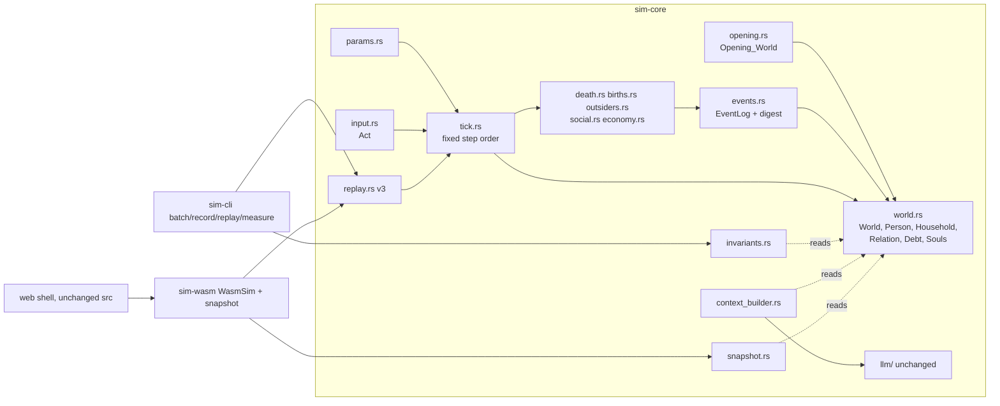

# Design Document: life-sim

## Overview

This spec replaces the skeleton model in `sim-core` (generic `Entity` with `value` and `affinity`, the `Workload` switch, and the `SetValue`/`Spawn`/`Despawn` inputs) with a thin, deterministic life simulation and the soul-identity core. Everything else built by specs 1 to 3 keeps working on the new model: the tick loop with recorded `TickInput`s, the canonical encoding and per-tick checksum, replay files, the native/WASM parity fixtures, the web shell and its Smoke_Test, and the `sim_core::llm` card code (byte-identical, R15.8).

The design follows `tech.md` without exceptions: plain structs and functions, integers only, `BTreeMap`/`BTreeSet` with ID-ordered iteration, counter-based random streams from the existing `rng::draw`, monotonic IDs, a written tick order, and per-tick checksums. Invalid states are pushed into the types wherever it is cheap: a dead Person has no money, mood or household (one `Life` enum), a Soul's place is one `SoulPlace` value, scores and traits are range-checked newtypes, and each event kind carries exactly its own actors and fields.

Scope is kept to what the requirements ask. There is no narrator, no player choice beyond one social-act input, no underworld economy, no model call and no new UI. The only forward-looking piece is the Context_Builder (R15), because the slow-think spec needs to know that contexts built from a live world render through System_One_Mapping_v1.

### Baseline measurement (current skeleton, before this spec)

`cargo run --release -p sim-cli -- measure --runs 3 --entities 60` on the development machine, 2026-11-10:

| Metric | Value |
|---|---|
| ticks per second (60 entities, Pairwise) | 22,620 |
| checksum per call | 34,544 ns |
| canonical state | 36,878 bytes |
| checksum share of tick time | 78.1% |

So hashing runs at roughly 1 byte per nanosecond, and the checksum, not the tick logic, sets the cost. The design therefore keeps the canonical state small and hashes the growing Event_Log incrementally (OP-8). All run-time estimates below are scaled from these numbers and must be re-measured in the tasks.

## Decisions for the Author

**Decided by the Author on 2026-11-10:** every open point takes the option marked **Recommended**. OP-8 versioning was decided separately (choice A, see OP-8). The alternatives stay listed below for history. The rest of this document follows the decided options; switching one later is a local change in the module named in brackets.

### OP-1: owner of money and property [`world.rs`, `economy.rs`]

- **A. Person owns money and property (Recommended).** Each living Person has a balance; each property item has one living Person as owner. Card `wealth` = balance + sum of property values. Households only group residents. Debts, inheritance and card `wealth` all work per person with no allocation rule. Cost: no shared family purse, so children have no money of their own and adults pay only their own upkeep.
- **B. Household owns everything.** One balance per Household; `wealth` = household money / members (floor). Simple economy, but an estate at death has to be carved out of a shared purse and debts are person-to-person, so every loan needs a rule for whose money it is.
- **C. Both (personal balance plus household purse).** Most realistic, double the flows and invariants. Not worth it for the slice.

### OP-2: inheritance and debts at death [`death.rs`]

Inheritance:
- **A. Class order, equal split (Recommended).** Heirs are the first non-empty class among: (1) living spouse and living children, (2) living parents, (3) living siblings. Money is split equally (floor), the remainder goes one dollar each to the first heirs in heir order; property items go round-robin in property-ID order. No heir: money leaves the World (sink `Escheat`) and property items are removed.
- **B. Single principal heir** (living spouse, else eldest living child, else eldest parent or sibling). Simplest, and it creates stakes (one winner), but leaves other children with nothing every time.
- **C. Spouse half, children split the other half.** Closer to real intestacy law, one more rule with rounding.

Debts where the debtor dies:
- **A. Transfer to the first heir; forgive if there is no heir or the first heir is the creditor (Recommended).** One `debt_transfer` (actors: dead debtor, heir) or `debt_forgiven` (actors: creditor, dead debtor) per Debt, citing the `loan` and the `death`.
- **B. Always forgive.** Fewer stakes across lives.
- **C. Settle from the estate first, transfer the rest.** Realistic, but needs a partial-repayment-at-death event the card format does not have.

Debts where the creditor dies:
- **A. Forgive (Recommended).** A `debt_forgiven` with the dead creditor as first actor (an Afterlife_Event_Type). The card format defines the creditor as the lender of the `loan` in `caused_by` and has no "claim transfer" event, so passing the claim on cannot be expressed in a Frozen_Context.
- **B. Claim passes to the creditor's first heir.** More stakes, but the log would no longer say who is owed, which breaks the card rule above.

Note (Author, 2026-11-10): passing the claim to heirs needs an event type outside the card format; left to a later spec.

### OP-3: soul selection and parents of a newborn [`births.rs`]

Selection:
- **A. Longest wait first, ties by lower Soul ID (Recommended).** Fair, and it minimises outsider releases (the soul closest to Max_Wait is placed first).
- **B. Uniform random among waiting souls.** More variety, more outsiders.
- **C. Prefer a soul with ties to the household** (for example a dead grandparent). Thematic, but needs a ties rule; better owned by the later underworld spec.

Parents:
- **A. Mother required, her living spouse is the second parent if any (Recommended).** A birth is rolled per female Resident aged 18..=45, at a higher rate if she has a living spouse. One or two parents. Robust: an empty marriage market cannot stop births entirely.
- **B. Two living parents required (married couple).** Cleaner families, but population collapses in seeds where few couples form.

### OP-4: outsider body kind and household [`outsiders.rs`]

Kind:
- **A. Seeded roll per released Soul: Rebuilt_Body with probability 200,000 ppm, else Imported_Vessel (Recommended).** Both origins appear in play; no economy needed yet.
- **B. Always Imported_Vessel in this spec.** Simplest; `rebuilt` never appears until the underworld spec prices it.
- **C. Rule by the soul's last body** (for example rebuilt if the previous body's piety >= 2). Thematic, opaque to players without the underworld UI.

Household:
- **A. A new single-person Household (Recommended).** Matches "no local ties" and needs no host rule.
- **B. Join the smallest existing Household.** Gives outsiders a home, but puts strangers in families with no Relation explaining why.

Note (Author, 2026-11-10): re-set the NPC rebuilt-body share once the underworld spec gives rebuilt bodies a joss paper cost.

### OP-5: numeric parameters [`params.rs`]

Initial values, rationale and calibration are in the section "Parameters and calibration". The opening age band for the Player_Soul stays 20 to 50; the outsider minimum age stays 18; the arrival-ratio target stays R17.8 (outsiders <= births) with no tighter ratio unless measurement shows it is easy to meet (see calibration).

### OP-6: input payloads [`input.rs`, `replay.rs`, `sim-cli/inputs.rs`]

- **A. One payload kind, `Act { kind, actor, target, intensity }` (Recommended).** `kind` is one of `help`, `gift`, `quarrel`, `insult`, `theft`, `apology`. A valid act appends that social Event through the normal path (relations, mood, log), so it changes the Checksum. It is what a living player will do later, and it exercises every rejection reason (unknown person, dead person, self target, intensity out of range). `sim-cli batch` generates random acts, about one third invalid.
- **B. `Act` plus `Lend { lender, borrower, amount, due_in_days }`.** Exercises debts from inputs too; one more payload, one more set of rejections.
- **C. Debug payloads (`Kill`, `SetMoney`).** Easy fault injection, but they bypass the event log and would have to be removed again.

### OP-7: where opening history goes in the Event_Log [`opening.rs`]

The card parser accepts only event ticks `>= 0` (`card.rs`, `o.int("tick", 0, i64::MAX)`), so history at negative ticks cannot render into a Frozen_Context.
- **A. All opening history Events at tick 0 (Recommended).** The opening `loan` and grievance Events are appended during generation with `tick` 0 and IDs from the event counter, before the first step. Persons' birth days are negative (a plain `i64`, not a card field), so ages are exact. Cost: history has no internal chronology; same-tick events are unordered in the card format anyway.
- **B. Negative ticks for history, shifted by the Context_Builder.** True chronology, but a context then shows ticks that are not the World's values (R15.1).
- **C. Start the clock at tick H (for example 100 years) and place history in `0..H`.** True chronology and card-safe, but every "tick 0" assumption in the replay format, the input stream, fixtures and the web shell would shift.

### OP-8: checksum cost of the growing Event_Log [`events.rs`, `canon.rs`]

- **A. Hash-chain digest (Recommended).** The `EventLog` keeps `digest = blake3(previous digest || canonical bytes of the new event)` updated on every append. The canonical encoding of the log is `(length, digest)`, so the per-tick checksum costs O(new events) for the log, not O(log). The digest is a pure fold over the events and is recomputed from scratch in tests and at the end of every batch seed. CANON_VERSION becomes 2.
- **B. Re-hash the full log every tick.** Simplest. About 15,000 events of ~60 canonical bytes at the end of an 80-year run, so the average tick would hash ~0.45 MB more: about 13 s extra per Life_Run at 1 byte/ns. Too slow for gates.
- **C. Full log hashed every N ticks, digest of recent events otherwise.** Bounded, but a divergence inside the log could go unnoticed for N ticks.

Ticks-per-second threshold:
- **A. Report only (Recommended).** R17.5 asks for the number; the gate time budget (OP-9) is the real constraint.
- **B. Fail `measure` below 5,000 ticks/s native release.** Machine-dependent, flaky in CI.

Versioning (Author's choice A, 2026-11-10): `CANON_VERSION` goes from 1 to 2 and `REPLAY_VERSION` from 2 to 3, because the canonical layout, the world config and the input payloads all change. The workspace version in `Cargo.toml` stays `0.1.0`, and no separate `sim_version` constant is added. `tech.md` has no versioning rule; this is the Author's decision, not a derived one.

### OP-9: Acceptance_Seeds and gate time [`scripts/gates.sh`]

- **A. Seeds 1..=5, one `batch --seeds 1..=5 --ticks 29200 --require-targets` step (Recommended).** Estimated 20 to 40 s release (see "Gate run time").
- **B. Seeds 1..=10.** Twice the evidence and time (50 to 80 s).
- **C. Seeds 1..=5 plus seed 18446744073709551557** (the `u64`-string fixture seed), one extra step of ~6 s.

### OP-10: Context_Builder location and ID mapping [`context_builder.rs`]

Location:
- **A. Library module `sim_core::context_builder` (Recommended).** The slow-think spec calls it directly; tests use it now.
- **B. Behind the `test-support` feature.** Not reachable by the later spec without moving it.

Test node: Family `DebtRepayment`, subject = debtor of an open Debt, options `repay`, `stall`, `refuse`.

ID mapping:
- Person IDs: **the Person counter starts at 1 (Recommended)**, so the card `id` is the live Person ID unchanged. (Alternative: context-local person numbering; harder to read in logs.) All four ID counters start at 1; `EntityId(0)` is kept for world-level random streams.
- Event IDs: **context-local** `e1`..`eN` in ascending live Event ID order (N <= 12 per context). Live IDs exceed `e9999` within one Life_Run, and the card parser accepts only 1 to 4 digits.
- Soul IDs: `S-` followed by the live Soul ID zero-padded to 4 digits. Total_Souls <= 62, so this is always 4 digits and the same text in every context of a run.

## Architecture



### Module layout (`crates/sim-core/src/`)

| File | Status | Content |
|---|---|---|
| `ids.rs` | changed | Adds `PersonId`, `HouseholdId`, `SoulId`, `EventId`, `PropertyId` (all `u64` newtypes) and `fn rng_key(self) -> EntityId`. `EntityId` stays only as the `rng::draw` key. |
| `rng.rs` | changed | New permanent `StreamTag` values 4..=14; tags 1 and 2 become `RetiredDrift`/`RetiredAffinity` (kept so the pinned `draw` outputs stay valid; never drawn by the simulation). |
| `canon.rs` | changed | `CANON_VERSION = 2`; `Canon` for the new newtypes. |
| `params.rs` | new | `Params` struct and `Params::DEFAULT`; `Params::stress()` under `test-support`. |
| `names.rs` | new | The Name_List (`FEMALE_FIRST`, `MALE_FIRST`, `SURNAMES`) and the probing name picker. |
| `world.rs` | rewritten | World state types, `WorldConfig`, accessors. |
| `events.rs` | new | `Event`, `EventKind`, tag sets, `EventLog` with digest, the single `append` path. |
| `opening.rs` | new | Opening_World generation. |
| `tick.rs` | rewritten | `World::step` in the fixed order, `Sim`. |
| `death.rs`, `births.rs`, `outsiders.rs`, `social.rs`, `economy.rs` | new | One tick step family each. |
| `invariants.rs` | new | `InvariantChecker` (stateful, per tick), `Violation { criterion, tick, detail }`. |
| `context_builder.rs` | new | R15. |
| `snapshot.rs` | new | R18 JSON, shared by native and WASM. |
| `input.rs` | changed | `InputPayload::Act`. |
| `replay.rs` | changed | Format version 3, new `ReplayConfig` and `ReplayPayload`. |
| `testing.rs` | rewritten | Single-field mutations of the new World (checksum sensitivity). |
| `llm/` | **unchanged** | R15.8. |

`sim-cli`: `batch.rs` (new report), `inputs.rs` (Act generator), `commands.rs` (default config), `measure.rs` (`--residents` replaces `--entities` and `Workload`). `sim-wasm`: `lib.rs` gains `snapshot()`; `bench` uses the new config JSON.

## Components and Interfaces

### Public API (sim-core)

```rust
// world.rs
pub struct WorldConfig { pub opening_residents: u16 }        // 40..=60, default 50
impl WorldConfig { pub fn try_new(opening_residents: u16) -> Result<Self, ConfigError>; }
impl World {
    pub fn new(seed: u64, config: WorldConfig) -> Result<Self, ConfigError>; // Opening_World
    #[cfg(any(test, feature = "test-support"))]
    pub fn new_with_params(seed: u64, config: WorldConfig, params: Params) -> Result<Self, ConfigError>;
    pub fn tick(&self) -> Tick;
    pub fn persons(&self) -> &BTreeMap<PersonId, Person>;
    pub fn households(&self) -> &BTreeMap<HouseholdId, Household>;
    pub fn relations(&self) -> &BTreeMap<(PersonId, PersonId), Relation>;
    pub fn debts(&self) -> &BTreeMap<EventId, Debt>;
    pub fn souls(&self) -> &Souls;
    pub fn log(&self) -> &EventLog;
    pub fn properties(&self) -> &BTreeMap<PropertyId, Property>;
    pub fn rejections(&self) -> &Rejections;
    pub fn last_flows(&self) -> FlowTotals;       // sources/sinks of the last tick run
    pub fn age_years(&self, p: &Person) -> u16;   // R2.3
    pub fn wealth(&self, p: PersonId) -> u64;     // OP-1 A
    pub fn household_members(&self, h: HouseholdId) -> Vec<PersonId>; // ascending
    pub fn rebuild_derived(&mut self);            // R16.5
    #[cfg(any(test, feature = "test-support"))] pub fn discard_derived(&mut self);
}
// tick.rs: unchanged shape
impl World { pub fn step(&mut self, inputs: &[TickInput]) -> Checksum; }
impl Sim { pub fn new(seed, config) -> Result<Sim, SimError>; submit; step; world; inputs; checksums; }
// invariants.rs
pub struct InvariantChecker { /* previous total money, previous log length, previous player place */ }
impl InvariantChecker {
    pub fn new(world: &World) -> Result<Self, Violation>;        // checks the Opening_World
    pub fn after_tick(&mut self, world: &World) -> Result<(), Violation>;
}
pub struct Violation { pub criterion: &'static str, pub tick: u64, pub detail: String }
// context_builder.rs
pub fn build_decision_context(world: &World, subject: PersonId, family: Family,
    options: Vec<OptionDef>, situation: String) -> Result<FrozenContext, BuildError>;
pub fn debt_repayment_node(world: &World, loan: EventId) -> Result<FrozenContext, BuildError>;
// snapshot.rs
pub fn snapshot_json(world: &World) -> String;
```

`Sim`, `record`, `verify`, `ReplayFile`, `SubmitInput` keep their signatures; only the config and payload types inside them change.

### The tick (R16.2)

`World::step(inputs)` for tick `T` (`T == world.tick` on entry) runs exactly these steps, in this order, every tick. "Today" is `T` throughout the step.

1. **Reset flows.** `flows = FlowTotals { sources: 0, sinks: 0 }`.
2. **Apply inputs** in `(tick, seq)` order. Each `Act` is validated (R1.5, R6.5) and, if valid, appended as a social Event through `social::apply_social` (the same path as step 8). Invalid inputs are recorded in `rejections` with `(T, seq, reason)`.
3. **Outsider releases** (R11). For every waiting Soul other than the Player_Soul, in Soul ID order, with `T - since > MAX_WAIT`: create the outsider body (see `outsiders.rs`).
4. **Deaths** (R6, R7). Roll mortality for every Resident in Person ID order against the state at the start of this step; then process the deaths in Person ID order (see `death.rs`).
5. **Births** (R10). For every female Resident aged 18..=45 in Person ID order, while a non-player Soul is waiting: roll a birth; on success create the newborn.
6. **Marriage** (R4). One world-level roll; on success pick a couple and marry them.
7. **Loans** (R8). One world-level roll; on success pick a borrower and lender and open a Debt.
8. **Repayments** (R8). For every open Debt in loan Event ID order whose debtor is a Resident and whose monthly anniversary is today: roll; on success repay.
9. **Social events.** `SOCIAL_ROLLS_PER_DAY` world-level rolls; each success appends one social Event.
10. **Economy.** For every Resident in Person ID order: wage (source) then upkeep (sink).
11. **Relation decay**, only when `T % 30 == 29`: every Relation whose `from` is a Resident moves `affinity` one point toward 0, except negative affinity of a `from` with `vindictiveness >= 2`. This includes Relations from a Resident to a dead Person (kept by the death step), so a grudge against the dead fades unless the holder is vindictive.
12. **Advance** `tick` to `T + 1`.
13. **Checksum** of the resulting World.

Every Event in steps 2 to 9 goes through `EventLog::append` (below), which also applies the Mood deltas and keeps the derived indexes up to date.

Why this order: releases come first so that R11.1 holds "when the tick begins"; deaths come before births so a soul freed today can be counted, but longest-wait-first (OP-3 A) places it last; economy runs after loans and repayments so the money a loan moves is visible to today's upkeep; decay runs last so today's events are not decayed today.

### Event append (R5)

```rust
impl World {
    /// The only way an Event enters the log. Checks R5.3 to R5.9 (most are
    /// structural, see Data Models), applies Mood deltas (R14.2) and derived indexes.
    fn append(&mut self, kind: EventKind, caused_by: CausedBy, tags: EventTags)
        -> Result<EventId, AppendRefused>;
}
pub enum AppendRefused { UnknownActor, DeadActor, BadCause, IdExhausted }
```

Checks in order: every actor exists (R5.7); no actor is dead unless the kind is an Afterlife_Event_Type (R5.8, R6.4); every `caused_by` ID is below the next Event ID (so it is already in the log) and its Event's tick is `<= T` (R5.6, always true because the log is in tick order); the Event ID counter has a value left. On refusal nothing changes. Tick logic never relies on a refusal: each step selects living actors first, so a refusal from tick logic is a bug, surfaced by a `debug_assert!` and by the invariant checker in tests; inputs are validated before they reach `append`, so they are recorded as rejections instead.

### Steps in detail

**Deaths (`death.rs`).** Hazard `mortality_ppm(age)` from the table in Params; a Resident with age 120 always dies (R6.2). For each dying Resident `d` in Person ID order:
1. `life = Dead { death: T }`; the household is left implicitly (membership lives on `Life::Alive`, see Data Models); if `d`'s Household now has no member it is removed (R3.6).
2. Append `death [d]`.
3. `souls[d.soul] = Waiting { since: T }` (R6.3).
4. Inheritance (OP-2 A): compute heirs among Residents; split money (Money_Flow `Inheritance` transfers) and property items; append one `inheritance [d, heir]` per heir who received anything, `caused_by = [death]`, `magnitude` = dollars + property value received, tags `cash` if money moved plus one of `land`/`house`/`shop`/`heirloom` per kind received. With no heir: money to sink `Escheat`, property items removed. The dead Person's balance becomes 0 by construction (the `Dead` variant has no balance).
5. Each open Debt with `d` as debtor, in loan ID order: transfer to the first heir (`debt_transfer [d, heir]`) or forgive (`debt_forgiven [creditor, d]`), `caused_by = [loan, death]` (R7.2).
6. Each open Debt with `d` as creditor: `debt_forgiven [d, debtor]`, `caused_by = [loan, death]`; Debt closed.
7. Remove every Relation whose `from` is `d` and that carries no Kinship_Tag. Relations whose `from` is a living Person and whose `to` is `d` are **kept**, including non-kin ones (`friend`, `rival`, ...), with their affinity, trust and tags as they are. The later underworld spec needs them: dreams reach only connected people, joss paper reflects how the deceased treated the living, and will-execution and dream-reading node contexts need the living's relations toward the dead. The removal happens in the death tick, so it is not a change "after the death" (R6.4). After this step, a Relation whose `from` is dead always carries a Kinship_Tag, and it never changes again (no step changes a Relation whose `from` is dead). A kept living-to-dead Relation still takes part in relation decay (step 11), because its `from` is a Resident; it is removed when its `from` dies, unless it carries a Kinship_Tag. The size this gives the Relation map is in "Relation map growth" (Data Models).

A later dying Resident in the same tick may already have received an inheritance from an earlier one; that is legal because its `death` Event gets a higher ID (R5.8 orders by Event ID).

**Births (`births.rs`).** Candidate mothers: female Residents aged 18..=45, in Person ID order. For each: if no non-player Soul is waiting, stop (R10.2); roll `birth_ppm(married)`; on success:
1. Take the Soul with the longest wait (OP-3 A), never the Player_Soul (R20.3).
2. Create the Person: next Person ID, `origin = Native`, `birth_day = T`, sex and Traits from streams keyed by the newborn's ID (R10.5: each trait is, by roll, either a copy of one parent's trait or a fresh draw), surname of the mother, first name by the name picker, `Alive { household: mother's household, mood: 0, money: 0 }`.
3. Kinship: `parent`/`child` with the mother and with her living spouse if any (R10.4); `sibling` both ways with every living child of either parent; `grandparent`/`grandchild` both ways with the parents' living parents. Dead siblings and grandparents get no Relation in either direction: a Relation from them would be a change on behalf of a dead Person (R6.4), and a one-way kinship tag would break the pairing of R4.3. Initial scores in Params.
4. `souls[soul] = Body(newborn)`; append `birth [newborn]`.

**Outsiders (`outsiders.rs`).** For a released Soul `s`: roll the kind by `s` (OP-4 A); create a Person aged `in_range(18, 40)` years (`birth_day = T - age*365 - below(365)`), sex and Traits fresh, name by the picker, wage drawn, money `in_range(500, 3000)` as Money_Flow source `ArrivalEndowment`, in a new single-person Household, no Relations (R11.2); `souls[s] = Body(person)`; append `possession [person]` or `rebuild [person]`.

**Marriage (`social.rs`).** Roll `marriage_ppm`. Candidates: Residents aged 18..=60 with no living spouse, in ID order. Pick `a = candidates[below(n)]`; partners are the candidates `b != a` with no Kinship_Tag between `a` and `b` in either direction and `affinity >= 0` both ways (a missing Relation counts as 0); pick `b` by a second draw. If none, nothing happens. Marrying: `spouse` tags both ways (creating Relations if needed, affinity raised to at least `SPOUSE_AFFINITY`), a new Household with both and every child under 18 who lived with either of them; old Households left empty are removed. Append `marriage [a, b]`, tag `public`. A widowed Resident keeps the `spouse` tag to the dead spouse (R4.7, R4.9); "no living spouse" is the eligibility test, and the invariant R4.6 counts only Resident spouses.

**Loans (`economy.rs`).** Roll `loan_ppm`. Borrowers: adult Residents (18+) with balance `< LOAN_NEED_BELOW`; lenders: adult Residents with balance `>= LOAN_LENDER_MIN`, not the borrower, whose `affinity` toward the borrower is `>= -10`. Pick both by draws. Amount `in_range(200, min(5000, lender_balance / 2))`; `due = T + in_range(60, 720)`. Transfer (Money_Flow `Loan`), open the Debt keyed by the new `loan [lender, borrower]` Event ID, tags `cash` and `written` or `verbal` by roll.

**Repayments.** Anniversary: `(T - loan_tick) % 30 == 0` and `T > loan_tick`. Roll `clamp(500_000 + 100_000*loyalty - 80_000*greed, 50_000, 950_000)` ppm. Amount `min(open, debtor_balance, ceil(principal / 3))`; if at least 1: transfer (Money_Flow `Repayment`), reduce `open`, append `repayment [debtor, creditor]` with `magnitude = amount`, `caused_by = [loan]`, tags `cash` and `partial` if the Debt stays open; close the Debt when `open == 0` (R8.4). An overdue Debt stays open (R8.5).

**Social events.** Each of `SOCIAL_ROLLS_PER_DAY` rolls succeeds with `social_ppm`. Actor: a Resident aged 12+ picked by draw; target: by draw, half the time among the actor's Relations to Residents, otherwise any other Resident aged 6+. Kind by weighted draw on the actor's Traits and current affinity toward the target:

| Kind | Weight (clamped to >= 1) | Allowed when |
|---|---|---|
| help | 30 + 10*warmth | always |
| gift | 15 + 5*warmth | always |
| quarrel | 20 + 8*temper | always |
| insult | 10 + 5*temper + 3*pride | always |
| theft | 3 + 3*greed - 2*loyalty | always |
| apology | 10 + 5*loyalty - 5*pride | actor's affinity toward target < 0 |

Intensity `in_range(10, 60)`. `apology.caused_by` = the latest grievance (`quarrel`, `insult`, `theft`) between the two, if any, read from the derived index. Effects are applied by `social::apply_social`, shared with `Act` inputs (R4.8 bounds, all divisions on non-negative intensity, rounded down):

| Kind | Target -> actor | Actor -> target |
|---|---|---|
| help | affinity +i/5 (<= 20), trust +i/10 (<= 10) | affinity +i/10 (<= 10) |
| gift | affinity +i/5 (<= 20) | affinity +i/20 (<= 5) |
| quarrel | affinity -i/4 (<= 25), trust -i/10 (<= 10) | affinity -i/4, trust -i/10 |
| insult | affinity -i/3 (<= 33), trust -i/5 (<= 20) | none |
| theft | affinity -i/2 (<= 50), trust -i/2 (<= 50) | none |
| apology | affinity +i/5 (<= 20), trust +i/10 (<= 10) | none |

Results are clamped to -100..=100. After any affinity change, the `friend` tag is set exactly when `affinity >= FRIEND_AT` and the `rival` tag exactly when `affinity < GRUDGE_THRESHOLD`.

**Economy.** Residents aged 18..=67 earn their `wage` (Money_Flow source `Wage`); Residents aged 18+ pay `min(balance, UPKEEP)` (sink `Upkeep`). Every addition uses `checked_add`; a flow that would overflow is skipped whole, so R3.5 stays exact (unreachable with the Params: the largest lifetime wage income is about 60 * 365 * 50 = 1.1 million dollars).

### Money_Flow list (R3.4)

| Flow | Kind | From | To | Where |
|---|---|---|---|---|
| `Wage` | source | outside | Resident aged 18..=67 | step 10 |
| `ArrivalEndowment` | source | outside | arriving outsider | step 3 |
| `Upkeep` | sink | Resident aged 18+ | outside | step 10 |
| `Escheat` | sink | estate with no heir | outside | step 4 |
| `Loan` | transfer | lender | borrower | step 7 |
| `Repayment` | transfer | debtor | creditor | step 8 |
| `Inheritance` | transfer | deceased | heir | step 4 |

Opening_World endowments and the opening loan are set during generation, before any tick, so R3.5 does not apply to them. Every flow goes through one function `economy::flow(world, Flow, amount)` that updates the balances and `flows`; nothing else writes a balance. Property values (`house` 60,000, `land` 25,000, `shop` 40,000, `heirloom` 1,500 dollars) are constants used only for card `wealth` and inheritance `magnitude`; moving property is not a Money_Flow.

### Opening_World generation (`opening.rs`, R12)

Input: seed and `opening_residents = N` (40..=60). All draws use streams keyed by the ID being generated (Household ID for household-level rolls, Person ID for person fields) or world-level `StreamTag::OpeningWorld` with `EntityId(0)`, each draw site with its own fixed `index` constant (rng.rs rule), never a running call counter.

1. **Households.** Repeat until N persons exist. Household `h` gets a template by roll on `h`: couple with 0 to 3 children (55%), single adult (25%), three generations: an elder parent, a couple, 0 to 2 children (20%). Household 1 is always "couple with at least one child", with the first adult aged 25..=50 (guarantees R12.2 and a Player_Soul candidate for R12.5). The last template is truncated to the remaining count (children first, then the elder, then one spouse).
2. **Persons.** Adults in a couple: ages `25..=60` and partner within 5 years (at least 18); opposite sexes so the couple can have children; children aged `0..=(younger parent - 18)`; elder `max(65, adult + 20)..=90`; single `18..=85`. `birth_day = -(age*365 + below(365))`. Traits from the opening distribution. Money: adults `in_range(1000, 30000)`, children 0. Wage `in_range(20, 60)` (stored for everyone, used from 18 to 67). All members share a surname drawn for the household; first names by the picker.
3. **Property.** The first adult of each household owns a `house`; by roll on the household: `land` (30%), `shop` (15%), `heirloom` (40%), owned by the first adult.
4. **Kinship** inside households: spouses, parent/child, siblings among the couple's children, grandparent/grandchild in three-generation households, with the Params initial scores.
5. **Cross-household relations.** `N / 2` world-level draws of a pair of adults in different households, each getting affinity `in_range(-30, 60)` both ways and trust `in_range(-20, 50)`; friend/rival tags by threshold.
6. **Grudge (R12.4).** Two adults from different households by world-level draws: `a -> b` affinity `-60`, trust `-50`, `rival`; one Event at tick 0 of kind `quarrel [a, b]`, `insult [b, a]` or `theft [b, a]` by roll, intensity 40..=80. The history Event's effect is already in the scores; generation does not apply effects again.
7. **Debt (R12.3).** Lender: an adult with money >= 2,000; borrower: an adult in another household; amount `in_range(500, 2000)`; `loan` Event at tick 0 with `due_tick = in_range(60, 720)` (> 0); money moved; Debt opened. Then 0 to 2 more opening loans the same way.
8. **Souls.** One Soul per Person in Person ID order (Soul IDs 1..=N), `Body(person)`; then `INITIAL_WAITING = 2` Souls with `Waiting { since: 0 }`, so a birth slot exists from day one. Total_Souls = N + 2 (42..=62).
9. **Player_Soul.** Candidates: Residents aged 20..=50 in Person ID order; pick one by world-level draw; `player_soul` = its Soul.
10. **Derived indexes** built; Mood 0 for everyone.

Generation cannot fail for a valid config: the forced household-1 template and the forced pair choices only need N >= 40 and at least two households with adults, which the templates give for N >= 40 (each template has at least one adult, at most 7 persons). If a forced choice still finds no candidate (unreachable), generation returns `ConfigError::Generation` instead of panicking, and a test runs generation for seeds 0..=999 and N 40..=60.

### Name_List and picker (`names.rs`, R13)

- The list is written for this project by hand and stored as three `const` arrays: 80 female first names, 80 male first names, 60 surnames, all single ASCII words, none taken from a third-party dataset (R13.2). `README.md` lists it as "project's own, Apache-2.0, same as the repository" (R19.5).
- A `FullName` stores `(first: u16, surname: u16)` indices; the first-name list is chosen by the Person's sex. Names never change.
- Picker: given sex, surname index and a draw, start at first-name index `below(draw, 80)` and probe forward (mod 80) until the full name is not held by a Resident; if all 80 are taken with that surname, move to the next surname (mod 60) and repeat. There are at most 61 other Residents and 4,800 full names per sex, so the picker always finds one (R13.3). Uniqueness is checked against the derived `living_names` index.
- Names of dead Persons may be reused by a later Resident.

### Context_Builder (`context_builder.rs`, R15)

`build_decision_context(world, subject, family, options, situation)`:
1. Refuse unless `subject` is a Resident and `options` has 2..=5 distinct IDs (`BuildError`).
2. **Events**: the last 12 Events (by live Event ID) that list the subject as an actor, in ascending ID order.
3. **People**: the subject; every actor of the chosen Events; then the subject's Relations (both directions) to other Persons, highest `|affinity|` first, ties by lower Person ID, up to 6 more people. Listed in ascending Person ID order.
4. **Relations**: every World Relation whose both ends are in People, in `(from, to)` order.
5. **ID mapping**: Person `id` = live Person ID (>= 1); Event IDs `e1..=eN` by ascending live ID; `caused_by` entries are mapped and entries pointing outside the context are dropped; Soul `soul_id` = `format!("S-{:04}", soul.0)`.
6. **Values** (R15.1): `age` per R2.3 with end tick `world.tick` for Residents and the death tick otherwise; `wealth` per OP-1 A (0 for the dead); `sex`, `origin`, `alive` as strings/bool; Traits as `i64`; Event `tick` and `due_tick` as `i64` (always `>= 0`); `magnitude` per R5.4; tags as card names in canonical order.
7. `tick` = `world.tick`, `task = Decision`, `subject = Some(id)`, `player_input = None`.

Dead Persons can enter `people` as Event actors or through the subject's Relations; since the death step keeps Relations from the living to the dead, these include non-kin ones such as the subject's `rival` Relation toward a dead creditor. A dead Person renders with `alive = false`, `age` at the death tick (0..=120), `wealth` 0 and unchanged Traits and Soul ID, and every Relation keeps `affinity` and `trust` in -100..=100, so all values stay inside the card ranges (R15.1). The card format places no restriction on Relations that end at a dead Person; it only forbids a dead Person acting after death outside the Afterlife_Event_Types, which the Event_Log already guarantees (R5.8).

`debt_repayment_node(world, loan)` is the test node: subject = the Debt's debtor, options `repay` "Pay the next instalment", `stall` "Ask for more time", `refuse` "Refuse to pay"; situation from a fixed template, for example `"{debtor} owes {creditor} {open} dollars from a loan of {principal} dollars, due on day {due}. Today is day {tick}."`, which is 22 words with two-word names, far below 80 (R15.3).

The builder never touches `llm/`; it constructs `llm::FrozenContext` values with public fields.

### Snapshot (`snapshot.rs`, R18)

`snapshot_json(&World) -> String` builds serde DTOs and writes compact JSON with `serde_json::to_string` (field order fixed by the DTO structs, so output is byte-identical on native and WASM):

```json
{
  "tick": "1234",
  "player_soul": "S-0007",
  "residents": [
    { "id": 1, "name": "Mara Okafor", "age": 34, "sex": "female", "alive": true,
      "origin": "native",
      "traits": { "greed": 0, "loyalty": 2, "pride": -1, "warmth": 1, "temper": 0,
                  "vindictiveness": 0, "piety": 1 },
      "wealth": 71250, "soul_id": "S-0001", "household": "3" }
  ],
  "households": [ { "id": "3", "members": [1, 4, 9] } ],
  "souls": [
    { "soul_id": "S-0001", "place": { "body": 1 } },
    { "soul_id": "S-0051", "place": { "waiting": { "since": "1200" } } }
  ]
}
```

Card_Person fields use the card JSON names and types (person IDs and `wealth` as JSON numbers, like the cards); project `u64` values that are not card fields (`tick`, household IDs, `since`) are decimal strings, like the replay format. Lists are in ascending ID order (R18.1). `wealth` is a `u64` written as a JSON integer; it stays far below 2^53 (largest reachable balance about 1.1 million plus property), so JavaScript reads it exactly. `WasmSim::snapshot()` (plain twin `snapshot_string`) returns `snapshot_json(self.inner.world())`; it takes `&self`, so it cannot change the World (R18.2).

### Inputs and replay format (OP-6 A)

```rust
pub enum SocialKind { Help, Gift, Quarrel, Insult, Theft, Apology }
pub enum InputPayload { Act { kind: SocialKind, actor: PersonId, target: PersonId, intensity: u8 } }
pub enum RejectReason { UnknownPerson, DeadPerson, SelfTarget, IntensityOutOfRange, IdExhausted }
```

Validation order: `actor` and `target` exist (`UnknownPerson`), both alive (`DeadPerson`, R6.5), `actor != target` (`SelfTarget`), `intensity` in 1..=100 (`IntensityOutOfRange`). `apology` needs no prior grievance. `IdExhausted` covers a full Event counter.

Replay format version 3:

```json
{ "format": "back-in-the-family/replay", "version": 3, "seed": "1",
  "config": { "opening_residents": 50 }, "ticks": "2000",
  "inputs": [ { "tick": "5", "seq": "0",
    "payload": { "Act": { "kind": "help", "actor": "3", "target": "17", "intensity": 40 } } } ],
  "checksums": [ "9f2c0a7d41e3b856" ] }
```

`ReplayConfig` is `#[serde(deny_unknown_fields)] { opening_residents: u16 }`, so a `workload` field fails with serde's "unknown field `workload`" and no World is created (R1.3). The same type is the `--config` file and the `WasmSim` constructor JSON. Version 2 files are rejected as `UnsupportedVersion`.

### sim-cli

**`batch`** (R17.3 to R17.7). New flags: `--require-targets` (criteria 17.1, 17.8, 17.9 failing makes the seed FAIL). Default `--random-inputs 60`. For each seed: generate inputs, step with the `InvariantChecker` after every tick, collect statistics, build the replay file from the stepped run's own checksums and `verify` it (two runs per seed instead of the current three), and recompute the Event_Log digest from scratch once at the end. Output, one line per seed, deterministic (no timing):

```text
seed 3 ok ticks=29200 final=<hex> residents_min=46 residents_max=52 band_40_60_ticks=29200 queue_final=1 max_wait_npc=1095 max_wait_player=0 births=51 deaths=52 imported=3 rebuilt=1 origin_final=native:46,possessed:3,rebuilt:1 arrivals=native:51,possessed:3,rebuilt:1 events=14212 relations_max=4410 rejections=unknown_person:9,dead_person:4,self_target:3,intensity_out_of_range:7,id_exhausted:0 invariants=pass pop_35_65=pass band_95=pass outsiders_le_births=pass
seed 4 FAIL tick=812 criterion=9.1 detail: soul S-0012 is in body 31 and waiting
seed 5 FAIL targets: band_95=fail
```

then `batch: <ok>/<total> seeds ok`. `max_wait_*` is the longest wait observed at the end of any tick; `relations_max` is the largest Relation count at the end of any tick (a measurement for "Relation map growth", not a target); `band_40_60_ticks` counts ticks with the Resident count in 40..=60; `band_95` is `band_40_60_ticks * 100 >= ticks * 95` (R17.9). Without `--require-targets`, failing targets print `=fail` but the seed is still `ok`. A failed invariant prints the first violation with its tick and criterion number and the exit status is 1 (R17.7).

**`record` / `replay`**: unchanged behaviour, new config and payloads; default config `{"opening_residents":50}`.

**`measure`** (R17.5): `--residents N` (40..=60, default 60) replaces `--entities` and `Workload`; the report rows stay (`ticks_per_second`, lifetime best/median, `checksum_ns_per_call`, `checksum_share_percent`, `canonical_state_bytes`) and the params line says `residents=60`. The checksum is timed on the World after one simulated year instead of 100 ticks, so relations and the log are populated. `scripts/measure-wasm.sh`/`.mjs` and the `sim-wasm` `bench` feature switch to the new config JSON. The weekly half of the old tick measurement is already gone from code (commit `bac46e3` is the only place it reproduces); `docs/tick-granularity.md` stays unchanged as the historical record.

**`inputs.rs`**: input `i` draws from `ToolingInputs` with `EntityId(i)` as now. Mix over 12 rolls: 0..=7 valid-looking `Act` (random kind, actor and target in `1..=N`), 8 unknown person (`N + 1000 + ...`), 9 self target, 10 intensity 0 or 101..=255, 11 actor drawn from `1..=N` regardless (dead ones become `DeadPerson` later in the run). Some "valid-looking" acts also hit dead persons late in a run, which is intended.

### WASM and web

- `WasmSim::new(seed, config_json)` takes the new config; `submit` takes the new payload JSON; `snapshot()` is new. `verify_replay` unchanged.
- `web/src` is unchanged: the App reads `fixtures/configs/pairwise.json` as text and passes it through.
- **File names are kept** (`fixtures/configs/pairwise.json`, `fixtures/parity/seed1-pairwise.replay.json`, `seed2-pairwise`, `seedbig-pairwise`), because `App.svelte`, the Smoke_Test and `sim-wasm/tests/parity.rs` name them and R18.4 allows no Smoke_Test change other than the regenerated fixture. Only their contents change. The stale `{ entity_count; workload }` type annotation in the smoke specs is a compile-time type on parsed JSON and has no runtime effect; it is left as is and noted in `fixtures/parity/README.md`. The names `pairwise` and `seedbig-pairwise` are kept from the skeleton era and no longer describe a workload; a comment in `crates/sim-wasm/tests/parity.rs` and a note in the existing `fixtures/parity/README.md` say so.
- Web unit tests that build real worlds change their config strings and generators (R1.2): `web/tests/unit/helpers/gen.ts` (config arbitrary `opening_residents` 40..=60, payload arbitrary `Act`), `helpers/reference.ts` (doc comment), and the config strings in `controller.test.ts`, `controller-rejects.test.ts`, `controller-speed.test.ts`, `controller-frames.test.ts`, `controller-clock.test.ts`.

### Fixtures and files that change

| File | Change |
|---|---|
| `fixtures/configs/pairwise.json` | `{"opening_residents":50}` (name kept) |
| `fixtures/parity/*.replay.json` (3 files) | regenerated by `scripts/regen-fixtures.sh` (2000 ticks, 120 random inputs, as now); commit message says so (R19.2) |
| `fixtures/parity/README.md` | table columns (config instead of workload/entities), format version 3; a note that the names `pairwise` and `seedbig-pairwise` are kept from the skeleton era and no longer describe a workload |
| `scripts/regen-fixtures.sh` | unchanged commands |
| `scripts/gates.sh` | new acceptance batch step (below) |
| `crates/sim-core/tests/replay.rs`, `properties.rs` | rewritten for the new model |
| `crates/sim-cli/tests/cli.rs`, `crates/sim-wasm/tests/parity.rs`, `bench.rs` | new config and payloads; `parity.rs` also gets a comment that the fixture names (`pairwise`, `seedbig-pairwise`) are kept from the skeleton era and no longer describe a workload |
| `README.md` | Name_List entry; no new third-party library (proptest and serde are already listed) |
| `fixtures/grading/` | unchanged (llm only) |

## Data Models

All types derive `Clone, Eq, PartialEq, Debug` (and `Ord` where used as keys); none derives `Hash`. Every struct has a `Canon` impl that destructures `Self` exhaustively.

```rust
// ids.rs: all counters start at 1 (OP-10); EntityId(0) is the world-level rng key.
pub struct PersonId(pub u64);  pub struct HouseholdId(pub u64);
pub struct SoulId(pub u64);    pub struct EventId(pub u64);   pub struct PropertyId(pub u64);

// Range-checked newtypes: private field, constructors clamp or refuse.
pub struct Score(i8);      // -100..=100, for affinity and trust; Score::clamped(i64)
pub struct Trait(i8);      // -3..=3
pub struct Intensity(u8);  // 1..=100; Intensity::new(u8) -> Option<Self>
pub struct Mood(i8);       // -100..=100 (R14.1); Mood::add_clamped(i64)

pub enum Sex { Female, Male }
pub enum Origin { Native, Possessed, Rebuilt }   // `official` is never produced here
pub struct Traits { pub greed: Trait, pub loyalty: Trait, pub pride: Trait, pub warmth: Trait,
                    pub temper: Trait, pub vindictiveness: Trait, pub piety: Trait }
pub struct FullName { pub first: u16, pub surname: u16 }

pub struct Person {
    pub id: PersonId,
    pub name: FullName,
    pub birth_day: i64,          // negative for Opening_World residents; age per R2.3
    pub sex: Sex,
    pub origin: Origin,
    pub traits: Traits,
    pub soul: SoulId,            // set at creation, never changed (R9.5)
    pub wage: u16,               // dollars per day while aged 18..=67
    pub life: Life,
}
/// Alive flag and death tick are one value (R2.1): death tick exists exactly when dead.
/// A dead Person has no household, mood or money, so R3.2 and "estates are settled"
/// hold by construction.
pub enum Life {
    Alive { household: HouseholdId, mood: Mood, money: u64 },
    Dead { death: Tick },
}

/// Exists exactly while it has at least one member; members are the Residents whose
/// `Life::Alive.household` names it (R3.1 by construction). Holds no money (OP-1 A).
pub struct Household { pub id: HouseholdId, pub founded: Tick }

pub enum PropertyKind { Land, House, Shop, Heirloom }
pub struct Property { pub id: PropertyId, pub kind: PropertyKind, pub owner: PersonId } // owner is a Resident

/// Key `(from, to)`, from != to. Tags say what `to` is to `from` (card rule).
/// `to` may be dead. `from` is dead only if the Relation carries a Kinship_Tag
/// (the death step removes the dead Person's non-kin Relations), and such a
/// Relation never changes again (R6.4).
pub struct Relation { pub affinity: Score, pub trust: Score, pub tags: RelTags }
pub struct RelTags(u16);   // bitset over the 16 card relation tags, bit order = card list order

pub struct Debt {
    pub creditor: PersonId,
    pub debtor: PersonId,        // changes only by debt_transfer
    pub principal: u64,          // = magnitude of the loan Event, >= 1
    pub open: u64,               // 1..=principal while the Debt exists (R8.3); closed Debts are removed
    pub due: Tick,
}

pub enum SoulPlace { Body(PersonId), Waiting { since: Tick } }
pub struct Souls {
    pub places: BTreeMap<SoulId, SoulPlace>, // one entry per Soul: a Soul cannot be in two places
    pub player: SoulId,                      // fixed at creation (R9.6)
    pub ids: IdCounter,                      // advanced only by opening generation (R9.4)
}

pub struct FlowTotals { pub sources: u64, pub sinks: u64 }   // of the last tick run
pub struct Rejections { pub count_by_reason: BTreeMap<RejectReason, u64>,
                        pub last: Option<(Tick, InputSeq, RejectReason)> }

pub struct WorldConfig { pub opening_residents: u16 }

pub struct World {
    seed: u64, config: WorldConfig, params: Params, tick: Tick,
    person_ids: IdCounter, household_ids: IdCounter, property_ids: IdCounter,
    persons: BTreeMap<PersonId, Person>,
    households: BTreeMap<HouseholdId, Household>,
    properties: BTreeMap<PropertyId, Property>,
    relations: BTreeMap<(PersonId, PersonId), Relation>,
    debts: BTreeMap<EventId, Debt>,   // keyed by the loan Event
    souls: Souls,
    log: EventLog,                    // owns the Event ID counter
    flows: FlowTotals,
    rejections: Rejections,
    derived: Derived,                 // NOT encoded, NOT checksummed (R16.5)
}

/// Rebuilt from the World by `rebuild_derived`; never read to decide anything that the
/// World itself could not decide. There is no Relation index: Relations are read from
/// `World::relations` directly, so keeping living-to-dead Relations adds nothing here.
pub struct Derived {
    pub last_grievance: BTreeMap<(PersonId, PersonId), EventId>, // unordered pair (low, high)
    pub living_names: BTreeSet<FullName>,
}
```

### Events (`events.rs`)

Each kind carries exactly its card actors in card order (R5.3), its amount or intensity where the card has a magnitude (R5.4), and a due tick only for `loan` (R5.5; `promise` is not produced in this spec). Kinds the slice does not produce (`deal`, `promise`, `accident`, `offering`, `dream`, ...) are left out until a spec needs them.

```rust
pub enum EventKind {
    Birth { person: PersonId },
    Death { person: PersonId },
    Marriage { a: PersonId, b: PersonId },
    Loan { lender: PersonId, borrower: PersonId, amount: u64, due: Tick },
    Repayment { payer: PersonId, payee: PersonId, amount: u64 },
    DebtTransfer { from: PersonId, to: PersonId, amount: u64 },        // amount = open amount
    DebtForgiven { creditor: PersonId, debtor: PersonId, amount: u64 },
    Inheritance { deceased: PersonId, heir: PersonId, amount: u64 },   // dollars + property value
    Possession { person: PersonId },
    Rebuild { person: PersonId },
    Social { kind: SocialKind, doer: PersonId, target: PersonId, intensity: Intensity },
    // quarrel uses doer/target as the card's "two people" in that order
}
pub struct CausedBy(Vec<EventId>);   // at most 2 entries here
pub struct EventTags(u16);           // bitset over the 13 card event tags
pub struct Event { pub id: EventId, pub tick: Tick, pub kind: EventKind,
                   pub caused_by: CausedBy, pub tags: EventTags }

pub struct EventLog {
    events: Vec<Event>,   // events[i].id == EventId(i + 1); ticks non-decreasing
    digest: [u8; 32],     // fold over events, see below
}
```

- `EventKind::actors() -> ArrayVec-like [PersonId; 1 or 2]`, `card_type() -> &'static str`, `magnitude() -> u64` (0 for kinds without one) and `is_afterlife()` (`death`, `debt_transfer`, `debt_forgiven`, `inheritance` among the produced kinds) are pure functions of the variant.
- `EventLog` has no `remove` and no `&mut` access to stored events; `append` is the only mutator (R5.2).
- **Digest** (OP-8 A): `digest_0 = [0; 32]`, `digest_{n+1} = blake3(digest_n || encode(event_{n+1}))`. `Canon for EventLog` writes `len as u32` then the 32 digest bytes. `EventLog::recompute_digest()` folds from scratch; the invariant checker and tests compare it with the stored digest. The digest is a commitment to the full log, so R5.10 holds: any change to any stored Event changes the Checksum.

### Canonical encoding of the World

`CANON_VERSION` (2), then `seed`, `config`, `params`, `tick`, the three ID counters, `persons`, `households`, `properties`, `relations`, `debts`, `souls`, `log` (length + digest), `flows`, `rejections`. `derived` is skipped with an explicit `derived: _` in the destructuring and a comment. Enums write an explicit `u8` tag per variant. `(PersonId, PersonId)` keys encode as two `u64`.

Expected size at the end of an 80-year run (estimate to be measured): ~150 Persons x ~45 bytes, ~60 Households, ~150 property items, ~4,500 Relations x 21 bytes (see below), ~10 open Debts, ~62 Souls, log 36 bytes: about 110 KB, or ~110 µs per checksum at the measured hashing speed.

### Relation map growth

Relations are never removed except by the death step, which removes the dead Person's non-kin Relations from `from = d`. So at any tick:

- **Non-kin Relations** all have a living `from`. Their number is at most Residents x (Persons ever created − 1). With at most 62 Residents (R9.3) and about 150 Persons over a Life_Run, the hard bound is 62 x 149 = 9,238.
- **Kin Relations** are created only at opening, births and marriages, and each Person has a bounded set (two parents, up to four grandparents, spouses, siblings, children, grandchildren), roughly 10 to 20 per Person, so about 1,500 to 3,000 over ~150 Persons. They are kept forever, as under the previous rule.

The new rule adds the non-kin Relations from Residents to the dead. They accumulate while their holder lives and leave when the holder dies. Estimate for an 80-year run: about 110 social events per year give each Resident a few new partners a year, so a middle-aged Resident holds some 30 to 40 non-kin Relations, about a third of them toward people who have died. That is roughly 1,500 more Relations than the old rule at the end of a Life_Run: about 4,500 in total (95 KB) instead of about 3,000 (63 KB). The hard bound (about 9,200 non-kin plus 3,000 kin, 12,000 Relations, 250 KB) is far above what the event rates produce.

**No pruning.** The estimated size fits the gate budget (see "Gate run time"). A pruning rule that keeps every Relation from a living Person could only remove Relations whose `from` is dead, and those all carry Kinship_Tags that R4.3, R4.7 and R4.9 keep, so there is nothing to prune. `sim-cli batch` reports `relations_max` (the largest Relation count at the end of any tick) so the calibration task checks the estimate. If the measured map makes the acceptance step too slow, the remedy is to hash the Relation map incrementally like the Event_Log (a new Author decision), not to delete Relations.

### Params (`params.rs`)

`Params` is a plain struct of integers, part of the World and the canonical encoding (so a test world with different Params can never be confused with a default one). `World::new` always uses `Params::DEFAULT`; the replay and config formats do not carry Params. `Params::stress()` (test-support only) raises the event rates so that short property-test runs hit every path.

## Parameters and calibration (OP-5)

Unit for every per-day probability: **parts per million (ppm)**. A roll succeeds when `below(draw, 1_000_000) < p`. All other divisions are on non-negative integers and round down, except the instalment `ceil(principal / 3) = (principal + 2) / 3` (checked add).

| Parameter | Initial value | Rationale |
|---|---|---|
| Mortality, ppm/day by age | 0: 15; 1..=17: 1; 18..=39: 3; 40..=59: 10; 60..=69: 40; 70..=79: 110; 80..=89: 300; 90..=99: 800; 100..=119: 2,000; 120: certain | Roughly a modern life table (about 0.5%/yr infant, 1.5%/yr at 65, 10%/yr at 85); life expectancy near 78. About 0.6 to 0.8 deaths per year in a town of 50. |
| `birth_ppm` married / unmarried | 500 / 50 | With about 8 married women aged 18..=45, about one birth every 250 days while a soul is waiting, against about one death every 500 to 600 days. |
| `MAX_WAIT` | 1,095 days (3 years) | With the rates above the wait is roughly exponential with a mean near 450 days, so about 10% of souls hit Max_Wait and become outsiders; well inside R17.8. |
| `INITIAL_WAITING` | 2 souls | A birth slot from day one; Total_Souls = N + 2. |
| `marriage_ppm` | 2,000 | About one wedding every 500 days. |
| `loan_ppm`, need below / lender min | 33,000 (about monthly); 2,000 / 5,000 dollars | Enough open debts for debt nodes later; each loan yields at most 3 repayment events. |
| `social_ppm`, rolls per day | 300,000, 1 | About 110 social events per year: log stays near 15,000 events per Life_Run. |
| Wage / upkeep | 20..=60 / 30 dollars per day | Workers save slowly; retirees (68+) draw savings down and become borrowers. |
| `GRUDGE_THRESHOLD` / `FRIEND_AT` | -40 / 50 | Matches the cards' grudge scale (strong negative affinity). |
| Mood range and deltas | -100..=100; marriage +20 both; loan lender -2 borrower +5; repayment payer -3 payee +3; debt_transfer new debtor -15; debt_forgiven debtor +10; inheritance heir +5; help/gift doer +2 target +5; quarrel -8 both; insult doer +1 target -10; theft doer +3 target -15; apology doer -2 target +4; birth, death, possession, rebuild 0 | Deltas only for living actors; no decay, because R14.3 forbids change without an Event. |
| Initial scores | spouse 60/60, parent<->child 50/50, siblings 30/30, grandparents 40/40 (affinity/trust) | Kin start warm, so grudges stand out. |
| Rebuilt share | 200,000 ppm of releases | OP-4 A. |
| Outsider age | 18..=40 | R11.2 minimum 18. |

**Population is bounded by soul conservation.** Residents + waiting Souls = Total_Souls = N + 2 at all times (R9.3), and every non-player Soul leaves the queue within Max_Wait. So the Resident count is `N + 2 - queue`, at most 62, and it drops only by the size of the queue. With the default N = 50 the band 40..=60 fails only if 13 or more Souls wait at once, which needs a burst of deaths faster than births and releases together. So the population band (R17.1, R17.9) is hard to fail at N = 50 whatever the rates are; it would pass even with badly tuned Params. It stays an acceptance check and **must not be used as a tuning target**. The metrics that do respond to the Params are R17.8 (`outsiders_le_births`, the ratio of births to releases) and the longest NPC wait (`max_wait_npc`, R11.3, R17.3); these two are the primary tuning metrics.

**Calibration procedure.** Run `cargo run --release -p sim-cli -- batch --seeds 1..=5 --ticks 29200` (and `--seeds 1..=20` for a wider look, not gated). Adjust one parameter at a time, in this order, against the named metric. Steps 2 and 3 carry the primary metrics; the others are secondary checks:

1. Mortality table scale, against `deaths` (target 40 to 70 per Life_Run) and the age distribution at the end (no seed with fewer than 6 women aged 18..=45 at the last tick).
2. `birth_ppm`, against the primary metrics `outsiders_le_births` (R17.8) and `max_wait_npc`: raise births if outsiders exceed a third of births or if `max_wait_npc` sits at Max_Wait on most seeds.
3. `MAX_WAIT`, against the primary metrics `max_wait_npc` and `outsiders_le_births`: a shorter Max_Wait shortens the longest wait but raises outsiders. `residents_min` and `band_40_60_ticks` are only confirmed to pass, not tuned against.
4. `loan_ppm` and `social_ppm`, against `events` (target under 20,000 per Life_Run, to keep memory and the Context_Builder's scan small), `relations_max` (expected near 4,500, see "Relation map growth") and the open-debt count seen in tests (at least one open Debt on most days).
5. A tighter arrival ratio than R17.8 (for example outsiders <= births / 3) is adopted only if all five seeds meet it with the final values; otherwise R17.8 stays the only ratio.

The final values and the batch output are recorded in `docs/kiro-log.md` by the calibration task, and the Params defaults are changed only together with a fixture regeneration.

## Gate run time (OP-9)

Measured baseline: 1 byte per ns of hashing, 22,620 ticks/s for a 37 KB state. Estimate for the new model, to be measured in the tasks with `sim-cli measure --residents 60`:

| Item | Estimate |
|---|---|
| Checksum per tick (60 to 120 KB, growing with the Relation map) | 60 to 120 µs |
| Tick logic per tick (60 residents, a few events) | 5 to 20 µs |
| One Life_Run (29,200 ticks) | 2 to 4 s |
| Acceptance batch, 5 seeds, step + verify (2 runs per seed) | 20 to 40 s |
| Existing short batch, 20 seeds x 2,000 ticks | 4 to 8 s |

`scripts/gates.sh` gains one step right after the existing batch:

```bash
# R17: Life_Runs (80 years) on the Acceptance_Seeds, with targets enforced.
run cargo run -q --release -p sim-cli -- batch --seeds 1..=5 --ticks 29200 --require-targets
```

If the measured acceptance step exceeds 60 s, the first fallback is to skip the record-and-verify round trip for the Life_Runs only (one run per seed; replay is still covered by the short batch and the fixtures); the invariant checks stay per tick, because R17.6 requires them at the end of every tick. The second fallback is OP-9 with fewer seeds, which needs the Author's approval because R17 says at least 5.

## Correctness Properties

*A property is a characteristic or behavior that should hold true across all valid executions of a system-essentially, a formal statement about what the system should do. Properties serve as the bridge between human-readable specifications and machine-verifiable correctness guarantees.*

"Generated run" below means: a seed from proptest, `opening_residents` in 40..=60, a list of `Act` inputs (valid and invalid mixed, as in `sim-cli` `inputs.rs`), and either `Params::stress()` (3 cases in 4, so deaths, births, inheritance, debts at death, releases and remarriage all occur within a short run) or `Params::DEFAULT`. Several criteria are guaranteed by the types (Data Models) and have no property: 2.1, 3.2, 4.1, 5.3, 5.4, 5.5, 5.9, 13.1, 14.1; the invariant checker still asserts the few runtime facts they rest on (for example name indices inside the list).

### Property 1: Core invariants hold at the end of every tick

*For any* generated run, at the Opening_World and at the end of every tick: Residents plus waiting Souls equals Total_Souls; every Soul has exactly one place, every Resident's Soul is `Body(that Resident)`, and no two Residents share a Soul; every Resident's Household exists; no Event lists an actor whose `death` Event has a lower ID unless the Event's kind is an Afterlife_Event_Type; the parent graph has no cycle; and total money after the tick equals total money before it plus the tick's sources minus its sinks. The run fails at the first tick where any of these is false.

**Validates: Requirements 3.1, 3.5, 4.4, 5.8, 6.4, 9.1, 9.2, 9.3, 19.1, 20.4**

### Property 2: Structural invariants hold at the end of every tick

*For any* generated run, at the end of every tick: no Household is empty; every property item's owner is a Resident; no Relation goes from a Person to itself; every Relation whose `from` is dead carries a Kinship_Tag; `parent`/`child`, `spouse`/`spouse` and `sibling`/`sibling` tags come in matching pairs; no Person has more than two `parent` Relations; no Resident has more than one Resident spouse; every `caused_by` entry names an Event with a lower ID and a tick no later than the citing Event; every actor is a Person in the World; every Resident's age is in 0..=120 and every Trait is in -3..=3; every open Debt has an open amount in 1..=principal; every non-player waiting Soul has waited at most Max_Wait; Resident full names are pairwise distinct; and no `inheritance` names as heir an outsider whose `possession`/`rebuild` Event has a higher ID than the `death`.

**Validates: Requirements 2.2, 3.3, 3.6, 4.2, 4.3, 4.5, 4.6, 5.6, 5.7, 6.2, 6.4, 7.3, 8.3, 8.4, 11.3, 13.3, 20.2**

### Property 3: History is preserved across ticks

*For any* generated run and any tick, comparing the World before and after the tick: every Person still exists with the same ID, name, birth day, sex, Origin, Traits and Soul ID; a Person who was dead stays dead with the same death tick; the Event_Log before the tick is an unchanged prefix of the log after it; every ID counter is unchanged or larger and every new ID is at least the counter's value before the tick; the Soul counter, the set of Soul IDs and the Player_Soul are unchanged; no `spouse` tag disappears; Relations whose `from` was already dead are unchanged; a Relation present before the tick is absent after it only if its `from` died in the tick and it carries no Kinship_Tag, so every Relation from a Resident to a Person who died in the tick (kin or not, for example `friend` or `rival`) is still present; and a Player_Soul that was waiting is still waiting with the same `since`.

**Validates: Requirements 2.4, 2.5, 4.7, 4.9, 5.2, 6.4, 9.4, 9.5, 9.6, 20.1**

### Property 4: Every death is settled in its own tick

*For any* generated run and any tick, every Person who died in the tick has death tick equal to the tick, exactly one `death` Event, no Household, and a Soul waiting since the tick; the deceased's money and property at the start of the tick are fully accounted for by the tick's `inheritance` transfers and `Escheat` (money) and by moved or removed property items; there is exactly one `inheritance` Event per heir who received anything, each citing the `death`; and each Debt whose debtor died is transferred to an heir or forgiven by exactly one `debt_transfer` or `debt_forgiven` Event citing both the Debt's `loan` and the `death`.

**Validates: Requirements 5.1, 6.3, 7.1, 7.2**

### Property 5: Births and arrivals use waiting Souls correctly

*For any* generated run and any tick, every new Person is either a native newborn or an outsider. A newborn has Origin `native`, birth day equal to the tick, the Household of its mother, `parent`/`child` links to one or two Residents, one `birth` Event, and a Soul that was waiting, was not the Player_Soul, and had the longest wait (lowest Soul ID on ties) among non-player waiting Souls when it was taken. An outsider has Origin `possessed` or `rebuilt`, age at least 18, no Kinship_Tag, its own Household, one `possession` or `rebuild` Event, and the Soul of a non-player Soul whose wait at the start of the tick exceeded Max_Wait; every such Soul was released in that tick.

**Validates: Requirements 5.1, 10.1, 10.3, 10.4, 11.1, 11.2, 11.4, 20.2, 20.3**

### Property 6: Debts follow their Events

*For any* generated run and any tick, every new `loan` Event has a Debt keyed by it with a creditor different from the debtor, open amount equal to the Event's magnitude (at least 1) and due tick later than the Event's tick, and the creditor's loss equals the debtor's gain from that flow; every `repayment` Event reduces its Debt's open amount by exactly its magnitude and moves that amount from debtor to creditor; and a Debt disappears in a tick only when its open amount reached 0 by a repayment or a `debt_forgiven` Event for it was appended in that tick, never because it is overdue.

**Validates: Requirements 5.1, 8.1, 8.2, 8.4, 8.5**

### Property 7: Mood changes only through Events

*For any* generated run and any tick, each Resident's Mood after the tick equals the Mood before it folded, in Event ID order, over that tick's Events listing the Resident as an actor, adding the documented delta for the Event kind and actor position and clamping to -100..=100 after each step; with no such Event the Mood is unchanged.

**Validates: Requirements 14.2, 14.3**

### Property 8: Social effects stay within their bounds

*For any* pair of distinct Residents, any prior Relations between them (including none), any social kind and any intensity in 1..=100, applying the social Event changes only the Relations between the two actors, each `affinity` and `trust` change is no larger in size than the bound in the effect table for that kind and direction, every result is in -100..=100, and the `friend` and `rival` tags match the thresholds afterwards.

**Validates: Requirements 4.8**

### Property 9: A valid Act changes the Checksum

*For any* seed and any `Act` that is valid at its tick (two distinct Residents, intensity in 1..=100), the run with the Act and the same run without it have different Checksums from that tick on.

**Validates: Requirements 1.4**

### Property 10: An invalid input is skipped and recorded

*For any* seed and any `Act` that is invalid at its tick (unknown person, dead person, actor equal to target, or intensity outside 1..=100), the World after the tick equals the World of the same run without the input in every field except `rejections`, and `rejections` holds one more count for the matching reason and `last = (tick, seq, reason)`.

**Validates: Requirements 1.5, 6.5**

### Property 11: Age is whole years rounded down

*For any* birth day `b` (including negative) and end tick `e >= b`, `age_years` returns `(e - b) / 365` rounded down, and it is unchanged between `e` and `e + 1` except when `e + 1 - b` is a multiple of 365.

**Validates: Requirements 2.3**

### Property 12: The Opening_World is valid and reproducible

*For any* seed and any `opening_residents` N in 40..=60, the Opening_World has exactly N Residents; at least one Household contains a Resident and that Resident's child with matching `parent`/`child` Relations; at least one open Debt between two Residents is linked to a `loan` Event with `due_tick > 0`; at least one Relation between two Residents has `affinity` below the grudge threshold with a `quarrel`, `insult` or `theft` Event between them; the Player_Soul is the Soul of a Resident aged 20..=50; Property 1 and Property 2 hold; and creating the World again from the same seed gives an equal World and Checksum.

**Validates: Requirements 12.1, 12.2, 12.3, 12.4, 12.5, 12.6**

### Property 13: The name picker always finds a free name

*For any* set of at most 61 occupied full names, any sex, any surname index and any draw, the picker returns a full name from the Name_List that is not in the occupied set.

**Validates: Requirements 13.1, 13.3**

### Property 14: Every state field reaches the Checksum

*For any* generated World after some ticks and any single-field mutation from `testing::Mutation` (including changing, adding or dropping one stored Event, which changes the recomputed digest), the mutated World has a different Checksum.

**Validates: Requirements 5.10**

### Property 15: Contexts built from the live World are valid cards

*For any* generated run, any tick, and any open Debt whose debtor is a Resident, the context from `debt_repayment_node`: contains the subject; takes every person, relation and event value from the World at that tick, inside the card ranges; uses person IDs >= 1, distinct event IDs `e1`..`eN` and soul IDs `S-` plus 4 digits equal to the live Soul ID; has a situation of at most 80 words; survives `frozen_context_from_json(frozen_context_to_json(ctx)) == ctx`; renders with `render_system_one` and the committed `decision.system_one.v1.txt` for every permutation from `render::permutations`; and `validate_raw_choice` returns `Decision` for each exact option ID and `Illegal(OutOfSetOption)` for any other generated string.

**Validates: Requirements 15.1, 15.2, 15.3, 15.4, 15.5, 15.6, 15.7**

### Property 16: Rebuilding Derived_State changes nothing

*For any* generated run and any tick T, a copy whose Derived_State is discarded and rebuilt at T produces the same Checksum as the original for every tick after T.

**Validates: Requirements 16.5**

### Property 17: Replays reproduce every Checksum

*For any* seed, config and input list, `record` followed by `verify` succeeds, and `verify` reports a divergence at the first tick whose recorded Checksum is altered.

**Validates: Requirements 16.6**

### Property 18: Snapshots are faithful and read-only

*For any* generated run and any tick, the Snapshot JSON parses, lists every Resident, Household and Soul exactly once in ascending ID order with values equal to the World's (Card_Person fields, Household ID, members, Soul_Place), and a run that takes a Snapshot after every tick has the same Checksums as the same run without Snapshots.

**Validates: Requirements 18.1, 18.2**

## Error Handling

| Situation | Behaviour |
|---|---|
| Config `opening_residents` outside 40..=60 | `ConfigError::OpeningResidentsOutOfRange`; no World. CLI exit 2, WASM `JsError` with the message. |
| Config or replay JSON with an unknown field (for example `workload`) | serde error "unknown field `workload`"; `ReplayError::Malformed`; no World (R1.3). |
| Replay `version` 2 or other | `ReplayError::UnsupportedVersion`. |
| Opening generation finds no candidate for a forced choice | `ConfigError::Generation(&'static str)`; unreachable for valid configs, covered by a seed sweep test. |
| Invalid `Act` at apply time | Skipped and recorded in `rejections` (R1.5); never an error to the caller. |
| `append` refused inside tick logic | Bug: `debug_assert!` in debug builds; in release the Event and its state change are skipped together (each step builds the Event before mutating state, so nothing is half-applied); the invariant checker and Properties 1 to 6 catch it in tests. |
| An ID counter exhausted | `IdExhausted`: an input becomes a rejection; inside a step the birth, arrival or Event is skipped. Unreachable in practice (2^64). |
| Money flow would overflow `u64` | The flow is skipped whole (no partial change), so conservation holds. Unreachable with the Params. |
| Tick counter overflow | Documented panic, as in the skeleton. |
| Invariant violated during `batch` | Seed reported as `FAIL tick=<t> criterion=<R> detail: ...`, exit status 1 (R17.7); other seeds still run. |
| Context_Builder given a dead subject, an unknown loan, or 0/1/6+ options | `BuildError` value; never a panic. |
| Snapshot `wealth` above 2^53 (unreachable) | Written as an exact JSON integer by serde; JavaScript would round it. Not reachable with the Params (largest balance about 1.1 million plus property); a unit test pins the bound. `snapshot_json` cannot fail. |

sim-core never panics on external data. The two documented panics (canonical length above `u32`, tick counter overflow) stay as they are.

## Testing Strategy

### Tools and configuration

- Rust property tests use `proptest` (already a dev-dependency of `sim-core`); no PBT code is written by hand. Each property in "Correctness Properties" is one `proptest!` test with at least 100 cases, tagged with a comment `// Feature: life-sim, Property <n>: <title>`.
- Generated runs (Properties 1 to 7, 14 to 18) last 240 ticks. With `Params::stress()` that is enough for several deaths, births, releases and debts at death per case; one case in four uses `Params::DEFAULT` to keep the real rates covered.
- Cost: debug builds hash slowly. The workspace adds `[profile.dev.package.blake3] opt-level = 3` (a profile setting for one dependency, no code change) so the property tests stay within roughly a minute in total; the task measures this and records it.
- The shared generator lives in `crates/sim-core/tests/life_gen/mod.rs` (scenario: seed, N, Params choice, inputs). The `InvariantChecker` is the same code that `sim-cli batch` uses, so Properties 1 and 2 and R17.6 test one implementation.
- Web: no new property tests. The existing `fast-check` controller tests keep running with the new config arbitrary (`opening_residents` 40..=60) and payload arbitrary (`Act`).

### Unit and example tests

- `params.rs`: mortality table lookup at band edges; `Params::DEFAULT` values pinned.
- `economy.rs`: one test per Money_Flow kind (balances and `flows` change as documented; transfers conserve).
- `death.rs`: an inheritance with remainder (for example 10 dollars to 3 heirs gives 4, 3, 3); no heir (escheat, property removed); debtor whose first heir is the creditor (forgiven); creditor death (forgiven); Relations at death (a living Resident's `rival` and `friend` Relations toward the deceased are kept with their affinity, trust and tags; the deceased's non-kin Relations toward the living are removed; kin Relations in both directions are kept).
- `births.rs`: only the Player_Soul waiting gives no birth (R10.2); tie on wait broken by lower Soul ID.
- `outsiders.rs`: a dead Player_Soul waiting longer than Max_Wait is not released (R20.2).
- `opening.rs`: generation succeeds for seeds 0..=999 and every N in 40..=60 (fast: generation only, no ticks).
- `replay.rs`: config with `workload` rejected (R1.3); version 2 rejected; payload round trip.
- `sim-cli`: `batch` output format and byte-identical repeat (R17.3, R17.4); a failing checker closure reports criterion and tick and exits 1 (R17.6, R17.7); `--require-targets` turns a failed target into `FAIL targets`; `measure --residents 60` prints every labelled row (R17.5).
- `sim-wasm` (native and wasm32): parity fixtures verify (R16.7); `snapshot()` equals `snapshot_json` for the same World, and a snapshot recorded natively at tick 500 of `seed1-pairwise` is compared byte for byte under `wasm-bindgen-test` (R18.3).
- Source guard: `Workload`, `Entity`, `SetValue` no longer appear in `sim-core/src` (R1.1); `llm/` files are compared with their committed hashes in the audit (R15.8).

### Integration gates

- `cargo test --workspace`, both clippy runs, `cargo fmt --check`: unchanged.
- Short batch `--seeds 1..=20 --ticks 2000`: unchanged command, new report.
- **New:** acceptance batch `--seeds 1..=5 --ticks 29200 --require-targets` (R17.1, R17.8, R17.9, OP-9).
- Native and WASM parity tests and the web Smoke_Test against the regenerated fixtures (R16.7, R18.4, R19.3).

### Fault injection (R19.4)

Only the six core invariants of R19.1 and the one new gate get an injected fault. Each injection is a temporary code edit, run against Property 1 and against `sim-cli batch`, then reverted; the fault, the failure seen and the revert are logged in `docs/kiro-log.md`.

| Invariant / gate | Injected fault | Expected failure |
|---|---|---|
| Soul conservation (9.3) | Death removes the Soul's entry from `places` instead of setting it to `Waiting` | Property 1 and batch: criterion 9.3 |
| One soul, one place (9.1, 9.2) | Birth gives the newborn the Soul but does not change its place from `Waiting` to `Body` | criterion 9.1 |
| One Household per Resident (3.1) | Marriage removes the old Household before moving the second spouse out of it | criterion 3.1 (dangling Household) |
| No actions by the dead (5.8, 6.4) | Social actor drawn from all Persons instead of Residents, with the `append` check disabled | criterion 5.8 |
| Acyclic kinship (4.4) | Birth adds the `parent` tag in the wrong direction for the second parent | criterion 4.4 (and 4.3) |
| Money conservation (3.5) | Upkeep subtracts from the balance without counting the sink | criterion 3.5 |
| Acceptance batch gate | Mortality table scaled by 30 | `batch --require-targets` prints `FAIL targets: band_95=fail` and `gates.sh` stops |

### Requirements without an automated test

R13.2 (own names), R16.2 (step order is the documented list), R17.2 (no count-based rule), R19.2 and R19.4 (process) and R19.5 (README) are checked by review in the audit task.
