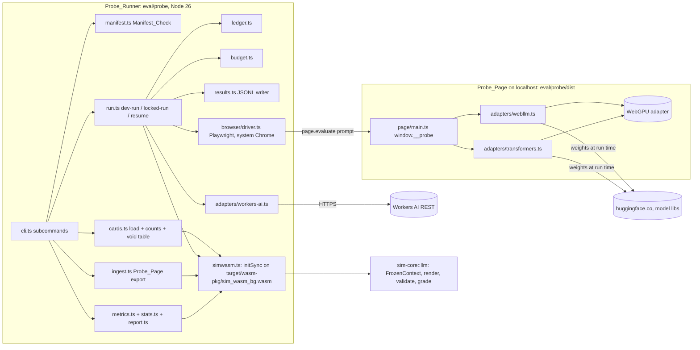
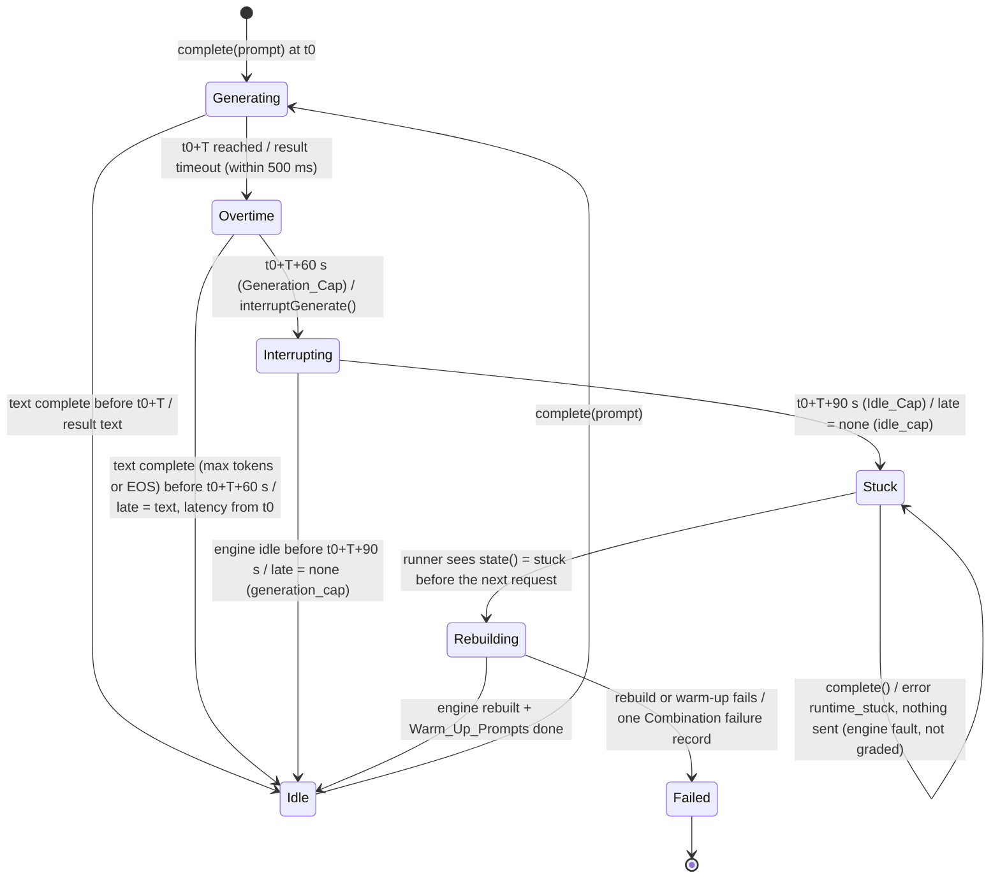

# Design Document: llm-probe

## Overview

This spec builds the W1 LLM probe. A TypeScript Probe_Runner verifies the imported Card_Set, renders prompts, sends them to candidate Runtimes (WebLLM and transformers.js on WebGPU in the system Chrome; Workers AI through its REST API, measured only in Phase_2 and only where the browser fails, R18), and stores every raw output. All legality, grading, identity and contrast decisions come from one Rust implementation in `sim-core` (module `sim_core::llm`), reached from Node through the existing `sim-wasm` build. Statistics (rates, Wilson intervals, cluster bootstrap, intra-group correlation, latency percentiles) are computed in TypeScript and written to `docs/llm-probe.md`. The Author picks the runtime from that Report; only then are `tech.md` and `structure.md` updated.

Two parts outlive the probe and are built for reuse by the game: the Rust LLM boundary (`FrozenContext`, prompt rendering, Output_Validator, Grader) and the transport-neutral Adapter_Interface with its fallback chain.

All open points and design questions below were decided by the Author on 2026-11-06 (third review). Each DA entry keeps its options and pros and cons as the record of what was weighed, and its status line names the chosen option. Fixed decisions from the requirements (B1, C3, D1 probe-only) and steering are applied without discussion. Purely mechanical choices are decided with a one-line reason and marked "Mechanical".

> **Revised 2026-11-06 (Author review 1).** The Author reviewed `requirements.md` and this design (6 blockers B1 to B6, 12 majors M1 to M12, 10 minors). `requirements.md` was revised first; this pass brings the design in line with it. Where the review offered alternatives, the first option was adopted (as in `requirements.md`). The table below maps each review item to the design sections it changed. Contradictions with the revised requirements that this pass found and fixed are listed in [Contradictions fixed in this revision](#contradictions-fixed-in-this-revision).
>
> | Item | Design sections changed |
> |---|---|
> | B1 once-only key | [Locked_Run_Ledger](#locked_run_ledger-evalresultsledgerjsonl) (Model_Key, overlap rule, `rerun_of`), [Probe_Runner CLI](#probe_runner-cli), [Report](#report-reportts-r15) section 7, Error Handling, Property 24, Property 25 |
> | B2 ticks in prompts | [Prompt rendering](#prompt-rendering-and-permutations-renderrs-da-13-a) (`{{tick}}`, `due day N`), Property 14 |
> | B3 render errors, completeness, denominator | [Prompt rendering](#prompt-rendering-and-permutations-renderrs-da-13-a) (`none`, structural errors only), [Locked run flow](#locked-run-flow-runts), sequence diagram, ledger `complete` rule, [Metrics and statistics](#metrics-and-statistics-metricsts-statsts), Error Handling, Properties 19, 24 |
> | B4 Workers AI response | [Workers AI adapter](#workers-ai-adapter-adaptersworkers-aits-r11), [Combination](#combination-combinationsjson) (`response_shape`, `max_output_param`), [Budget](#budget-budgetts) (usage mapping), Results record, Property 39 |
> | B5 fresh profile, quota | [Browser driver](#browser-driver-browserdriverts), Mechanical choices, Error Handling |
> | B6 D schema | [In-browser adapters](#in-browser-adapters), [DA-6](#da-6-sampling-parameters-and-constrained-decoding-q-open-6), research note on issue 560 |
> | M1 who reads locked cards | [Main rules](#main-rules) |
> | M2 timing | [Adapter timing state machine](#adapter-timing-state-machine-r82-r812-r813), [DA-7](#da-7-answers-that-arrive-after-the-timeout-q-open-7), Results `late`, Error Handling, Property 29 |
> | M3 thinking off, fingerprint | [In-browser adapters](#in-browser-adapters), [Model_Fingerprint](#model_fingerprint) |
> | M4 warm-up | [In-browser adapters](#in-browser-adapters), Layout (`warmup/`), Testing Strategy |
> | M5 pinned weights | [Combination](#combination-combinationsjson) (`revision`, `model_lib_url`), [In-browser adapters](#in-browser-adapters), [Browser driver](#browser-driver-browserdriverts) (URL check), Property 36 |
> | M6 VRAM_Preflight | [VRAM_Preflight](#vram_preflight-preflightts) |
> | M7 terminal exclusions | Exclusion_Record data model, [Probe_Runner CLI](#probe_runner-cli) phase gate, Properties 37, 38 |
> | M8 performance at Locked_Run start | [Browser driver](#browser-driver-browserdriverts), Integration runs, Combination `size` fields, DA-1 measures |
> | M9 not-run reasons | [Outcome mapping](#outcome-mapping-r85) |
> | M10 CPU-placed nodes | [Placement detection](#placement-detection-r91) |
> | M11 `web/` imports `eval/` | Gates table, Property 35 |
> | M12 Intel memory | [DA-11](#da-11-peak-memory-measurement-q-open-11), Report section 6, Performance record |
> | Minor: percentiles | [Metrics and statistics](#metrics-and-statistics-metricsts-statsts), DA-9, Property 23, Testing Strategy |
> | Minor: weak evidence | [Metrics and statistics](#metrics-and-statistics-metricsts-statsts), Report section 4, Property 20 |
> | Minor: stale design:45 note | the second-review note under Research findings, marked superseded |
> | Minor: `excluded` list | [Grades file](#grades-file-rungradesjsonl) |
> | Minor: `llm-probe-` prefix | [Schema identifiers](#schema-identifiers-r1211), Property 35, Rust error strings in [`sim_core::llm` types](#sim_corellm-types) |
> | Minor: approvals from `HEAD` | [Approvals](#approvals-evalprobeapprovalsjson-da-14), DA-14 |
> | Minor: redaction | [Workers AI adapter](#workers-ai-adapter-adaptersworkers-aits-r11) (`redact.ts`), Property 27 |
> | Minor: conversion-repo license | Report section 3, research note |
> | Minor: DA-8 arithmetic | DA-8 (S only typical 3,969), Q-open-8 row |
> | Minor: DA-9 rotation | DA-9 |
>
> **Decided (Author, 2026-11-06, review 2).** The three choices this pass left awaiting confirmation were confirmed with added rules; see the Author review 2 note below.
>
> 1. R8.13: when a timed-out request is still generating at the Idle_Cap, no Late_Answer is recorded; the runner rebuilds the engine and runs the Warm_Up_Prompts before the next request; a failed rebuild fails the whole Combination ([timing state machine](#adapter-timing-state-machine-r82-r812-r813)). Decided (Author, 2026-11-06).
> 2. M10 / R9.1: forward-pass nodes that ONNX Runtime places on the CPU are flagged in the Results header and the Report; they do not fail the run; the Report adds a latency caveat and a recommendation risk (R15.11, R15.12) ([Placement detection](#placement-detection-r91)). Decided (Author, 2026-11-06).
> 3. M6 / R9.16: the VRAM_Preflight prompt length is max(8,000 bytes, 2 × the longest rendered Dev_Card prompt), with a synthetic context of at least 8 events and 6 persons, based on Author-supplied Locked_Card aggregates ([VRAM_Preflight](#vram_preflight-preflightts)). Decided (Author, 2026-11-06).

> **Revised 2026-11-06 (Author review 2).** The Author confirmed the three items above and listed eight unverified items to settle before the formal runs. `requirements.md` was updated first (R8.5, R8.13, R9.1, R9.16, R15.7, new R15.11 and R15.12, glossary VRAM_Preflight). Changed in this design as a result:
>
> | Item | Design sections changed |
> |---|---|
> | Idle_Cap → rebuild, rebuild failure, `runtime_stuck` as engine fault (R8.5, R8.13, R15.7) | [Adapter timing state machine](#adapter-timing-state-machine-r82-r812-r813), [Outcome mapping](#outcome-mapping-r85), [Locked run flow](#locked-run-flow-runts) (phase gate), [Metrics and statistics](#metrics-and-statistics-metricsts-statsts), [Report](#report-reportts-r15) section 10, Results record (`engine_fault`, `rebuild_failed`), Error Handling, new Property 40, Testing Strategy |
> | CPU-placed nodes flagged, not failed (R9.1, R15.11, R15.12) | [Placement detection](#placement-detection-r91), [Report](#report-reportts-r15) sections 6 and 9, Testing Strategy |
> | VRAM_Preflight length and synthetic context (R9.16, glossary) | [VRAM_Preflight](#vram_preflight-preflightts), Testing Strategy |
> | Unverified items | new [Pre-run verification items](#pre-run-verification-items) |

> **Revised 2026-11-06 (third review): Author decisions recorded; two-phase plan.** The Author decided DA-1 (option M, five in-browser Combinations plus one Intel iGPU Dev_Run, LFM Open License v1.0 accepted), adopted the recommendations of DA-2 to DA-14, approved RC-1 to RC-9 (now applied to `requirements.md`), and chose the two-phase, browser-first plan of Requirement 18. Changed as a result: the status columns of both decision tables; the Q-open-1 and Q-open-8 rows; the IllegalReason comment; the Probe_Runner CLI (`--task D|S|DS`, `phase-status`, Phase_2 gating); `budget.ts` (the Neuron_Cap of R11.13 and R11.14); the Report outline (Phase_2 branch, "not measured (browser passed)", Smoke_Call counts, custom-license acceptance, over-limit downloads); the data models (Task_Type_Subset in the Results header and the ledger key, the size-limit fields of a Combination, the `neurons` counter field, Phase_2 approvals); Properties 25, 27, 28, 36 and 37 and the new Property 38; Error Handling; Testing Strategy; DA-1 (Workers AI models are Phase_2 branch-B candidates only); DA-8 (the 4-UTC-day schedule is replaced by the two-phase plan, with branch-B estimates per Task_Type_Subset); DA-14 (Phase_2 approval entries); the Headless_Launch_Flags in Mechanical choices (reduced to the three flags verified on the Target_Machine). The section "Proposed requirement changes" is kept as a record and marked applied.

### Resolution of the open points

| Point | Decision | Status |
|---|---|---|
| Q-open-1 models per runtime | Size rule M "moderate" (text-path download ≤ 1,536 MiB, ≤ 2.3 B checkpoint parameters, WebLLM VRAM ≤ 2,600 MiB; the Target_Machine is the upper bound of visitor hardware). WebLLM `Qwen3.5-0.8B-q4f32_1-MLC`, `Qwen3.5-2B-q4f32_1-MLC`. transformers.js: `onnx-community/Qwen3.5-0.8B-ONNX`, `onnx-community/Qwen3.5-2B-ONNX`, `LiquidAI/LFM2.5-1.2B-Instruct-ONNX` (all q4, after a VRAM_Preflight). Five NVIDIA Combinations go to Locked_Runs in Phase_1, plus one Intel iGPU Dev_Run. LFM Open License v1.0 accepted (custom, not OSI). Workers AI (Free plan) candidates are for Phase_2 only: default branch-B proposal `@cf/google/gemma-4-26b-a4b-it`, alternatives `@cf/zai-org/glm-4.7-flash` and `@cf/ibm-granite/granite-4.0-h-micro`; the branch-B model is approved by name at the Phase_1 checkpoint (R18.4). See [DA-1](#da-1-candidate-models-q-open-1) | decided: M (Author, 2026-11-06) |
| Q-open-2 where the runner lives | Own pnpm package `eval/probe/`, same pinned pnpm, own frozen lockfile, own Type_Check and Unit_Tests gates. See [DA-2](#da-2-where-the-probe_runner-lives-q-open-2) | decided: A (Author, 2026-11-06) |
| Q-open-3 Rust to Node | Load the existing `--target web` output in Node with `initSync({ module })` on the same `.wasm` bytes; the LLM exports ship in the game build. See [DA-3](#da-3-how-rust-reaches-node-q-open-3) | decided: A (Author, 2026-11-06) |
| Q-open-4 Probe_Page gating, COOP/COEP | Separate Vite app in `eval/probe/page/`, built to `eval/probe/dist`, served only on `localhost`; never in `web/dist`. No COOP/COEP anywhere; no `web/public/_headers`. See [DA-4](#da-4-probe_page-gating-and-cross-origin-isolation-q-open-4) | decided: A (Author, 2026-11-06) |
| Q-open-5 answer format and extraction | D: one card-independent JSON object `{"option":"<id>"}` with no other member (R4.2, R4.15); option-set membership is checked by the Output_Validator only. S: the family's JSON object. The whole output must be that one JSON value, optionally inside one Markdown code fence, with only whitespace around it. Same rule in the game. See [DA-5](#da-5-answer-format-and-extraction-rule-q-open-5) | decided: D-A with extraction B (Author, 2026-11-06); D schema card-independent (Author review 1) |
| Q-open-6 sampling and constrained decoding | Greedy (temperature 0, or `do_sample: false`), fixed seed `20261104` where the Runtime accepts one (`null` in the fingerprint otherwise), max output tokens D 64 / S 1,024, thinking disabled through chat-template arguments, schema-constrained decoding where the Runtime supports it (D: the one card-independent schema), recorded in the Model_Fingerprint. See [DA-6](#da-6-sampling-parameters-and-constrained-decoding-q-open-6) | decided: B (Author, 2026-11-06) |
| Q-open-7 late answers | Keep the Late_Answer of a timed-out in-browser request (generation continues to the Generation_Cap) in a separate `late` field and report "quality without timeout" acceptable rate, severe count and illegal rate as secondary figures (R13.12); Workers AI requests are aborted at the Timeout (R11.11), so their `late` field is always the no-Late_Answer marker. See [DA-7](#da-7-answers-that-arrive-after-the-timeout-q-open-7) | decided: B (Author, 2026-11-06; Generation_Cap and Idle_Cap from Author review 1) |
| Q-open-8 Request_Budget | Per-run cap 410 requests, daily cap 600 requests per UTC day, 10 Smoke_Calls per UTC day without approval, and the Neuron_Cap of 9,000 estimated neurons per UTC day (R11.13, R11.14). Two-phase plan (R18): Phase_1 sends Smoke_Calls only; Phase_2 branch A sends Smoke_Calls only; branch B runs one Dev_Run and one Locked_Run of one approved model on the failing Task_Type_Subset. Branch-B default gemma-4-26b-a4b-it, Dev_Run + Locked_Run typical / upper bound: D only 3,608 / 6,337 neurons (one UTC day), S only 3,969 / 8,945 (one UTC day typical; at the upper bound the last requests may spill to a second day), D and S 7,576 / 15,282 (one day typical, two at the upper bound). See [DA-8](#da-8-request_budget-values-and-expected-cost-q-open-8) | decided: values and plan as in DA-8 (Author, 2026-11-06); the branch-B model and run are approved by name at the Phase_1 checkpoint (R11.7, R18.4) |
| Q-open-9 percentile, PRNG, rotation | Nearest-rank percentiles with an integer index `ceil(p·n/100) − 1` (R14.1); SplitMix64 with seed 20261104; "rotated by one" is a left rotation (`[o2, o3, …, o1]`), chosen after the lock and before any model run because the cards README leaves the direction open. See [DA-9](#da-9-percentile-method-bootstrap-prng-and-rotation-direction-q-open-9) | decided: A, A, A (Author, 2026-11-06) |
| Q-open-10 ledger and counter storage | `eval/results/ledger.jsonl` and all Results tracked in git (append-only); the Request_Budget counter in `eval/results/budget/` gitignored. See [DA-10](#da-10-storage-of-the-locked_run_ledger-results-and-request_budget-counter-q-open-10) | decided: A (Author, 2026-11-06) |
| Q-open-11 peak memory | NVIDIA: `nvidia-smi --query-gpu=memory.used` sampled every 250 ms, peak minus idle baseline. Intel iGPU: "Chrome GPU process peak RSS (excludes unmapped GEM buffers)" from `/proc`, in its own column. Workers AI: "not measured, server-side". See [DA-11](#da-11-peak-memory-measurement-q-open-11) | decided: A (Author, 2026-11-06; Intel naming from Author review 1) |

New questions that came up during design:

| Question | Decision | Status |
|---|---|---|
| JSON reader for model output in `sim-core` | A small strict JSON reader written for `sim_core::llm` (exact integer lexemes, depth and size limits, duplicate-key rejection), not `serde_json::Value`. See [DA-12](#da-12-json-reader-for-model-output) | decided: A (Author, 2026-11-06) |
| Where prompts are rendered | In Rust (`sim_core::llm::render`), per `structure.md` ("Rust: context rendering"), exported through `sim-wasm`. See [DA-13](#da-13-where-prompts-are-rendered) | decided: A (Author, 2026-11-06) |
| How the Author's approval of a Workers AI run reaches the runner | A tracked `eval/probe/approvals.json` entry, added only in a commit the Author approved in the conversation, plus a matching `--approval <id>` flag. The runner reads the file only from git `HEAD` and only when it has no uncommitted changes (R11.20). See [DA-14](#da-14-how-workers-ai-approval-reaches-the-runner) | decided: A (Author, 2026-11-06) |
| Workers AI plan | **Free** (Author, 2026-11-06). 10,000 neurons per UTC day, operations above it fail. Server models whose locked run does not fit one UTC day at the typical estimate, or that need a paid billing method, are dropped. See [DA-8](#da-8-request_budget-values-and-expected-cost-q-open-8) | closed: Free |
| Measurement plan | Two phases, browser first, server only where the browser fails (Requirement 18). See [DA-8](#da-8-request_budget-values-and-expected-cost-q-open-8) and [Probe_Runner CLI](#probe_runner-cli) | decided: two-phase (Author, 2026-11-06) |

The proposed requirement changes RC-1 to RC-9 in [Proposed requirement changes](#proposed-requirement-changes) were approved by the Author and applied to `requirements.md` on 2026-11-06.

### Research findings used here

> **Revised 2026-11-06 after Author review.** The first draft's model list was stale. It included Qwen2.5-1.5B on both in-browser runtimes without a stated reason, ran transformers.js only on older Qwen builds (Qwen2.5, Qwen3), kept Llama-3.2-3B without a reason, and missed `@cf/qwen/qwen3.8-27b` on Workers AI. DA-1 was re-screened with an explicit selection rule (newest generation per family that fits the runtime constraints; older models only with a stated reason), against WebLLM `src/config.ts` at v0.2.87, the Hugging Face API and the Workers AI models and pricing pages. Changed as a result: DA-1, the Q-open-1, Q-open-8 and "Workers AI plan" rows above, the WebLLM, transformers.js and Workers AI research notes below plus a new "Qwen generations" note, the example IDs in Data Models (Results record, Model_Fingerprint, Combination, ledger), and the cost tables, budget notes and plan question in DA-8. No other section changed.

> **Revised 2026-11-06 (second review): Free plan; Target_Machine is the upper bound; three Author-suggested models evaluated.** *Superseded in part (Author review 1): the statements below that `budget.ts` and Property 28 do not mention the neuron guard, and that "the 4,096 MiB check in the Combination data model stays as the hard limit", are out of date. The Neuron_Cap is in [Budget](#budget-budgetts) and Property 28, and the Combination check uses the 2,600 MiB In_Browser_Size_Limits of option M (R9.3); no 4,096 MiB check remains.* The Author answered that the Cloudflare account is on the Free plan, that the Target_Machine is the upper bound of the hardware a demo visitor may have (not the typical case), and asked for `LiquidAI/LFM2.5-1.2B-Instruct-ONNX`, `onnx-community/granite-4.0-1b-ONNX-web` and `HuggingFaceTB/SmolLM3-3B-ONNX` to be evaluated. Changed as a result: DA-1 now screens in-browser models by size (three threshold options S, M, L; M recommended), which drops gemma-4-E2B, Ministral-3-3B and SmolLM3-3B as too heavy and adds Qwen3.5-0.8B on both engines and LFM2.5-1.2B on transformers.js; the Workers AI list is re-screened under Free, which drops qwen3.8-27b, gpt-oss-20b and llama-4-scout and adds granite-4.0-h-micro; the option sets A, B, C are replaced by the size options. DA-8 drops the Paid and set-C figures, makes the daily neuron guard part of the proposal and adds a run schedule; new RC-9 adds the guard to Requirement 11. Also changed: the Q-open-1, Q-open-8 and "Workers AI plan" rows (the plan question is closed as Free), and the WebLLM, transformers.js and Workers AI research notes plus a new "Author-suggested models" note. The `budget.ts` component description and Property 28 do not yet mention the neuron guard; they are updated if the Author approves RC-9. The 4,096 MiB check in the Combination data model stays as the hard limit of R9.3; the size rule is applied when `combinations.json` is written. No other section changed.

All facts checked on 2026-11-06. Model licenses are listed in DA-1.

- **WebLLM.** npm `@mlc-ai/web-llm` latest is `0.2.87` (release 2026-10-30, [dist-tags](https://registry.npmjs.org/-/package/@mlc-ai/web-llm/dist-tags)); license Apache-2.0 ([repo](https://github.com/mlc-ai/web-llm)). The prebuilt model list and each model's `vram_required_MB` live in [`src/config.ts`](https://github.com/mlc-ai/web-llm/blob/main/src/config.ts) (`modelVersion = "v0_2_87/base"`), which calls itself "the only source of truth" for compatible model libraries. Newest families in it: Qwen3.5 (0.8B, 2B, 4B, 9B), Qwen3, gemma-4-E2B-it, Ministral-3-3B (Base, Instruct-2512-BF16, Reasoning-2512), Phi-4-mini, Llama-3.2, SmolLM2; no Qwen3.6, 3.7 or 3.8 build. `q4f32_1` values read there: `Qwen3.5-0.8B` 1894.19, `Qwen3.5-2B` 2591.55, `Qwen3.5-4B` 4680.36, `Qwen3-1.7B` 2635.44, `Qwen3-4B` 4327.71, `gemma-4-E2B-it` 3862.72, `Ministral-3-3B-Instruct-2512-BF16` 3532.37, `Phi-4-mini-instruct` 4220.59, `Llama-3.2-3B-Instruct` 2951.51; none of these `q4f32_1` entries lists `required_features`. `q4f16_1` values, for visitors whose GPU has `shader-f16`: `Qwen3.5-0.8B` 1629.49, `Qwen3.5-2B` 2245.44, `gemma-4-E2B-it` 3387.37 (lists `required_features: ["shader-f16"]`), `Ministral-3-3B-Instruct-2512-BF16` 2863.69. The packaged prebuilt list of `@mlc-ai/web-llm@0.2.87` (npm tarball, read 2026-11-06) has no LFM, Granite or SmolLM3 entry; its SmolLM entries are SmolLM2 only (135M, 360M, 1.7B). Structured output: `response_format: { type: "json_object", schema }` and `{ type: "grammar", grammar }` (EBNF), implemented with XGrammar ([example](https://github.com/mlc-ai/web-llm/blob/main/examples/json-schema/src/json_schema.ts)). Known risks: an XGrammar matcher crash in JSON mode on Qwen3-0.6B ([issue 807](https://github.com/mlc-ai/web-llm/issues/807)) and an engine error ("Module has already been disposed") when the schema changes between requests on one engine ([issue 560](https://github.com/mlc-ai/web-llm/issues/560)). Re-read 2026-11-06 (Author review 1): issue 560 is closed; a maintainer wrote that PR 571 fixes it and that the fix ships in npm `0.2.66`, so 0.2.87 should include it. This was not verified on the Target_Machine. The design avoids depending on it either way: D uses one card-independent schema (B6), so the D grammar never changes within an engine. Also re-read on WebLLM `main` (2026-11-06; not checked at the `v0.2.87` tag): `cleanModelUrl` in [`src/support.ts`](https://github.com/mlc-ai/web-llm/blob/main/src/support.ts) appends `resolve/main/` to a model URL only when the URL does not already contain a `/resolve/<ref>/` segment, so a model URL ending in `resolve/<commit-sha>/` is fetched at that commit; and [`chat_completion.ts`](https://github.com/mlc-ai/web-llm/blob/main/src/openai_api_protocols/chat_completion.ts) has `extra_body.enable_thinking`, which, when `false`, prepends an empty `<think>` block to the response so the model emits no thinking tokens (the source notes it is meant for Qwen3 models but is not checked), and `ignore_eos`.
  - **Re-read at the `v0.2.87` tag, 2026-11-07 (task 15.8, V8).** Tag `v0.2.87` exists (commit `6897fad…`, release 2026-10-30), and the npm tarball `@mlc-ai/web-llm@0.2.87` (Apache-2.0, `dist.integrity` `sha512-34N1998…`) has the same behavior in its `lib/index.js`. Verified, no change needed: `cleanModelUrl` (`src/support.ts:92-98`) adds `resolve/main/` only when the URL does not match `/.+\/resolve\/.+\//`, so a `…/resolve/<sha>/` URL is kept; `extra_body.enable_thinking` (`chat_completion.ts:277-284`, passed in `engine.ts:983`) makes `llm_chat.ts:1226-1234` append the tokens of `<think>\n\n</think>\n\n` to the reply header; `ignore_eos` is a top-level request field (`chat_completion.ts:262`); `interruptGenerate()` sets a flag (`engine.ts:930-932`); `CreateMLCEngine(modelId, engineConfig, chatOpts)` (`engine.ts:137-145`) looks the ID up in `appConfig.model_list` (`support.ts:209-218`); `vram_required_MB` is 1894.19 (`Qwen3.5-0.8B-q4f32_1-MLC`, `config.ts:1378`) and 2591.55 (`Qwen3.5-2B-q4f32_1-MLC`, `config.ts:1423`), with no `required_features`. Differs from the design's wording or omits a detail, now fixed in [In-browser adapters](#in-browser-adapters): (1) `response_format.schema` is a JSON-encoded **string**, not an object, and is accepted only with `type: "json_object"` (`chat_completion.ts:1276-1284`, check at `:559-566`); (2) the prebuilt Qwen3.5 entries carry `overrides` (`context_window_size: 4096`, `max_history_size: 1`, `conv_config.stop_token_ids: [248046, 248044]`, `config.ts:1380-1384`, `1425-1429`) that a custom entry must repeat, because the effective chat config is the model's `mlc-chat-config.json`, then `overrides`, then `chatOpts` (`engine.ts:407-411`); (3) `vram_required_MB` is metadata only: no engine code reads it, and only `required_features` is checked (`engine.ts:473`), so the VRAM_Preflight is the only size check; (4) an interrupt applies to the running request only: the flag is cleared when each request starts (`engine.ts:1012-1013`) and the aborted request ends with `finish_reason: "abort"` (`llm_chat.ts:1404`); (5) `ModelRecord` has new optional `integrity` and `model_manifest` fields (`config.ts:282-294`), unused here. `support.ts` and `config.ts` are byte-identical at `main` (d0a8ade) and at the tag; `chat_completion.ts` differs only in a doc comment about `model`.
- **Qwen generations.** On the Hugging Face API (Qwen org, 2026-11-06), Qwen3.8 exists only as `Qwen3.8-27B` (and `-FP8`, Apache-2.0, [API](https://huggingface.co/api/models/Qwen/Qwen3.8-27B)), `Qwen3.8-Flash-Next` and `Qwen3.8-2.4T-A95B`; Qwen3.6 only as 27B and 35B-A3B; there are no Qwen3.7 repositories. No Qwen model of generation 3.6 or later fits 4 GiB in a browser, so Qwen3.5 is the newest Qwen generation with small sizes. `Qwen/Qwen3.5-2B` and `Qwen/Qwen3.5-0.8B` are Apache-2.0 and tagged `image-text-to-text` ([2B](https://huggingface.co/api/models/Qwen/Qwen3.5-2B), [0.8B](https://huggingface.co/api/models/Qwen/Qwen3.5-0.8B)); the probe uses text only. Checkpoint parameter totals from the same API (`safetensors.total`, vision encoder included): Qwen3.5-2B 2,274,069,824; Qwen3.5-0.8B 873,438,784.
- **transformers.js.** npm `@huggingface/transformers` latest is `4.3.2` ([dist-tags](https://registry.npmjs.org/-/package/@huggingface/transformers/dist-tags)); license Apache-2.0. WebGPU is selected with `device: "webgpu"` and quantization with `dtype` (`q4`, `q4f16`, …), as on the model cards. No VRAM figure is published for these models. onnx-community published `Qwen3.5-0.8B-ONNX`, `Qwen3.5-2B-ONNX`, `Qwen3.5-4B-ONNX` (plus `-ONNX-OPT` variants, not screened here) and `gemma-4-E2B-it-ONNX`, `gemma-4-E4B-it-ONNX` on 2026-10-13. These are multimodal exports split into `decoder_model_merged`, `embed_tokens` and encoder files; the text path needs the decoder and `embed_tokens`. q4 text-path bytes from the Hugging Face API (`.onnx` plus `.onnx_data`): `Qwen3.5-2B-ONNX` 885,982 + 1,209,126,912 + 857 + 325,795,840 = 1,535,809,591 B; `Qwen3.5-0.8B-ONNX` 876,359 + 485,425,152 + 857 + 162,897,920 = 649,200,288 B; `gemma-4-E2B-it-ONNX` 647,599 + 1,864,102,912 + 5,142 + 1,762,656,256 = 3,627,411,909 B ([2B tree](https://huggingface.co/api/models/onnx-community/Qwen3.5-2B-ONNX/tree/main/onnx), [0.8B tree](https://huggingface.co/api/models/onnx-community/Qwen3.5-0.8B-ONNX/tree/main/onnx), [gemma tree](https://huggingface.co/api/models/onnx-community/gemma-4-E2B-it-ONNX/tree/main/onnx)). If the loader also fetches the q4 vision encoder, add 218,291,014 B (2B) or 68,451,862 B (0.8B); the download measurement (R14.5) records what is actually fetched. The `Qwen3.5-2B-ONNX` model card has an empty README, so loading it with transformers.js 4.3.2 is confirmed in the first Dev_Run, not here. Its repository has no license tag; its `base_model` is `Qwen/Qwen3.5-2B`, which is Apache-2.0, and the Report cites the base model's license for it. In MiB (2^20 bytes), the q4 text paths are about 1,465 (Qwen3.5-2B), 619 (Qwen3.5-0.8B) and 3,459 (gemma-4-E2B); the q4f16 text paths, usable only with `shader-f16`, are about 1,320 and 557 for the two Qwen3.5 sizes. The README of the 4.3.2 npm package lists LFM2 (`lfm2`), GraniteMoeHybrid (`granitemoehybrid`) and SmolLM3 (`smollm3`) among the supported architectures, and the bundled build contains all three model types (npm tarball, read 2026-11-06). gemma-4-E2B's large `embed_tokens` file holds its Per-Layer Embeddings ([model card](https://huggingface.co/onnx-community/gemma-4-E2B-it-ONNX), Apache-2.0); whether they sit in VRAM under transformers.js is unknown, so its VRAM need would come from the VRAM_Preflight (R9.9). Constrained decoding is not in the core package: the JSON-schema feature request is [issue 1328](https://github.com/huggingface/transformers.js/issues/1328); an experimental package `@huggingface/transformers-structured-output` exists in the repository ([README](https://github.com/huggingface/transformers.js/blob/main/packages/transformers-structured-output/README.md)) and rejects JSON Schema `pattern`; an llguidance-based package is proposed in [PR 1733](https://github.com/huggingface/transformers.js/pull/1733). Whether either is published on npm is checked when versions are pinned.
- **Workers AI.** REST endpoint `POST https://api.cloudflare.com/client/v4/accounts/{ACCOUNT_ID}/ai/run/{model}` with `Authorization: Bearer {API_TOKEN}`; the response wraps the output in `result` ([REST API](https://developers.cloudflare.com/workers-ai/get-started/rest-api/)). The account ID is part of the URL. Pricing (page updated 2026-10-20): $0.011 per 1,000 neurons, 10,000 neurons per day free on both plans, limits reset at 00:00 UTC, on the Free plan requests above the allowance fail with an error, and `glm-5.2`, `glm-5.3`, `glm-5.3-flash`, the kimi models and the deepseek-v4 models require a paid billing method ([pricing](https://developers.cloudflare.com/workers-ai/platform/pricing/)). Text-generation models visible to the Author's account (models/search API, checked by the orchestrator 2026-11-06) include `qwen3.8-27b`, `qwen3-30b-a3b-fp8`, `gemma-4-26b-a4b-it`, `glm-4.7-flash`, `glm-5.3-flash`, `glm-5.2`, `glm-5.3`, `gpt-oss-20b`, `gpt-oss-120b`, `llama-4-scout-17b-16e-instruct`, `llama-3.3-70b-instruct-fp8-fast`, `mistral-small-3.1-24b-instruct`, `nemotron-3-120b-a12b`, `granite-4.0-h-micro`, deepseek-v4 and kimi variants. Per-model prices (neurons per million input / output tokens, same page): `qwen3.8-27b` 40,909 / 290,909; `gemma-4-26b-a4b-it` 9,091 / 27,273; `glm-4.7-flash` 5,500 / 36,400; `glm-5.3-flash` 13,636 / 45,455; `gpt-oss-20b` 18,182 / 27,273; `gpt-oss-120b` 31,818 / 68,182; `llama-4-scout-17b-16e-instruct` 24,545 / 77,273; `llama-3.3-70b-instruct-fp8-fast` 26,668 / 204,805; `mistral-small-3.1-24b-instruct` 31,876 / 50,488; `nemotron-3-120b-a12b` 45,455 / 136,364; `granite-4.0-h-micro` 1,542 / 10,158. Rate limit for text generation: 300 requests per minute ([limits](https://developers.cloudflare.com/workers-ai/platform/limits/)). JSON Mode: `response_format: { type: "json_schema", json_schema }`; Cloudflare's list of supported models names `llama-3.3-70b-instruct-fp8-fast` but none of the candidates below, and an unmet schema returns the error `JSON Mode couldn't be met` ([JSON mode](https://developers.cloudflare.com/workers-ai/features/json-mode/)). The model pages of `qwen3.8-27b`, `gpt-oss-20b` and `gemma-4-26b-a4b-it` list `response_format` among their parameters; all three, and `glm-4.7-flash`, are flagged as reasoning models. `qwen3.8-27b` takes `reasoning_effort` `low`, `medium` or `xhigh` (default `xhigh`) and a `chat_template_kwargs` object ([model page](https://developers.cloudflare.com/workers-ai/models/qwen3.8-27b/)); `gpt-oss-20b` reasons at `low`, `medium` (default) or `high` ([model page](https://developers.cloudflare.com/workers-ai/models/gpt-oss-20b/)). `qwen3-30b-a3b-fp8` has a planned deprecation on 2026-11-15 ([model page](https://developers.cloudflare.com/workers-ai/models/qwen3-30b-a3b-fp8/)), so it is not a candidate. The pricing page still lists `llama-3.1-8b-instruct-fp8-fast`, but its model page says it is deprecated or removed; it is not a candidate either. Re-checked 2026-11-06 (second review): the pricing page says the free allocation is 10,000 neurons per day, that using more needs Workers Paid, that all limits reset at 00:00 UTC, and that above any limit "further operations will fail with an error". `granite-4.0-h-micro` costs $0.017 / $0.112 per M input / output tokens (1,542 / 10,158 neurons), has a 131,000-token context, lists `response_format` and `seed` (1 to 9,999,999,999) among its parameters, defaults `max_tokens` to 256, and is not flagged as a reasoning model ([model page](https://developers.cloudflare.com/workers-ai/models/granite-4.0-h-micro/)); its weights `ibm-granite/granite-4.0-h-micro` are Apache-2.0 with 3,191,396,096 parameters (Hugging Face API). The `glm-4.7-flash` and `gemma-4-26b-a4b-it` model pages list `response_format`, `seed`, `chat_template_kwargs` and `max_completion_tokens` (`max_tokens` is marked deprecated in favour of it) and flag both as reasoning models; gemma-4-26b's "Terms and License" link resolves to the Apache License 2.0 text, and `zai-org/GLM-4.7-Flash` is tagged MIT on Hugging Face. The JSON Mode page (updated 2026-09-14) still names none of the three among its supported models.
- **Workers AI response shapes** (re-read 2026-11-06 for Author review 1 from the model pages and their raw `sync-output.json` schemas on developers.cloudflare.com). `gemma-4-26b-a4b-it` ([page](https://developers.cloudflare.com/workers-ai/models/gemma-4-26b-a4b-it/), [output schema](https://developers.cloudflare.com/workers-ai/models/gemma-4-26b-a4b-it/sync-output.json)) and `glm-4.7-flash` ([page](https://developers.cloudflare.com/workers-ai/models/glm-4.7-flash/), [output schema](https://developers.cloudflare.com/workers-ai/models/glm-4.7-flash/sync-output.json)) return the OpenAI chat-completion shape: `choices[]` with `message.content` typed string or null, `finish_reason` in `stop`, `length`, `tool_calls`, `content_filter`, `function_call`, and `usage` with `prompt_tokens`, `completion_tokens`, `total_tokens` and `completion_tokens_details.reasoning_tokens`. Both pages mark `max_tokens` "Deprecated in favor of `max_completion_tokens`" and list `chat_template_kwargs`, `response_format` and `seed`. The schemas list no reasoning-text field on `message`; whether the live API adds one (for example `reasoning_content`) is not documented there, and the adapter ignores every field except `content` either way. `granite-4.0-h-micro` ([page](https://developers.cloudflare.com/workers-ai/models/granite-4.0-h-micro/), [output schema](https://developers.cloudflare.com/workers-ai/models/granite-4.0-h-micro/sync-output.json)) returns the older Workers AI text shape: `response` (string, required), `usage` with `prompt_tokens`, `completion_tokens`, `total_tokens`, and `tool_calls`; it has no `finish_reason` (documented; **contradicted 2026-11-07** by the live API, which returns the chat shape with `finish_reason` for granite, see the Workers AI adapter section); it takes `max_tokens` (default 256), `response_format`, `seed`, and no `chat_template_kwargs`. Over REST, each body is wrapped in Cloudflare's envelope `{ "result": …, "success", "errors", "messages" }`.
- **Author-suggested models** (Hugging Face API, file sums by the orchestrator, configs and licenses re-read 2026-11-06; MiB = 2^20 bytes):
  - `LiquidAI/LFM2.5-1.2B-Instruct-ONNX`: `model_type` `lfm2` (`Lfm2ForCausalLM`, 16 layers mixing `conv` and `full_attention`), `config.json` carries a `transformers.js_config`; base `LiquidAI/LFM2.5-1.2B-Instruct` has 1,170,340,608 parameters. Single-file variants: q4 811 MiB, q4f16 725, q8 1,686, fp16 2,248, fp32 4,496. License tag `other` (`lfm1.0`), the **LFM Open License v1.0** ([text](https://huggingface.co/LiquidAI/LFM2.5-1.2B-Instruct/blob/main/LICENSE), read on the base model's repository). It is Apache-2.0 wording plus a Section 5 "Commercial Use Limitation": commercial use is licensed only while the user's legal entity stays below USD 10 million annual revenue; non-commercial and research use have no such limit. Redistribution must include the license and mark changed files (Section 4). It places no restriction on model outputs. Not an OSI license.
  - `onnx-community/granite-4.0-1b-ONNX-web`: Apache-2.0, `transformers.js` library tag, updated 2026-10-07; `model_type` `granitemoehybrid` with every one of its 40 layers `attention` and `num_local_experts` 0 (no Mamba or MoE layers); base `ibm-granite/granite-4.0-1b` has 1,631,750,144 parameters. q4 1,699 MiB, q4f16 1,190, fp16 3,145, fp32 6,289. q4 is larger than q4f16 here, so a visitor without `shader-f16` downloads 1,699 MiB.
  - `HuggingFaceTB/SmolLM3-3B-ONNX`: Apache-2.0, `transformers.js` tag, updated 2026-10-28; `model_type` `smollm3`, 36 layers; base `HuggingFaceTB/SmolLM3-3B` has 3,075,098,624 parameters. q4 2,711 MiB, q4f16 2,026, bnb4 2,543, int8 2,966.
  - None of the three has a WebLLM 0.2.87 prebuilt build, so each can run only on transformers.js.
  - For comparison, from the same API: `google/gemma-4-E2B-it` has 5,123,178,051 parameters (2 B "effective"; the rest are Per-Layer Embeddings) and `mistralai/Ministral-3-3B-Instruct-2512` has 3,849,090,048; both Apache-2.0.
- **Headless Chrome and WebGPU.** Chrome's guidance for headless WebGPU on Linux with NVIDIA uses `--enable-unsafe-webgpu`, `--enable-features=Vulkan`, `--use-angle=vulkan` (plus `--disable-vulkan-surface` and `--headless=new`) ([Chrome for Developers](https://developer.chrome.com/blog/supercharge-web-ai-testing)). WebGPU and `requestAdapter()` are available only in secure contexts, and `requestAdapter({ powerPreference })` is a hint the browser may ignore ([MDN requestAdapter](https://developer.mozilla.org/en-US/docs/Web/API/GPU/requestAdapter)). `SharedArrayBuffer` needs cross-origin isolation ([MDN](https://developer.mozilla.org/en-US/docs/Web/JavaScript/Reference/Global_Objects/SharedArrayBuffer)); WebGPU does not.
- **Local check on the Target_Machine** (2026-11-06, read-only, Playwright from `web/node_modules`, `channel: 'chrome'`, Chrome 155.0.8059.84, page on `http://localhost`):

  | Launch flags (headless) | `high-performance` adapter | `low-power` adapter |
  |---|---|---|
  | none | `null` | `null` |
  | `--enable-unsafe-webgpu` | `google` / `swiftshader` (software) | `google` / `swiftshader` |
  | `--enable-unsafe-webgpu --enable-features=Vulkan` | `google` / `swiftshader` | `google` / `swiftshader` |
  | `--enable-unsafe-webgpu --enable-features=Vulkan --use-angle=vulkan` | `nvidia` / `ampere`, no `shader-f16` | `intel` / `gen-12lp`, has `shader-f16` |

  `adapter.info.device` and `adapter.info.description` were empty strings on both GPUs. `vulkaninfo --summary` lists the RTX 3050 Ti Laptop GPU (NVIDIA driver) and Intel UHD Graphics (TGL GT1, Mesa). Consequences used below: headless Playwright works (C3 first branch) with the third flag set; a SwiftShader adapter must be rejected as a non-GPU path; on the NVIDIA adapter only `q4f32` (WebLLM) and `q4` (transformers.js) builds can run, because `q4f16` builds need `shader-f16`.

## Architecture



```mermaid
sequenceDiagram
  participant R as Probe_Runner
  participant W as Sim_Wasm (sim_core::llm)
  participant A as Runtime_Adapter
  R->>R: Manifest_Check (every run start)
  R->>W: llm_parse_card per line, counts vs LOCK.md, void table
  R->>W: Locked_Run only: llm_render_prompt for every Card x Permutation (any render error: exit, nothing written)
  R->>R: Locked_Run only: once-only check (Model_Key), Fresh_Profile + quota check, ledger "start" entry, kiro-log entry
  R->>A: create engine, cold start on Warm_Up_Prompts (in-browser; not recorded as Results)
  loop each Card x Permutation without a recorded output
    R->>W: llm_render_prompt (Dev_Run; Locked_Run reuses the pre-rendered prompt)
    R->>R: budget check and increment (Workers AI)
    R->>A: complete(prompt, {timeoutMs, sampling})
    A-->>R: text | timeout (+ Late_Answer or none) | error
    R->>R: append Results record (raw bytes unchanged)
  end
  R->>W: llm_validate, llm_grade, llm_identity, llm_contrast
  R->>R: grades file; ledger "complete" only if no not_run record remains
```

### Main rules

- One rule implementation. The Probe_Runner passes card lines, raw outputs and verdicts to `sim-wasm` exports as JSON text and writes their JSON results unchanged. It never parses model output itself (R6.2, R6.3).
- `sim_core::llm` follows the determinism rules: integers only, `BTreeMap`/`BTreeSet`, no clock, no environment, no randomness, no I/O. It is covered by the existing `clippy.toml` bans and `tests/source_guard.rs`.
- Floating point is allowed only in the TypeScript statistics and timing code of the Probe_Runner (`stats.ts`, `metrics.ts`, `perf.ts`). It never feeds back into `sim-core`. Pass or fail decisions compare integer counts (R13.4); the bootstrap uses an integer PRNG so its draws are bit-identical (R13.8).
- The locked split is rendered into prompts only inside a Locked_Run, including `page-bundle --split locked`, which starts one (R3.1). `ingest`, `regrade` and `report` read `cards/locked.jsonl` for grading and statistics only: they call `llm_parse_card`, `llm_grade`, `llm_identity` and `llm_contrast`, never `llm_render_prompt` on a locked card, and they print and write no card content other than Card IDs, `pair_id`s and scenario group IDs. The Manifest_Check hashes the file without printing it. Dev runs, the VRAM_Preflight and every gate use `cards/dev.jsonl` only.
- Nothing from `eval/` is imported by `web/`, and a gate checks it (R3.16). The Probe_Page is a separate Vite project; `web/dist` stays the only Deploy_Directory, and its checks gain two leak checks.

## Components and Interfaces

### Layout (DA-2 A)

```
crates/sim-core/src/llm/
  mod.rs            # public API used by sim-wasm and tests
  json.rs           # strict JSON reader + canonical writer (DA-12)
  card.rs           # Card parse (R2.3, R2.9, R2.10), split into FrozenContext + AnswerKey
  context.rs        # FrozenContext, Person, Relation, Event, OptionDef, OutputSchema
  render.rs         # prompt rendering + permutations (R7, DA-13)
  answer.rs         # typed S items per schema, canonical serialization
  validate.rs       # Output_Validator -> Verdict (R4)
  key.rs            # AnswerKey, Pattern, Pattern_Match
  grade.rs          # Grader, Identity_Value, contrast decision (R5)
  api.rs            # JSON-in / JSON-out functions shared by sim-wasm and native tests
crates/sim-core/tests/llm_properties.rs   # proptest (R4.8-R4.13, R5.12-R5.14, R2.10, R7.5)
crates/sim-core/tests/llm_examples.rs     # example tests, reason codes, README grading examples
crates/sim-wasm/src/llm.rs                # #[wasm_bindgen] wrappers over sim_core::llm::api
crates/sim-wasm/tests/llm_parity.rs       # native and wasm32: every Dev_Card x fixture output vs golden
fixtures/grading/
  dev-outputs.json  # committed raw outputs per Dev_Card (valid and Illegal), synthetic, not model output
  dev-golden.json   # expected export results, regenerated on purpose by scripts/regen-grading-golden.sh
eval/probe/
  package.json      # packageManager pnpm@10.33.1 (same as web/), scripts below
  pnpm-lock.yaml
  tsconfig.node.json  tsconfig.page.json
  vite.config.ts    # Probe_Page build -> eval/probe/dist (never web/dist)
  combinations.json # candidate Combinations with license, VRAM figure and source URL
  approvals.json    # Author approvals for Workers AI runs and the Phase_2 go-ahead (DA-14, R18)
  templates/
    decision.v1.txt   synthesis.v1.txt
  warmup/
    decision.txt  synthesis.txt   # fixed Warm_Up_Prompts, not built from any Card (R9.12); hashed into the fingerprint
  src/
    cli.ts manifest.ts cards.ts simwasm.ts run.ts ledger.ts budget.ts results.ts
    env.ts redact.ts sink.ts ingest.ts metrics.ts stats.ts report.ts perf.ts chain.ts approvals.ts
    phase.ts screen.ts preflight.ts   # R18 phase gate; In_Browser_Size_Limits and pinning screen (R9.3, R9.8, R9.11, R9.15); VRAM_Preflight (R9.9, R9.10, R9.16)
    check-web-imports.ts              # gate: no file under web/ imports eval/ (R3.16)
    adapters/ interface.ts timing.ts workers-ai.ts webllm.ts transformers.ts fake.ts gpu.ts placement.ts
    browser/ driver.ts server.ts profile.ts
  page/ index.html main.ts   # Probe_Page
  tests/unit/*.test.ts       # node:test + fast-check
eval/results/
  ledger.jsonl               # Locked_Run_Ledger (tracked)
  dev/<run-id>.jsonl         # Dev_Run Results (tracked)
  dev/<run-id>.grades.jsonl
  dev/<run-id>.perf.json     # Dev_Run performance figures, labelled Dev_Run only (tracked)
  locked/<entry-id>.jsonl    # Locked_Run Results (tracked)
  locked/<entry-id>.grades.jsonl
  locked/<entry-id>.perf.json  # cold start, download, memory measured at Locked_Run start (R14.10)
  bundles/<run-id>.json      # prompt bundles for the headed Probe_Page (gitignored)
  ingest/<file>.json         # Probe_Page exports as received (tracked)
  smoke/<day>.jsonl          # Smoke_Call records, verdicts and Response_Shape checks, never in a Metric (tracked)
  preflight/<combo>.json     # VRAM_Preflight results, no card content (tracked)
  exclusions.jsonl           # Exclusion_Records, terminal Phase_1 state (R9.17) (tracked)
  failures.jsonl             # Combination failure records, R9.4 / R9.6 / R14.9 / R8.13 (tracked)
  budget/workers-ai.json     # Request_Budget counter (gitignored)
docs/llm-probe.md            # Report
scripts/regen-grading-golden.sh
```

`eval/cards/` is not touched. `.gitignore` gains `eval/results/budget/` and `eval/results/bundles/`; `eval/probe/node_modules` and `eval/probe/dist` are already covered by `node_modules/` and `dist/`.

### `sim_core::llm` types

All IDs and numbers are integers or strings. Collections that are compared or iterated are `BTreeMap`/`BTreeSet` or sorted `Vec`.

```rust
pub struct PersonId(pub i64);          // card schema: integer >= 1
pub struct EventId(String);            // ^e[0-9]{1,4}$, compared character for character (R7.6)
pub struct OptionId(String);           // ^[a-z][a-z_]*$

pub enum Task { Decision, Synthesis }
pub enum OutputSchema { GrudgeV1, DebtChainV1, BrokenPromiseV1, RelationshipShiftV1 }

/// R4.9: the only input of rendering and validation. Holds no answer-key field.
pub struct FrozenContext {
    pub task: Task,
    pub family: Family,                 // node type; selects nothing in the key
    pub tick: i64,
    pub subject: Option<PersonId>,
    pub people: Vec<Person>,            // card order
    pub relations: Vec<Relation>,
    pub events: Vec<Event>,             // card order (sorted by tick, R2 validation)
    pub situation: String,
    pub player_input: Option<PlayerInput>,
    pub spec: TaskSpec,
}
pub enum TaskSpec {
    Decision { options: Vec<OptionDef> },       // 2..=5, unique IDs (checked at build)
    Synthesis { schema: OutputSchema },
}

pub enum Verdict {
    Decision { option: OptionId },
    Synthesis {
        answer: SynthesisAnswer,
        missing_persons: Vec<i64>,      // sorted, deduplicated (R4.7)
        missing_events: Vec<String>,    // sorted, deduplicated
    },
    Illegal { reason: IllegalReason, path: Option<String> },
}

pub enum IllegalReason {
    ParseFailure, OutOfSetOption,
    MissingRequiredField, UnknownField, IllegalEnumValue,
    NonInteger, IntegerOutOfRange,
    EmptyEvidence, DuplicateEvidence, MalformedEventId,
    WrongType, WrongSchemaConst,          // R4.6 (RC-4, applied 2026-11-06)
    Timeout, RuntimeError,                // built by the runner for non-text outcomes (R8.5)
}

pub enum SynthesisAnswer {
    Grudge(Vec<GrudgeItem>), DebtChain(Vec<DebtItem>),
    BrokenPromise(Vec<PromiseItem>), RelationshipShift(Vec<ShiftItem>),
}
pub struct GrudgeItem { pub from: i64, pub to: i64, pub level: Level, pub evidence: Vec<EventId>, pub reason: String }
pub struct DebtItem { pub debtor: i64, pub creditor: i64, pub amount: i64, pub status: DebtStatus,
                      pub origin_event: EventId, pub transferred_from: Option<i64>,
                      pub evidence: Vec<EventId>, pub reason: String }
pub struct PromiseItem { pub promisor: i64, pub promisee: i64, pub promise_event: EventId,
                         pub status: PromiseStatus, pub evidence: Vec<EventId>, pub reason: String }
pub struct ShiftItem { pub a: i64, pub b: i64, pub direction: Direction,
                       pub turning_point: Option<EventId>, pub evidence: Vec<EventId>, pub reason: String }

pub enum AnswerKey {
    Decision { acceptable: BTreeSet<OptionId>, severe: BTreeSet<OptionId> },
    Synthesis {
        schema: OutputSchema,
        must_include: Vec<Pattern>, must_not_include: Vec<Pattern>,
        severe_conditions: BTreeSet<SevereCondition>,
        severe_patterns: Vec<(SevereCondition, Pattern)>,
    },
}
pub struct Pattern { fields: BTreeMap<String, PatternValue>, evidence_any: Option<BTreeSet<EventId>> }
pub enum PatternValue { Exact(Scalar), AnyOf(Vec<Scalar>) }
pub enum Scalar { Int(i64), Str(String), Null }

pub enum SevereCondition {            // Ord = this order; Grade lists conditions in it (R5.8)
    InventedEventId, InventedPerson, SelfReference,
    ReversedDirection, DeadPersonAsActorAfterDeath, ContradictsFact, WrongDebtHolder,
}
pub struct Grade { pub acceptable: bool, pub severe: bool, pub illegal: bool,
                   pub severe_conditions: Vec<SevereCondition> }
pub enum IdentityValue { Invalid, Option(OptionId), Set(BTreeSet<IdentityTuple>) }
pub struct ContrastDecision { pub a_in_expected: bool, pub b_in_expected: bool, pub consistent: bool }
```

Rules that the types alone do not carry:

- `card.rs` splits one card line into `(CardMeta, FrozenContext, AnswerKey, Option<Contrast>)`. `CardMeta` holds `id`, `scenario_group`, `split`, `scored`, `author_note`; nothing in it reaches `render.rs` or `validate.rs`, whose signatures take `&FrozenContext` only (R4.9, R7.1). Unknown severe conditions or pattern fields outside the family schema are a card error (R5.11), reported by `llm_grade` as `{"ok":false,"error":{"kind":"answer_key", …}}`.
- Pattern_Match: every key in `fields` must exist on the item and match (`Exact` equal, `AnyOf` equal to one); `evidence_any` needs a non-empty intersection with the item's `evidence`. For `relationship_shift_v1` the pattern is tried against the item and against the item with `a` and `b` swapped; either orientation matching counts.
- Automatic_Severe (R5.6): `invented_event_id` holds when `missing_events` is non-empty; `invented_person` when `missing_persons` is non-empty; `self_reference` when an item's two person fields are equal. A condition is raised only if it is listed in the card's `severe_conditions`.
- Identity tuples (R5.10) are canonical: `relationship_shift_v1` stores `(min(a,b), max(a,b), direction, turning_point)`. The set's canonical JSON is sorted, so two Identity_Values are equal exactly when their canonical JSON bytes are equal; the runner compares bytes and does not interpret them.
- Person fields for missing-ID checks: `from`, `to`, `debtor`, `creditor`, `transferred_from`, `promisor`, `promisee`, `a`, `b`. Event fields: every `evidence` entry, `origin_event`, `promise_event`, `turning_point`.
- Arithmetic is limited to counting and comparisons with `checked_*`; the module denies `clippy::unwrap_used`, `clippy::expect_used`, `clippy::panic` and `clippy::indexing_slicing` in addition to the crate-wide lints, so no input can reach a panic (R4.8, R6.7).
- D validation (R4.2, R4.15): the reader first checks the card-independent D schema (an object whose only member is `option`, a string; otherwise `MissingRequiredField`, `UnknownField` or `WrongType` with path `option` or the extra key), and only then checks membership of the string in the Frozen_Context's option IDs (`OutOfSetOption`). Membership is never assumed from constrained decoding.
- Error and detail strings in `sim_core::llm` and `sim-wasm` name answer-key fields bare (`author_note`, `severe_patterns`), never in the quoted JSON-key form, and the Rust code contains no `llm-probe-` string. These strings ship in the game's `.wasm`, and the Deploy_Directory marker check of R3.13 matches the quoted forms and the Schema_Prefix. A unit test in `llm_examples.rs` scans the `llm` module sources for the three forbidden literals.

### Strict JSON reader (`json.rs`, DA-12 A)

- Input limit 1,048,576 bytes of model output is accepted; larger input returns `ParseFailure` with detail `too_large` (a verdict, not a panic).
- Nesting limit 64; deeper input returns `ParseFailure` with detail `too_deep`. The reader is a loop with an explicit stack, so 10,000 levels of `[` cost no recursion.
- Numbers keep their lexeme. An integer field accepts only `-?(0|[1-9][0-9]*)` that fits `i64`; a fraction or exponent gives `NonInteger`; a pure integer outside `i64` gives `IntegerOutOfRange` (R4.3, R4.12).
- Duplicate object keys are a `ParseFailure` (detail `duplicate_key`), so the answer cannot depend on which duplicate wins.
- Canonical writer: keys in byte order, no insignificant whitespace, strings escaped with the minimal JSON escapes, integers in shortest decimal form. Used for every export result (byte-identical results, R6.4, R6.6) and for the S round trip (R4.10).

### Answer extraction (DA-5 B)

1. Strip leading and trailing ASCII whitespace.
2. If the text starts with three backticks, drop the opening fence line (`` ``` `` or `` ```json ``) and require the text to end with a closing fence; drop it and strip whitespace again. Anything else around the fence is a `ParseFailure`.
3. The rest must be exactly one JSON value. D: an object with exactly the key `option` holding a string, checked before set membership (R4.15); S: the family's object (`schema` constant plus `items`).

### Prompt rendering and permutations (`render.rs`, DA-13 A)

- `render(ctx: &FrozenContext, template: &str, schema_text: Option<&str>, perm: Permutation) -> Result<RenderedPrompt, RenderError>`.
- Template format: UTF-8 text with two sections introduced by the lines `[system]` and `[user]`, and placeholders `{{tick}}`, `{{situation}}`, `{{people}}`, `{{relations}}`, `{{events}}`, `{{options}}`, `{{player_input}}`, `{{subject}}`, `{{schema}}`. An unknown placeholder, or a structural placeholder whose value the context lacks (for example `{{options}}` on an S context, or `{{schema}}` without a schema name), is a `RenderError` naming the placeholder (R7.9). Both templates contain the line `Today is day {{tick}}.`, so the context tick always appears (R7.10).
- Optional fields (R7.11): `player_input`, `subject` and `relations` that are `null`, absent or empty render as the literal text `none` (for `relations`, the whole block is the single line `none`). They never cause a `RenderError`. Render errors are structural only: a D card with fewer than 2 or more than 5 options or a repeated option ID; an event without an ID or tick; a person without an ID; a missing schema name; an unknown placeholder.
- The blocks are rendered by fixed code: one line per person (`#2 June Pike, 34, female, alive, native, traits greed 0 loyalty 1 …, wealth 2600, soul S-0102`), one per relation, one per event (`e3 day 21400 dream actors #1 #2 magnitude 0 caused_by — tags —`), and for an event with a `due_tick` the line ends with `, due day N` where N is the decimal `due_tick` (R7.10), one per option (`- heed_warning: Check the ladder, …`). Days, not ticks, are named in text; ages and years come from `situation` (cards README, "Time"). IDs are printed exactly as stored (R7.6).
- `RENDERER_VERSION: u32 = 2` is part of the Model_Fingerprint, because a change to the fixed block format changes prompts without changing a template's bytes. It was raised from 1 for the `due day N`, `none` and tick changes of Author review 1; no Dev_Run had been recorded with version 1.
- Permutations (R7.3, R7.4, DA-9): candidates in fixed order `reversed`, `rotated_1`, `rotated_2`, where `rotated_k(xs) = xs[k..] ++ xs[..k]` (left rotation). For S they apply to each same-tick block independently; a single-event block is unchanged. A candidate equal to the base or to an earlier kept candidate is dropped. Result for the cards: 2 options → `[base, reversed]`; 3 to 5 options → all four; S with only 2-event blocks → `[base, reversed]`; S with any block of 3 or more → all four. Only Scored_Cards get non-base permutations; Sanity_Cards run in base only.

Request counts that follow (used for the budget):

| Split | D requests | S requests | Total |
|---|---|---|---|
| dev (measured from `dev.jsonl`) | 18 scored × 4 + 2 sanity = 74 | 12 scored + 16 non-base + 2 sanity = 30 | 104 |
| locked (upper bound, every card at 4) | 60 × 4 + 4 sanity = 244 | 40 × 4 + 4 sanity = 164 | 408 |

The locked bound assumes the 8 sanity cards split 4 D / 4 S (cards README "Sample sizes"); the locked file was not opened to count options or tick blocks. A run restricted to a Task_Type_Subset sends only that subset's column (R3.14): a D-only Locked_Run sends at most 244 requests and an S-only one at most 164.

### `sim-wasm` exports (R6.1)

All take one JSON string and return one JSON string; none throws. Each has a plain-Rust twin in `sim_core::llm::api` that native tests call. Every result is `{"ok":true,…}` or `{"ok":false,"error":{"kind":"input"|"card"|"answer_key"|"render","message":"…"}}` (R6.7).

| Export | Input | Result |
|---|---|---|
| `llm_parse_card(line)` | one card line | `card` (canonical JSON of the parsed card), `frozen_context`, `meta` (`id`, `task`, `family`, `scenario_group`, `split`, `scored`, `pair_id`, `role`), `random_baseline_parts` for D (`acceptable_count`, `option_count`) |
| `llm_permutations(input)` | `{"frozen_context":…}` | `permutations`: kept names in order |
| `llm_render_prompt(input)` | `{"frozen_context":…,"template":"…","schema_text":"…"\|null,"permutation":"base"}` | `system`, `user`, `renderer_version` |
| `llm_validate(input)` | `{"frozen_context":…,"raw":"…"}` or `{"frozen_context":…,"outcome":{"kind":"timeout"\|"error","code":"…"}}` | `verdict` |
| `llm_grade(input)` | `{"card":"<line>","verdict":…}` | `grade` |
| `llm_identity(input)` | `{"card":"<line>","verdict":…}` | `identity` |
| `llm_contrast(input)` | `{"card_a":"<line>","verdict_a":…,"card_b":"<line>","verdict_b":…}` | `contrast` |

The existing exports (`WasmSim`, `submit`, `step`, `tick`, `run_ticks`, `verify_replay`) are unchanged (R6.9).

### Probe_Runner CLI

Run as `mise exec -- pnpm --dir eval/probe run probe <command>`. Every command that touches cards first runs the Manifest_Check (R1.1).

| Command | Does | Network | Reads `env` |
|---|---|---|---|
| `check-manifest` | Manifest_Check only; used by the gates | no | no |
| `check-web-imports` | Fail if any file under `web/` imports a path under `eval/` (R3.16); used by the gates | no | no |
| `preflight --combo <id>` | VRAM_Preflight of one transformers.js candidate (see [VRAM_Preflight](#vram_preflight-preflightts)); writes `eval/results/preflight/<combo>.json`, and an Exclusion_Record if it fails; no Results record (R9.9, R9.10, R9.16) | model host only | no |
| `screen` | Apply the In_Browser_Size_Limits and the pinning check to every in-browser Combination; write an Exclusion_Record for each one that fails (R9.3, R9.15, R9.17) | Hugging Face API only (file sizes at the Pinned_Revision) | no |
| `dev-run --combo <id> [--task D\|S\|DS] [--timeout-ms N] [--approval <id>]` | Dev_Run over `dev.jsonl` for the Task_Type_Subset (default `DS`) | Runtime only | Workers AI combos only |
| `smoke --combo <id> [--count N]` | Workers AI Smoke_Calls on Dev_Cards (N ≤ remaining daily smoke allowance), each checked against the declared Response_Shape (R11.19) | yes | yes |
| `locked-run --combo <id> --task D\|S\|DS [--approval <id>] [--rerun-reason "…"]` | Locked_Run for one Task_Type_Subset, in the order of [Locked run flow](#locked-run-flow-runts). `--approval` is required for Workers AI | Runtime only | Workers AI combos only |
| `locked-run --resume <entry-id>` | Continue an incomplete entry with its recorded Task_Type_Subset (R3.9, R3.10); not a re-run | Runtime only | Workers AI combos only |
| `page-bundle --combo <id> --split dev\|locked --task D\|S\|DS [--rerun-reason "…"]` | Render prompts for the headed Probe_Page; for locked, this starts the Locked_Run and follows the same flow up to the ledger start entry | no | no |
| `page-serve` | Build and serve the Probe_Page on `http://localhost:4318` | no | no |
| `ingest --file <export.json>` | Check and ingest a Probe_Page export (R10.4, R10.5) | no | no |
| `regrade --results <file>` | Re-validate and re-grade stored Results, compare with the stored grades and Metrics (R12.6) | no | no |
| `phase-status` | Derive the phase from the ledger, failure records, `combinations.json` and `approvals.json`; print, per Task_Type, whether an in-browser Combination passed, with ledger entry IDs, and the Phase_2 branch that follows (R18.2) | no | no |
| `report` | Write `docs/llm-probe.md` from the ledger, Results, `combinations.json` and `approvals.json` | no | no |
| `ledger` | List ledger entries with their Task_Type_Subset and derived status | no | no |

Exit status is non-zero on every failure listed in Error Handling. During a Locked_Run, standard output and standard error carry only progress counts (`D 120/244 S 40/164`), aggregate Metrics, Card IDs in errors and error messages (R3.11). The logger for locked runs has no method that accepts prompt or output text.

### Locked run flow (`run.ts`)

A `locked-run` (and `page-bundle --split locked`) runs these steps in order; a failure at any step before step 7 exits non-zero (or writes only a failure record, step 6) with nothing written to the ledger or Results:

1. Manifest_Check (R1.1), card load and count checks (R2), Timeout check (R8.4).
2. Phase gate and approval for Workers AI Combinations (R18, R11.8, R11.20). A refused Locked_Run sends nothing and writes no ledger entry.
3. Once-only check on the Model_Key (R3.6; see [Locked_Run_Ledger](#locked_run_ledger-evalresultsledgerjsonl)).
4. Dev_Run precondition per Task_Type (R3.12).
5. Pre-render (R3.15): `llm_render_prompt` for every Card × Permutation of the Task_Type_Subset. If any call returns a render error, print the Card ID and reason of every error and exit. The prompts are kept in memory (or written to the gitignored bundle for `page-bundle`) and not re-rendered later.
6. For in-browser Combinations, open the Fresh_Profile, check the WebGPU adapter and run the storage quota check ([Browser driver](#browser-driver-browserdriverts)). None of these sends a request to the Runtime. A quota failure is a failure record `model_load_failed` with reason `quota` (R14.9); an adapter failure is a failure record under R9.6. Both happen before the ledger entry, so they use up no once-only slot.
7. Append and `fsync` the ledger `start` entry (R3.3, R3.4) and append the R17.6 `docs/kiro-log.md` entry (the developer writes it; the runner prints the text to paste, without card content).
8. For in-browser Combinations, load the engine and run the cold-start measurements (empty cache, then warm cache after `page.reload()`), which send the Warm_Up_Prompts. A load failure here is a failure record under R9.4 with 0 cards answered and an `abort` event on the entry.
9. Send every request that has no recorded output; write Results records.
10. Grade through Sim_Wasm; write the grades file.
11. Append `complete` only if every Card × Permutation of the entry has an output record and no `not_run` record is left without a later output record (R3.5). Otherwise append `abort` with the reason and leave the entry incomplete.

The cold-start figures therefore belong to the Locked_Run (R14.10), and the ledger entry exists before the first request of any kind reaches the Runtime (R3.3). A resume opens a new Fresh_Profile; it measures cold start again only if the entry has no perf record yet, and otherwise only loads the engine and runs the Warm_Up_Prompts.

**Phase gate (`phase.ts`, R18).** Every Workers AI request goes through one function `allowWorkersAi(kind, combo, task_subset, state)`, where `kind` is `smoke`, `dev` or `locked` and `state` is derived from the ledger, failure records and `approvals.json`:

- Phase_1 lasts until every Combination in `combinations.json` with `phase1_locked: true` (the five NVIDIA in-browser Combinations) has a `complete` ledger entry covering D and S, a failure record (R9.4, R9.6, R14.9, or `rebuild_failed` under R8.13) or an Exclusion_Record (R9.17). In Phase_1 only `smoke` is allowed, within the Smoke_Call count (R18.1).
- A Combination counts as passing a Task_Type in the browser only if it passed under R13.4 in the ledger entry used under R3.8, has no Exclusion_Record, and is not marked over the In_Browser_Size_Limits by its measured download (R9.11, R9.17, R18.2). `phase.ts` and `report.ts` call the same function `browserPass(combo, task, state)`.
- At the end of Phase_1, `phase-status` prints the per-Task_Type result and the branch that follows, and the developer asks the Author (R18.2). The runner moves to Phase_2 only when `approvals.json` holds a `phase2` entry, added after the Author's go-ahead in the conversation.
- Branch A (both D and S passed in the browser): only `smoke` is allowed (R18.3).
- Branch B: `dev` and `locked` are allowed only for the one Workers AI model named in the `phase2` entry, and only with `task_subset` equal to the set of Task_Types that had no passing in-browser Combination (R18.4). Every such run still needs its own `dev` or `locked` approval (DA-14).
- `phase-status` recomputes the branch; if it differs from the `phase2` entry's branch (for example after a late re-run), the gate refuses every non-smoke Workers AI run and names both values.
- A refused run is handled as an unapproved run under R11.8: it sends at most the Smoke_Calls left in the day's count, records every other Card × Permutation as `not_run` with reason `not_approved`, prints the gate condition, and exits non-zero. A refused Locked_Run writes no ledger entry and sends nothing, because Smoke_Calls never use Locked_Cards.
- Smoke_Call outputs are graded and stored under `eval/results/smoke/`, never in a Dev_Run or Locked_Run file, so they cannot enter a Metric (R18.6).
- Response_Shape gate (R11.19): a Workers AI `dev-run` or `locked-run` needs a Smoke_Call record for the same Combination whose `shape_check` is `ok` and whose `declared_shape` equals the Combination's current `response_shape`. A mismatch is reported with the Combination and the HTTP status, and the gate refuses until `combinations.json` declares a shape that a later Smoke_Call confirms.

### Adapter_Interface (`adapters/interface.ts`, R8)

```ts
export interface Prompt { system: string; user: string }

export type OutputConstraint =
  | { kind: 'none' }
  | { kind: 'json_schema'; schema: unknown };   // D: the one card-independent schema; S: the family schema

export interface SamplingParams {
  temperature: number;          // 0 = greedy
  topP: number | null;
  maxOutputTokens: number;
  seed: number | null;          // null where the Runtime takes none (recorded as null, R12.12)
  chatTemplateKwargs: Record<string, boolean | string | number> | null;  // e.g. { enable_thinking: false }
  constraint: OutputConstraint;
}

export interface RequestOptions { timeoutMs: number; sampling: SamplingParams }

export type AdapterErrorCode =
  | 'gpu_unavailable' | 'software_adapter' | 'backend_not_webgpu' | 'placement_not_logged'
  | 'model_load_failed' | 'out_of_memory' | 'runtime_stuck'
  | 'credentials_missing' | 'budget_exhausted' | 'not_approved'
  | 'remote_error' | 'rate_limited' | 'constraint_unmet'
  | 'empty_content' | 'truncated' | 'non_text_response' | 'runtime_error';

export interface Usage { inputTokens: number; outputTokens: number; reasoningTokens: number | null }

export type LateAnswer =
  | { kind: 'late'; text: string; latencyMs: number }          // arrived after the Timeout, by the Generation_Cap
  | { kind: 'none'; reason: 'generation_cap' | 'idle_cap' | 'aborted' | 'error' };

export type AdapterResult =
  | { kind: 'text'; text: string; latencyMs: number; usage: Usage | null }
  | { kind: 'timeout'; timeoutMs: number; elapsedMs: number; late: Promise<LateAnswer> }
  | { kind: 'error'; code: AdapterErrorCode; detail: string; elapsedMs: number;
      remote: { status: number; code: string | null } | null };

export interface RuntimeIdentity {
  runtime: string; runtimeVersion: string; modelId: string;   // 'unknown' when not determinable (R8.10)
  modelRevision: string;                                       // commit sha, or 'server-side, not pinnable' (R11.21)
  quantization: string;
}

export interface RuntimeAdapter {
  identity(): RuntimeIdentity;
  state(): 'idle' | 'busy' | 'stuck';
  complete(prompt: Prompt, options: RequestOptions): Promise<AdapterResult>;
}
```

- Transport-neutral (R8.11): nothing in these types names Workers AI, REST, the `env` file or a token. `remote` is a generic status and code pair that a later Worker proxy can fill too.
- The call's result is final when it resolves. A `timeout` result carries a separate `late` promise, which the Probe_Runner awaits before it sends the next request and stores in the record's `late` field (R8.12, R12.10). The game's fallback chain ignores `late`.
- Latency (R8.1, R12.1): whole milliseconds, `Math.ceil` of the `performance.now()` difference from the moment the request is handed to the engine or `fetch` until the complete text is available. A Late_Answer's latency uses the same start point.
- `chain.ts` implements the fallback chain (R8.7, R8.8): links `[inBrowser, server, rulesDefault]`, each `complete` result is passed to `llm_validate`; the first non-Illegal verdict stops the chain. It records `{ link, kind: 'valid'|'illegal'|'timeout'|'error', code? }` per tried link. The Rules_Default link returns a caller-supplied default answer; the probe never uses it for scoring.

### Adapter timing state machine (R8.2, R8.12, R8.13)

`adapters/timing.ts` wraps every in-browser engine call. Times are measured from `t0`, the moment the request is handed to the engine. `T` is the Timeout, `max` the request's maximum output tokens.



- The Generation_Cap is "max output tokens or `t0 + T + 60 s`, whichever comes first" (glossary). Reaching max output tokens ends generation by itself, so the only timer that interrupts is `t0 + T + 60 s`. WebLLM is interrupted with `engine.interruptGenerate()`; transformers.js with an interruptable stopping criterion that the timer sets.
- The Timeout result is returned by a timer that races the engine promise, so it resolves within 500 ms of `t0 + T` whatever the engine does. The text of that request is never the call's result (R8.2).
- The next request is sent only when the state is `Idle`. A request's latency clock starts at its own `t0`, so it does not include the wait.
- Stuck (R8.13; decided by the Author, 2026-11-06). The timed-out request stays a Timeout (Illegal, R8.5) with `late = none (idle_cap)`; the model really was too slow. The adapter refuses every later call with `runtime_stuck` until the engine is rebuilt. The runner checks `state()` before each request. On `stuck` it rebuilds before sending the next request of that Combination: page reload in the same browser context, engine create, then both Warm_Up_Prompts (R9.12). This is not a cold-start measurement. So in normal operation no request is ever refused with `runtime_stuck`.
- Rebuild failure (R8.13). If the engine create or a Warm_Up_Prompt fails, the runner writes one failure record for the whole Combination (`cause: "rebuild_failed"`, phase `inference`, cards answered), appends an `abort` ledger event with reason `rebuild_failed` for a Locked_Run, sends nothing more to that Combination, and records each remaining Card × Permutation as `not_run` with reason `rebuild_failed`. None of them is graded, counted as Illegal or used in any Metric. Engine faults are never counted card by card into the model's acceptable rate. The failure record is a terminal Phase_1 state for the Combination like the R9.4 failure records, and the Report lists it (R15.7).
- `runtime_stuck` record (R8.5, R8.13). If a call is nevertheless refused with `runtime_stuck` (a runner bug, because the state check comes first), the record is `outcome.kind = engine_fault` with code `runtime_stuck`. It is not graded, not Illegal and in no Metric; the Report lists it (R15.7). For completeness (R3.5) it counts as a missing output, like `not_run`, so a resume sends that Card × Permutation again.
- Workers AI does not use this machine: R11.11 requires the adapter to abort the HTTP request at the Timeout, so its `late` is always `none (aborted)`. R11.11 is the more specific rule for that Runtime and takes precedence over R8.2's "keep generating" for it.

### Outcome mapping (R8.5)

| Adapter result | Results record | Counts in Metrics |
|---|---|---|
| `text` | `outcome.kind = text`, graded by `llm_validate` | yes |
| `timeout` | `outcome.kind = timeout` (Illegal), `late` from the promise | yes, as Illegal |
| `error` with `budget_exhausted` | `not_run`, reason `budget` | no |
| `error` with `not_approved` | `not_run`, reason `not_approved` | no |
| `error` with `gpu_unavailable` or `software_adapter` | a Combination failure record "WebGPU on a hardware GPU unavailable" (R9.6) and no Results for that Combination (R10.6); the adapter check runs before the first request, so no card record exists | no |
| `error` with `model_load_failed` or `out_of_memory` | failure record (R9.4), remaining Card × Permutations `not_run` with reason `load_failed` or `oom` | no |
| `error` with `non_text_response` | `outcome.kind = error`; `llm_validate` is given `{"kind":"error","code":"parse_failure","detail":"non_text_response"}` and returns Illegal `ParseFailure` (R11.18) | yes, as Illegal |
| `error` with `runtime_stuck` | `outcome.kind = engine_fault` with code `runtime_stuck`; not graded; listed in the Report (R8.13, R15.7) | no |
| engine rebuild failed after an Idle_Cap hit | one Combination failure record `rebuild_failed` (R8.13); remaining Card × Permutations `not_run` with reason `rebuild_failed` | no |
| any other `error` (`remote_error`, `rate_limited`, `constraint_unmet`, `empty_content`, `truncated`, `runtime_error`, …) | `outcome.kind = error` with its code (Illegal) | yes, as Illegal |

`backend_not_webgpu` and `placement_not_logged` stop the Combination before any Card result is recorded (R10.6; [Placement detection](#placement-detection-r91)).

### In-browser adapters

- Engines run on the Probe_Page main thread, so every fetch is visible to Playwright for byte counting (R14.5). Mechanical: the page has no UI to keep responsive.
- `gpu.ts` requests the adapter with the Combination's `powerPreference` (`high-performance` → NVIDIA, `low-power` → Intel on this machine) and records `adapter.info` `vendor`, `architecture`, `device`, `description` exactly as reported (R9.5). It returns `software_adapter` when `vendor` is `google` with architecture `swiftshader` or `adapter.info.isFallbackAdapter` is true, and `gpu_unavailable` when `navigator.gpu` is missing or the adapter is `null` (R9.6, R10.6).
- Pinned weights (R9.15). Every in-browser Combination in `combinations.json` carries `revision`, a 40-hex Hugging Face commit sha, and WebLLM Combinations also carry `model_lib_url`, a `raw.githubusercontent.com/mlc-ai/binary-mlc-llm-libs/<40-hex sha>/…` URL. `screen.ts` writes an Exclusion_Record with reason `unpinned` for a Combination that lacks either or whose value does not match those forms. The driver also checks, through `page.on('request')`, that every request to `huggingface.co` contains `/resolve/<revision>/` and every model-library request equals `model_lib_url`; a mismatch stops the Combination with `model_load_failed` (detail `unpinned_fetch`). Redirects from `huggingface.co` to its storage CDN are allowed and counted as model bytes.
- WebLLM: no prebuilt list is used. The adapter builds one custom entry: `CreateMLCEngine(modelId, { appConfig: { model_list: [{ model: "https://huggingface.co/mlc-ai/<repo>/resolve/<revision>/", model_id: modelId, model_lib: model_lib_url, vram_required_MB, overrides }] } })`. *Revised 2026-11-07 (V8, read at the `v0.2.87` tag):* `overrides` is copied from the prebuilt entry of the same model: `{ context_window_size: 4096, max_history_size: 1, conv_config: { stop_token_ids: [248046, 248044] } }` for both Qwen3.5 sizes; without it the custom entry would lose the stop tokens and the 4,096 context. `vram_required_MB` (1894.19 and 2591.55) is only a record for screening; the engine does not enforce it. `response_format.schema` is passed as a JSON-encoded string (`JSON.stringify(schema)`) with `type: "json_object"`. An interrupt applies only to the request running when `interruptGenerate()` is called, and ends with `finish_reason: "abort"`. WebLLM keeps a URL that already has a `/resolve/<ref>/` segment (research note), so weights come from that commit. Requests are `chat.completions.create({ messages, temperature: 0, max_tokens, seed: 20261104, response_format, extra_body: { enable_thinking: false } })`. `enable_thinking: false` makes WebLLM prepend an empty `<think>` block, which is WebLLM's equivalent of the chat-template argument; whether Qwen3.5's template then emits no thinking text is confirmed in the first Dev_Run. The fingerprint records `chat_template_kwargs: { "enable_thinking": false, "add_generation_prompt": true }` and `seed: 20261104`.
- WebLLM constraint (B6): D requests use one card-independent schema, `{"type":"object","properties":{"option":{"type":"string"}},"required":["option"],"additionalProperties":false}`, for every D card; S requests use the family schema with `pattern` removed. Per-card `enum` schemas are not used: they would compile a new grammar for almost every request and were the trigger of [issue 560](https://github.com/mlc-ai/web-llm/issues/560) (now closed, reported fixed in 0.2.66, not verified here). Option-set membership is checked only by the Output_Validator (R4.15). The engine is not re-created when the schema changes between D and S; if a schema-change error still occurs in a Dev_Run, it is recorded as `runtime_error` (Illegal) and this choice is revisited before any Locked_Run.
- transformers.js: tokenizer and model are loaded with `from_pretrained(modelId, { revision, device: 'webgpu', dtype: 'q4', session_options })` using the model class named on the model card (for the multimodal Qwen3.5 exports, the text path only; confirmed in the first Dev_Run). The prompt is built with `tokenizer.apply_chat_template(messages, { add_generation_prompt: true, enable_thinking: false, tokenize: false })`; for LFM2.5 the same call without `enable_thinking`, which its template does not use. Generation uses `do_sample: false` and `max_new_tokens`. transformers.js has no seed for greedy decoding, so the fingerprint records `seed: null` (R12.12). The fingerprint records the exact `chat_template_kwargs` passed. Constrained decoding only if a structured-output package is published and pinned (DA-6); otherwise `constraint: none` for this runtime.
- Warm-up (R9.12). After every engine create or rebuild the adapter runs `warmup/decision.txt`, then `warmup/synthesis.txt`, with the D and S sampling parameters, before any Card prompt. These fixed prompts are not built from any Card (a short invented town scene with IDs that are not in the Card_Set). Their outputs go to no Results file, no Metric, no latency figure and no interval; the adapter returns them only to `perf.ts`, which uses the first one for cold start (R14.4). Their sha256 values are in the Model_Fingerprint.
- Model weights are fetched from the model host at run time (R9.7). Neither engine is imported by `web/`.

### Placement detection (R9.1)

- WebLLM: the forward pass is the model library, a TVM-compiled WebGPU module; WebLLM has no CPU kernels for it. The adapter records `placement: { method: "webllm_model_lib", cpu_nodes: [] }` after confirming the hardware adapter (`gpu.ts`). Tokenization, sampling and XGrammar masking run in WebAssembly on the CPU, which R9.1 allows.
- transformers.js: the session is created with `session_options: { executionProviders: ['webgpu'], logSeverityLevel: 0, logVerbosityLevel: 0 }` and `env.backends.onnx.logLevel = 'verbose'`. ONNX Runtime then logs its node placement at session creation (a "Node placements" block naming each execution provider, the number of nodes and, for nodes not on the preferred provider, their operator types). `placement.ts` captures these lines from the page console through Playwright `page.on('console')`, before any Card prompt, and parses them into `cpu_nodes: [{ op_type, count }]`.
- Any node placed on `CPUExecutionProvider` is flagged, not failed: the list goes into the Results header and the Report (R9.1). ONNX Runtime places some shape-computation nodes on the CPU on purpose, so a non-empty list is expected, and the game meets the same fallback. Decided (Author, 2026-11-06). For a flagged Combination the Report states next to its latency figures that they are not pure-WebGPU results (R15.11), and if the Report recommends it, the CPU-placed nodes with operator types and counts are listed as a risk of that recommendation (R15.12).
- If no placement block appears in the log, the Combination stops with `placement_not_logged` and no Results (R10.6), because R9.1 requires the placement to be logged. Whether the ONNX Runtime Web build bundled in transformers.js 4.3.2 prints this block at these settings is not verified; the VRAM_Preflight is the first run that shows it, and if it does not, the method is changed here before any Dev_Run.
- If WebGPU is not the selected backend (the session reports another provider for all nodes), the Combination stops with `backend_not_webgpu` (R10.6).

### VRAM_Preflight (`preflight.ts`)

- Runs once per transformers.js candidate before any Dev_Run of it (R9.9), in a Fresh_Profile with the Headless_Launch_Flags, on the Combination's adapter.
- Prompt: a fixed synthetic prompt, not built from any Card, rendered from a synthetic Frozen_Context with at least 8 events and at least 6 persons (invented IDs that are not in the Card_Set), then padded with fixed filler text to at least `L` bytes, where `L = max(8,000, 2 × the UTF-8 byte length of the longest rendered Dev_Card prompt over all Permutations)` (R9.16). The runner renders all Dev_Card prompts to find `L`. Locked_Card prompts are not rendered, because R3.1 allows that only inside a Locked_Run. The factor 2 is the margin for the Locked_Cards; its basis is the aggregate maxima the Author supplied on 2026-11-06 (counts and sizes only, no card content):

  | | Dev_Card max | Locked_Card max |
  |---|---|---|
  | D card context JSON | 2,146 bytes | 3,092 bytes |
  | S card context JSON | 2,019 bytes | 2,394 bytes |
  | S card event count | 6 | 8 |
  | Person count | 5 | 6 |

  The largest Locked_Card context is 3,092 / 2,146 ≈ 1.44 times the largest Dev_Card context, under the factor 2. Decided (Author, 2026-11-06).
- Generation: `max_new_tokens: 1024` and `min_new_tokens: 1024`, so the end-of-sequence stop is suppressed and exactly 1,024 tokens are generated. `min_new_tokens` is used only here; Dev_Runs and Locked_Runs never set it (R9.16).
- Peak VRAM: the DA-11 NVIDIA sampler (`nvidia-smi` every 250 ms, peak minus idle baseline), in MiB.
- Record `eval/results/preflight/<combo>.json` (`llm-probe-preflight-v1`): `prompt_bytes`, `event_count`, `person_count` (of the synthetic context), `new_tokens`, `eos_disabled: true`, `peak_vram_mib`, `loaded_on_webgpu`, `placement`, adapter info, versions and revision. No Results record. A load failure, `loaded_on_webgpu: false`, or `peak_vram_mib > 2600` writes an Exclusion_Record (R9.10, R9.17).

### Browser driver (`browser/driver.ts`)

Headless measurement of one in-browser Combination (C3 first branch). Used by Dev_Runs and Locked_Runs; only a Locked_Run's figures reach the Report's performance tables (R14.10), and a Dev_Run's figures are labelled Dev_Run only.

```ts
const dir = await mkdtemp(join(tmpdir(), 'llm-probe-profile-'));          // Fresh_Profile
try {
  const ctx = await chromium.launchPersistentContext(dir, {
    channel: 'chrome', headless: true, args: HEADLESS_LAUNCH_FLAGS });     // system Chrome, no download
  const page = ctx.pages()[0] ?? await ctx.newPage();
  page.on('requestfinished', countBytes);  page.on('request', checkPinned);  page.on('console', capturePlacement);
  await page.goto(`http://localhost:4318/?combo=${id}`);
  await checkAdapter(page);                                                // gpu.ts: R9.6, R10.6
  const { quota } = await page.evaluate(() => navigator.storage.estimate());
  if (!(quota > expectedDownloadBytes)) return failure('model_load_failed', 'quota', { quota, expectedDownloadBytes });  // R14.9
  // Locked_Run: ledger start entry is written here (Locked run flow, step 7)
  const empty = await page.evaluate(() => window.__probe.coldStart());     // download start -> first Warm_Up answer
  await page.reload();                                                     // same context, warm HTTP cache
  const warm = await page.evaluate(() => window.__probe.coldStart());      // load start -> first Warm_Up answer
  await runCards(page);                                                    // engine of the reloaded page
  await ctx.close();
} finally {
  await rm(dir, { recursive: true, force: true });                         // delete the Fresh_Profile
}
```

- `expectedDownloadBytes` is the sum of the files the Combination's loader fetches at its `revision`, read from the Hugging Face API tree by `probe screen` and stored in the Combination (`size.expected_download_bytes`).
- Empty-cache cold start runs from the start of the model download (engine create) to the complete text of the first Warm_Up_Prompt answer; warm-cache cold start, after `page.reload()` in the same context, runs from the start of model loading to the same point (R14.4). Byte counts (R14.5) come from the empty-cache phase only, split by host into model files, Runtime files and local assets.
- The NVIDIA memory sampler starts before engine create and stops after the last Card request; the peak belongs to this Locked_Run (R14.7, R14.10).
- A page crash (`page.on('crash')`) stops the Combination with a failure record and the number of answered cards.

### Workers AI adapter (`adapters/workers-ai.ts`, R11)

- Runs in the Node process. URL `https://api.cloudflare.com/client/v4/accounts/${accountId}/ai/run/${model}`. Body: `{ messages, temperature: 0, seed: 20261104, [max_output_param]: maxOutputTokens, response_format?, chat_template_kwargs? }`, where `max_output_param` and `chat_template_kwargs` come from the Combination (see below). Mechanical: the `/ai/run` endpoint is the one Cloudflare documents `response_format` for.
- Per-model fields in `combinations.json`, from the model pages read 2026-11-06 (Research findings, "Workers AI response shapes"):

  | Model | `response_shape` | `max_output_param` | `chat_template_kwargs` | Source |
  |---|---|---|---|---|
  | `@cf/google/gemma-4-26b-a4b-it` | `chat` | `max_completion_tokens` (`max_tokens` is marked deprecated) | `{ "enable_thinking": false }` | [model page](https://developers.cloudflare.com/workers-ai/models/gemma-4-26b-a4b-it/) |
  | `@cf/zai-org/glm-4.7-flash` | `chat` | `max_completion_tokens` (`max_tokens` is marked deprecated) | `{ "enable_thinking": false }` | [model page](https://developers.cloudflare.com/workers-ai/models/glm-4.7-flash/) |
  | `@cf/ibm-granite/granite-4.0-h-micro` | `chat` (`result.choices[0].message.content`; corrected 2026-11-07, V4: the model page's schema said `text`, the live API returns the chat shape) | `max_tokens` (default 256, so it must be set) | none (not a parameter; not a reasoning model) | [model page](https://developers.cloudflare.com/workers-ai/models/granite-4.0-h-micro/) |

  Whether `enable_thinking` is the kwarg name the gemma-4 and glm-4.7 chat templates read is not stated on those pages; the Smoke_Calls check that `usage.completion_tokens_details.reasoning_tokens` is 0 or absent.
- Raw text (R11.15, R11.16, R11.18). The adapter reads exactly one field and never serializes a parsed value:
  - `chat`: `result.choices[0].message.content`. A string that is non-empty is the raw text, unchanged. `null` or `""` → error `empty_content`. `finish_reason == "length"` → error `truncated` (checked first, so a cut-off string is never graded as text). Any other type (for example an object) → error `non_text_response`.
  - `text`: `result.response`. A non-empty string is the raw text. `""` → `empty_content`. An object or array → `non_text_response`. This shape has no `finish_reason`; `usage.completion_tokens` equal to or above the requested `max_tokens` is treated as the model reporting that it stopped at the limit → `truncated`.
  - Observed basis (V4, 2026-11-07, three granite Smoke_Calls; supersedes the "no `finish_reason`" statement here and in Research findings "Workers AI response shapes"): the live REST API returns granite-4.0-h-micro in the **chat shape**, not the `text` shape the model page's `sync-output.json` documents. `result.response` is absent; the text is in `result.choices[0].message.content`, and `choices[0].finish_reason` is present (`stop` on normal calls, `length` when cut). With `max_tokens` 5 the response had `finish_reason` `length`, `usage.completion_tokens` 5 (equal to `max_tokens`) and the adapter classified it `truncated` through the `finish_reason` check; the `completion_tokens >= max_tokens` rule was not what fired. With the old `text` declaration, a normal call came back `empty_content` (shape mismatch, `result.response missing`). `combinations.json` now declares granite `chat`. The `text`-shape rule above is kept as a defensive contract for a model that really returns `result.response`, and Property 39 still covers it; no Combination uses it at present. `response_format` `json_schema` works for granite with the S schema (after the `uniqueItems` strip): HTTP 200, validator accepted. `reasoning`/`reasoning_content` keys exist on the message (values not read).
  - No other field of the response is read into the outcome, in particular no reasoning or thinking text and no `tool_calls`. `JSON.stringify` is never applied to model output.
- Usage (R11.17): `inputTokens ← usage.prompt_tokens`, `outputTokens ← usage.completion_tokens`, `reasoningTokens ← usage.completion_tokens_details.reasoning_tokens` (chat shape) or `usage.reasoning_tokens` if a response puts it at the top level, else `null`. The values are stored in the Results record's `usage`.
- Response_Shape check (R11.19): `probe smoke` validates each response against the declared shape (the envelope, then `choices[0].message.content` and `finish_reason` for `chat`, or `response` for `text`) and writes `shape_check: "ok" | "mismatch"` with `declared_shape` and the HTTP status to the smoke record.
- `env.ts` reads only the root `env` file, only when a Workers AI Combination starts (R11.2), parses `KEY=value` lines without echoing them, and returns the token and the account ID as opaque value objects whose `toString()` and `toJSON()` return `"[redacted]"`. Missing file, missing variable or empty value → exit non-zero naming only the file or variable (R11.4).
- Redaction (R11.3): `redact.ts` holds the two secret strings once `env.ts` has read them and replaces every occurrence with `[redacted]`. `sink.ts` is the only code that writes to a file or a console stream, and every writer goes through it: Results, grades, smoke records, ledger, budget counter, Report, exclusion, failure and preflight records, console and log output, and thrown error messages printed by `cli.ts`. Remote error text (for example a Cloudflare error that echoes the request URL with the account ID) is redacted like any other string.
- HTTP error or rate limit → `error` with `remote.status` and the first `errors[].code`; no headers, no token, no retry (R11.9). Timeout → `AbortController.abort()`, `timeout` with `late = none (aborted)`, the request still counts (R11.11).
- Model_Fingerprint `model.revision` is `server-side, not pinnable` (R11.21).

### Budget (`budget.ts`)

- Counter file `eval/results/budget/workers-ai.json`: `{"schema":"llm-probe-budget-v1","days":{"2026-11-06":{"requests":12,"smoke":4,"neurons":318}}}`, keyed by UTC calendar day. Unreadable or unparsable, including a missing or non-integer `neurons` field on any day or a missing schema identifier → exit before any request, file untouched (R11.12).
- Before each request, in this order:
  1. Request caps: per-run count < per-run cap (410) and day count < daily cap (600); a Smoke_Call also needs day `smoke` < 10 (R11.5, R11.8).
  2. Neuron estimate (R11.13): `input_bound` = UTF-8 byte length of the system and user prompt + 256 tokens of chat-template allowance; `estimate` = ceil((`input_bound` × input price + max output tokens × output price) / 1,000,000), with integer prices in neurons per million tokens from the Combination. All products are `BigInt`.
  3. Neuron_Cap (R11.14): if day `neurons` + `estimate` > 9,000, send neither this request nor any later Workers AI request on that UTC day; every unsent Card × Permutation gets a `not_run` record with reason `budget`; the message says the Neuron_Cap of 9,000 was reached.
  4. Write `requests + 1`, `smoke + 1` for a Smoke_Call, and `neurons + estimate` in one write (temp file, `fsync`, rename), and only then send (R11.6).
- After the response: if it reports token usage, replace the estimate by ceil((input tokens × input price + billed output tokens × output price) / 1,000,000) in a second write, where billed output tokens = `completion_tokens`, or `completion_tokens + reasoning_tokens` if `reasoning_tokens` is larger than `completion_tokens` (that is, if reasoning was evidently not included in the completion count). The actual cost can exceed the estimate if reasoning tokens are billed beyond the cap; the counter then records the actual figure. Without usage (timeout, HTTP error, rate limit) the estimate stays. Every request sent counts, whatever its outcome (R11.6, R11.11, R11.17).
- The per-run count of a Locked_Run is the sum over its ledger entry, so resumes share one cap.
- Over a request cap → no further requests in that run; each remaining Card × Permutation gets a `not_run` record with reason `budget`; the message names the cap (per-run or daily) and its value (R11.5).
- A Locked_Run stopped by any cap gets an `abort` ledger event with reason `budget` and stays incomplete; `locked-run --resume` on a later UTC day sends only the missing outputs (R3.9).

### Metrics and statistics (`metrics.ts`, `stats.ts`)

- Denominators (R13.1, B3): for a Locked_Run, the acceptable rate and the illegal rate of a Task_Type are divided by the count of all Locked_Cards of that Task_Type that are Scored_Cards and not Void_Cards, whether or not they have an output record. A Card whose base Permutation has no output (only possible in an entry that is not `complete`) counts as not acceptable, not severe and not Illegal. The Report uses only `complete` entries (R3.8), where every Card has an output. For a Dev_Run, the same rule over the Dev_Cards of the run's Task_Type_Subset.
- Flip rate, contrast consistency, Random_Baseline and zero denominators as R13.2, R13.3, R13.5 and R13.6. Pass or fail compares integers: `100·acc ≥ 80·den`, `severe ≤ 1`, `100·flips ≤ 5·perms`, `100·consistent ≥ 80·pairs` (R13.4).
- Weak-evidence labels (R13.9), for a passing acceptable rate (lower bound of the Cluster_Bootstrap) or contrast consistency (lower bound of the pair bootstrap), with `lb` and the Threshold `t` in percentage points: `lb ≥ t` → "pass"; `t − 10 ≤ lb < t` → "pass (interval overlaps threshold)"; `lb < t − 10` → "pass with weak evidence". All three count as a pass. Each bootstrap resample value is kept as an exact fraction `k / m` (successes and cards in that resample; `m` varies with the groups drawn), the resamples are sorted by cross-multiplication, and the label tests use integers: `100·k ≥ t·m`, `100·k ≥ (t − 10)·m`. Exactly 10 points under the Threshold is therefore "pass (interval overlaps threshold)".
- Latency percentiles (R14.1): over the `n` requests that returned raw text, sorted ascending, p-th percentile = element at index `ceil(p·n / 100) − 1`, computed as `Math.floor((p * n + 99) / 100) - 1` on integers. For n = 60: p50 index 29, p95 index 56. For n = 10,000: p50 index 4,999, p95 index 9,499. The bootstrap bounds use the same nearest-rank rule on the 10,000 sorted resample values with p = 2.5 and 97.5 written as `ceil(25·10,000 / 1,000) − 1 = 249` and `ceil(975·10,000 / 1,000) − 1 = 9,749`.
- "Quality without timeout" (R13.12): the acceptable rate, severe count and illegal rate are computed again with the same denominator, replacing each timed-out base output that has a Late_Answer by the grade of that Late_Answer (validated and graded through Sim_Wasm). A timeout without a Late_Answer stays Illegal. These figures are labelled "without timeout" and never feed a mark, label or recommendation.
- Engine faults (R8.5, R8.13): `engine_fault` records (`runtime_stuck`) and `not_run` records with reason `rebuild_failed` have no output, are not graded and enter no numerator; such an entry is never `complete`, so its Metrics are not used for a mark (R3.8). A Combination whose rebuild failed is reported as failed, not scored card by card.

### Report (`report.ts`, R15)

`probe report` writes `docs/llm-probe.md` from the ledger, the Locked_Run Results and grades, the perf records, the failure and preflight records, the Smoke_Call records, `combinations.json` and `approvals.json`. Sections, in order:

1. Target_Machine, browser version and network conditions (R14.8).
2. Measurement plan: the Phase_2 branch taken (A, Smoke_Calls only, or B, one Workers AI model), the Author's Phase_2 approval with its date, and for branch B the approved model and its Task_Type_Subset (R18.8).
3. Candidate table: In_Browser_Size_Limits figures per model (download, parameters, VRAM need with its source URL or VRAM_Preflight result), Pinned_Revision, license name and URL, and every Exclusion_Record with the exceeded limit or failed check and its value or "unknown" (R9.2, R9.3, R9.10, R9.15, R9.17). The LFM Open License v1.0 is named as custom and not OSI-approved, with "accepted by the Author on 2026-11-06" (R15.6). For a conversion repository that declares no license (for example `onnx-community/Qwen3.5-2B-ONNX`), the row cites the base model's license and URL (`Qwen/Qwen3.5-2B`, Apache-2.0) and states that the conversion repository declares none; `combinations.json` carries `license.declared_by: "base_model"` for these.
4. One table per Combination and Task_Type of each completed Locked_Run's Task_Type_Subset, with every Metric, numerator and denominator, Threshold, the mark "pass", "pass (interval overlaps threshold)", "pass with weak evidence" or "fail", cluster bootstrap and Wilson intervals, intra-group correlation, Random_Baseline next to D acceptable rates (R13, R15.1), and the CPU-placed node list of R9.1.
5. Sanity results, apart.
6. Performance: latency p50/p95 and counts, cold start (empty and warm cache), download bytes and MiB, peak memory or "not measured" with reason, "not applicable" for Workers AI, measurement source headless or Probe_Page (R14, R10.10). NVIDIA figures are in the column "NVIDIA device memory.used delta, MiB"; Intel iGPU figures, if any, are in a separate column "Chrome GPU process peak RSS (excludes unmapped GEM buffers), MiB" and never in the NVIDIA column (R14.7). All figures come from the Locked_Run's perf record (R14.10). A Combination whose measured model download exceeds 1,536 MiB is marked "over the In_Browser_Size_Limits" and is not recommended for any link (R9.11). For a Combination flagged for CPU-placed nodes (R9.1), its latency rows carry the note "not pure-WebGPU results: N nodes placed on the CPU" (R15.11).
7. Every ledger entry per Model_Key and Task_Type with its entry ID, status and Metrics; the first `complete` entry (earliest start time) is the one the marks and recommendation use, and later entries are listed as "re-run, not used" (R3.8).
8. Support marks per link and Task_Type with ledger IDs (R15.4). An in-browser link is supported only through a Combination that passes `browserPass` (no Exclusion_Record, not over the limits). The Workers AI link is supported, not supported, or, after branch A, "not measured (browser passed)", citing the passing in-browser ledger entry IDs and the Smoke_Call results: number sent and number the Output_Validator accepted (R18.6). Smoke_Call outputs appear only here.
9. The recommendation per Task_Type, with the full Model_Fingerprint of each recommended Combination (R15.3, R15.5, R15.6, R18.7). If a recommended Combination is flagged for CPU-placed nodes, a "Risks" line under that recommendation lists those nodes with operator types and counts (R15.12).
10. Void cards, excluded pairs, failed Combinations (load failure, out of GPU memory, engine rebuild failure, failed Thresholds), every `runtime_stuck` engine fault, re-runs with the earlier entry ID, and incomplete entries, with reasons (R15.7).
11. The Workers AI note: measurements (or Smoke_Calls) used the REST API from the local Probe_Runner; a production server path still has to decide or measure the added latency of a Worker proxy, keeping the Workers_AI_Token out of the browser, and the request budget and rate limits from `tech.md` (R15.10).

Dev_Run figures, if shown, sit in a section titled "Dev_Run figures (not used for the recommendation)" (R15.2); the Intel iGPU Dev_Run appears only there. The "quality without timeout" figures (R13.12) sit in their own section and never feed a mark.

The Report recommends; it does not decide. `tech.md` keeps "Decided by the W1 probe" until the Author records a decision; then one change updates the `tech.md` "LLM runtime" row and `structure.md` "Next steps" with a link to the Report (R15.8, R15.9). `README.md` gains one third-party row per new direct dependency with the version resolved in the lockfile and its SPDX license (R16.8); expected rows: `@mlc-ai/web-llm` (Apache-2.0), `@huggingface/transformers` (Apache-2.0), plus the probe package's dev tools. Model weights are not dependencies; their licenses (including the custom LFM Open License v1.0) are recorded in the Report under R15.6.

## Data Models

### Results record (`llm-probe-result-v1`, one JSON line)

```json
{
  "schema": "llm-probe-result-v1",
  "run_id": "dev-20261106T101500Z-webllm-qwen35-2b",
  "split": "dev",
  "card_id": "D-dream_interpretation-001",
  "permutation": "base",
  "outcome": { "kind": "text", "text": "{\"option\":\"heed_warning\"}" },
  "latency_ms": 1834,
  "timeout_ms": 10000,
  "requested_at": "2026-11-06T10:15:02.118Z",
  "template_hash": "3f0c…64 hex",
  "fingerprint_id": "fp-…",
  "usage": { "input_tokens": 912, "output_tokens": 9, "reasoning_tokens": null },
  "late": null,
  "source": "headless"
}
```

- `outcome.kind`: `text` (with `text` exactly as returned, R12.2), `timeout`, `error` (`code`, `detail`, `remote`), `engine_fault` (`code: "runtime_stuck"`, `detail`; not graded, R8.13), or `not_run` (`reason`: `budget`, `not_approved`, `render_error`, `load_failed`, `oom`, `rebuild_failed`; with `detail`). `render_error` occurs only in Dev_Runs; a Locked_Run with any render error never starts (R3.15). `not_run` records have `latency_ms: null` and carry the Card ID, Permutation and Model_Fingerprint through the header (R12.9). `load_failed`, `oom` and `rebuild_failed` mark the Card × Permutations left after a Combination failure; the failure itself is a record in `eval/results/failures.jsonl` (R9.4). There is no `text_source` field: a non-text response is an `error` with code `non_text_response` (R11.18).
- `late` (R12.10): `null` for any outcome other than `timeout`; for a `timeout`, either `{ "kind": "late", "text": "…", "latency_ms": 13120 }` (byte-for-byte, latency from the moment the request was handed to the Runtime) or `{ "kind": "none", "reason": "generation_cap" | "idle_cap" | "aborted" | "error" }`. Never used for timed Metrics.
- `source`: `headless`, `probe_page` or `node`.
- The first line of every Results file is a header `{"schema":"llm-probe-results-header-v1","run_id":…,"split":…,"combination":…,"model_key":…,"task_subset":"DS","fingerprint":{…},"template_hashes":{…},"timeout_ms":…,"placement":{"method":…,"cpu_nodes":[{"op_type":…,"count":…}]}}`, where `task_subset` is `D`, `S` or `DS` (Task_Type_Subset, R3.14) and `placement` is the R9.1 record (`null` for Workers AI); records refer to the header through `fingerprint_id`, which keeps lines short while every record still resolves to the complete Model_Fingerprint (R12.1).
- One file per run, never shared between splits (R12.3). Files are opened append-only; a run never opens another run's file for writing (R12.8).

### Grades file (`<run>.grades.jsonl`)

One line per Results record that has an output: `{"schema":"llm-probe-grade-v1","card_id","permutation","verdict":<llm_validate result>,"grade":<llm_grade result>,"identity":<llm_identity result>,"late_grade":<llm_grade result of the Late_Answer>|null}`, plus one line per Contrast_Pair `{"schema":"llm-probe-contrast-v1","pair_id","contrast":<llm_contrast result>}`, plus one last line `{"schema":"llm-probe-excluded-v1","excluded":[{"id":"<Card ID or pair_id>","reason":"void"|"sanity"}]}` listing every excluded Card and Contrast_Pair (R2.8). Export results are embedded unchanged (R6.2). `regrade` recomputes them and requires byte equality (R12.6).

### Schema identifiers (R12.11)

Every record of every file under `eval/results/` starts with a `schema` value that begins with the Schema_Prefix `llm-probe-`: `llm-probe-results-header-v1`, `llm-probe-result-v1`, `llm-probe-grade-v1`, `llm-probe-contrast-v1`, `llm-probe-excluded-v1`, `llm-probe-ledger-v1`, `llm-probe-budget-v1`, `llm-probe-smoke-v1`, `llm-probe-perf-v1`, `llm-probe-preflight-v1`, `llm-probe-exclusion-v1`, `llm-probe-failure-v1`, `llm-probe-bundle-v1`, `llm-probe-page-export-v1`. The readers reject a record without one (R12.7). The Deploy_Directory marker check matches the prefix `llm-probe-` rather than individual names, so a new record type is covered without changing the check.

### Model_Fingerprint

```json
{
  "runtime": { "name": "webllm", "version": "0.2.87" },
  "model": { "id": "Qwen3.5-2B-q4f32_1-MLC", "revision": "<40-hex hf commit sha>", "model_lib_url": "https://raw.githubusercontent.com/mlc-ai/binary-mlc-llm-libs/<40-hex sha>/web-llm-models/v0_2_87/<lib>.wasm", "quantization": "q4f32_1" },
  "model_key": { "runtime": "webllm", "model_id": "Qwen3.5-2B-q4f32_1-MLC", "quantization": "q4f32_1", "revision": "<40-hex hf commit sha>" },
  "sampling": { "temperature": 0, "top_p": null, "max_output_tokens": { "decision": 64, "synthesis": 1024 }, "seed": 20261104 },
  "chat_template_kwargs": { "enable_thinking": false, "add_generation_prompt": true },
  "constraint": "json_schema",
  "template_hashes": { "decision.v1": "…", "synthesis.v1": "…" },
  "warmup_hashes": { "decision": "…", "synthesis": "…" },
  "renderer_version": 2,
  "sim_wasm_sha256": "…",
  "pinned_manifest_hash": "<from the single constant>",
  "browser": { "version": "155.0.8059.84", "headless": true, "flags": ["--enable-unsafe-webgpu", "--enable-features=Vulkan", "--use-angle=vulkan"] },
  "webgpu": { "power_preference": "high-performance", "vendor": "nvidia", "architecture": "ampere", "device": "", "description": "" },
  "measurement": "headless"
}
```

`browser` and `webgpu` are `null` for Workers AI, whose `model.revision` is `server-side, not pinnable` (R11.21) and whose `model_lib_url` is `null`. `seed` is `null` for transformers.js (no seed for greedy decoding) and is recorded as `null`, not left out (R12.12). `chat_template_kwargs` is the exact object passed: for WebLLM the `extra_body` flag and the generation-prompt default, for transformers.js the `apply_chat_template` options, for Workers AI the request's `chat_template_kwargs` (or `null` for granite). Unknown values are the string `"unknown"` (R8.10). The fingerprint ID is the sha256 of its canonical JSON; a resume compares the Model_Key, the fingerprint ID and the template hashes with the ledger entry (R3.10).

`model_key` is the Model_Key of the glossary: Runtime name, model ID, quantization and Pinned_Revision (`server-side, not pinnable` for Workers AI). It deliberately leaves out the Template_Hash, the sampling parameters, the Combination ID and the GPU. Consequence: the NVIDIA and Intel iGPU Combinations of the same model share a Model_Key; this does not matter here because the Intel Combination has no Locked_Run.

### Combination (`combinations.json`)

```json
{
  "id": "webllm/qwen3.5-2b-q4f32/nvidia",
  "runtime": "webllm",
  "model_id": "Qwen3.5-2B-q4f32_1-MLC",
  "quantization": "q4f32_1",
  "revision": "<40-hex hf commit sha of mlc-ai/Qwen3.5-2B-q4f32_1-MLC>",
  "model_lib_url": "https://raw.githubusercontent.com/mlc-ai/binary-mlc-llm-libs/<40-hex sha>/web-llm-models/v0_2_87/<lib>.wasm",
  "power_preference": "high-performance",
  "sampling": { "temperature": 0, "top_p": null, "seed": 20261104, "max_output_tokens": { "decision": 64, "synthesis": 1024 } },
  "chat_template_kwargs": { "enable_thinking": false },
  "constraint": "json_schema",
  "phase1_locked": true,
  "size": {
    "expected_download_bytes": null,
    "download_source": "Hugging Face API tree at `revision`, summed by `probe screen` (not yet read); measured again at Locked_Run start (R14.5)",
    "params": 2274069824,
    "params_source": "https://huggingface.co/api/models/Qwen/Qwen3.5-2B",
    "vram_mib": 2591.55,
    "vram_source": "https://github.com/mlc-ai/web-llm/blob/main/src/config.ts"
  },
  "license": { "name": "Apache-2.0", "osi": true, "url": "https://huggingface.co/Qwen/Qwen3.5-2B", "declared_by": "model", "accepted": null }
}
```

- `screen.ts` applies the In_Browser_Size_Limits (option M) and the pinning check to every in-browser Combination before any run (R9.3, R9.8, R9.15): `vram_mib ≤ 2600`, `params ≤ 2,300,000,000`, `expected_download_bytes ≤ 1,536 MiB` (the published file sizes at the Pinned_Revision), a 40-hex `revision`, and for WebLLM a commit-pinned `model_lib_url`. Each failure writes an Exclusion_Record (below) with the limit or check and its value or "unknown". For transformers.js, `vram_mib` is null until the VRAM_Preflight has run; the preflight result fills it, and a load failure or a peak above 2,600 MiB writes an Exclusion_Record (R9.9, R9.10). The model download measured at Locked_Run start (R14.5) above 1,536 MiB marks the Combination over the limits for the Report (R9.11).
- WebLLM's field is labelled MB; the design treats the number as MiB, which overstates the need if it is decimal megabytes, so the check errs on the safe side.
- `phase1_locked: true` marks the five NVIDIA Combinations that get a Locked_Run in Phase_1. The Intel iGPU Combination has `false` (Dev_Run only) and does not hold up the end of Phase_1. Workers AI Combinations have `false`, `revision: "server-side, not pinnable"`, `response_shape` (`chat` or `text`), `max_output_param` with its source URL, and `prices: { "input": 9091, "output": 27273, "source": "<pricing URL>", "read_on": "2026-11-06" }` in integer neurons per million tokens (see [Workers AI adapter](#workers-ai-adapter-adaptersworkers-aits-r11)).
- For a custom license, `license` is `{ "name": "LFM Open License v1.0", "osi": false, "url": "https://huggingface.co/LiquidAI/LFM2.5-1.2B-Instruct/blob/main/LICENSE", "declared_by": "base_model", "accepted": "2026-11-06" }`, which the Report prints (R15.6). `declared_by: "base_model"` means the run repository declares no license of its own and the URL is the base model's (as for `onnx-community/Qwen3.5-2B-ONNX`).

### Exclusion_Record (`eval/results/exclusions.jsonl`)

`{"schema":"llm-probe-exclusion-v1","combination":…,"model":…,"check":"vram"|"download"|"params"|"unpinned"|"preflight_load"|"preflight_vram","value":…|"unknown","limit":…,"at":"…"}`. An Exclusion_Record is a terminal Phase_1 state for its Combination (R9.17): the runner refuses every later Dev_Run or Locked_Run of it, `phase-status` counts it as finished, and `browserPass` is false for it. Removing an exclusion would need a new Combination ID and is outside this spec.

### Locked_Run_Ledger (`eval/results/ledger.jsonl`)

Append-only events; the status of an entry is derived from its latest event, so earlier lines are never rewritten (R3.7):

```json
{"schema":"llm-probe-ledger-v1","event":"start","entry_id":"L-20261107T090000Z-webllm-qwen35-2b","model_key":{"runtime":"webllm","model_id":"Qwen3.5-2B-q4f32_1-MLC","quantization":"q4f32_1","revision":"<sha>"},"combination":"webllm/qwen3.5-2b-q4f32/nvidia","task_subset":"DS","fingerprint":{…},"template_hashes":{…},"started_at":"…","rerun_of":null,"rerun_reason":null,"overlaps":[],"approval":null,"planned":{"decision":244,"synthesis":164}}
{"schema":"llm-probe-ledger-v1","event":"abort","entry_id":"L-…","at":"…","reason":"budget"}
{"schema":"llm-probe-ledger-v1","event":"resume","entry_id":"L-…","at":"…"}
{"schema":"llm-probe-ledger-v1","event":"complete","entry_id":"L-…","ended_at":"…","results":"eval/results/locked/L-….jsonl","requests_sent":408}
```

- Status: `complete` if a `complete` event exists, otherwise incomplete (`in progress`, which also covers a killed process, R3.5). An `abort` event (budget, load failure, out of memory) keeps the entry incomplete and names the reason. `complete` is appended only when every planned Card × Permutation has an output record and no `not_run` record lacks a later output record for the same Card × Permutation (R3.5).
- The `start` line is written and `fsync`ed before the first request of any kind to the Runtime, warm-ups included; if that fails the run exits non-zero and sends nothing (R3.3, R3.4). Every Card × Permutation was rendered before it (R3.15). `approval` is null for in-browser runs and the DA-14 approval ID for Workers AI runs. `planned` counts only the Task_Types of `task_subset` (R3.14).
- Once-only rule (B1; R3.6, R3.7, R18.5). For a `locked-run --combo X --task T` request, let `O` be every ledger entry, `complete` or incomplete, with the same Model_Key as X and a `task_subset` that shares at least one Task_Type with T. Template hashes, sampling parameters and the Combination ID play no part.
  - `O` empty → a new Locked_Run (also when the same Model_Key has entries with disjoint subsets, for example S after a complete D).
  - `O` not empty and `--rerun-reason` given with at least one non-whitespace character → a re-run. The new `start` line records `rerun_reason`, `rerun_of` = the entry ID in `O` with the latest start time, and `overlaps` = every entry ID in `O`. Earlier entries and their Results stay byte-for-byte unchanged.
  - `O` not empty and no valid reason → refused: no request, ledger and Results unchanged, exit non-zero naming the entry IDs in `O` (and suggesting `--resume <id>` for each incomplete one).
  - `locked-run --resume <id>` is the only way to continue an incomplete entry; it is not a re-run and needs no reason (R3.9).
- Resume check (R3.10): the current Model_Key, fingerprint ID and every Template_Hash must equal the entry's. Otherwise refused, ledger and Results unchanged, and the message says that a changed Template_Hash or sampling parameter for the same Model_Key needs a re-run with a reason, not a resume. The resume plans exactly the Card × Permutations without an output record; `not_run` records count as missing.
- Which entry the Report uses (R3.8): per Model_Key and Task_Type, the `complete` entry with the earliest `started_at` whose subset contains that Task_Type. All other entries for that pair are listed with their status and Metrics as "re-run, not used" or "incomplete".
- Dev_Run precondition (R3.12): for each Task_Type of the requested subset, the runner finds the newest Dev_Run Results header of the same Combination whose `task_subset` contains that Task_Type, and requires its `template_hashes` to equal the current ones. A missing Dev_Run or a mismatched template is named in the error.

### Probe_Page bundle and export

Bundle (written by `page-bundle`, read by the page; gitignored because it holds rendered locked prompts):

```json
{ "schema": "llm-probe-bundle-v1", "run_id": "…", "split": "dev", "task_subset": "DS", "combination": {…},
  "template_hashes": {…}, "pinned_manifest_hash": "…", "timeout_ms": 10000,
  "requests": [ { "card_id": "…", "permutation": "base", "task": "decision", "prompt": { "system": "…", "user": "…" }, "constraint": {…} } ] }
```

Export (written by the page, checked by `ingest`; R10.3, R10.5):

```json
{ "schema": "llm-probe-page-export-v1", "run_id": "…", "split": "dev",
  "template_hashes": {…}, "pinned_manifest_hash": "…",
  "fingerprint": {…}, "cold_start": { "empty_cache_ms": 41250, "warm_cache_ms": 6120 },
  "entries": [ { "card_id": "…", "permutation": "base", "outcome": { "kind": "text", "text": "…" }, "latency_ms": 1834, "requested_at": "…", "late": null } ] }
```

The page never reads `locked.jsonl`; it sees only prompts the runner rendered. `ingest` rejects the whole file on the first schema error, unknown or missing Card × Permutation, duplicate entry, or mismatched hash; an entry whose `latency_ms` exceeds `timeout_ms` is recorded as a timeout (R10.4). Ingest reads `locked.jsonl` for grading only (R3.1). For a headed locked run, the Author starts Chrome with `--user-data-dir` set to a new empty directory that `page-serve` creates and prints (the Fresh_Profile), and deletes it afterwards; `page-serve` prints the delete command.

### Performance record (`<run>.perf.json`)

`{ "schema": "llm-probe-perf-v1", "run_kind": "locked" | "dev", "fresh_profile": true, "cold_start": { "empty_cache_ms", "warm_cache_ms" }, "storage": { "quota_bytes", "expected_download_bytes" }, "download": { "model_bytes", "runtime_bytes", "local_bytes", "duration_ms" }, "memory": { "gpu": "nvidia" | "intel", "quantity": "NVIDIA device memory.used delta" | "Chrome GPU process peak RSS (excludes unmapped GEM buffers)" | "i915 debugfs" | "intel_gpu_top" | null, "peak_mib": int | null, "reason": "…" | null }, "network": { "connection": "…", "throttling": "none", "measured_mbit_s": … } }`. Model files are requests to the model host (`huggingface.co` and its CDN redirects); runtime files are the engine's own downloads from other hosts (for example WebLLM model libraries); `local_bytes` are the Probe_Page's own assets from `localhost`. Only `run_kind: "locked"` records feed the Report's performance tables (R14.10).

### Request_Budget counter

See [Budget](#budget-budgetts). Per UTC day it holds `requests`, `smoke` and `neurons` (integers). Kept outside git (DA-10 A) because it is machine state, and so the count of a failed run is never lost to a `git checkout`.

### Approvals (`eval/probe/approvals.json`, DA-14)

```json
{ "schema": "llm-probe-approvals-v1", "approvals": [
  { "id": "P2-001", "kind": "phase2", "branch": "B", "model": "@cf/google/gemma-4-26b-a4b-it", "task_subset": "S", "approved_on": "2026-11-08", "note": "…" },
  { "id": "A-001", "kind": "dev", "combination": "workers-ai/gemma-4-26b-a4b-it", "task_subset": "S", "max_requests": 30, "phase2": "P2-001", "approved_on": "2026-11-08", "note": "…" }
] }
```

A `phase2` entry has `branch` `A` (no `model`, `task_subset` null) or `B` (one model and the failing Task_Type_Subset). `dev` and `locked` entries name their `phase2` entry. Entries are added only in a commit made after the Author approves the action in the conversation (R17.1).

`approvals.ts` reads the file only from git (R11.20): `git status --porcelain -- eval/probe/approvals.json` must print nothing (no change in the index or the working tree, and the file is not untracked), and the content is taken from `git show HEAD:eval/probe/approvals.json`, never from the working tree. Both are run with `execFile` and fixed arguments. If either step fails, or the file is not in `HEAD`, every Workers AI run is treated as not approved (Smoke_Calls only) and the reason is printed.

## Correctness Properties

*A property is a characteristic or behavior that should hold true across all valid executions of a system-essentially, a formal statement about what the system should do. Properties serve as the bridge between human-readable specifications and machine-verifiable correctness guarantees.*

Properties 1 to 15 are `proptest` tests in `crates/sim-core/tests/llm_properties.rs` (Property 15 also runs in `sim-wasm` on wasm32). Properties 16 to 40 are `fast-check` tests in `eval/probe/tests/unit/`. Generators build Frozen_Contexts and answer keys from the card schema (2 to 5 options, 1 to 12 people, 0 to 12 events with random same-tick blocks, optional fields `null`, absent or empty, `due_tick` present or absent), and the Dev_Cards are used as seeds where a property is stated "for all Dev_Cards". Properties 3, 14, 19, 20, 23, 24, 25, 26, 27, 29, 32, 35, 36, 37 and 38 were revised and Property 39 was added for Author review 1. Property 40 was added for Author review 2.

### Property 1: Card parse round trip and integer-only numbers

For any valid card, `parse(serialize(parse(card))) == parse(card)`; and for any valid card with one numeric field replaced by a number that has a fraction or exponent part, parsing fails with a parse error that names the line.

**Validates: Requirements 2.3, 2.9, 2.10**

### Property 2: Answers built from the context are legal

For any Frozen_Context and any answer written in the DA-5 format that uses only that context's option IDs (D), or only its person IDs and event IDs with legal enum values and non-empty duplicate-free evidence (S), `validate` returns a non-Illegal verdict whose option (D) or items (S) equal the answer, with empty missing-person and missing-event lists.

**Validates: Requirements 4.2, 4.3, 4.11**

### Property 3: One injected fault gives its own reason code and path

For any legal answer and any single mutation from the fault list (break the JSON, add text outside the fence, out-of-set option ID, D output that is not an object, D object with an extra member besides `option`, D `option` that is not a string, drop a required field, add an unknown field, illegal enum value, fraction or exponent in an integer field, integer outside `i64`, empty evidence, duplicate evidence ID, malformed event ID, wrong JSON type, wrong `schema` constant, duplicate object key), `validate` returns Illegal with the reason code of that mutation and, for S, the field path of the mutated field.

**Validates: Requirements 4.4, 4.5, 4.6, 4.12, 4.14, 4.15**

### Property 4: Missing-reference lists are exact

For any legal S answer into which a random set of person IDs and event IDs absent from the context is inserted, the verdict stays non-Illegal and its missing-person and missing-event lists equal those inserted sets, sorted ascending and without duplicates.

**Validates: Requirements 4.7**

### Property 5: The validator is total and deterministic

For any string (arbitrary bytes as UTF-8, JSON-like fragments, inputs of at least 1,048,576 bytes, nesting at least 10,000 levels deep) and any Frozen_Context, `validate` returns a verdict without panicking, and two calls with the same inputs return byte-identical canonical JSON.

**Validates: Requirements 4.8, 4.13, 5.2, 6.6**

### Property 6: Canonical round trip of S answers

For any schema-valid S output, parsing it, writing the parsed value as canonical JSON and parsing that JSON again yields a value equal to the first parsed value.

**Validates: Requirements 4.10**

### Property 7: D and Illegal grades follow set membership

For any decision answer key and any non-Illegal D verdict, the Grade is `acceptable = option ∈ acceptable`, `severe = option ∈ severe`, `illegal = false`, no severe conditions; and for any answer key of either task and any Illegal verdict (including `timeout` and `runtime_error`), the Grade is `acceptable = false`, `severe = false`, `illegal = true`, no severe conditions.

**Validates: Requirements 5.3, 5.4, 8.5**

### Property 8: S grades agree with a reference model

For any synthesis answer key (patterns over the family's fields, any subset of the seven severe conditions, severe patterns) and any schema-valid S verdict, the Grader's `acceptable`, `severe` and condition list equal those of a direct reference implementation of the cards README rules written in the test, and the condition list holds each raised condition once in `SevereCondition` order; an answer key naming an unknown condition or a field outside the schema yields an error, not a Grade.

**Validates: Requirements 5.5, 5.6, 5.7, 5.8, 5.11**

### Property 9: Order of items and evidence does not matter

For any schema-valid S verdict and answer key, any permutation of the items, any permutation of each item's `evidence`, swapping `a` and `b` in `relationship_shift_v1` items, and duplicating an item leave the Grade and the canonical JSON of the Identity_Value unchanged.

**Validates: Requirements 5.10, 5.12**

### Property 10: Contrast decisions follow the expected subsets

For any Contrast_Pair of generated cards and any pair of verdicts, `contrast` returns `a_in_expected` and `b_in_expected` equal to the reference rule (D: option in the subset; S: every `include` matched and no `exclude` matched; Illegal: false) and `consistent = a_in_expected ∧ b_in_expected`.

**Validates: Requirements 5.9, 13.3**

### Property 11: Gold answers grade as acceptable on every Dev_Card

For every Dev_Card of task D and every option in its `acceptable` list that is not in `severe`, grading that option gives acceptable, not severe, not illegal; and for every Dev_Card of task S, any generated schema-valid answer that satisfies each `must_include` pattern with one item using allowed values and matches no `must_not_include` or severe pattern gives acceptable, not severe, not illegal.

**Validates: Requirements 5.13, 5.14**

### Property 12: Prompts depend only on the Frozen_Context

For any card, any permutation and any change to `id`, `scenario_group`, `split`, `scored`, `contrast`, `author_note`, `acceptable`, `severe`, `gold`, `severe_conditions` or `severe_patterns` that keeps `task`, `family` and the context, the rendered prompt bytes are identical; rendering the same inputs twice also gives identical bytes.

**Validates: Requirements 4.9, 7.1, 7.2**

### Property 13: Permutations follow the fixed rules

For any option list of 2 to 5 unique IDs, the kept permutations are the base followed by the distinct ones among reversed, rotated by one and rotated by two (exactly 1 non-base for 2 options, 3 for 3 to 5); for any tick-sorted event list, every kept S permutation only reorders events inside same-tick blocks, keeps the multiset of events and the sequence of ticks, and contains no duplicate of the base or of an earlier kept permutation; a list with no multi-event block yields the base alone.

**Validates: Requirements 7.3, 7.4, 7.5, 7.8**

### Property 14: Every ID, the tick and every due day appear verbatim in the prompt

For any Frozen_Context and permutation: every option ID and event ID of the context appears in the rendered prompt as an exact substring, and every person ID appears in the `#<id>` form; the decimal text of the context tick appears as `day <tick>` and, for every event with a `due_tick`, that event's line contains `due day <due_tick>`; and when `player_input`, `subject` or `relations` is `null`, absent or empty, rendering succeeds and that field renders as `none`. For any context with one injected structural fault (option count outside 2 to 5, repeated option ID, event without ID or tick, person without ID, missing schema name), rendering returns a render error naming the Card ID and the reason.

**Validates: Requirements 7.6, 7.9, 7.10, 7.11**

### Property 15: Exports survive bad input

For any string passed to any `llm_*` export, the export returns JSON with `ok: false` and `kind: "input"` or a normal result, without trapping; and after any sequence of such calls in one loaded module, a call with a golden input still returns the golden output bytes.

**Validates: Requirements 6.7**

### Property 16: The Manifest_Check reports exactly the faults

For any copy of the Card_Set in a temporary directory with a random set of faults (changed bytes, deleted files, unreadable files, malformed manifest lines, absolute or `..` paths), the check fails, reports exactly the faulty paths or line numbers, reads no file at an escaping path, and prints no byte of any file's content (a random marker string written into each file never appears in standard output or standard error); with no faults it prints one pass line with the hash and the file count.

**Validates: Requirements 1.2, 1.3, 1.7, 1.8, 1.9, 1.10**

### Property 17: Card loading finds duplicates and reads the void table

For any list of card lines in which some IDs repeat, loading fails and names each repeated ID with both line numbers; and for any generated "Voided cards" table, the parsed void set equals the non-empty "Card" cells, a `none` row yields the empty set, and a malformed row or unknown ID fails the load.

**Validates: Requirements 2.4, 2.5, 2.6, 2.7**

### Property 18: Void and sanity cards never move a Metric

For any graded run, adding Sanity_Cards or Void_Cards with arbitrary grades, or marking an existing card void, changes no Metric of the remaining cards except removing the voided card and any pair that contains it, and every excluded card and pair is listed with its reason.

**Validates: Requirements 2.8, 13.10**

### Property 19: Metrics match their definitions

For any set of base and permutation grades and identity values over scored cards, some of them missing, some `not_run` and some timed out with or without a Late_Answer: the acceptable count, severe count, illegal count, flip count (an Illegal permutation flips unless the base is also `invalid`) and contrast counts equal those of a direct reference computation; the acceptable and illegal denominators equal the number of scored non-void cards of the Task_Type, whether or not they have an output; `not_run` records add to no numerator; the "without timeout" figures use the same denominators and differ from the timed figures only at timed-out cards that have a Late_Answer; and a zero denominator yields "not computable".

**Validates: Requirements 8.5, 13.1, 13.2, 13.3, 13.5, 13.12**

### Property 20: Thresholds compare integers exactly

For any numerator and denominator, the verdict equals the integer test (`100·num ≥ 80·den` for acceptable and contrast, `100·flips ≤ 5·den` for flips, `severe ≤ 1`), and a Combination and Task_Type passes only when all four hold. For any passing acceptable or contrast Metric and any bootstrap lower bound `k / m`, the label is "pass" when `100·k ≥ t·m`, "pass (interval overlaps threshold)" when `(t − 10)·m ≤ 100·k < t·m`, and "pass with weak evidence" when `100·k < (t − 10)·m`; every label counts as a pass, and a failing Metric is "fail" whatever its interval.

**Validates: Requirements 13.4, 13.9**

### Property 21: Intervals are well formed and reproducible

For any counts with a non-zero denominator, the Wilson interval satisfies `0 ≤ lower ≤ p ≤ upper ≤ 1`; for any grouped data, the cluster bootstrap and the pair bootstrap return `lower ≤ upper` within `[0, 1]`, and two runs with seed 20261104 on the same data return bit-identical bounds.

**Validates: Requirements 13.7, 13.8**

### Property 22: The Random_Baseline depends only on the cards

For any set of scored D cards and any two sets of model outputs for them, the Random_Baseline is the same and equals the mean of `|acceptable| / |options|` over the non-void scored D cards.

**Validates: Requirements 13.6**

### Property 23: Latency percentiles use returned text only

For any list of outcomes, p50 and p95 equal the element at index `ceil(p·n/100) − 1` of the ascending latencies of the `text` outcomes (checked against a `BigInt` reference), so both are observed values with `p50 ≤ p95`; the covered count equals the number of `text` outcomes (including text later graded Illegal), the timeout and error counts equal their kinds, and a list without `text` outcomes reports "no data" with the counts.

**Validates: Requirements 14.1, 14.2, 14.3**

### Property 24: The ledger is append-only and resumes the complement

For any sequence of ledger operations (start, resume, abort, complete, re-run) and outcome records (outputs and `not_run`), each earlier file content is a byte prefix of the later content; the derived status of an entry is `complete` exactly when it has a `complete` event, and a `complete` event is appended only when every planned Card × Permutation has an output record and none is left with only `not_run` records; and for any set of already recorded outputs and `not_run` records a resume plans exactly the Card × Permutations without an output record.

**Validates: Requirements 3.5, 3.7, 3.9, 12.8**

### Property 25: The once-only rule follows the Model_Key

For any ledger of `complete` and incomplete entries with random Model_Keys, Combination IDs, template hashes, sampling parameters and Task_Type_Subsets, any set of Dev_Run headers, any card set with or without injected render faults, and any request (new, `--resume <id>`, or with a reason string): a new request is refused exactly when some entry, `complete` or incomplete, with the same Model_Key has a subset sharing a Task_Type with the request and the reason is missing or whitespace only, whatever the template hashes, sampling parameters or Combination ID; with a valid reason the new start line has `rerun_of` equal to the latest-started overlapping entry and `overlaps` equal to all of them; a request whose subset is disjoint from every entry of its Model_Key is a new Locked_Run; a resume is refused exactly when the Model_Key, fingerprint ID or a Template_Hash differs from the entry's; a request is refused when some Task_Type of its subset has no covering Dev_Run of the same Combination or the newest one has different template hashes, or when any Card × Permutation fails to render; every refused request sends nothing and leaves the ledger and Results bytes unchanged; and the entry the Report uses per Model_Key and Task_Type is the earliest-started `complete` entry covering it.

**Validates: Requirements 3.6, 3.7, 3.8, 3.10, 3.12, 3.15, 18.5**

### Property 26: Locked runs print no card content

For any locked-run simulation with a fake adapter whose outputs and whose prompts contain random marker strings, and for any `ingest`, `regrade` and `report` run over locked fixtures whose card fields contain markers, the captured standard output and standard error contain none of those markers, and `ingest`, `regrade` and `report` make zero `llm_render_prompt` calls on locked cards.

**Validates: Requirements 3.1, 3.11**

### Property 27: The token and account ID never leave `env.ts` unredacted

For any random token value and account ID and any adapter outcome sequence (success, HTTP error, rate limit, timeout, thrown error, and a remote error body or message that contains the account ID inside a request URL), neither exact string occurs in any of: captured console output, Results, grades, smoke records, ledger, budget counter, Report, exclusion, failure or preflight records, or any thrown error message, and each occurrence in a remote error appears as `[redacted]`; a missing file, variable or empty value prints only the file or variable names and no other value from the file.

**Validates: Requirements 11.3, 11.4**

### Property 28: Budget accounting is exact

For any per-run cap, daily request cap, starting counter (requests, smoke and neurons per UTC day), prompt sizes, integer prices, maximum output tokens and outcome sequence (text with or without usage, HTTP error, rate limit, timeout): every request sent was preceded by a persisted write that raised the day's request count by one and the day's neurons by its estimate `ceil(((bytes + 256) × in + max_out × out) / 1,000,000)`; after a response with usage the day's neurons hold the usage-based cost in place of that estimate, and without usage they keep the estimate; no request is sent whose estimate would take the day's neurons above 9,000, and after the first such refusal no further request is sent that UTC day; no request is sent past the per-run or daily request cap; and every unsent Card × Permutation gets a `not_run` record with reason `budget`.

**Validates: Requirements 11.5, 11.6, 11.11, 11.13, 11.14**

### Property 29: Timeouts are prompt and final; late answers follow the caps

For any Timeout `T`, maximum output token count and fake engine (completion time, tokens per second, whether it stops when interrupted, and how long it takes to go idle) on a fake clock: a request that completes before `T` returns its text and latency; otherwise the call returns `timeout` within 500 ms of `t0 + T` and never that request's text; the Late_Answer is the complete text with latency from `t0` exactly when the text completes by `t0 + T + 60 s`, and otherwise the adapter calls interrupt at `t0 + T + 60 s` and records no Late_Answer; if the engine is still busy at `t0 + T + 90 s`, every later call returns `runtime_stuck` without reaching the engine until a rebuild, and each rebuild sends both Warm_Up_Prompts before the next Card prompt and writes no Results record for them; and no request is sent while the engine is busy.

**Validates: Requirements 8.1, 8.2, 8.12, 8.13, 9.12, 12.10**


### Property 30: Only positive whole Timeouts start a run

For any configured Timeout value, the run starts only if the value is a positive safe integer of milliseconds; otherwise it is refused before any request or Results file, naming the value.

**Validates: Requirements 8.3, 8.4**

### Property 31: The fallback chain stops at the first valid link

For any sequence of link results (valid text, Illegal text, timeout, error), the chain tries links in the order in-browser, server, Rules_Default, stops at the first link whose output the validator accepts, tries no later link, and records the producing link and the result kind of every tried link.

**Validates: Requirements 8.7, 8.8**

### Property 32: Results records round trip byte-exact

For any Results record, including raw text and Late_Answer text with arbitrary Unicode, control characters, lone whitespace and empty strings, writing it to a Results file and reading it back yields an equal record with byte-identical raw text; and every record any writer produces under `eval/results/` carries a `schema` value starting with `llm-probe-`, and a record without one is rejected on read.

**Validates: Requirements 12.1, 12.2, 12.4, 12.10, 12.11**

### Property 33: Re-grading reproduces every Grade and Metric

For any Results produced by a fake run, `regrade` makes zero adapter calls and reproduces byte-identical grades file lines and identical Metrics, intervals and Wilson intervals.

**Validates: Requirements 12.6**

### Property 34: Ingest accepts only complete, consistent exports

For any bundle and any valid export for it, ingest records every entry, and entries whose latency exceeds the Timeout or that carry a timeout or error marker become Illegal; for any single mutation of a valid export (schema break, unknown Card ID or Permutation, missing entry, duplicate entry, changed Template_Hash or Pinned_Manifest_Hash), ingest rejects the whole file and writes no Results.

**Validates: Requirements 10.3, 10.4, 10.5, 12.5**

### Property 35: The deploy leak checks find every marker and every `eval/` import

For any set of files, the Deploy_Directory check fails exactly when some file contains `WORKERS_AI_TOKEN`, `api.cloudflare.com`, a card marker (`"author_note"`, `"severe_patterns"`) or the Schema_Prefix `llm-probe-`, and it prints the path of each matching file. For any set of source files under a generated `web/` tree, the import check fails exactly when some file imports, re-exports or dynamically imports a specifier that resolves to a path under `eval/` (relative or root-relative, with or without a query suffix such as `?raw` or `?url`), and it prints each importing file and imported path; imports that only mention `eval` in another way (for example a package named `evaluate` or a string literal that is not an import) do not fail it.

**Validates: Requirements 3.13, 3.16, 11.10, 16.2**

### Property 36: Only hardware WebGPU and fitting models run

For any adapter description, the classifier accepts it only when an adapter exists and it is not a software or fallback adapter; and for any list of in-browser Combinations with random size figures, revisions, model-library URLs and VRAM_Preflight results, the set that runs is exactly those with a known VRAM need of at most 2,600 MiB, at most 2.3 billion parameters, a published download of at most 1,536 MiB, a 40-hex `revision`, for WebLLM a commit-pinned `model_lib_url`, and, for transformers.js, a VRAM_Preflight that loaded on WebGPU; every other one gets exactly one Exclusion_Record naming the first failed check and its value or "unknown" (`unpinned` for the pinning checks); any Combination whose measured model download exceeds 1,536 MiB is marked over the limits and never recommended; and for any fetch log, the pinned-fetch check fails exactly when a `huggingface.co` request lacks `/resolve/<revision>/` or a model-library request differs from `model_lib_url`.

**Validates: Requirements 9.3, 9.6, 9.8, 9.10, 9.11, 9.15, 9.17, 10.6**

### Property 37: Support marks follow completed passing runs

For any set of ledger entries, verdicts, Exclusion_Records, over-limit marks, Phase_2 branch and Smoke_Call results, a Runtime link is marked supported for a Task_Type exactly when some Combination of that Runtime passed all four Thresholds for it in the entry used under R3.8 (the earliest `complete` entry of its Model_Key covering that Task_Type) and, for an in-browser Runtime, that Combination has no Exclusion_Record and is not over the In_Browser_Size_Limits; the Workers AI link is marked "not measured (browser passed)" exactly when branch A was taken, citing the passing in-browser entry IDs and the Smoke_Call counts sent and accepted; Smoke_Call results never change any Metric, interval or pass mark; the Rules_Default link is always supported; and a Task_Type with no passing Combination recommends the Rules_Default alone.

**Validates: Requirements 3.8, 9.17, 15.4, 15.5, 18.6**

### Property 38: The phase gate and the Task_Type_Subset bound every request

For any ledger, failure records, Exclusion_Records, smoke shape checks, `combinations.json`, approvals content in `HEAD` and requested run: a run sends requests only for Cards whose Task_Type is in its Task_Type_Subset (plus the Sanity_Cards of those Task_Types); Phase_1 ends exactly when every `phase1_locked` Combination has a `complete` D-and-S entry, a failure record or an Exclusion_Record; a non-smoke Workers AI run is allowed only after Phase_1 has ended, a `phase2` approval with branch B exists, the run's model is the one named there, its subset equals the set of Task_Types with no passing in-browser Combination (a Combination with an Exclusion_Record or over the limits never counts as passing), and the newest Smoke_Call shape check for that Combination is `ok` for its declared Response_Shape; in Phase_1 and in branch A only Smoke_Calls are allowed; and `phase-status` reports, per Task_Type, a pass exactly when some `phase1_locked` Combination passed it under those rules, with those entry IDs.

**Validates: Requirements 3.14, 11.19, 18.1, 18.2, 18.3, 18.4**

### Property 39: Workers AI responses yield content text or a named error

For any REST response body generated for a declared Response_Shape (`chat` or `text`) with random `content` or `response` values (non-empty string, empty string, `null`, object, array), `finish_reason` values, reasoning or thinking fields filled with random marker text, extra unknown fields and `usage` objects with or without `completion_tokens_details.reasoning_tokens`: the adapter returns `text` exactly when the shape's content field is a non-empty string and the response does not report a stop at the output-token limit, and then the text equals that string byte for byte and contains no marker from any other field; it returns `empty_content` for `null` or `""`, `truncated` for `finish_reason == "length"` (chat) or `completion_tokens ≥ max_tokens` (text), and `non_text_response` for an object or array, which the runner records as Illegal parse failure; usage maps to input, output and reasoning tokens as stated in the design; and a body that does not match the declared shape is reported as a shape mismatch by the smoke check.

**Validates: Requirements 11.15, 11.16, 11.17, 11.18, 11.19**

### Property 40: Engine faults never reach a Metric

For any Card × Permutation plan and any fake engine sequence in which requests time out, the engine is or is not still busy at the Idle_Cap, and each rebuild succeeds or fails: the runner rebuilds the engine and sends both Warm_Up_Prompts before the next request after every Idle_Cap hit, so no `runtime_stuck` record is written; each timed-out request stays one Timeout (Illegal); after the first failed rebuild there is exactly one Combination failure record `rebuild_failed`, no further request, and a `not_run` record with reason `rebuild_failed` for each remaining Card × Permutation; and for any Results file with `engine_fault` or `rebuild_failed` records added, the grades file has no line for them and every Metric numerator equals that of the same file without them.

**Validates: Requirements 8.5, 8.13, 15.7**

## Error Handling

### Probe_Runner exits

Every failure below exits non-zero, prints one line starting with `probe: <check>:` and sends no Runtime request unless stated.

| Condition | Output | Side effects |
|---|---|---|
| Manifest hash differs | expected and actual hash (64 hex each) | none (R1.2) |
| Listed files missing, unreadable or changed | every such path | none (R1.3) |
| Malformed manifest | manifest path, line number of each malformed line | none (R1.8) |
| Absolute or escaping manifest path | the path; file not read | none (R1.9) |
| Card count differs from `LOCK.md` | split, count name, expected, actual | none (R2.2) |
| Card line does not parse | 1-based line number, card ID if present | none (R2.3) |
| Duplicate card ID | ID, both line numbers | none (R2.4) |
| Void table missing, malformed, or unknown ID | the problem and row or ID | none (R2.6, R2.7) |
| Ledger start entry cannot be written | the write error | none (R3.4) |
| Locked run requested while an entry with the same Model_Key (complete or incomplete) has an overlapping Task_Type_Subset, without `--resume` of that entry or a non-empty `--rerun-reason` | every overlapping entry ID; for an incomplete one the `--resume` hint | none (R3.6) |
| Resume with changed Model_Key, fingerprint or template hash | the differing field; "a changed Template_Hash or sampling parameter for the same Model_Key needs a re-run with a reason, not a resume" | none (R3.10) |
| Any render error while pre-rendering a Locked_Run | Card ID and reason of every render error | no ledger entry, no Results (R3.15) |
| Dev_Run or Locked_Run of a Combination with an Exclusion_Record | the Combination and the Exclusion_Record's check | none (R9.17) |
| Workers AI Dev_Run or Locked_Run without a matching `ok` Response_Shape check | the Combination, declared shape and HTTP status of the mismatching Smoke_Call | handled as a refused run (R11.19) |
| `approvals.json` has uncommitted changes, is untracked, or is missing from `HEAD` | which condition | every Workers AI run is unapproved: Smoke_Calls only (R11.20) |
| No Dev_Run of the same Combination covering a Task_Type of the subset, or template mismatch | missing Dev_Run per Task_Type or each mismatched template | none (R3.12) |
| Invalid `--task` value | the value; allowed values `D`, `S`, `DS` | none |
| Workers AI Dev_Run or Locked_Run refused by the phase gate (Phase_1 not ended, no `phase2` approval, branch A, wrong model, subset not equal to the failing Task_Types, or branch changed since approval) | the gate condition that failed and the values involved | handled as an unapproved run under R11.8: at most the remaining Smoke_Calls, every other Card × Permutation `not_run` with reason `not_approved`; for a Locked_Run, no ledger entry is written (R18.1, R18.3, R18.4) |
| In-browser candidate over the In_Browser_Size_Limits, VRAM unknown, unpinned, or VRAM_Preflight failed | the Combination, limit or check and value or "unknown" | Exclusion_Record written; listed in the Report (R9.3, R9.10, R9.15, R9.17) |
| Invalid Timeout | the value | none (R8.4) |
| `env` missing, variable missing or empty | file or variable name only | none (R11.4) |
| Budget counter unreadable | "Request_Budget counter unreadable" | counter untouched (R11.12) |
| No approval for a non-smoke Workers AI run | the missing approval | Smoke_Calls only (R11.8) |
| Probe_Page export rejected | first failing entry and reason | no Results (R10.5) |
| Headless adapter missing or software adapter; backend not WebGPU; placement not logged | the cause | failure record; no Results for that Combination (R9.6, R10.6, R9.1) |
| Results file unreadable or schema error (regrade, report) | file and first failing record | file untouched (R12.7) |

### Conditions recorded in Results instead of exiting

| Condition | Record |
|---|---|
| Timeout | `outcome.kind = timeout`; graded Illegal (R8.5); `late` holds the Late_Answer or the no-Late_Answer marker (R12.10) |
| Runtime error, HTTP error, rate limit, `JSON Mode couldn't be met`, `empty_content`, `truncated` | `outcome.kind = error` with code, `remote.status`, API error code where present; graded Illegal; no retry (R11.9, R11.16) |
| Request refused with `runtime_stuck` (not expected, because the runner rebuilds first) | `outcome.kind = engine_fault`, code `runtime_stuck`; not graded, not Illegal, in no Metric; listed in the Report; counts as a missing output for completeness (R8.5, R8.13, R15.7) |
| Engine rebuild after an Idle_Cap hit fails | one Combination failure record `rebuild_failed`; remaining Card × Permutations `not_run` (`rebuild_failed`), not graded; the ledger entry gets `abort` and stays incomplete; next Combination continues (R8.13, R15.7) |
| Workers AI answer delivered as a parsed JSON value | `outcome.kind = error`, code `non_text_response`; graded Illegal as a parse failure with detail `non_text_response`; never serialized (R11.18) |
| Render error (bad option count, duplicate option ID, missing structural value) in a Dev_Run | `not_run`, reason `render_error`; not Illegal; run continues (R7.9). In a Locked_Run the run never starts (R3.15) |
| Budget cap reached (per-run or daily request cap) | `not_run`, reason `budget` for every remaining request; message names the cap and value (R11.5) |
| Neuron_Cap reached | `not_run`, reason `budget` for every unsent Card × Permutation that UTC day; message names the Neuron_Cap of 9,000 (R11.14) |
| Not approved beyond Smoke_Calls | `not_run`, reason `not_approved` (R11.8) |
| Model load failure or GPU out of memory | Combination failure record with message, phase (`load` or `inference`) and cards answered; remaining Card × Permutations `not_run` (`load_failed` or `oom`); the ledger entry gets `abort` and stays incomplete; next Combination continues (R9.4) |
| Storage quota not greater than the expected download | failure record `model_load_failed`, reason `quota`, with both values; nothing downloaded; no ledger entry; next Combination continues (R14.9) |

### Validator and exports

- Any input yields a verdict or `{"ok":false,"error":{…}}`. The `llm` module denies panicking constructs at compile time, and Property 5 and Property 15 check this at run time on native and wasm32.
- A wasm trap would still be possible through a bug the lints miss. `simwasm.ts` therefore treats a thrown `WebAssembly.RuntimeError` as fatal: it stops the run with exit status 2, names the export and Card ID, and writes nothing more, so a trapped module is never reused.

### In-browser runs

- After a timeout the adapter follows the [timing state machine](#adapter-timing-state-machine-r82-r812-r813): generation continues to the Generation_Cap (Timeout + 60 s or max output tokens), then is interrupted; if the engine is still busy at the Idle_Cap (Timeout + 90 s), the adapter records no Late_Answer and returns `runtime_stuck` until the engine is rebuilt. The runner rebuilds the engine and runs both Warm_Up_Prompts before the next request; a failed rebuild is one failure record for the whole Combination and the remaining runs are not graded (R8.13). The earlier 30-second idle limit is replaced by these caps.
- A page crash (`page.on('crash')`) stops the Combination with a failure record and the number of answered cards.
- The Fresh_Profile directory is deleted in a `finally` block, also after a failure or crash (R14.4).

## Testing Strategy

### Rust (`cargo test --workspace`)

- `proptest` runs Properties 1 to 15 with at least 256 cases each (the crate default of 256 is kept; the minimum required is 100). Each test carries the tag comment `// Feature: llm-probe, Property N: <title>`.
- Example tests (`llm_examples.rs`): one per reason code; the README grading rules on hand-built cards (for example a `relationship_shift_v1` pattern with `a`/`b` swapped); the 1 MiB and 10,000-deep inputs; the canonical JSON of each export for one Dev_Card.
- `crates/sim-wasm/tests/llm_parity.rs`: for every Dev_Card and every output in `fixtures/grading/dev-outputs.json` (at least one accepted and one Illegal per card, R6.4), every export result must equal the bytes in `fixtures/grading/dev-golden.json`. It runs natively under `cargo test --workspace` and on wasm32 under the existing `cargo test -p sim-wasm --target wasm32-unknown-unknown` step, so both builds are compared with one golden file. A failure names the Card ID and the export (R6.5). `scripts/regen-grading-golden.sh` rewrites the golden file on purpose only; the commit message says so.
- `dev-outputs.json` is synthetic: valid outputs come from each card's acceptable options and gold patterns, Illegal ones from fixed mutations. No model output is committed as a fixture.
- Existing tests (`source_guard.rs`, replay parity, fixtures in `fixtures/parity/`) run unchanged (R6.9). `source_guard.rs` already scans every file under `sim-core/src`, so it covers `llm/`.

### TypeScript (`eval/probe`, Node's test runner)

- `fast-check` runs Properties 16 to 40 with `numRuns: 200` (minimum 100), each tagged `// Feature: llm-probe, Property N: <title>`.
- Example tests: Wilson values 8/10 → about [0.4902, 0.9433], 0/10 lower 0, 10/10 upper 1, within 0.0005 (R13.11); hand-computed Metrics with an Illegal output, a Void_Card, a Sanity_Card and a zero denominator; latency percentiles for n = 60 (p50 index 29, p95 index 56) and n = 10,000 (p50 index 4,999, p95 index 9,499) on hand-built lists (R13.13); the weak-evidence labels at a lower bound exactly at the Threshold ("pass"), exactly 10 points under ("pass (interval overlaps threshold)") and one resample step more than 10 points under ("pass with weak evidence") (R13.13); the dev Random_Baseline equals 55.6% (from `LOCK.md`); `env.ts` parsing; the Workers AI adapter against a fake `fetch` (chat success, text-shape success, HTTP 400, 429, timeout with `late = none (aborted)`, `content: null`, `finish_reason: "length"`, a parsed-object `response` giving `non_text_response`, a body with a reasoning field that must not reach the text); the fallback-chain cases of R8.9; warm-up: a fake engine create and a rebuild each send the D and S Warm_Up_Prompts before the first Card prompt and the Results writer receives no record for them (R9.13); the request bodies of both in-browser adapters with a fake engine carry `enable_thinking: false` and the fingerprint records `chat_template_kwargs` and `seed` (`null` for transformers.js) (R9.14, R12.12); the VRAM_Preflight with a fake adapter sends no card prompt, writes no Results record, uses a prompt of at least `max(8,000, 2 × longest Dev_Card prompt)` bytes whose synthetic context has at least 8 events and 6 persons, requests 1,024 new tokens with `min_new_tokens` 1,024, writes `prompt_bytes`, `event_count`, `person_count`, `new_tokens` and `eos_disabled` to the preflight record, and no Dev_Run or Locked_Run request carries `min_new_tokens` (R9.9, R9.16); Idle_Cap handling with a fake engine that stays busy: the timed-out request is recorded as a Timeout (Illegal), the engine is rebuilt and both Warm_Up_Prompts are sent before the next Card prompt, and no record is `runtime_stuck`; a rebuild failure produces exactly one Combination failure record `rebuild_failed`, an `abort` ledger event, `not_run` (`rebuild_failed`) for every remaining Card × Permutation and no per-card Illegal grade (R8.13); a forced `runtime_stuck` refusal is written as `engine_fault`, gets no grade line and leaves every Metric unchanged (R8.5); placement-log parsing on recorded ONNX Runtime log samples (R9.1); approvals read from a temporary git repository in four states (committed and clean → accepted; modified, staged, or untracked → not approved) (R11.20); the quota check with a fake `navigator.storage.estimate()` below, equal to and above the expected download (R14.9); ledger start-before-request ordering, ledger write failure and the `task_subset` and `model_key` fields of the start entry (R3.3); the counter file with a missing `neurons` field is refused untouched (R11.12); `phase-status` output on a fixture ledger for both branches and with an Exclusion_Record; report sections against a fixture ledger, including the Phase_2 branch and approval date (R18.8), the "not measured (browser passed)" mark with Smoke_Call counts (R18.6), the LFM license line marked custom, not OSI, accepted 2026-11-06, the `Qwen3.5-2B-ONNX` line citing the base model's license (R15.6), and the NVIDIA and Intel memory figures in separate columns with the Intel quantity named (R14.7), the "not pure-WebGPU results" note on the latency rows of a CPU-flagged Combination (R15.11), the "Risks" line with operator types and counts when a CPU-flagged Combination is recommended and its absence otherwise (R15.12), and the rebuild-failure and `runtime_stuck` entries in section 10 (R15.7).
- A TS-side parity test loads `target/wasm-pkg/sim_wasm_bg.wasm` with `initSync` and checks the same golden file, so the exact bytes the runner uses are tested too.
- No unit test makes a network request, starts a browser or reads `env`; the Workers AI tests inject a fake `fetch` and a fake env reader.

### Integration and manual runs (not gates)

Two-phase plan (R18). Each step that needs the Author's approval is named; nothing else in this list is approved by the design.

- **Phase_1, in-browser.**
  1. `probe screen` (pinning, size limits from the Hugging Face tree at each Pinned_Revision), then the VRAM_Preflight for the three transformers.js candidates (`probe preflight`); each failure writes an Exclusion_Record (R9.10, R9.15, R9.17).
  2. `probe dev-run` per in-browser Combination that is not excluded (five NVIDIA, plus the Intel iGPU Dev_Run of the best NVIDIA model) on the Target_Machine, headless with the Headless_Launch_Flags, each in its own Fresh_Profile. Any performance figures from these runs are Dev_Run figures only.
  3. `probe locked-run --task DS` for each of the five NVIDIA Combinations that is not excluded. Cold start, download bytes and memory are measured at the start of each Locked_Run in a new Fresh_Profile (R14.4, R14.10). No Workers AI approval is needed for in-browser runs; the R17.6 log entries are still written.
  4. Optional during Phase_1: up to 10 Workers AI Smoke_Calls per UTC day on Dev_Cards, to confirm connectivity, the declared Response_Shape, JSON mode, the output-token parameter, and that reasoning text stays out of the content field (R18.1, R11.19).
- **Checkpoint.** `probe phase-status`; the developer reports the per-Task_Type result with ledger entry IDs and asks the Author before Phase_2 (R18.2).
- **Phase_2, branch A** (D and S both passed in the browser): Smoke_Calls only, on the branch-B default model, enough to show the link is reachable and returns output the Output_Validator accepts; no Workers AI Dev_Run or Locked_Run (R18.3).
- **Phase_2, branch B** (D or S failed in the browser): the Author approves one Workers AI model by name and its Task_Type_Subset; then one approved `dev-run --task <subset>` and one approved `locked-run --task <subset>` (R18.4), within the DA-8 budget.
- The headed Probe_Page is used only if headless WebGPU stops working (C3 second branch).

### Pre-run verification items

The Author listed these unverified items on 2026-11-06 (review 2). Each one becomes a task that must be done, with its conclusion recorded in `docs/kiro-log.md`, before the formal runs (the Phase_1 Locked_Runs). Where the check fails, the fallback in the last column applies.

| # | Item | When to verify | If it fails |
|---|---|---|---|
| V1 | WebLLM issue 560 fixed in 0.2.87? | first dev smoke test | design already uses the fixed schema; just record the conclusion |
| V2 | `apply_chat_template` passes `enable_thinking` into the Qwen3.5 template? | dev smoke test, check the output for `<think>` | switch to a hand-built prompt and record it in the fingerprint |
| V3 | gemma-4 / glm-4.7 read `enable_thinking`? does the API return extra reasoning fields? | Workers AI smoke test (the small number of calls R11.7 allows) | adjust `response_shape` to the actual structure |
| V4 | granite has no `finish_reason`; truncation judged by `completion_tokens >= max_tokens` | smoke test, deliberately trigger once with a very small `max_tokens` | write the basis of the truncation rule into design. **Done 2026-11-07: premise false; granite returns the chat shape with `finish_reason` (`length` when cut)** |
| V5 | DA-8 neuron estimates for the glm and granite rows | before the Author approves the budget | recompute, then approve |
| V6 | Can ORT log which device each operator is placed on? | transformers.js pre-flight stage | stop at `placement_not_logged`, change the detection method per design |
| V7 | Actual WebLLM download size at the pinned revisions | dev smoke test | over 1,536 MiB -> handled by the exclusion rule |
| V8 | WebLLM source was read on main, not the v0.2.87 tag | before writing the adapters | re-read the interfaces involved at the v0.2.87 tag |

### Gates added (R16.1) and their fault injections (R16.6)

New gates, in `scripts/gates.sh` order. The Smoke_Test stays last.

| Position | Gate | Command | Fault to inject once | Expected failure |
|---|---|---|---|---|
| inside `cargo test --workspace` | Output_Validator and Grader tests | `llm_properties.rs`, `llm_examples.rs` | Grader ignores `must_not_include` | Property 8 fails |
| inside `cargo test --workspace` and the wasm32 test step | Grading parity, native and wasm32 | `llm_parity.rs` | change one byte of an expected verdict in `dev-golden.json` | parity test names the card and export |
| after the existing pnpm check | pnpm pin check, extended | `scripts/check-pnpm-version.sh` now also compares `eval/probe/package.json` | `packageManager` `pnpm@10.33.0` in `eval/probe/package.json` | check names the file |
| after the `web` install | Probe frozen install | `mise exec -- pnpm --dir eval/probe install --frozen-lockfile` | add a dependency to `eval/probe/package.json` without updating the lockfile | install fails |
| next | Manifest_Check | `mise exec -- pnpm --dir eval/probe run probe check-manifest` | one hex digit changed in the pinned constant (no edit under `eval/cards/`; file-level faults are covered by Property 16 on a temporary copy) | `probe: manifest:` with both hashes |
| next | Probe Type_Check | `mise exec -- pnpm --dir eval/probe run typecheck` (`tsc` over `tsconfig.node.json` and `tsconfig.page.json`, against `target/wasm-pkg/sim_wasm.d.ts`) | assign a string to `latencyMs` | `tsc` error |
| next | Probe Unit_Tests | `mise exec -- pnpm --dir eval/probe run test:unit` | Wilson `z` set to 1.0 | Wilson example test fails |
| inside `scripts/web-build.sh` (`check-deploy.ts`, new checks 4 and 5) | Deploy_Directory token-reference and leak check | `check-deploy.ts`: `WORKERS_AI_TOKEN`, the Workers AI API host name, `"author_note"`, `"severe_patterns"`, and the Schema_Prefix `llm-probe-` | a file `web/public/leak.txt` containing `WORKERS_AI_TOKEN`; separately one containing `"author_note"`; separately one containing `llm-probe-result-v1` | check prints the path |
| after the Probe Unit_Tests | `web/`-imports-`eval/` check (R3.16) | `mise exec -- pnpm --dir eval/probe run probe check-web-imports`: scans every `.ts`, `.js`, `.svelte`, `.html` and config file under `web/` (excluding `web/node_modules` and `web/dist`) for `import … from`, `export … from`, `import(…)` and `new URL(…, import.meta.url)` specifiers, strips any `?query` suffix, resolves relative and root-relative paths against the file, and fails on any path under `<repo>/eval/` | add `import cardsReadme from '../../../eval/cards/README.md?raw';` to a file under `web/src/` (R16.11) | check prints the importing file and the imported path |

Each injection is made in the working tree only, the gates are run, the failing gate name is noted, the injection is reverted, the gates are run green again, and the four facts are appended to `docs/kiro-log.md` at the time (R16.7). Existing gates keep their order and commands (R16.9).

The gates need no network, GPU or token (R16.4, R16.5): `check-manifest` and `check-web-imports` never import `env.ts`, and the unit tests use fakes.

## Design Decisions

### DA-1: Candidate models (Q-open-1)

Decided: option M (Author, 2026-11-06). In-browser Combinations: WebLLM Qwen3.5-0.8B and Qwen3.5-2B (`q4f32_1`); transformers.js Qwen3.5-0.8B, Qwen3.5-2B and LFM2.5-1.2B-Instruct (`q4`); plus one Intel iGPU Dev_Run. The Author accepted the LFM Open License v1.0 (custom, not OSI) on 2026-11-06. The Workers AI candidates below are for Phase_2 branch B only (R18.4). The options and screening below are kept as the record of what was weighed. Re-screened twice on 2026-11-06. The first draft's list (Qwen2.5-1.5B, Llama-3.2-3B, Qwen3-1.7B, llama-3.3-70b) was withdrawn at the first review. The second review withdrew the option sets A, B and C, because they screened in-browser models only against this machine's 4 GiB of VRAM and Workers AI models against a plan that was still unknown.

**Selection rule.**

- All Runtimes: take the newest generation of each model family that meets the Runtime's constraints. An older generation appears only with a stated reason (for example "baseline" or "only option for X"). The license must allow publishing outputs and results in a public repository and using the model in a free hackathon demo.
- In-browser (WebLLM, transformers.js), per the Author: **the Target_Machine (RTX 3050 Ti Laptop, 4 GiB VRAM; Intel UHD iGPU) is the upper bound of what a demo visitor may have, not the typical case.** We cannot know the visitor's device, so a model that runs here but would be hard to run in a typical browser is dropped. A model passes only if it meets the size thresholds of the chosen option below as well as the existing runtime constraints:
  - WebLLM: a prebuilt entry in `config.ts` of the pinned version (0.2.87) and a `q4f32_1` build.
  - transformers.js: an ONNX export with a `q4` build that the pinned transformers.js (4.3.2) supports, and a VRAM_Preflight (R9.9) whose peak is within the option's VRAM limit (R9.10).
  - Under the chosen option M these limits are the In_Browser_Size_Limits of R9.3 (2,600 MiB VRAM, 1,536 MiB download, 2.3 B parameters). The 4,096 MiB of the Target_Machine's VRAM is no longer a separate limit.
- The thresholds are applied to the build a visitor without `shader-f16` gets: `q4f32_1` on WebLLM and `q4` on transformers.js. The NVIDIA adapter here has no `shader-f16`, so these are also the builds measured here. The smaller f16 builds are recorded as the download for visitors whose GPU supports `shader-f16`, but they are not measured and do not decide the screen.
- Measures:
  - **Download** is the q4 text-path bytes from the Hugging Face API (transformers.js). For WebLLM, `config.ts` gives no byte figure; `probe screen` sums the file sizes of the `mlc-ai` repository at the Pinned_Revision from the Hugging Face API tree (not read yet for these two repositories), and the download measured at Locked_Run start (R14.5, R14.10) is checked again (R9.11). If the measured download exceeds the option's limit, the Report marks the Combination as over the size rule, and the Combination is not recommended.
  - **Parameters** is the checkpoint total from the Hugging Face API, vision encoder included where the checkpoint has one.
  - **WebLLM VRAM** is `vram_required_MB` from `config.ts`.
- Where possible the same family runs on both in-browser engines, so the probe compares WebLLM and transformers.js on the same weights.
- Workers AI, per the Author: the account is on the **Free plan**. Models that need a paid billing method are dropped. A model is also dropped if one Locked_Run does not fit comfortably in one UTC day at the typical estimate, that is, under the 9,000-neuron Neuron_Cap of R11.13 (DA-8). Under the two-phase plan (R18) these models are measured only in Phase_2 branch B, and only one of them. The model must be available on the account and not deprecated, and must list `response_format` among its documented parameters.

**Size threshold options for in-browser models.** Each option sets three limits: download, parameters and WebLLM VRAM.

| Option | Download (q4 text path) | Parameters | WebLLM VRAM (q4f32_1) | Also: transformers.js pre-flight peak |
|---|---|---|---|---|
| S, strict | ≤ 1,024 MiB | ≤ 1.2 B | ≤ 2,048 MiB | ≤ 2,048 MiB |
| **M, moderate (chosen)** | ≤ 1,536 MiB | ≤ 2.3 B | ≤ 2,600 MiB | ≤ 2,600 MiB |
| L, loose | ≤ 2,560 MiB | ≤ 3.1 B | ≤ 3,072 MiB | ≤ 3,072 MiB |

- **S.** Pros: about 1 GiB or less to download, which most visitors accept, and it fits GPUs with 2 GiB of VRAM or an integrated GPU with modest shared memory. Fewest runs (3 Combinations). Cons: no model above 1.2 B. If both small models miss the Thresholds, the probe cannot tell whether a 2 B model would have passed. Only the 0.8 B Qwen pair compares the engines.
- **M (chosen by the Author, 2026-11-06).** Pros: both Qwen3.5 sizes run on both engines, so one family shows both the size effect and the engine effect. The Author's LFM2.5-1.2B is included. 1.5 GiB is a heavy but plausible one-time download. A VRAM need up to 2,600 MiB fits common 3 to 4 GiB GPUs. Cons: Qwen3.5-2B sits at the edge (2,591.55 of 2,600 MiB on WebLLM, 1,465 of 1,536 MiB download); visitors with 2 GiB of VRAM can run only the 0.8 B and 1.2 B models; granite-4.0-1b misses the download limit by 163 MiB. 5 Combinations, plus the iGPU Dev_Run.
- **L.** Pros: adds granite-4.0-1b. Cons: a 1.7 GiB download for a 1.6 B model. The 2.5 GiB limit comes close to what the Author called hard to run in a typical browser. One more Dev_Run for one more family.

**Screening result.** Sources: WebLLM `config.ts` v0.2.87 and its npm package, the Hugging Face API trees, configs and model cards, the transformers.js 4.3.2 npm package, and the Workers AI pricing and model pages. All are cited under Research findings. Sizes are in MiB (2^20 bytes) and parameter counts in billions (10^9).

| Runtime | Model | Build | Download, MiB (f16 build) | Params, B | WebLLM VRAM, MiB | License | S | M | L | Result under M |
|---|---|---|---|---|---|---|---|---|---|---|
| WebLLM | `Qwen3.5-0.8B-q4f32_1-MLC` | q4f32_1 | from the HF tree at the Pinned_Revision, not read yet (q4f16_1 VRAM 1,629.49) | 0.87 | 1,894.19 | Apache-2.0 | keep | keep | keep | **candidate**: newest Qwen, smallest size; pairs with transformers.js |
| WebLLM | `Qwen3.5-2B-q4f32_1-MLC` | q4f32_1 | from the HF tree at the Pinned_Revision, not read yet (q4f16_1 VRAM 2,245.44) | 2.27 | 2,591.55 | Apache-2.0 | drop | keep | keep | **candidate**: newest Qwen at 2 B; pairs with transformers.js |
| WebLLM | `gemma-4-E2B-it-q4f32_1-MLC` | q4f32_1 | not measured (q4f16_1 VRAM 3,387.37) | 5.12 | 3,862.72 | Apache-2.0 | drop | drop | drop | dropped: too heavy (5.12 B parameters with Per-Layer Embeddings; 3,862.72 MiB VRAM) |
| WebLLM | `Ministral-3-3B-Instruct-2512-BF16-q4f32_1-MLC` | q4f32_1 | not measured (q4f16_1 VRAM 2,863.69) | 3.85 | 3,532.37 | Apache-2.0 | drop | drop | drop | dropped: too heavy (3.85 B; 3,532.37 MiB VRAM) |
| WebLLM | `Qwen3.5-4B`, `Phi-4-mini-instruct` | q4f32_1 | — | ~4 | 4,680.36, 4,220.59 | — | drop | drop | drop | dropped: over 4,096 MiB, far above the 2,600 MiB limit |
| WebLLM | `SmolLM2-1.7B-Instruct` | q4f32_1 | — | 1.7 | 2,692.38 | — | drop | drop | drop | dropped: older generation than SmolLM3 and over the M and S VRAM limits; WebLLM has no SmolLM3 build |
| WebLLM | `Qwen3-1.7B`, `Llama-3.2-3B-Instruct` | q4f32_1 | — | 1.7, 3.2 | 2,635.44, 2,951.51 | — | drop | drop | drop | dropped: older generations with no reason to keep; both over the M VRAM limit |
| transformers.js | `onnx-community/Qwen3.5-0.8B-ONNX` | q4 | 619 (q4f16 557) | 0.87 | n/a | Apache-2.0 | keep | keep | keep | **candidate**: same weights as WebLLM Qwen3.5-0.8B |
| transformers.js | `LiquidAI/LFM2.5-1.2B-Instruct-ONNX` | q4 | 811 (q4f16 725) | 1.17 | n/a | LFM Open License v1.0 (custom, not OSI) | keep | keep | keep | **candidate** (Author-suggested): newest LFM generation; transformers.js only |
| transformers.js | `onnx-community/Qwen3.5-2B-ONNX` | q4 | 1,465 (q4f16 1,320) | 2.27 | n/a | no tag; base Apache-2.0 | drop | keep | keep | **candidate**: same weights as WebLLM Qwen3.5-2B |
| transformers.js | `onnx-community/granite-4.0-1b-ONNX-web` | q4 | 1,699 (q4f16 1,190) | 1.63 | n/a | Apache-2.0 | drop | drop | keep | dropped under M (Author-suggested): q4 download 1,699 > 1,536 MiB |
| transformers.js | `HuggingFaceTB/SmolLM3-3B-ONNX` | q4 | 2,711 (q4f16 2,026) | 3.08 | n/a | Apache-2.0 | drop | drop | drop | dropped (Author-suggested): too heavy (3.08 B; 2,711 MiB q4) |
| transformers.js | `onnx-community/gemma-4-E2B-it-ONNX` | q4 | 3,459 | 5.12 | n/a | Apache-2.0 | drop | drop | drop | dropped: too heavy (3,459 MiB q4 text path; 5.12 B) |
| transformers.js | `Qwen3.5-4B-ONNX`, `gemma-4-E4B-it-ONNX` | q4 | not screened | ≥ 4 | n/a | Apache-2.0 | drop | drop | drop | dropped: larger than models already over every limit |

Kept per option: **S** = WebLLM Qwen3.5-0.8B; transformers.js Qwen3.5-0.8B and LFM2.5-1.2B (3 Combinations). **M** = S plus WebLLM and transformers.js Qwen3.5-2B (5 Combinations). **L** = M plus transformers.js granite-4.0-1b (6 Combinations). Every option adds one Intel iGPU Combination (`low-power`) of the best NVIDIA in-browser model as a Dev_Run only. It shows what a player without a discrete GPU gets, and it uses the same `q4f32_1` or `q4` build.

**The three Author-suggested models.**

| Model | Fits M? | License | Runtime support | Verdict |
|---|---|---|---|---|
| `LiquidAI/LFM2.5-1.2B-Instruct-ONNX` | yes: 811 MiB q4, 1.17 B (also fits S) | LFM Open License v1.0. Apache-2.0 wording plus a commercial-use limit: commercial use is licensed only while the user's entity has under USD 10 M annual revenue; non-commercial and research use are unlimited. It puts no restriction on outputs. Publishing results is allowed. A free hackathon demo is allowed: it is non-commercial, and even counted as commercial it is under the revenue threshold. Weights are downloaded by the visitor's browser from Hugging Face, not redistributed by us; if we ever redistributed them, the license copy and change notices of Section 4 apply. Not OSI; `README.md` would list it as a custom license. | transformers.js 4.3.2 lists LFM2 and bundles `lfm2`; the repo's `config.json` has a `transformers.js_config`, but the repo has no `transformers.js` library tag, so WebGPU loading of its `conv` layers is confirmed in the pre-flight. No WebLLM build. | **keep** (transformers.js); custom license accepted by the Author on 2026-11-06 |
| `onnx-community/granite-4.0-1b-ONNX-web` | no: q4 1,699 MiB > 1,536 (1.63 B passes); fits L | Apache-2.0 | transformers.js 4.3.2 lists GraniteMoeHybrid and bundles `granitemoehybrid`; this checkpoint uses attention layers only (no Mamba, no experts). No WebLLM build. | **drop under M**; kept under L. Its q4f16 build (1,190 MiB) would pass M, but visitors without `shader-f16` would get the 1,699 MiB q4 build |
| `HuggingFaceTB/SmolLM3-3B-ONNX` | no: 3.08 B > 2.3 B, q4 2,711 MiB > 1,536 (also fails L on download) | Apache-2.0 | transformers.js 4.3.2 lists SmolLM3 and bundles `smollm3`. No WebLLM build. | **drop**: too heavy under every option |

**Workers AI under the Free plan (Phase_2 branch B only).** Costs come from DA-8 (typical / upper bound, neurons per run with both Task_Types; Neuron_Cap 9,000 per UTC day). In branch B exactly one of the three candidates is measured, with the Author's approval by name (R18.4); DA-8 proposes gemma-4-26b-a4b-it as the default.

| Model | Price in / out (neurons per M tokens) | Locked typical / upper | Dev typical / upper | License | Result |
|---|---|---|---|---|---|
| `@cf/google/gemma-4-26b-a4b-it` | 9,091 / 27,273 | 6,123 / 12,424 | 1,453 / 2,858 | Apache-2.0 | **branch-B default**: newest Gemma; lowest output price of the two larger models, which matters most for S; reasoning model, thinking kept off |
| `@cf/zai-org/glm-4.7-flash` | 5,500 / 36,400 | 4,924 / 11,169 | 1,112 / 2,435 | MIT | **branch-B alternative**: newest GLM usable on Free; MIT; reasoning model, thinking kept off |
| `@cf/ibm-granite/granite-4.0-h-micro` | 1,542 / 10,158 | 1,378 / 3,123 | 311 / 681 | Apache-2.0 | **branch-B alternative (cheapest)**: cheapest current model with `response_format`. It is not a reasoning model, so the D cap of 64 tokens is not eaten by reasoning. It also gives a low-cost floor for server quality. Was "not proposed" in the first revision; the Free plan makes its cost the deciding fact |
| `@cf/qwen/qwen3.8-27b` | 40,909 / 290,909 | 37,863 / 86,779 | 8,504 / 18,824 | Apache-2.0 | dropped: a typical locked run is 4.2 times the Neuron_Cap (about 5 UTC days of resumes), and even a typical Dev_Run uses 94% of a day's cap; reasoning defaults to `xhigh` |
| `@cf/openai/gpt-oss-20b` | 18,182 / 27,273 | 10,574 / 19,843 | 2,588 / 4,749 | Apache-2.0 | dropped: a typical locked run exceeds the 9,000 Neuron_Cap; reasoning cannot be turned off |
| `@cf/meta/llama-4-scout-17b-16e-instruct` | 24,545 / 77,273 | 16,754 / 34,212 | 3,966 / 7,845 | not checked | dropped: typical locked run is 1.9 times the Neuron_Cap |
| `mistral-small-3.1-24b-instruct`, `gpt-oss-120b`, `llama-3.3-70b-instruct-fp8-fast`, `nemotron-3-120b-a12b` | see Research findings | 18,702, 19,758, 25,612, 30,614 typical | — | — | dropped: typical locked run is 2 to 3.4 times the Neuron_Cap |
| `glm-5.2`, `glm-5.3`, `glm-5.3-flash`, kimi, deepseek-v4 | — | — | — | — | dropped: need a paid billing method |
| `qwen3-30b-a3b-fp8` | — | — | — | — | dropped: deprecation planned 2026-11-15 |

Notes that apply to every option:

- Qwen3.5 and gemma-4 are multimodal and reasoning-capable models. The probe sends text only and disables thinking where the Runtime allows it: Qwen3.5 `enable_thinking: false`; on Workers AI, `chat_template_kwargs: { enable_thinking: false }` for gemma-4-26b and glm-4.7-flash. The first Dev_Run and the Smoke_Calls confirm that this works. If reasoning tokens still count against the output cap, the D cap of 64 tokens in DA-6 may cut answers short; the Author then decides whether DA-6 needs a per-model cap. DA-6 itself is not changed here.
- On gemma-4-26b and glm-4.7-flash the model pages mark `max_tokens` as deprecated in favour of `max_completion_tokens`, so the Workers AI adapter sends the cap as `max_completion_tokens` for these two models. The Smoke_Calls confirm that the cap is honoured.
- None of the three Workers AI candidates is on Cloudflare's JSON Mode list, although all three list `response_format`. The Smoke_Calls confirm per model whether it is honoured (DA-6).
- No Combination in the chosen set uses an older generation, so none needs a stated reason.

### DA-2: Where the Probe_Runner lives (Q-open-2)

Decided: A (Author, 2026-11-06).

- **A (chosen).** Own package `eval/probe/` with `packageManager` `pnpm@10.33.1`, its own `pnpm-lock.yaml`, `tsconfig.node.json` and `tsconfig.page.json`, run with `mise exec -- pnpm --dir eval/probe …`. Pros: WebLLM, transformers.js and Playwright scripts can never end up in `web/dist`; the game's bundle and lockfile stay unchanged; clear blast radius. Cons: a second install and lockfile; the pnpm pin check must cover two files; `@playwright/test`, `typescript` and `fast-check` are installed twice.
- **B.** Inside `web/` (`web/probe/`, `web/tests/probe/`). Pros: one install, one lockfile, reuses the existing Type_Check and Unit_Tests. Cons: WebLLM and transformers.js become `web/` dependencies next to the deployed app, and the Deploy_Directory checks become the only barrier against shipping them.
- **C.** A pnpm workspace at the repo root with `web` and `eval/probe`. Pros: one lockfile, shared versions. Cons: changes the existing `--dir web` gate commands and the deploy workflow's install step; larger change than the probe needs.

### DA-3: How Rust reaches Node (Q-open-3)

Decided: A (Author, 2026-11-06).

- **A (chosen).** Node loads the existing `target/wasm-pkg` (`--target web`) output: `initSync({ module: readFileSync('target/wasm-pkg/sim_wasm_bg.wasm') })`. The `llm_*` exports are part of the game build. Pros: the runner grades with the exact bytes that ship to the browser; one build; the game needs these exports for its LLM boundary anyway. Cons: the deployed `.wasm` grows (estimate tens of KB over today's 232 KB; checked against the Size_Limit by the existing gate).
- **B.** A second `wasm-bindgen --target nodejs` build for the runner. Pros: idiomatic Node loading. Cons: two artefacts from one crate; parity between them is a new thing to prove.
- **C.** Exports behind a Cargo feature `llm`, built only for the runner. Pros: game build unchanged now. Cons: the probe grades with a different binary than the game will run; the feature must be switched on later anyway.

### DA-4: Probe_Page gating and cross-origin isolation (Q-open-4)

Decided: A (Author, 2026-11-06).

- **A (chosen).** A separate Vite app in `eval/probe/page/`, built to `eval/probe/dist` and served by `probe page-serve` (or the headless driver) on `http://localhost:4318`. No COOP/COEP headers on the Probe_Page or the deployed site, and no `web/public/_headers`. Reasons: WebGPU needs only a secure context (localhost counts); neither engine's WebGPU path needs `SharedArrayBuffer`; COEP `require-corp` would block cross-origin weight downloads that lack CORP headers. Pros: the game page cannot link to or load it (R10.7); the deployed site is untouched. Cons: ONNX Runtime's CPU fallback kernels run single-threaded without isolation, which may slow transformers.js where an op falls back to CPU; this is recorded if seen.
- **B.** A dev-only entry in `web/` (`web/probe.html`) excluded from `vite build`. Pros: one Vite config. Cons: the exclusion is a config detail that a later change can undo.
- **C.** As B, plus `web/public/_headers` with COOP `same-origin` and COEP `credentialless` for multithreaded CPU fallback. Cons: changes the deployed site's headers for a dev-only need; `credentialless` support varies by browser.

Note: the web-shell design (D5) expected spec 3 to add `web/public/_headers`. Under A this spec adds none; the web-shell note stays historical and is not edited.

### DA-5: Answer format and extraction rule (Q-open-5)

Decided: D-A, extraction B (Author, 2026-11-06). D answer shape:

- **D-A (chosen).** `{"option":"heed_warning"}`, an object whose only member is `option` (string), the same schema for every D card (R4.2, R4.15). Pros: same parser and constraint machinery as S; one card-independent constraint schema; membership is checked by the Output_Validator. Cons: a few more tokens; the constraint does not prevent out-of-set IDs.
- **D-B.** Bare ID `heed_warning`. Pros: shortest. Cons: a second parse path; harder to tell "ID with trailing prose" from a refusal.

Extraction:

- **A.** Whole output must be one JSON value after trimming whitespace. Pros: strictest; with constrained decoding most outputs comply. Cons: penalises a common small-model habit (code fences) on runtimes without constraints.
- **B (chosen).** As A, but one surrounding Markdown code fence (```` ``` ```` or ```` ```json ````) is allowed. Pros: tolerates the most common wrapper and nothing else; still unambiguous. Cons: slightly more code in the reader.
- **C.** Take the first balanced JSON value anywhere in the text. Pros: highest legal rate. Cons: accepts outputs that also contain prose such as "I would pick X, but …", which the game would then act on.

### DA-6: Sampling parameters and constrained decoding (Q-open-6)

Decided: B (Author, 2026-11-06). Common: temperature 0 (WebLLM, Workers AI) or `do_sample: false` (transformers.js), `top_p` unset, seed 20261104 where accepted (Workers AI accepts 1 to 9,999,999,999; WebLLM accepts one; transformers.js has none, recorded as `null`), max output tokens D 64 and S 1,024 (sent as `max_completion_tokens` or `max_tokens` per Workers AI model, see the Workers AI adapter), thinking disabled through chat-template arguments where the model has a thinking mode (R9.14). All of it, including `chat_template_kwargs`, is in the Model_Fingerprint.

- **A.** Prompt-only for every Runtime. Pros: one comparable mode. Cons: measures formatting skill more than judgment; the game would use constraints where available.
- **B (chosen).** Schema-constrained decoding where supported, prompt-only elsewhere: WebLLM `response_format: json_object` with a schema (D: the one card-independent schema `{"option": string}` with `additionalProperties: false`, the same for every D card, B6 of Author review 1; S: the family schema with `pattern` removed, since the validator checks it anyway); Workers AI `response_format: json_schema` with the same schemas if the Smoke_Calls show the model honours it; transformers.js only if a structured-output package is published and pinned. Option-set membership and every pattern are checked by the Output_Validator, never assumed from the constraint (R4.15). Pros: measures what the game would run; one D grammar per engine. Cons: modes differ across Runtimes; the constraint cannot stop an out-of-set option ID, so those show up as Illegal `OutOfSetOption`; XGrammar crashes (issue 807) become runtime errors, graded Illegal. *Revised for Author review 1: the first version constrained D with a per-card `enum` of option IDs.*
- **C.** Both modes as separate Combinations. Pros: shows the effect of constraints. Cons: doubles Dev_Runs and locked requests.

### DA-7: Answers that arrive after the Timeout (Q-open-7)

Decided: B (Author, 2026-11-06).

- **A.** Discard. Pros: simplest; matches R8.2 exactly. Cons: no evidence for players who turn waiting off (`tech.md` lets them).
- **B (chosen).** In-browser only: after the timeout result is returned, let generation run until the Generation_Cap (its max output tokens or Timeout + 60 s after the request was handed to the Runtime, whichever comes first), and store the text in `late` as the Late_Answer; wait at most until the Idle_Cap (Timeout + 90 s) for the engine to stop (R8.2, R8.12, R8.13; [timing state machine](#adapter-timing-state-machine-r82-r812-r813)). Report "quality without timeout" acceptable rate, severe count and illegal rate with the same denominators as secondary figures, never in pass or fail marks (R13.12). Workers AI aborts as R11.11 requires. *Revised for Author review 1: the cap was "60 s" without a stated start point, and only an acceptable rate was reported.* Pros: answers the "wait off" question at no extra request cost. Cons: longer runs; the next request waits for the GPU.
- **C.** A separate untimed Dev_Run. Pros: clean separation. Cons: double time; only dev evidence.

### DA-8: Request_Budget values and expected cost (Q-open-8)

Decided: the values and the two-phase plan below (Author, 2026-11-06). The Workers AI model and run of Phase_2 branch B are approved by name at the Phase_1 checkpoint, which is the R11.7 approval for that run. The account is on the Free plan (Author, 2026-11-06). The pricing page gives 10,000 neurons per day, a reset at 00:00 UTC, and "further operations will fail with an error" above the limit ([pricing](https://developers.cloudflare.com/workers-ai/platform/pricing/)). A failed request would be recorded as an error, graded Illegal, and would spoil a locked run. So the budget must stop the probe before Cloudflare does. The Free plan never charges money; the cost of going over is failed requests, not dollars.

Assumptions for the estimate (unchanged from the first draft):

- Upper bound: at most 2,000 input tokens per request (the largest dev context is 2,227 bytes of compact JSON; instructions and schema add the rest) and output at the cap (D 64, S 1,024 tokens).
- Typical: about 1,200 input tokens, D 16 and S 350 output tokens.
- Request counts come from the permutation table: locked 244 D + 164 S = 408, dev 74 D + 30 S = 104. A run restricted to one Task_Type sends only that Task_Type's requests.
- Neurons = requests × (input tokens × input price + output tokens × output price) / 1,000,000, with prices in neurons per million tokens from the pricing page. The counter rounds each request up to a whole neuron, which adds at most one neuron per request.

Per-model figures for both Task_Types (second review, unchanged):

| Model | Price in / out | Locked run, upper bound | Locked, typical | Dev run, upper bound | Dev, typical | Largest single request (upper bound) |
|---|---|---|---|---|---|---|
| gemma-4-26b-a4b-it | 9,091 / 27,273 | 12,424 (D 4,862 + S 7,562) | 6,123 | 2,858 | 1,453 | D 19.9, S 46.1 |
| glm-4.7-flash | 5,500 / 36,400 | 11,169 (D 3,252 + S 7,917) | 4,924 | 2,435 | 1,112 | D 13.3, S 48.3 |
| granite-4.0-h-micro | 1,542 / 10,158 | 3,123 (D 911 + S 2,212) | 1,378 | 681 | 311 | D 3.7, S 13.5 |

The figures assume that thinking is off, or that reasoning tokens count against the output cap. If the Smoke_Calls show reasoning tokens billed beyond the cap, the upper bound does not hold; the estimate is then redone from the measured `usage` before the branch-B approval.

Values:

- Per-run cap: **410 requests** (the 408 upper bound; a resume shares the cap with its entry).
- Daily request cap: **600 requests per UTC day** across all Workers AI requests.
- Smoke_Calls without approval: **10 per UTC day**, on Dev_Cards or the fixed test prompt, counted in both daily caps and the Neuron_Cap. Ten Smoke_Calls cost at most 483 neurons (all S on glm-4.7-flash at the upper bound; 461 on gemma-4-26b).
- Neuron_Cap (R11.13, R11.14): **9,000 estimated neurons per UTC day** across all Workers AI requests of the probe, leaving 1,000 of the free 10,000 as margin for estimate error. The mechanism (estimate from prompt bytes + 256 tokens of chat-template allowance and the maximum output tokens, written before sending, replaced by the usage-based cost after the response, integer `BigInt` arithmetic) is in [Budget](#budget-budgetts). Byte-level and byte-fallback tokenizers emit at most one token per byte, so the byte length bounds the input tokens. The check uses the estimate of the next request only, so near the end of a day a request can be refused although its actual cost would have fitted; the largest estimate is about 100 neurons (an S prompt of 8,000 bytes on gemma-4-26b).
- The Neuron_Cap counts only the probe's own requests. On run days the Author does not use Workers AI elsewhere on the account. The Report shows the counter's total next to the dashboard figure if the Author provides it.
- Why request caps alone are not enough: 600 S requests on glm-4.7-flash could reach about 29,000 neurons at the upper bound.

A request stopped by a cap is not an output (R12.9). The Locked_Run's ledger entry gets an `abort` event with reason `budget` and stays incomplete. `locked-run --resume` on a later UTC day sends exactly the Card × Permutations that have no output (R3.9), shares the per-run cap and is checked against the same fingerprint and template hashes (R3.10).

**Two-phase plan (R18).** It replaces the 4-UTC-day server schedule of the second review.

| Step | Workers AI requests | Neurons (upper bound) | Approval |
|---|---|---|---|
| Phase_1: VRAM_Preflights, in-browser Dev_Runs (five NVIDIA + one Intel iGPU), five NVIDIA Locked_Runs with `--task DS` | Smoke_Calls only, at most 10 per UTC day (optional) | ≤ 483 per day | none for in-browser runs; Smoke_Calls within the count need none |
| Checkpoint: `probe phase-status`, report per Task_Type with ledger entry IDs | none | 0 | the Author's Phase_2 go-ahead (R18.2), recorded as a `phase2` approval |
| Phase_2 branch A (D and S both pass in the browser) | Smoke_Calls only on the branch-B default model, at most 10 (for example 5 D and 5 S Dev_Cards), to show the link is reachable and returns output the Output_Validator accepts (R18.3) | ≤ 461 | the `phase2` entry with branch A |
| Phase_2 branch B (D or S, or both, fail in the browser) | one Dev_Run and one Locked_Run of one model, restricted to the failing Task_Type_Subset (R18.4) | see the table below | the `phase2` entry naming the model and subset, plus one `dev` and one `locked` approval (DA-14) |

**Branch-B default model: `@cf/google/gemma-4-26b-a4b-it`.** Reasons: the newest Gemma on the account; Apache-2.0; its output price (27,273 neurons per M tokens) is the lowest of the two larger candidates, and output dominates the cost of S, the Task_Type most likely to fail in the browser; its S-only Locked_Run fits one UTC day under the Neuron_Cap even at the upper bound. Alternative: `@cf/zai-org/glm-4.7-flash` (MIT, cheaper input, dearer output; S-only upper bound 9,365 for Dev_Run + Locked_Run). Cheapest fallback: `@cf/ibm-granite/granite-4.0-h-micro` (fits every subset in one day, but the weakest of the three).

Neurons for one Dev_Run plus one Locked_Run, per Task_Type_Subset (typical / upper bound; Dev_Run + Locked_Run):

| Model | D only | S only | D and S |
|---|---|---|---|
| gemma-4-26b-a4b-it (default) | 3,608 / 6,337 (840 + 2,768 / 1,475 + 4,862) | 3,969 / 8,945 (614 + 3,355 / 1,383 + 7,562) | 7,576 / 15,282 (1,453 + 6,123 / 2,858 + 12,424) |
| glm-4.7-flash | 2,284 / 4,239 | 3,752 / 9,365 | 6,036 / 13,604 |
| granite-4.0-h-micro | 640 / 1,187 | 1,049 / 2,616 | 1,689 / 3,804 |

Rounding note (Author review 1): each part in parentheses is rounded on its own, so a sum of parts can differ by one neuron from a figure computed in one step. The gemma S-only typical figure is the sum of its parts, 614 + 3,355 = 3,969 (it was printed as 3,968 before). The gemma D-and-S typical figure, 7,576, is computed from the whole-run figures 1,453 + 6,123; the sum of the D-only and S-only figures is 3,608 + 3,969 = 7,577, and the whole-run Dev_Run figure 1,453 is one less than its D and S parts 840 + 614 = 1,454. These one-neuron differences do not change any fit-in-one-day conclusion below. The glm and granite rows were not recomputed in this revision.

**Revised 2026-11-07 (V5).** The glm and granite rows were recomputed offline (no API request) from the stated prices and assumptions, and all three rows were set against the nine usable Smoke_Calls of `eval/results/smoke/2026-11-07.jsonl`. Result: the upper-bound and typical rows above are arithmetically correct, including the glm and granite rows (glm D only 2,284 / 4,239 and S only 3,752 / 9,365; granite D only 640 / 1,187 and S only 1,049 / 2,616 reproduce from the formula). They are too high by a large factor, because real prompts are shorter than assumed and real answers much shorter than the cap. The gemma-4 rows are not invalidated in the other direction: no Smoke_Call showed `reasoning_tokens` (all `null`), and `output_tokens` stayed far below the cap, so reasoning tokens are not billed beyond the cap and the upper bound still holds.

Observed cost per request (response `usage` and the API-reported `neurons`; the reported `neurons` equals `(prompt_tokens × in + completion_tokens × out) / 1,000,000` to six digits, so it carries no extra information beyond the tokens):

| Model | D tokens in / out | D neurons | S tokens in / out | S neurons | Reserved estimate D / S (the Neuron_Cap counter's pre-send value) | Estimate ÷ observed D / S |
|---|---|---|---|---|---|---|
| gemma-4-26b-a4b-it | 826–827 / 8 | 7.73 | 1,142 / 160 | 14.75 | 31 / 65 | 4.0× / 4.4× |
| glm-4.7-flash | 768 / 7 | 4.48 | 1,046 / 85 | 8.85 | 21 / 60 | 4.7× / 6.8× |
| granite-4.0-h-micro | 775 / 5–7 | 1.27 | 1,053 / 18 | 1.81 | 6 / 17 | 4.7× / 9.4× |

Basis and limits: one S card (`S-grudge_detection-001`) and one or two D cards per model, so S output length is a single sample; assumed 1,200 / 2,000 input tokens against 770–1,150 observed; assumed D output 16 / 64 against 5–8. The reserved estimate treats every prompt byte as a token (R11.13), but real prompts run about 3.3–3.8 bytes per token.

Request counts, computed with the runner's own `buildPlan` over the Dev_Cards (dev only, throwaway script): decision 74, synthesis 30, total 104 (matches DA-8). Locked: the documented 244 D + 164 S = 408 (the locked cards were not opened for this recomputation).

Projected neurons, D only / S only / D and S. "Observed" = observed per-request cost × request counts; "settled" = what the counter holds after `settle()` (each request rounded up to a whole neuron: gemma 8 / 15, glm 5 / 9, granite 2 / 2 per D / S); "S at 350" = the same with S output raised to the typical 350 tokens, as a guard against the single S sample; "estimate" = sum of the pre-send reservations (Dev_Run exact from the rendered Dev_Card prompts; Locked_Run extrapolated at the Dev_Run mean estimate per Task_Type, because the locked prompts were not rendered).

| Model, run | Observed | Settled (ceil) | Settled, S at 350 | Estimate (reservation) |
|---|---|---|---|---|
| gemma-4, Dev_Run | 572 / 442 / 1,015 | 592 / 450 / 1,042 | 592 / 600 / 1,192 | 2,300 / 2,055 / 4,355 |
| gemma-4, Locked_Run | 1,887 / 2,418 / 4,305 | 1,952 / 2,460 / 4,412 | 1,952 / 3,280 / 5,232 | 7,588 / 11,234 / 18,822 |
| glm-4.7-flash, Dev_Run | 331 / 265 / 597 | 370 / 270 / 640 | 370 / 570 / 940 | 1,502 / 1,862 / 3,364 |
| glm-4.7-flash, Locked_Run | 1,093 / 1,451 / 2,544 | 1,220 / 1,476 / 2,696 | 1,220 / 3,116 / 4,336 | 4,953 / 10,184 / 15,138 |
| granite-4.0-h-micro, Dev_Run | 94 / 54 / 148 | 148 / 60 / 208 | 148 / 180 / 328 | 450 / 531 / 981 |
| granite-4.0-h-micro, Locked_Run | 309 / 296 / 605 | 488 / 328 / 816 | 488 / 984 / 1,472 | 1,488 / 2,903 / 4,391 |

Fit under the 9,000 Neuron_Cap in one UTC day (a Locked_Run alone; Dev_Run and Smoke_Calls on the day before, as in the branch-B schedule):

- On the settled figures, which are what the counter holds after each response, every model and every Task_Type_Subset fits one UTC day, also with the Dev_Run on the same day (gemma-4 D and S settled, S at 350: 1,192 + 5,232 = 6,424).
- On the reservation estimate alone (what the counter would hold if no response ever returned `usage`, for example after timeouts or errors): gemma-4 D only 7,588 fits, S only 11,234 and D and S 18,822 do not; glm D only 4,953 fits, S only 10,184 and D and S 15,138 do not; granite fits every subset (4,391 at most).
- A D-only gemma-4 Locked_Run: 7,588 by estimate, 1,887 observed (1,952 settled). The estimate overstates real cost 4.0–9.8× (S on granite is the extreme; its real cost is dominated by the whole-neuron rounding).

The Neuron_Cap counter checks `counted + next estimate`, where `counted` holds settled cost for answered requests and the full estimate only for requests without `usage`. The conservative estimate therefore only reserves headroom for the one request in flight, and the 9,000 cap stays safe against the real 10,000 limit.

Does it fit one UTC day under the 9,000 Neuron_Cap (gemma-4-26b)?

- D only: yes, both runs in one day at the typical estimate and at the upper bound (6,337 plus at most 461 of Smoke_Calls).
- S only: yes at the typical estimate (3,969). At the upper bound 8,945 leaves 55 neurons, less than one S estimate, so the last few requests may spill to a second day if both runs share a day.
- D and S: yes at the typical estimate (7,576); no at the upper bound (15,282), which takes two days, or three if the Dev_Run has a day to itself.

Schedule for branch B: run the Smoke_Calls and the Dev_Run on day 1 and start the Locked_Run at the next 00:00 UTC on day 2. A Locked_Run alone then fits one day for D only (4,862) and S only (7,562) at the upper bound; only a D-and-S Locked_Run at the upper bound (12,424) spills, and its resume runs first on day 3. Requests stay within the daily cap of 600 on every day (at most 104 + 10 on day 1, 408 on day 2).

### DA-9: Percentile method, bootstrap PRNG and rotation direction (Q-open-9)

Decided: A for percentiles, PRNG and rotation (Author, 2026-11-06).

- Percentiles. **A (chosen):** nearest rank with an integer index, `sorted[ceil(p·n/100) − 1]`, computed as `floor((p·n + 99) / 100) − 1` on integers (R14.1), for latency p50/p95 and for the bootstrap bounds (`sorted[249]` and `sorted[9749]` of 10,000, from p = 2.5 and 97.5). Tests for n = 60 and n = 10,000 are in the Testing Strategy (R13.13). Pros: always an observed value; integer result for latency; no floating point in the index. **B:** linear interpolation (type 7). Pros: smoother. Cons: non-integer latencies; less obvious.
- PRNG. **A (chosen):** SplitMix64 on `BigInt` state seeded with 20261104; a draw over `k` groups is `Number(next() >> 32n) * k / 2**32` floored, exact in doubles for `k < 2^21`. Pros: tiny, well known, bit-identical everywhere. **B:** xoshiro128** seeded by SplitMix64. Pros: faster. Cons: more code for no gain at 10,000 resamples.
- Rotation. **A (chosen):** left rotation, `rotated_1([o1,o2,o3,o4]) = [o2,o3,o4,o1]`. **B:** right rotation, `[o4,o1,o2,o3]`. Either works for the Shuffle_Test; A matches the common `xs[k:] + xs[:k]`. The cards README does not fix the direction, so this is a choice made by this spec; it was made after the Card_Set was locked (2026-11-06) and before any model run, so it cannot have been tuned to model outputs.
- Intra-group correlation: the one-way ANOVA estimator `(MSB − MSW) / (MSB + (n0 − 1)·MSW)` with `n0 = (N − Σnᵢ²/N) / (k − 1)` on 0/1 outcomes; "not estimable" when `k < 2`, `N = k`, or the denominator is 0. Mechanical (standard estimator for unequal group sizes).

### DA-10: Storage of the Locked_Run_Ledger, Results and Request_Budget counter (Q-open-10)

Decided: A (Author, 2026-11-06).

- **A (chosen).** Ledger and Results under `eval/results/` tracked in git; bundles and the budget counter gitignored. Pros: the evidence behind the Report is public and reviewable; a re-grade needs no model; append-only files diff cleanly. Cons: raw outputs of the locked cards become public (the cards themselves already are); about 1 MB per locked run.
- **B.** Everything gitignored, only the Report committed. Pros: small repo. Cons: the Report cannot be re-derived by anyone else; loses R12.6's value.
- **C.** Everything tracked, including the counter. Cons: the counter is machine state; a `git checkout` could roll it back and break the daily cap.

### DA-11: Peak memory measurement (Q-open-11)

Decided: A (Author, 2026-11-06).

- **A (chosen).** NVIDIA: the runner samples `nvidia-smi --query-gpu=memory.used --format=csv,noheader,nounits` every 250 ms; peak minus the idle baseline before model load, quantity named "NVIDIA device memory.used delta". Intel iGPU: peak RSS of the Chrome GPU process from `/proc/<pid>/status` (`VmHWM`), quantity named "Chrome GPU process peak RSS (excludes unmapped GEM buffers)", because GPU buffer objects that are not mapped into the process do not count in RSS (R14.7). Measuring through i915 debugfs or `intel_gpu_top` is allowed if it works without root on the day, and the source is then named instead; otherwise "not measured" with the reason. Intel figures go in their own column of the Report, never in the NVIDIA column. Workers AI: "not measured: server-side". All figures used by the Report come from the Locked_Run (R14.10); the Intel iGPU has only a Dev_Run, so its figure appears only in the Dev_Run section. Pros: real numbers from tools already on the machine. Cons: device-wide figure includes other processes' changes; Probe_Page headed runs report "not measured" unless the runner is sampling alongside.
- **B.** Only Chrome's own process memory via CDP `SystemInfo`/`Memory` domains. Pros: per-process. Cons: does not show VRAM, which is the constraint.
- **C.** Not measured, with reasons. Cons: leaves the 4 GiB claim unverified.

### DA-12: JSON reader for model output

Decided: A (Author, 2026-11-06).

- **A (chosen).** A strict reader in `sim_core::llm::json`. Pros: exact integer lexemes (`1.0`, `1e2`, out-of-range all classified correctly); depth and size limits; duplicate keys rejected; no float type anywhere, so `clippy.toml` and `source_guard.rs` apply unchanged. Cons: about 400 lines of new code that need their own tests.
- **B.** `serde_json::Value`. Pros: no new parser. Cons: numbers like `99999999999999999999` become floats and are misreported as non-integer instead of out of range; duplicate keys silently keep the last; recursion limit 128 is fixed. Turning on `arbitrary_precision` to fix numbers would change `serde_json` for the whole workspace, including replay files.

### DA-13: Where prompts are rendered

Decided: A (Author, 2026-11-06).

- **A (chosen).** Rust (`render.rs`), exported as `llm_render_prompt`. Pros: `structure.md` places context rendering in Rust; the game renders from simulation state with the same code; Property 12 and 13 run under proptest next to the validator. Cons: template changes need no Rust change, but block-format changes do (tracked by `RENDERER_VERSION`).
- **B.** TypeScript in the runner. Pros: faster to iterate on wording. Cons: a second renderer later for the game, or a port.

### DA-14: How Workers AI approval reaches the runner

Decided: A (Author, 2026-11-06).

- **A (chosen).** `eval/probe/approvals.json` (tracked) lists approvals `{ "id": "A-001", "combination": "…", "kind": "dev"|"locked", "task_subset": "D"|"S"|"DS", "max_requests": 104, "phase2": "P2-001", "approved_on": "2026-11-07", "note": "…" }` and the Phase_2 go-ahead `{ "id": "P2-001", "kind": "phase2", "branch": "A"|"B", "model": "…"|null, "task_subset": …|null, "approved_on": "…" }` (format in [Approvals](#approvals-evalprobeapprovalsjson-da-14)). An entry is added only in a commit made after the Author approves it in the conversation (R17.1), and the runner reads the file only from git `HEAD` and only when it has no uncommitted changes (R11.20; [Approvals](#approvals-evalprobeapprovalsjson-da-14)), so an uncommitted edit grants nothing; Workers AI runs need `--approval <id>` matching combination, kind and Task_Type_Subset, the phase gate must allow them (R18), and the run's request count may not exceed `max_requests`. In-browser runs need no approval entry. Pros: auditable in git. Cons: an agent could add an entry; the safeguard is the R17.1 process, which the log records.
- **B.** An interactive confirmation (`type the combination ID to continue`) on a TTY. Pros: a human must be present. Cons: no record; breaks unattended runs.
- **C.** An environment variable. Cons: invisible afterwards.

### Mechanical choices

- Probe_Page port 4318 (distinct from the Smoke_Test's 4173).
- Engines on the page's main thread (byte counting through Playwright).
- Headless_Launch_Flags (R10.1): exactly `--enable-unsafe-webgpu --enable-features=Vulkan --use-angle=vulkan`, with `channel: 'chrome'` and `headless: true`. This is the set that returned the NVIDIA and Intel hardware adapters in the local check. Chrome's guidance also lists `--disable-vulkan-surface`; it is not added, because it was not part of the verified set; if the first Dev_Run needs it, the flag set is changed here first and recorded in every Model_Fingerprint. Each Combination run gets its own Fresh_Profile through `chromium.launchPersistentContext(mkdtemp dir, { channel: 'chrome', headless: true, args })`, measures empty-cache cold start, then `page.reload()` in the same context for warm-cache cold start, and deletes the directory afterwards ([Browser driver](#browser-driver-browserdriverts)).
- Latencies are `Math.ceil` of `performance.now()` differences.
- Combination IDs are readable slugs; fingerprint IDs are hashes.

## Contradictions fixed in this revision

Found while re-checking the design against the revised `requirements.md` (Author review 1) and fixed in the sections named:

1. Re-run key was Combination + template hashes over `complete` entries only; R3.6 keys on the Model_Key and counts incomplete entries too. Fixed in the ledger section, Error Handling and Property 25.
2. The Workers AI adapter serialized a parsed JSON `response` with `JSON.stringify` and marked it `text_source: "json_object"`; R11.18 forbids serializing it. Now an error `non_text_response`, graded as a parse failure; the `text_source` field is gone from the Results record.
3. The adapter interrupted generation at the Timeout and failed the Combination after 30 s of non-idle engine; R8.2, R8.12 and R8.13 require generation to continue to the Generation_Cap, an Idle_Cap of Timeout + 90 s and `runtime_stuck` until rebuild. Fixed in the timing state machine, DA-7 and Error Handling.
4. DA-6 constrained D with a per-card `enum` and the WebLLM adapter re-created the engine per family schema; R4.2 and R4.15 fix one card-independent D schema with membership checked by the validator. Fixed in DA-5, DA-6 and the in-browser adapters.
5. Cold start, download and memory came from a Dev_Run; R14.4 and R14.10 take them at Locked_Run start in a Fresh_Profile. Fixed in the browser driver, the locked run flow, the perf record, the Combination `size` fields, DA-1 and the integration runs.
6. The ledger `start` entry was written before rendering, and render errors in a Locked_Run became `not_run`; R3.15 requires every prompt rendered first and refuses the run on any render error. Fixed in the sequence diagram, the locked run flow, Error Handling and Property 25.
7. `complete` was appended after the request loop regardless of remaining `not_run` records; R3.5 forbids it. Fixed in the ledger section and Property 24.
8. Phase_1 could end only with a complete entry or a failure record, and a passing in-browser Combination was not required to be free of exclusions; R9.17, R15.4 and R18.2 add Exclusion_Records as terminal and exclude them from passes. Fixed in the phase gate, the Report and Properties 36 to 38.
9. The weak-evidence label fired on any lower bound under the Threshold; R13.9 defines three labels with the 10-point Weak_Evidence_Margin. Fixed in Metrics and statistics, the Report and Property 20.
10. The leak check matched two Results schema names; R3.13 and R12.11 use the Schema_Prefix `llm-probe-` on every record, and the budget counter, grades and contrast lines had no schema identifier. Fixed in Schema identifiers, the budget counter, the grades file, the gates table and Property 35.
11. The Model_Fingerprint had no `chat_template_kwargs`, no Model_Key and allowed `revision: unknown`; R9.14, R9.15, R11.21 and R12.12 require them. Fixed in the Model_Fingerprint and Combination models.
12. The prompt had no context tick line and no due days, and an optional `null` field could raise a render error; R7.10 and R7.11 require both and `none`. Fixed in prompt rendering (`RENDERER_VERSION` 2) and Property 14.
13. `budget_exhausted`, `not_approved` and `gpu_unavailable` adapter errors had no stated mapping and could have been graded Illegal; R8.5 maps them to `not_run` or a failure record. Fixed in the outcome mapping table.
14. The untimed figure was an acceptable rate only; R13.12 requires acceptable rate, severe count and illegal rate with the same denominator. Fixed in Metrics and statistics and DA-7.
15. Approvals were read from the working tree; R11.20 accepts only `HEAD` with a clean file. Fixed in Approvals and DA-14.
16. The Intel iGPU memory quantity was named "Chrome GPU process peak RSS" without the GEM caveat; R14.7 requires the full name and a separate column. Fixed in DA-11, the perf record and the Report.
17. The Main rules said only `run.ts` reads the locked split; R3.1 allows ingest, regrade and report to read it for grading only. Fixed in Main rules and Property 26.

One tension is resolved by precedence rather than a change: R8.2 lets a timed-out request keep generating, while R11.11 requires the Workers AI adapter to abort at the Timeout. The design follows R11.11 for Workers AI (the more specific criterion) and R8.2 for the in-browser Runtimes.

## Proposed requirement changes

Applied 2026-11-06. The Author approved RC-1 to RC-9, and they are applied to `requirements.md`. The text below is kept as the record of what was proposed; where the applied wording differs, `requirements.md` governs. In particular, RC-2's 4,096 MiB exclusion became the 2,600 MiB limit of option M (R9.3, R9.10), and RC-9's "daily estimated-neuron cap" is the Neuron_Cap of R11.13 and R11.14, whose consequences (`budget.ts`, the `neurons` counter field, Property 28) are now in this design.

- **RC-1 (R11.2, R11.4): account ID.** The REST URL needs the account ID, but R11.2 lets the runner read only `WORKERS_AI_TOKEN`. Proposal: R11.2 also reads `CLOUDFLARE_ACCOUNT_ID` from the same `env` file, with the same not-printed and missing-variable rules (R11.3, R11.4), and R11.4 names whichever variable is missing.
- **RC-2 (R9.2, R9.3): VRAM of transformers.js models.** No VRAM figure is published for the ONNX models, and R9.3 forbids running a model whose VRAM need is unknown, so the only allowed source ("a measurement on the Target_Machine") cannot be produced. Proposal: allow a VRAM pre-flight per candidate: load the model, run one fixed non-card test prompt, record the peak with the DA-11 method; this pre-flight sends no card prompt and produces no Results; a peak above 4,096 MiB or a load failure excludes the model. Added at the second review: under DA-1's size rule, the pre-flight peak must also be within the chosen option's VRAM limit (2,600 MiB under the recommended option M), and the pre-flight also confirms that the pinned transformers.js loads the model on WebGPU (for example LFM2.5's `conv` layers).
- **RC-3 (R10.1, R10.2, R10.6, R9.1): headless flags and software adapters.** Headless Chrome returns no adapter with default flags and a SwiftShader adapter with only `--enable-unsafe-webgpu`. Proposal: R10.1/R10.2 refer to "headless system Chrome launched with the flags fixed in the design"; R10.6 and R9.1 state that a software or fallback adapter (SwiftShader) counts as "not WebGPU on a GPU". R9.1 also clarifies that tokenization, sampling and grammar masking on the CPU are allowed; the model forward pass must run on WebGPU.
- **RC-4 (R4.6): reason codes.** The listed codes do not cover a value of the wrong JSON type (string where an integer is required), a wrong `schema` constant, a malformed event ID in `origin_event`, `promise_event` or `turning_point`, a negative `amount` (schema `minimum: 0`), or duplicate object keys. Proposal: add `wrong_type` and `wrong_schema_const`; use `malformed_event_id` for every event-ID field; use `integer_out_of_range` for schema minimums; treat duplicate keys as `parse_failure`.
- **RC-5 (R3.1, R3.13, R10.2): who reads `locked.jsonl`.** The headed Probe_Page must run locked prompts, and R3.13's check "no line of `locked.jsonl` in the Deploy_Directory" would need a gate to read the locked file, which R3.1 forbids outside a Locked_Run. Proposal: R10.2 states the Probe_Page receives prompts rendered by the Probe_Runner in a bundle and never reads `locked.jsonl`; R3.13 is checked by markers present in every card line (`"author_note"`, `"severe_patterns"`) and in every Results file (`llm-probe-result-v1`), plus the structural rule that `web/` imports nothing from `eval/`.
- **RC-6 (R12.1, R12.7): records that are not outputs.** R7.9, R11.5 and R11.8 require "not run" entries in Results, but R12.7 rejects any record without latency. Proposal: `not_run` records carry a reason and `latency_ms: null`; R12.1 and R12.7 apply their latency and outcome rules to output records only.
- **RC-7 (R6.4): "recorded raw outputs".** The parity fixture cannot hold real model outputs without running a model in the gates. Proposal: R6.4 says "a fixed, committed set of synthetic raw outputs" built from each Dev_Card's answer key and fixed mutations.
- **RC-8 (R16.6 vs R17.7): fault injection under `eval/cards/`.** R16.6's example "an edited byte in a Card_Set file" edits `eval/cards/`, which R17.7 forbids at every commit. An uncommitted, reverted edit would not break R17.7, but it is an easy way to commit a changed card by accident. Proposal: the Manifest_Check gate is shown to fail by a wrong pinned constant; file-level faults are covered by Property 16 on a temporary copy.
- **RC-9 (R11): daily estimated-neuron cap.** On the Free plan, Workers AI requests above 10,000 neurons per UTC day fail with an error, and the request caps of R11.5 do not bound neurons. Proposal: Requirement 11 gains a criterion: "THE Probe_Runner SHALL keep a daily estimated-neuron cap for Workers_AI (9,000 neurons per UTC day, a Request_Budget value). Before sending each request it SHALL compute an integer upper-bound estimate of that request's neurons from the prompt's UTF-8 byte length plus a fixed chat-template allowance, the request's maximum output tokens, and the Combination's recorded prices. It SHALL add that estimate to the persisted counter before sending, and replace it with the cost computed from the response's reported token usage when the response reports usage. WHEN the day's counted neurons plus a request's estimate would exceed the cap, THE Probe_Runner SHALL NOT send that request or any later request that day, SHALL record each unsent Card × Permutation as not run with reason `budget`, and SHALL name the cap and its value." Consequences if approved: R11.6 also covers the neuron counter, R11.12 also covers an unreadable neuron field, the `budget.ts` description and the counter format gain the `neurons` field, and Property 28 adds "the persisted neuron count equals the sum of reservations and usage-based costs, and no request is sent whose reservation would exceed the cap".
