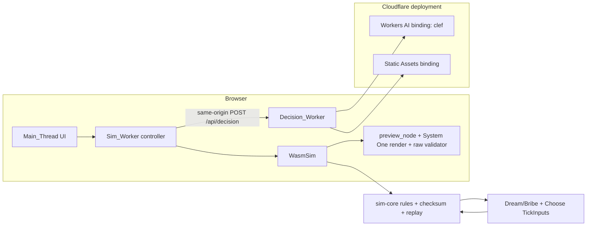

# Design Document: slow-think

## Overview

Spec 7 adds the production D bridge and the deployable Worker seam without moving any simulation rule into JavaScript or into Cloudflare. The data path is:

1. `sim-core` previews a legal underworld Decision_Node without changing the run.
2. `sim-wasm` exposes that preview, the existing System One renderer and raw-choice validator.
3. The browser Sim_Worker sends the rendered closed set to a same-origin Decision_Worker.
4. The Decision_Worker calls the native Workers AI binding for `@cf/cloudflare/clef` once.
5. The Sim_Worker validates the returned option locally, records an optional Decision_Fingerprint on the `Choose` TickInput, and atomically submits the trigger plus `Choose` for the existing same-tick resolution.
6. On every failure or budget exhaustion it submits only the trigger and the existing Rules_Default resolves the node.

The Decision_Worker holds no World state and writes no game state. The model sees a rendered frozen context and option descriptions, not a live simulation handle. The browser is the authority for applying the returned option only because the rules validator and `try_submit_all` remain in the WASM seam.

The spec also adds a generated Artifact_Branch. `main` continues to hold source and runs the full gates. A post-gates publisher stages `web/dist`, the bundled generic Worker module and a minimal Wrangler project into the artifact branch without rebuilding. Under the separate [permanent public deployment grant](requirements.md#permanent-public-deployment-author-grant), tasks **10.1–10.4 are execution-complete**: actual permanent `refs/heads/cloudflare-deploy` and README button, successful main/static/publisher/judge CI, fresh default-off import/build/UI/byte/binding proof, owned cleanup and published delivery documentation with observed CI. Execution is **ready for final Spec review; acceptance remains pending**, not final public-delivery PASS.

The import source is `32100ed224595d0ec4d0645a0ae4e9cde640c7bf`, producer `45326300030/1`, permanent artifact commit `83dd1ae56f46f2f18c60619f1d9121b79b1408a8`; [current audit evidence](../../../docs/slow-think-audit.md#permanent-public-delivery) retains the complete authenticated identities. The single generic own-account Worker has native AI/ASSETS, **no Secret/storage binding**, inference false, the **16384-byte** actual UTF-8 request policy and a **40-attempt page-document default**, with playable Rules_Default and no application rebuild. **0 new model dispatches** were made. The judge service, original accepted `1701d2…` identity and 40/UTC-day, 10/session-lifetime, TTL 86400/persisted-counter contract are separate and retained.

The real UI import initially hit anonymous GitHub rate limiting and continued after its reported reset. Blank initial manual-Build `commit_hash` is associated through independently fetched copied commit/tree and byte proof. Wrangler `no_bundle` uploaded **seven multipart modules**, including **four SDK WASM/HTML auxiliaries**; checked main Worker and game/page bytes are exact, but the deployed Cloudflare module inventory is not asserted to equal the closed public Git allowlist or a single module. Config/profile/module rules and SDK remain canonical. Delivery documentation was published as `b152d6fc81d26731c84ab759aea007cdcabb72e8`, with successful main/static/publisher `45354247253/1` and judge `45357996605/1`, observed artifact ref `899ad65f6c454311271d8f6e2d4b3f1e528ac5cf` and unchanged deployment payload excluding only provenance. The next status-only closure's source/CI tuple comes from Main's final handoff, not a self-hash in this design.

C1/C2/C3 and the bounded SDK repair are accepted. Earlier preparation/repair grants and failed C4 attempts are historical context, not reusable authorization. The current C4 disposition below records later separately authorized evidence; this document update changes no application, inference setting, deployment or task checkbox. Frozen LLM/guard/template/fixtures, C1 pins, existing budgets and the main-only Spec 6 static deployment remain unchanged.

Current C4 is **functional PASS under the Author's explicit evidence-reuse and cleanup-timing decision**. On unchanged reviewed source `af7384ba811e0ced61d19173784c2fe11120feb8` and the accepted envelope, retain the real non-default button/import/SDK-only build, native bindings, API/SPA/Access and static-byte proof from `target/slow-think-evidence/c4-reviewed-retry-af7384/`; combine it with `c4-functional-verify-af7384/functional-result.json`, the observed single Worker POST and actual fingerprinted Dream+Choose replay/native audit. The new request is 6999 UTF-8 bytes, HTTP 200, Clef usage 2400 input/0 output as reported, with tick/controls held and no fallback. Native v5 evidence has 5374 verified checksums and one model-applied Dream choice. Complete cleanup is accepted; the earlier missed fifteen-minute full-cleanup deadline remains an operational failure under the Author's one-off non-veto decision. Historical failed attempts remain non-passes. Production/static main, hosted selection, publisher/button and existing control credentials remain unchanged. No new live attempt, external preflight, push/deploy, permanent rollout or C5 execution follows automatically.

**Accepted corrected source:** local `af7384ba811e0ced61d19173784c2fe11120feb8` (run `63007`/attempt `1`, envelopeSHA `41c864b8064cfa4ff2543b1df4269cdb16596ba85d7839a3bb0f00879bac849a`) has accepted bounded 6.1–6.2 graph and fresh SDK/native/no_bundle proof in `target/sdk-closure-prep/run.SFwS9B/native-result-r7.json`, `transport-r7/` and `public-r7/`. The Spec review independently matched raw envelope SHA, recorded/current public bytes, helper source pins and license sourcePins. Earlier four-file tests were 156/156; corrected graph fixtures were subsequently 42/42, not a final full-suite claim. Supported `WRANGLER_HIDE_BANNER=true` suppresses only the fixed CLI's background update path; real CLI/native operations and unchanged zero RX/TX assertions remain proven. The bounded offline repair grant is complete; the C4 disposition above records separately authorized live work. No inference/hosted/publisher enablement or C5 continuation is implied by the SDK repair.

## Scope guard

- No `S` model call, fact synthesis, generated prose, UI redesign, new scene, haunting control or Bribe control.
- No model call from `sim-core`, `sim-cli`, replay verification or the offline gates.
- No model output reaches simulation state before local closed-set validation and `try_submit_all`.
- No application-owned daily counter or per-minute limiter. The session cap protects one page experience; platform/account limits remain external facts.
- No REST API token in the browser or artifact. The Worker uses the native `AI` binding.
- No production deploy or permanent Artifact_Branch write is authorized merely by accepting this document. The disposable trial and publisher rollout are STOP checkpoints.

## Architecture



### Source and artifact trees

`main` remains a source repository:

```text
crates/sim-core/       pure rules, preview, validator, replay DTO
crates/sim-wasm/       thin preview/LLM exports
worker-api/           Decision_Worker source, tests and bundled output
web/src/worker/        Sim_Worker and Decision_Bridge
web/dist/              generated Deploy_Directory during gates
.github/workflows/     gates and Artifact_Publisher
```

The generated Artifact_Branch is deliberately different:

```text
artifact-root/
  dist/                 built page and WASM only
  worker.js             bundled Decision_Worker, outside dist
  wrangler.jsonc        main, assets, AI binding and routing
  package.json          minimal deploy metadata, no build script
  pnpm-lock.yaml        only if needed to pin Wrangler
  LICENSE
  NOTICE                deployment, account/quota and fallback statement plus required notices
  provenance.json       source commit and build identifiers
```

The artifact contains no source Rust, `target/`, `node_modules`, `eval/`, root `env`, test fixtures, CI workflow or secret. The generated branch is a deployment input, not a second development tree.

## Decision lifecycle

### Preview

`Sim::preview_node(payload)` is the existing pure seam. It clones the World, applies already queued current-tick inputs to the clone and previews the candidate with `inputs.next_seq()`. The clone may evaluate the same keyed draws as a real firing; no live ID, input sequence, RNG state, World, or checksum history changes. It returns:

```rust
pub struct NodeSpec {
    pub family: NodeFamily,
    pub trigger: InputSeq,
    pub context: FrozenContext,
    pub options: Vec<NodeOption>,
    pub rules_default: NodeOption,
}
```

The WASM DTO adds only transport fields: the frozen context JSON, option IDs and option definitions, the Rules_Default, family and decimal-string trigger. It does not expose mutable World objects or a predicted Node ID.

The adapter reuses the existing WASM exports `llm_render_system_one` and `llm_validate` with `mode: raw_choice`. Production mapping bytes and contract metadata live outside `crates/sim-core/src/llm/`; that whole directory (including its file set), the pinned probe template, and the guard pins stay unchanged. The browser never imports `eval/`.

`System_One_Mapping_v1` is the exact bytes of `eval/probe/templates/decision.system_one.v1.txt` at this spec's start. A production copy or generated build input outside the frozen sources is checked offline against those bytes and their SHA-256. The same version/hash is available to both adapters without a runtime file read. The response schema version is `clef-system-one-choice-v1`.

### Request

The Decision_Request is strict JSON. Its conceptual shape is:

```json
{
  "version": "decision-request-v1",
  "family": "dream_interpretation",
  "mapping_version": "system-one-v1",
  "mapping_hash": "…",
  "question_id": "decision",
  "metadata": {"bridge_version": "slow-think-v1"},
  "state": "Today is day …",
  "instructions": "…",
  "criteria": [
    {"id": "heed_warning", "label": "…"},
    {"id": "dismiss_dream", "label": "…"}
  ]
}
```

The request schema is closed: exactly the nine shown keys are required, with no unknown keys at any object level. The version, family, mapping version/hash, fixed `question_id: "decision"` and exact `metadata: {"bridge_version":"slow-think-v1"}` are validated against the local contract. Criteria IDs are unique and criteria count is 2–5. The Worker bounds actual body bytes first, then checks the parsed depth, field/string bounds, closed shape and mapping contract before calling `env.AI.run`.

### Shared wire bounds

Decoded string lengths mean UTF-8 bytes measured with `TextEncoder`, not JavaScript UTF-16 code units or escaped JSON bytes. Serialized body lengths mean actual received UTF-8 bytes, independently of `Content-Length`. These are application safety domains, not claims about Cloudflare platform limits. The browser and Worker consume one shared strict public schema, not a tolerant probe parser.

| Field or structure | Exact bound or domain |
|---|---|
| Request `state` | Nonempty; at most 65,536 decoded UTF-8 bytes |
| Request `instructions` | Nonempty; at most 8,192 decoded UTF-8 bytes |
| Each criterion `label` | Nonempty; at most 1,024 decoded UTF-8 bytes |
| Criterion `id` and response `choice` | 1–64 ASCII bytes; `^[a-z][a-z_]*$`; unique request IDs and response membership in the request criteria; Rust remains authoritative for closed-option legality |
| Request `criteria` | 2–5 objects, each exactly `id` and `label` |
| Request `family` | Exactly `dream_interpretation` or `magistrate_ruling` |
| Request/public versions, metadata and identity strings | Exact literals defined here; every public object has exact keys and no unknown fields |
| Mapping hash | Exactly local pinned lowercase 64-hex `e275f397327b91dc1b6f69290535d6ef72c6bb712021ff130ed9da43589b337d` |
| Accepted response fingerprint | Exactly local C1-pinned lowercase 64-hex `6ffb8d3a255dbc1d066ba3b4a1c38291b1adfda5aa1f4e3c65a9adafbd243a32`; response version remains `clef-system-one-choice-v1` |
| `session_cap` | JSON number; `Number.isSafeInteger`; inclusive `0..=9007199254740991` |
| Public usage counters | JSON numbers; `Number.isSafeInteger`; inclusive `0..=9007199254740991` |
| Parsed public request/config/success/error depth | At most 4: root object/array counts 1, each nested object/array adds 1, primitive leaves add no level; request criteria array is depth 2 and each criterion object depth 3 |
| Configured request-body cap | Explicit integer in `1..=1048576` actual UTF-8 bytes; 1,048,576 is only the supported ceiling, never a default, trial cap or measured permanent cap |
| Every public GET/POST/error response body | At most 4,096 actual UTF-8 bytes, including when `Content-Length` is absent; bounded read and strict validation remain inside the relevant deadline |

Do not perform an unbounded recursive walk before enforcing the depth bound. Request shape/type/literal/string/depth violations return HTTP 400 `malformed_request`; actual request-body bytes above the configured cap return HTTP 413 `payload_too_large`; both perform zero AI calls. Invalid local request construction uses the checked trigger-only path with `malformed_request` or `payload_too_large` as appropriate, without POST or a spent attempt; it is not an inference failure. An oversized public response is instead a local `invalid_response` fallback, never a request `payload_too_large` classification. The selected project policy below does not change these public wire/string/depth bounds or the supported configurable safety ceiling; C4 temporary caps still require separate approval.

Only the rendered fictional decision context and option labels go to Workers AI, not the raw `FrozenContext`. Rendered text/labels can contain generated resident names, relationships, event details and local Person/Soul IDs. The bridge sends no separate World or person identifiers, player input text, real identity or account data. The Worker does not store or log these bodies, prompt fragments or raw responses. The in-game comparison concerns the stock renderer's character facts, not an explicit numeric personality prior: the scoring priors remain in Rules_Default, and Rust still generates the legal options and owns all filtering and effects. Agreement or divergence from the default is not a measure of personality quality.

### Selected project body-cap policy; implementation pending 5.3

The Spec independently selects **16,384 actual serialized UTF-8 request bytes** as the permanent project policy, not automatic promotion of C3's equal temporary number. Task 5.3 must still install and verify the explicit project pin, keep runtime cap configuration and any affected generated types/stamps consistent, and record the evidence; this selection is not an implementation pass or rollout approval. No legacy alias or implicit default may hide missing configuration. The cap is transport policy, not a token/neuron conversion or a <=50-neuron guarantee; the page default remains 40 requests with no endpoint minute limiter or daily counter.

| Existing evidence | Recorded value and limit |
|---|---|
| Accepted C3 single real request | 7,386 bytes; actual usage 2,544 input/0 output tokens; client-observed latency 888.711918 ms; published-rate estimate 55.504992 neurons, not provider-metered cost or a rate/quality guarantee |
| Existing actual-WASM offline corpus | 1,410 requests: Dream 1,387 at 6,243–12,239 bytes; Magistrate 23 at 5,848–7,608 bytes |
| Sampled maximum and headroom | 12,239 bytes; policy leaves 4,145 bytes (33.87%) above that sampled maximum |

The corpus spans only two lineages of one 50-resident seed-185 fixture with limited legal history, not worst-case or all-world coverage. Larger otherwise valid contexts may exceed 16,384 bytes: explicit 413 `payload_too_large` before AI and checked Rules_Default fallback are the intended bounded-cost/coverage tradeoff, with complete gameplay retained. Task 5.3 must separately prove valid exact-16,384-byte bodies make one fake call only when explicitly enabled and 16,385-byte bodies make zero, including multibyte/escaped JSON and no Content-Length. Reason-specific fake/telemetry attempt/fallback denominators remain separate from replay comparisons and C3's single success. Pin this measured project policy in disabled hosted candidates/generated artifacts and NOTICE opt-in guidance; ordinary source inference remains false, candidate selection remains off, and the current static production path is unchanged. The configurable `1..=1048576` ceiling and all public wire examples/contracts remain unchanged; independently approved C4 temporary caps may differ.

The Clef binding call is the native binding form:

```ts
await env.AI.run('@cf/cloudflare/clef', {
  model: 'clef',
  state: request.state,
  questions: {
    [request.question_id]: {
      type: 'choice',
      instructions: request.instructions,
      criteria: Object.fromEntries(request.criteria.map((x) => [x.id, x.label])),
    },
  },
})
```

### Native provider selected projection

The official [Clef input schema](https://developers.cloudflare.com/workers-ai/models/clef/schema-input.json) and [output schema](https://developers.cloudflare.com/workers-ai/models/clef/schema-output.json) were inspected during this planning session. The native output is `model`/`answers`/`usage`, not a REST `result`/`success` envelope. The output schema requires those three fields; a choice answer requires `type`, `choice`, `probabilities` and `confidence`; its usage schema requires integer `input_tokens` and `output_tokens`, but declares no numeric min/max and does not close additional properties. The application consumes a selected projection and deliberately permits absent native usage for unavailable reporting; that absence exception is not the documented standard output shape.

| Consumed native field | Validation and public projection |
|---|---|
| Result, `answers`, `answers.decision` | Require non-array objects; selected answer has `type: "choice"` and a valid `choice` with the shared ID bound and request membership |
| Raw `model` | Require a nonempty string of at most 128 decoded UTF-8 bytes; no documented literal guarantee equates it with the endpoint/selector. Do not echo it; public `model` is the locally pinned call identity `@cf/cloudflare/clef` |
| Raw own `usage` property absent | Deliberate application exception: emit required public `usage: null` |
| Raw `usage` property present | Require an exact object with both and only `input_tokens` and `output_tokens`, each a nonnegative safe integer within the shared domain; project those two counters |
| Unconsumed envelope/answer members | Ignore and discard, including `probabilities` and `confidence`; no full-response echo, REST unwrapping or probe parser import |

Apply depth and string bounds to the consumed projection, not to unconstrained ignored provider members. Present raw usage that is null, a wrong type, empty, partial, has any unknown key (including `reasoning_tokens`, `total_tokens` or `neurons`), or contains negative, fractional or unsafe counters returns HTTP 502 `invalid_response`; it never becomes missing/unavailable usage. Do not synthesize counters from bytes or infer neurons. The Worker validates request membership; the browser then checks the public mapping/fingerprint and validates the option against the frozen set in Rust.

### Public config, success and error wire

All fields shown below are required; all public objects are closed at every level. The only public normalization is the Worker's explicit projection of native output. The browser does not tolerate unknown fields, missing fields or unversioned payloads. Every public JSON response, including path/method errors, emits `Content-Type: application/json; charset=utf-8` and `Cache-Control: no-store`; the client accepts the `application/json` media type with parameters.

`DecisionConfig`, HTTP 200, advertises the pinned v1 request/success/error contracts through the exact version literal `decision-config-v1`. `enabled` is a required JSON boolean equal to evaluated readiness; required `session_cap` uses the shared safe-integer domain. It has no request-byte-cap field or inference byte-cap default:

```json
{"version":"decision-config-v1","enabled":true,"session_cap":40}
```

Normal disabled readiness uses the identical HTTP 200 shape:

```json
{"version":"decision-config-v1","enabled":false,"session_cap":40}
```

`ModelDecision`, HTTP 200, always includes `usage` and `session_cap`. The sample choice is illustrative; membership is determined by the request and Rust, not by this example:

```json
{"version":"clef-system-one-choice-v1","choice":"heed_warning","model":"@cf/cloudflare/clef","mapping_version":"system-one-v1","mapping_hash":"e275f397327b91dc1b6f69290535d6ef72c6bb712021ff130ed9da43589b337d","fingerprint":"6ffb8d3a255dbc1d066ba3b4a1c38291b1adfda5aa1f4e3c65a9adafbd243a32","usage":{"input_tokens":123,"output_tokens":4},"session_cap":40}
```

When native usage is absent, the canonical public success remains complete:

```json
{"version":"clef-system-one-choice-v1","choice":"heed_warning","model":"@cf/cloudflare/clef","mapping_version":"system-one-v1","mapping_hash":"e275f397327b91dc1b6f69290535d6ef72c6bb712021ff130ed9da43589b337d","fingerprint":"6ffb8d3a255dbc1d066ba3b4a1c38291b1adfda5aa1f4e3c65a9adafbd243a32","usage":null,"session_cap":40}
```

Public absent `usage`, `{}` or partial usage is invalid. Public usage is exactly null or the exact two-counter object. POST `session_cap` is required and validated in the same domain as GET, but is diagnostic only: it never replaces the cached page cap, and a difference from GET's value alone does not invalidate an otherwise valid decision.

`DecisionError` is used only on non-2xx responses, with exactly `version` and `error`, where `error` has exactly `kind`:

```json
{"version":"decision-error-v1","error":{"kind":"disabled"}}
```

No error contains free-form text, a provider code/message, a retry flag, identity or an echo. The exact kind/status pairing is defined in Errors and quota below. The client validates shape, version and pairing before classification. Malformed or unsupported success/error bodies, wrong media type or over-bound bodies cause local `invalid_response` fallback. Client-only `timeout`, `network`, `session_cap`, `cancelled` and manual fallback statuses are not HTTP wire kinds. A valid HTTP 200 config with `enabled: false` is not an HTTP error.

### Atomic application

The preview predicts the sequence the trigger will receive. While the Sim_Worker is waiting, it accepts no competing game input for that current-tick operation. On a model success it submits the following two payloads in one checked batch:

```json
[
  {"Dream": {"dreamer": "39", "intent": "reassure"}},
  {"Choose": {
    "node": {"Trigger": {"seq": "64"}},
    "option": "take_comfort",
    "fingerprint": "…"
  }}
]
```

The real trigger sequence is the preview's `trigger`, not the Choose input's own later `seq`. `try_submit_all` remains the atomic guard. If the model is not accepted, the bridge submits only the trigger and the current same-tick resolver uses the Rules_Default.

### Pending-operation state machine

Configuration prefetch is independent of the game transaction. A request arriving before enabled configuration is ready, or with zero wait or no budget, uses checked trigger-only submission immediately; it does not wait for configuration or change the pacing loop. When inference can proceed, take the current-tick input lock before previewing and hold it through the terminal submission. Bind the operation to the request ID, `worldId`, current tick and predicted trigger sequence. Snapshot the wait preference once for this operation; the deadline uses a browser clock, never a WASM argument. Only the first terminal action can commit.

Cancel the scheduled Frame and guard against callbacks already queued, including same-World stale callbacks. No Frame, `run`, `step`, `pause`, `set-speed` or competing input can change tick, stream, Run_State, speed or anchor while the operation is open; competing requests reply `decision_pending`. Read-only queries and changes to the wait preference may proceed; the latter apply to future operations only. A running World retains Run_State `running` with an orthogonal decision-pending status; a paused World remains paused. This is not a new Pause_Reason and it does not bypass `node_unanswered`.

On a current-World terminal action, accept the validated pair atomically or try the trigger alone for Rules_Fallback. If the checked trigger is rejected, report its existing rejection without accepting an input. Closing the operation does not step. For the same running World, reset the pacing anchor, tick debt and TPS sampling at the current tick and schedule a single fresh Frame; never catch up ticks spent waiting. A paused World stays paused. Ordinary stops and scenes are still emitted by the tick that actually resolves the dream.

### Late responses and replacement

Preserve WS-R2.7 and FP-R8.11 FIFO handling outside the async window. While a decision is outstanding, later requests may receive replies before the original one; correlate by the existing request ID and deliver one terminal reply per live request. A matching `Use rules now` closes the decision and queues only the trigger, then replies once to both the original request and the control request; a stale control must not cancel a newer decision. A valid replacement first closes the old operation, aborts its fetch and emits the original `cancelled` reply without inputs, then installs the new paused World and replies to `create-world`. Failed creation leaves the old World and transaction intact. A timeout, old Frame, duplicate result or response after closure cannot queue any input or paint over a newer World's status. A fatal Sim_Worker termination follows the existing failure path to settle outstanding client requests; it cannot commit a fallback to a failed WasmSim.

## Replay and provenance

### Fingerprint

`Decision_Fingerprint` is the lowercase 64-hex SHA-256 digest of the UTF-8 bytes of five NUL-separated fields in this fixed order: `cloudflare_workers_ai`, `@cf/cloudflare/clef`, `system-one-v1`, the lowercase SHA-256 `mapping_hash`, and `clef-system-one-choice-v1`. These fields contain no NUL bytes. The exact algorithm and a test vector are shared by Rust, the Worker and the browser contract validator.

A successful model-bearing `Choose` carries `Option<DecisionFingerprint>`. Existing human/Auto_Player `Choose` inputs carry `None`. The replay DTO serializes the digest as a fixed lowercase 64-hex string and omits the field for `None`. The Worker response also returns the mapping version/hash; the browser compares both to its current contract before accepting the fingerprint. Replay decoding validates only the fixed format and does not require the historical fingerprint to match today's model contract.

The fingerprint is input provenance, not World state. With all else identical, changing only the fingerprint preserves the checksum. `NodeRecord.source` is canonical: `External` and `Rules_Default` remain distinct even for the same selected option. Compare a model run to direct submission of the same checked pair, and a fallback to direct submission of just the trigger; do not equate the two.

### Replay compatibility

Replay format remains version 5. Old no-fingerprint files round-trip byte-identically in the new reader; an older strict reader need not accept new records. Unknown fields remain rejected. New model-bearing records get their own round-trip tests. Do not regenerate parity fixtures to accommodate an unexpected checksum change from this spec; report and investigate the change.

An audit-only WASM export serializes v5 from the **live run**, not `replay::record` on a reconstructed input list. Capture the creation seed/config, all accepted inputs in actual assigned sequence order, and the completed tick count and per-tick checksum history. Queued inputs at or beyond that count follow the existing v5 convention; evidence for an applied choice must include its completed tick. The export is read-only, contains no decision HTTP envelope or telemetry, and is exposed via the local evidence harness, not a player-facing replay feature. Verify the export natively and in WASM without network. Native comparison reconstructs each recorded trigger's NodeSpec from its tick and exact preceding input sequence, including when both families trigger on the same tick; only a resolved, fingerprint-bearing choice counts as model-applied. Do not add trigger identity to canonical World records for reporting.

## Decision_Worker

### Routes

- `GET /api/decision/config`: makes no AI call; returns HTTP 200 `DecisionConfig` with evaluated readiness when a valid cap can be advertised, or HTTP 503 `DecisionError` with `disabled` for an explicitly invalid session cap.
- `POST /api/decision`: returns HTTP 503 `disabled` with zero AI on any readiness failure; otherwise validates the request and makes one Clef call, returning `ModelDecision` or `DecisionError`.
- Exact `/api` and unknown `/api/*` paths: fixed JSON 404. Wrong methods on a known route: fixed JSON 405 with `Allow`. These requests never reach assets.
- Non-API requests: serve existing assets and apply the configured SPA fallback for navigation. This is the Worker profile, not a change to the still-active Spec 6 assets-only config.

The Worker is same-origin in production. The development fake server and unit tests may use a test origin, but production CORS is not a dependency.

### Configuration

The generated artifact config uses the checked bundle as its entry point:

```jsonc
{
  "main": "./worker.js",
  "compatibility_date": "2026-11-10",
  "no_bundle": true,
  "assets": {
    "directory": "./dist",
    "binding": "ASSETS",
    "run_worker_first": ["/api", "/api/*"],
    "not_found_handling": "single-page-application"
  },
  "ai": { "binding": "AI" }
}
```

Use `worker-api/wrangler.jsonc` for the source/local Worker (`main: ./src/index.ts`, assets directory `../web/dist`); the checked Worker profiles share the route contract above and explicit `compatibility_date: "2026-11-10"`. The fake-AI actual runtime, C3/C4 profiles, future hosted candidate and generated Artifact_Branch config inherit that same source runtime date and compatibility flags. Fakes may replace bindings, vars and test wiring as already permitted, but must exercise the same source runtime semantics; do not lower only a test date or add divergent compatibility flags. Native AI test binding remains non-remote, and ordinary inference remains disabled.

Decision A retains the existing pinned Wrangler/workerd, locks and offline stores. The Author reports that workerd `1.20261103.1` rejected `2026-11-21` and supports at most `2026-11-10`; this decision is not a new runtime pass. No toolchain upgrade, engine/dependency patch or today-derived date default is authorized. The separately bounded SDK preparation below may fetch only missing already-fixed registry content and `yaml@2.8.1`, never advance those versions. Future date/toolchain advancement needs a separate planned change. Task 3.1 must align source/fake configs, regenerate types from the pinned schema/date and prove the actual router with checked assets before 3.2; direct-handler success or startup alone is insufficient.

The same readiness predicate governs GET's `enabled` and direct POST inference: explicit enablement AND a valid Session_Cap AND an explicitly configured valid request-byte cap AND a usable native AI binding. A missing session-cap setting defaults to 40; an explicitly invalid value is never coerced, clamped or replaced with that default. The byte cap has no default: it must be an integer in `1..=1048576` actual UTF-8 bytes. The upper endpoint is only a supported safety ceiling, not a selected permanent limit. Missing/invalid byte-cap configuration is disabled. A valid cap of 0 prevents every page inference attempt via `session_cap` fallback, but does not by itself set readiness to false; this cap is not a server quota.

| Configuration condition | GET `/api/decision/config` | Direct POST `/api/decision` |
|---|---|---|
| Explicit enablement, valid session cap, explicit valid byte cap and usable AI binding | 200 `DecisionConfig`, `enabled: true` | Validate request; one AI call only if accepted |
| Enablement off, byte cap missing/invalid or binding absent/unusable; session cap valid (including missing setting defaulting to 40) | 200 `DecisionConfig`, `enabled: false` | 503 `DecisionError`, `disabled`; zero AI |
| Session cap explicitly invalid | 503 `DecisionError`, `disabled`; no fabricated cap | 503 `DecisionError`, `disabled`; zero AI |

GET always performs zero AI calls. Ordinary source and hosted configs remain disabled. Offline fakes supply explicit test caps; C3/C4 trial caps are separately approved and stay outside the ordinary hosted path. The Spec independently selected the 16384-byte project policy above; task 5.3 still owns its explicit implementation pin and boundary proof, not a new generic ceiling or automatic trial-cap promotion. An evaluated disabled config (200) is distinct from inability to advertise a valid config (503).

### Errors and quota

Use only the closed `DecisionError` wire defined above, with these exact status pairings:

| `error.kind` | HTTP status |
|---|---|
| `malformed_request` | 400 |
| `not_found` | 404 |
| `method_not_allowed` | 405; preserve the known route's `Allow` header |
| `payload_too_large` | 413 |
| `model_error`, `invalid_response` | 502 |
| `disabled`, `unavailable` | 503 |
| `quota`, `rate_limited` | 429 |

A verified daily-quota signal maps to `quota` and alone triggers the daily notice. A generic provider 429 maps to `rate_limited`; code 3036 is interpreted only if evidence confirms what it denotes. No provider text is echoed and no path retries. HTTP bodies with any other kind/status pairing, including an error body on 2xx, are local `invalid_response`; client network, timeout, session-cap, cancellation and manual statuses remain outside this enum.

The Free plan's documented 10,000 neurons per UTC day is a shared account allocation. A Paid account may incur charges above its free allocation. Report provider usage as supplied; report neurons only as provider data or as an explicitly labeled estimate from a documented applicable conversion. Otherwise the ~50-neuron target is unknown, not a failure or pass inferred from bytes.

## Browser Decision_Bridge

The controller receives a `DecisionClient` dependency:

```ts
interface DecisionClient {
  config(signal: AbortSignal): Promise<DecisionConfig>;
  decide(request: DecisionRequest, signal: AbortSignal): Promise<ModelDecision>;
}
```

The same-origin adapter makes exactly one read-only config-prefetch attempt per page document with `CONFIG_PREFETCH_TIMEOUT_MS = 3000`. Start its deadline immediately before dispatch; it covers HTTP headers, the bounded body read, decode and full strict validation. Abort on the deadline or document disposal; do not retry or reset the timer on a partial response. This deadline is independent of the decision wait preference (`0..=10` seconds). Prefetch never blocks gameplay, and failure leaves inference unavailable until reload. World replacement does not abort, restart or refund config prefetch and does not reset config, cap or spent count. If valid config arrives after a trigger used rules because configuration was unready, only future operations may use it. The fake client shares this bound through injectable clock/timers, with no real multi-second sleeps. In the rules-only smoke harness the adapter is explicitly disabled or local/fake; no remote inference path is reachable.

Route the existing Underworld Dream control through the bridge in the Sim_Worker; the internal seam also accepts Bribe for tests, but Spec 7 adds no Bribe control. Preserve direct `submit`, `ChoosePlayer`, Snapshot-only scenes and their current contracts. The Main_Thread displays only a pending indicator, a minimal wait preference/`Use rules now` control and a fixed outcome notice, using request IDs and World-tagged status; it never assembles the model request. The decision status is separate from the Spec 6 stops. While a running World is held, continue the normal status cadence with unchanged tick/checksum and no TPS sample or catch-up; count-based Snapshot reads may still run.

## Budget and metrics

The Decision_Budget counts POST attempts immediately before dispatch (including failures, timeouts and cancelled requests), never refunds them, and survives World replacement. GET is the sole page-session cap source: `session_cap` is a safe integer in `0..=9007199254740991`, defaulting to 40 only for a missing deployer setting. Compare spent count against cap before incrementing so the counter remains safe even at `Number.MAX_SAFE_INTEGER`. Cap 0 permits no page attempt and uses `session_cap` fallback. GET never counts; the required POST cap is validated but diagnostic only, even if it differs from the cached cap. Before valid enabled config is ready, a Dream uses rules immediately. Failed prefetch leaves inference unavailable until document reload. Track eligibility separately from attempts; never label disabled/unready config or invalid local request construction as a failed inference attempt.

The page cap is not abuse protection: an outside caller can reach a public Worker and draw on the deployment account's allocation, or incur charges on Paid. Spec 7 adds no application per-minute limiter or daily counter. Client abort closes the browser operation without retry; it does not guarantee cancellation or refund for work Workers AI already accepted.

C3 captures UTF-8 serialized request bytes, recorded usage (`input_tokens` when returned), latency, response shape and the actual post-resolution browser export. Report the one outcome as a sample, not a production rate. The selected 16384-byte project policy uses the accepted live sample and both-family offline corpus above; task 5.3 records its headroom, coverage limits and pending implementation proof. Browser/fake decision metrics provide separate reason-specific attempt/fallback denominators. Replay supplies applied-choice/default comparison denominators; a trigger-only replay does not encode why a model call was skipped or failed. No prompts, synthetic names or raw provider output in metrics or the log.

The page-session wait preference defaults to 10 seconds and is clamped to `0..=10`. Setting it to zero skips the endpoint for every operation while zero is selected and immediately uses Rules_Fallback without fetching. While a non-zero request is pending, the minimal decision status offers a `Use rules now` action. That action closes the operation, commits trigger-only fallback, and ignores any late response. The wait preference and the Session_Cap persist across World replacement, but reset with a full page-document reload. No full settings page is added.

### C3 control-plane authentication-only continuation (historical pre-C3 scope)

The following records the earlier preflight-only grant, superseded by the separately approved and accepted C3 trial. It is not a current continuation grant: the Overview now bounds offline 5.3–6.2 and the 7.1 STOP, without renewed authentication, live inference or inherited token-policy waiver.

The Author's fresh `existing_token_readonly` choice permits only a bounded online control-plane preflight, not renewal of `local_one_attempt`. Wrangler supports [granular API-token authentication](https://developers.cloudflare.com/workers/authorization/#use-granular-permissions-with-wrangler), distinct from the prohibited client-held token/direct Workers AI REST inference path. Native inference remains `env.AI.run` with an independently approved remote binding. Use project-pinned Wrangler `4.157.0`; a global CLI result cannot substitute for that pin or verification. The earlier `default` profile selection is not an authenticated OAuth identity: an environment API token [takes precedence over profiles](https://developers.cloudflare.com/workers/wrangler/profiles/#resolution-order). Name the current method `existing-environment-api-token`; retain the failed token-stripped default-profile OAuth path and `manual_auth_pause` as historical records, without retroactive reinterpretation.

Only this preflight caller may inherit its already-present `CLOUDFLARE_API_TOKEN`. Do not strip that allowlisted token for this approved check, substitute/create it, read root `env` or token configuration, or carry unrelated authentication/loader/proxy variables. If the caller does not inherit it, STOP with `missing-credential-in-scope`; the Author may relaunch the executor from the authenticated shell, never paste a token into a handoff. Do not print/persist raw credentials in arguments, credential files, logs or artifacts, or forward them to Sim_Worker, browser, DecisionRequest or replay. All offline gate/build/unit/smoke wrappers retain credential rejection/removal and external-network isolation unchanged; this is no shared-wrapper exception.

Permit one `whoami`/identity invocation and only necessary read-only permission/resource metadata and original static-Worker ownership checks for the same existing Back in the Family static deployment account. Verify credential validity, effective roles/token grants/resource scopes and target ownership; successful identity alone or an environment/account default proves none of those permissions or ownership. Verified account metadata may be held privately and temporarily for these checks, without changing normal source configuration or trusting an unverified forced account. Failure, ambiguity or missing required evidence means STOP, with no repeated command, retry or alternate target. If exact permissions cannot be established read-only, report unverified and STOP; never test a privilege by a write or proxy call.

No login, OAuth refresh, new/edited token, profile change or account fallback is authorized. No proxy creation/upload/start, browser/model/GPU operation, deployment/push, public endpoint or continuation of disabled artifact work is authorized. Permission to inspect effective credential metadata is not inference/deployment permission; no live inference budget is authorized or spent.

After the single preflight, clean up temporary metadata and return only a bounded redacted report: authentication method, pinned CLI, verified booleans, permission/ownership result, status/limitations, cleanup and zero proxy/browser/inference/AI counts. Omit raw token, identity/account dumps and raw authentication diagnostics. STOP for Author/Spec review even on success. C1/C2 remain accepted; C3 remains non-pass, and 5.2 still requires fresh explicit live approval naming the verified target, proxy creation/upload/teardown and other operations, temporary cap, one-page/one-attempt/no-retry bounds and cleanup. Prior `16384`, `SESSION_CAP: 1`, 10-second wait/3-second config, native `@cf/cloudflare/clef` and `2026-11-10` trial parameters do not automatically inherit authorization; any new trial must explicitly reapprove its scope. Authentication success selects no permanent cap or release.

## Hosted release and build hand-off

`scripts/worker-build.sh` uses pinned Wrangler `deploy --dry-run --outdir` with the source config's explicit `compatibility_date: "2026-11-10"` after the ordinary web build, without remote bindings or credentials, and stages the checked bundle at `target/decision-worker/worker.js`. Stage the same checked `web/dist` and Worker bundle for hosted deployment, if approved, and for publisher packaging. The staged Worker config retains that identical explicit date and uses `no_bundle` so release does not run a second bundling step. Preserve the existing WASM byte-identity and deployed file-size checks.

Keep `web/wrangler.jsonc` and the ordinary green-`main` static deployment path as-is until hosted rollout is explicitly approved. Prepare the Worker as a distinct, fail-closed CI deployment candidate with explicit measured 16384-byte policy, inference false and selection off: a green push alone, the preexisting `DEPLOY_ENABLED`, and C3/C4/permanent publisher approval do not select or enable it. Document activation and rollback without switching workflows or live variables. Enable hosted inference only in the separately approved hosted config with the measured limit; with no usable limit or no enablement, direct POST still makes zero calls. Approval must call out automatic deploy on green `main`. Skipping or failing C4 does not block offline hosted preparation; neither preparation nor artifact checks approve ongoing artifact writes.

## Artifact_Publisher

The existing `deploy.yml` keeps its main-only trigger and full gates. The publisher is a separate job dependent on the successful gate/build job. The gate/build job uploads the exact checked `web/dist` and `worker-api` bundle as immutable workflow artifacts; the publisher downloads those artifacts and never rebuilds them. The publisher job and its branch-write step remain disabled until the C4 trial has passed and the Author has separately approved permanent rollout. Once enabled, it has the minimum repository write permission needed to update the fixed Artifact_Branch; the gate and production-deploy jobs remain read-only except for their existing Cloudflare secrets. The publisher does not use the Cloudflare production token.

The private transport reuses `inputs.json`; its checked envelope must contain a mandatory readonly `licenseClosure`, not a second manifest or a public license-input directory. The closure has closed fields and the exact fixed logicalIDs for the existing project LICENSE, Svelte runtime terms, pinned Cargo runtime terms and Rust standard-library license/exception texts. Bind each entry to its fixed version or source pin and retain its complete lossless UTF-8 text plus SHA256; preserve original bytes rather than storing only digests, excerpts or normalized text. The closure's closed `sourcePins` equal the existing `sourceDigests` values for `LICENSE`, `Cargo.lock`, `rust-toolchain.toml`, `web/package.json` and `web/pnpm-lock.yaml`.

The gate/build prepare path captures those actual prepared license sources and includes the closure in the envelope whose SHA256 becomes an independent successful-gate job output. A consumer first checks the complete envelope against the externally expected envelopeSHA and trusted source commit/run ID/run attempt, then checks closure shape, fixed IDs/versions/source pins, lossless text and recomputed SHA256, and the complete LICENSE/NOTICE semantic rules. The existing checkout/source provenance and pinned Node checker SDK/schema checks remain required; neither public provenance nor a self-declared closure digest supplies the expected envelopeSHA. Reject every old envelope lacking the closure. If the envelope schema version changes, migrate every producer, consumer and fixture together, without aliases, compatibility shims or legacy fallback.

Only build prepare may call `collectArtifactInputs` and read actual license sources from prepared dependencies/toolchain inputs. Ordinary stage/check require an external expected envelopeSHA and must not derive an expectation by collecting or rebuilding inputs. Their license verification consumes only the trusted closure and public LICENSE/NOTICE: no local Svelte license resolution, Cargo registry/cache license reads, Rust toolchain/license reads, `rustc.path`, absolute toolchain paths or missing-closure fallback. Normal source checkout and checker SDK checks may remain; no Rust installation or application/Worker rebuild is added to the publisher.

Preserve the existing complete project Apache LICENSE, Svelte text inclusion, full MIT bodies and distinct copyright notices, Unicode terms, BLAKE3 Apache-body/notice split, Rust standard-library license and exception text, and NOTICE account/opt-in/quota/Free/Paid/rules-only/fallback policy checks. Keep the public tree and LICENSE/NOTICE allowlist, C1 pins, public wires, explicit 16384-byte cap, `compatibility_date: "2026-11-10"` and disabled inference unchanged. Only the two existing hard-disabled publisher guards may be enabled under the later permanent public deployment grant; update the shared exact workflow SHA pin without weakening static config/path checks. The private closure never becomes a public-tree file.

Prove the consumer through a fresh real CLI fixture containing only the exact source checkout, prepared Node checker SDK and immutable transport, with no producer Cargo/cache/license sources, Rust toolchain/`rustc.path` or prior Worker/WASM/web build outputs. Deleting only disposable fixture caches is insufficient if module-level `root` still reads the original repository's license inputs; the fixture must exclude that escape as well as local Svelte-license fallback. Preserve all LICENSE/NOTICE semantic, source-freshness, exact-public-byte, privacy and local predecessor/CAS failure/race proofs. Add independent closure fixtures for missing/extra/duplicate IDs, wrong versions/source pins, invalid or incomplete text and text/hash mismatch; modifying the private closure and recomputing its embedded hash still rejects against the unchanged externally expected envelopeSHA. Record actual narrow repair evidence and return for offline re-review/STOP, without claiming C4 or permanent rollout proof.

### Complete locked SDK graph and bounded preparation

Replace the lossy offline `--lockfile-only` re-resolution in `prepare-artifact-metadata.sh` with one shared structured source-lock selector/validator using the public YAML API and plain safe YAML. Do not create a generic framework, private bundled-parser dependency, regex package-name parser or `SDKClosure` manifest. Root selection is the existing public deploy package's two devDependencies (`@types/node` and Wrangler) against the healthy `web/pnpm-lock.yaml`, currently resolving `@types/node@26.6.6` and `wrangler@4.157.0(@types/node@26.6.6)`. Output exactly one root importer with the original exact specifiers, resolved references and dev classification, not application dependencies or a new npm resolution. Keep Node `26.7.0`, pnpm `10.33.1`, Wrangler `4.157.0`, workerd `1.20261103.1`, esbuild `0.28.2`, sharp `0.35.5` and libvips `1.3.4` fixed.

Walk mandatory and optional dependency edges and actually resolved peer-context references. Preserve selected package and snapshot records semantically losslessly, including full snapshot keys/peer suffixes/registry aliases, dependency maps, `peerDependencies`, `peerDependenciesMeta`, `transitivePeerDependencies`, optional flags, resolution/integrity, engines, `hasBin`, `cpu`/`os`/`libc` and lock settings. Retain all platform alternatives, not just the current host's packages; do not merge peer contexts, force an uninstalled optional peer declaration into a required edge, add unreachable/application records or expand workspace/link/file references. Reject selected nonregistry/local references. Required examples include all five workerd platform optionals, all 26 esbuild platform optionals, sharp's platform graph with the nested Linux sharp → libvips edge, Wrangler's optional fsevents and unenv-preset's optional peer-context workerd. An empty native leaf snapshot may be valid; an empty native parent that has lost its edges is not. Adding only `@cloudflare/workerd-linux-64` or allowing postinstall download is not a closure repair.

Add exact `yaml@2.8.1` only to the project checker/selector devDependencies, not app runtime or the public deploy root, which stays at two dependencies. Its [official manifest](https://registry.npmjs.org/yaml/2.8.1) declares built-in TypeScript types, Node >=14.6, no runtime dependencies and no install/preinstall/postinstall/prepare script; its [ISC LICENSE](https://raw.githubusercontent.com/eemeli/yaml/1dc3c3ba06971613d0bcb772da4711ca25343dac/LICENSE) and metadata were inspected during planning, not newly fetched here. Expected official tarball integrity is `sha512-lcYcMxX2PO9XMGvAJkJ3OsNMw+/7FKes7/hgerGUYWIoWu5j/+YQqcZr5JnPZWzOsEBgMbSbiSTn/dv/69Mkpw==`; Spec has not verified tarball bytes or complete cache payloads. Preserve the source SDK versions/full optional graph when adding YAML; regenerate affected source peer contexts without upgrades. Implementation updates the existing README third-party dev-tool license/source facts, not a new public runtime redistribution.

The explicit Author choice `pinned_registry_prep` permits a separate preparation phase to fetch only this exact YAML package and cache-missing packages already fixed by the healthy SDK lock from the public npm registry, verify locked integrity and ignore all lifecycle scripts. No auth/root `env`, loader/proxy escape, Cloudflare/account call, global install, version upgrade or implicit shared-cache mutation is permitted; copy/own the store before writing. Index presence alone is not complete payload readiness. Preparation network ends before offline selector generation, installation or gates begin. Offline missing content is a failure with the exact missing fixed packages and preparation need reported, never an implicit network fallback.

### Artifact_Check graph semantics and fresh public SDK proof

Artifact_Check uses that same structured validator to compare the public lock against the healthy expected source lock rooted in the exact public deploy package; the expected source commit/digests must already have been independently verified through the trusted checkout/envelope, not taken from the artifact being tested. Check every reachable package/snapshot and resolution/integrity record, mandatory/optional/nested native edge, peer context and platform field, and reject extra application/unreachable records. A matching metadata/source digest is not graph-completeness or executability proof. Against the real gate command, add independently owned, identity-and-metadata-digest-consistent bad fixtures that reach the graph rejection: empty workerd/esbuild parents; omitted native maps/optionals or sharp → libvips nested edge; missing package/snapshot; wrong fixed version, integrity or `cpu`/`os`/`libc`; lost peer suffix/transitive peers; forbidden local references or extra application nodes. Preserve the healthy web seed and independently owned fixture context rather than mutating the trust anchor or substituting only digest-tampering negatives.

After prepare/Artifact_Check and before final Smoke_Test, perform a separate actual public SDK proof in a new owned Linux x64 glibc workspace. Copy only the public package/repaired lock and needed allowlisted prebuilt root files, launch explicit fixed Node/pnpm, use a copied prefilled store and empty HOME/config/cache, and install with `--frozen-lockfile --offline --ignore-scripts` and optional dependencies enabled. Do not use `--prod`/`NODE_ENV=production` because the two roots are devDependencies. Exclude the source/old checker SDK, original `node_modules`, Rust, root `env`, credentials, loader/native-binary overrides, lifecycle approvals/download fallbacks and outbound network. Generate `node_modules` only in this fixture; actual native paths must resolve inside its installed SDK/owned store graph, never a host SDK. A copied healthy checker SDK is not proof that the public lock installs.

Run the newly installed pinned Wrangler's real CLI startup/version and public `deploy --dry-run --outdir`/`no_bundle` packaging path without account/auth/remote binding/model calls. Exercise actual workerd binary version and minimal esbuild/sharp native operations resolved through the installed Wrangler dependency chain, even if Wrangler lazily loads those components; do not make them extra direct roots merely to resolve them. No Rust/Vite/wasm/application rebuild is allowed. Record Linux architecture/libc, versions, actual install/CLI/native commands, counts/exits, zero download/model counts, independent path provenance and result; compare prebuilt Worker/assets/WASM and public package/lock bytes before/after. The installed fixture is not a publishable tree: the staged public tree remains closed and excludes `node_modules`. Failure to install reports the exact missing fixed package content without network fallback; a successful local proof is not a C4 remote pass. Narrow 6.2 checks do not run full 9.1 gates, which remain C5 work.

### Regenerated reviewed source identity

Register every new shared selector/parser/helper in the existing sole source/metadata pin lists and the independent fixture's `fixturecliPaths` pin set; retain one pin convention. Commit the graph helper and project package/healthy lock changes as a reviewed local source identity before regenerating prepare outputs, the private envelope and external envelopeSHA, license `sourcePins`, public SDK lock, public provenance and all affected source/artifact digests. Refresh affected Worker stamps/bundle/typechecks only as source pins require; preserve prebuilt game/WASM bytes without an application rebuild. Source `7531de90`, transport `ade694…` and the failed C4 copy are historical failure evidence, not corrected inputs to reuse or republish. Preserve the complete 13-text license/copyright closure, full LICENSE/NOTICE semantics, external SHA and independent context, source-freshness/closed-tree/privacy guards, exact public byte identity, predecessor/CAS proofs, C1/public wire/replay-v5 pins, 16384-byte policy, date 2026-11-10 and disabled inference/hosted selection/both publisher guards. Record the new source/artifact digests and Linux proof, return for Spec re-review and STOP without renewed C4 authority.

The staging script:

1. creates a fresh temporary artifact directory;
2. copies only the allowlisted `web/dist` output, the checked `worker-api` bundle, minimal Wrangler config/package metadata and a `NOTICE` deployment statement;
3. checks that every referenced file exists and every unexpected path is absent;
4. checks that the bundle is outside `dist`, the explicit `compatibility_date: "2026-11-10"` matches the source profile, the API/SPA route contract and AI binding are present, and the NOTICE explains that copied deployments start in rules-only mode and may opt into inference on their own account with the measured cap, exposing their own quota and possible Paid charges;
5. writes source commit provenance;
6. updates the Artifact_Branch only after all checks pass and only if the branch head has not advanced beyond the source run's expected predecessor.

The artifact branch update is serialized and must not replace a newer branch head with an older workflow run. The job records the source commit and artifact commit in the log or workflow summary. A failed publication leaves the previous Artifact_Branch unchanged.

## Disposable Deploy-button trial

The trial requires explicit approval for the public throwaway ref, GitHub operation, disposable Cloudflare account/Worker, trial cap, temporary access control, one inference attempt and cleanup. The imported configuration starts with inference disabled. First prove import, asset serving and disabled API routing; only enable inference for the named operator after restricting access to the trial target. Disable it again after the one attempt, even on failure. If access or the one-attempt scope cannot be ensured, leave inference off and record the trial as not verified. This is not a production application limiter. The distinctive marker is absent from `main`; the trial proves:

1. the Deploy button imports the intended non-default ref;
2. the root is treated as a self-contained application;
3. Workers Builds has no application build command and does not install Rust/wasm-bindgen/Vite to rebuild the page;
4. the page, WASM and `/api/decision` route work after deployment;
5. Wrangler provisions the AI binding;
6. one approved inference call reaches Clef;
7. cleanup does not touch production.

**Accepted checkpoint evidence:** the Author explicitly approved retaining the real button/infrastructure proof and performing one new functional attempt on the same reviewed artifact without recreating Git repositories. The accepted evidence spans `c4-reviewed-retry-af7384/` and `c4-functional-verify-af7384/`; the latter adds the real Clef request and native-applied replay missing from the former. Cleanup remained mandatory. The Author removed cleanup timing as a functional veto for this acceptance only; the former deadline miss is not rewritten as compliance, nor does this decision become a reusable retry or release grant. Source/envelope and prebuilt payload identity remain fixed, with only the previously approved trial name/HTML marker overrides. Permanent publisher/button, hosted rollout and C5 continuation still require their own decisions.

Cloudflare's current Deploy-button documentation confirms public GitHub/GitLab import, optional subdirectories, automatic resource provisioning including Workers AI, and blank build command behavior when no build script exists. It does not by itself prove that a non-default branch URL imports as intended; the trial remains required.

## Error handling

| Situation | Behavior |
|---|---|
| Preview payload rejected | No model call; caller receives the existing rejection and World is unchanged |
| Decision_Worker unavailable | Trigger is submitted alone; Rules_Default resolves; status `unavailable` |
| Configured wait limit expires | Abort/close operation; trigger alone; status `timeout` |
| Invalid model option | Local validator rejects it; trigger alone; status `invalid_response` |
| Session cap reached | No model call; trigger alone; status `session_cap` |
| Body over configured limit | Worker returns 413 before inference; checked trigger alone; status `payload_too_large`; 16384-byte permanent project policy is selected, but implementation pin/boundary proof remain pending 5.3 |
| Confirmed daily quota exhaustion | Trigger alone; fixed daily-quota notice; status `quota` |
| Generic provider 429 | Trigger alone; status `rate_limited`, no daily-quota notice |
| World replaced while waiting | One `cancelled` reply for the original request; discard late result and submit no trigger |
| Replay verification | No Worker or model call; recorded input and fingerprint are read locally |
| Artifact allowlist mismatch | Publisher fails before branch update |

## Correctness properties

### Property 1: Preview is read-only and exact

*For every valid current-tick trigger payload*, previewing leaves the World, input stream, next sequence and checksum history unchanged; the predicted trigger equals the sequence assigned when the same trigger is submitted first, and the returned options/default equal the node that fires from that trigger.

**Validates: Requirements 1.1, 1.2, 2.1, 2.2, 2.3, 2.4, 2.5, 4.2**

### Property 2: Model choices are closed and atomic

*For every preview and returned option*, an accepted option queues exactly the trigger and one matching `Choose` in order; an invalid option queues only the trigger through fallback; no partial batch is accepted.

**Validates: Requirements 4.1, 4.2, 4.3, 4.4, 4.5, 7.2, 7.3, 7.4**

### Property 3: Fingerprints do not affect the World

*For every fixed seed, World and input option*, two otherwise identical external `Choose` inputs differing only in fingerprint produce equal World Checksums and distinct replay provenance; old no-fingerprint JSON round-trips byte-identically. A separate comparison confirms that trigger-only fallback has a different `ChoiceSource` even when the chosen option matches.

**Validates: Requirements 4.5, 6.1, 6.2, 6.3, 6.4, 6.5, 6.6, 6.7**

### Property 4: Fallback is total

*For every Decision_Worker outcome* (success, timeout, malformed response, wrong option, quota, network error, cap), the controller answers once, submits no invalid choice, and either applies the model option or lets the Rules_Default apply.

**Validates: Requirements 1.3, 5.1, 5.2, 5.3, 5.4, 5.5, 5.6, 5.7, 7.3, 7.4, 7.5, 7.6, 7.8**

### Property 5: Stale responses cannot mutate a new World

*For every sequence of delayed response, Frame, timeout, world creation and cancellation events*, a response or Frame from an obsolete operation cannot mutate the current World or overwrite its status. Each live request gets one terminal reply; a failed world creation preserves the original pending request.

**Validates: Requirements 4.6, 7.3, 7.6, 7.9**

### Property 6: Worker request contract is bounded

*For every generated public request*, exact-limit decoded UTF-8 strings and configured body-byte limits are accepted only with the closed schema; over-limit or empty strings, unknown/missing keys (including nested metadata/criteria), duplicate IDs, invalid ID grammar/count, mismatched mapping literals and excessive depth perform zero AI calls. Shape/type/literal/string/depth violations return 400 `malformed_request`; actual-byte oversize returns 413 `payload_too_large`, including without Content-Length and for multibyte/escaped input. Depth counting is bounded before recursive traversal. Invalid local construction instead uses checked trigger-only fallback without POST or spent attempt. Config readiness tests cover default/zero/max-safe/invalid session cap and missing/invalid byte caps: GET never calls AI, evaluated disabled is 200, unadvertisable invalid session cap is 503, and any direct POST readiness failure is 503 `disabled`.

**Validates: Requirements 3.3, 3.4, 3.5, 3.6, 3.7, 10.2, 10.3**

### Property 7: Worker responses are strict

*For every fake native AI response*, validate only the selected projection and request membership, discarding unconsumed members rather than imposing public closed-shape rules on them. Missing/invalid consumed model or choice envelope returns 502 `invalid_response`; raw model need not equal the pinned endpoint but is bounded and never echoed. Absent raw usage alone becomes complete public `usage: null`; present null, wrong type, empty/partial object, unknown usage keys or negative/fractional/unsafe counters returns 502 `invalid_response`, never unavailable. The shared browser validator accepts only exact config/success/error versions, keys, literals, bounds, media type and HTTP pairing: public missing/partial usage, invalid cap, extra fields, unsupported versions, mismatched hashes/fingerprint, wrong status pairing and responses over 4,096 bytes (with or without Content-Length) use Rules_Fallback as local `invalid_response` within the relevant deadline. A valid diagnostic POST cap differing from cached GET does not alone reject success.

**Validates: Requirements 3.4, 3.5, 3.6, 4.1, 4.2, 4.3, 4.4**

### Property 8: Session budget is exact

*For every generated sequence of eligible nodes and outcomes*, browser attempts never exceed a valid configured Session_Cap, including 0 and the maximum safe integer; compare before increment, spend before POST and never refund timeouts, errors, cancellation or success. World replacement retains cap/config/spent; the required POST cap is diagnostic only. Exactly one page-document prefetch has an independent 3,000 ms deadline covering headers, bounded read and validation, with no retry or partial-response reset. Pending/failing config never blocks gameplay; valid late config affects only future operations. Replacement does not restart/abort prefetch, while deadline/disposal does; use injected clock/timers to test these boundaries without real sleeps. Once the cap is reached every later eligible node uses `session_cap` fallback without POST.

**Validates: Requirements 5.1, 5.4, 5.7, 8.1**

### Property 9: Metrics are checksum-neutral and non-sensitive

*For every generated bridge run*, enabling Decision_Metrics changes no World Checksum or replay bytes and emits only the bounded fields defined by the metrics contract.

**Validates: Requirements 6.4, 8.1, 8.2, 8.3, 8.4, 10.1, 10.2, 10.3**

### Property 10: Artifact allowlist is closed

*For every staged artifact*, adding a source file, secret-looking file, missing Worker bundle, missing AI binding or Worker inside `dist` causes the publisher check to fail; the valid artifact contains exactly the allowlisted classes.

**Validates: Requirements 9.2, 9.3, 9.4, 9.5, 9.6, 10.5**

## Testing strategy

### Rust and WASM

- Cover the read-only NodeSpec and live v5 export on native and WASM, including a queued but not yet applied input. Verify the actual export, not a freshly recorded simulation.
- Use `proptest` for clone-only keyed draw equivalence, sequence prediction, fingerprint neutrality and replay round trips; test a same-tick trace containing both node families with trigger-sequence attribution.
- Reuse existing System One parity fixtures. Check the production mapping bytes and leave the pinned `llm/` directory, source-guard pins and protected template unchanged.

### Web unit tests

- Exercise success, absent config, pending/disabled config, malformed/oversized/wrong-media or status-mismatched public responses, timeout, zero wait, cap, manual cancel and late/duplicate results, plus running and paused Worlds. Cover the exact shared schemas and strict usage cases in Properties 6/7, session-cap zero/max-safe/invalid domains, and Property 8's independent 3,000 ms prefetch boundaries with injected timers. Hold an already scheduled Frame across an async operation; verify unchanged tick/sequence during the wait, out-of-order terminal replies, successful/failed replacement, and no catch-up after release.
- Add fast-check Property 4, Property 5, Property 8 and Property 9 with at least 100 runs under the existing Node test gate.
- Keep all existing Spec 6 unit and Smoke_Tests.

### Worker unit tests

- Use the local Worker runtime routing layer and a fake `AI` binding. Cover Properties 6/7's exact request bounds, readiness HTTP matrix, selected native projection, strict present-usage failures and public success/error schemas. Check one call on valid enabled POST and zero calls for GET, disabled/invalid readiness, rejection and oversize. Check exact status, JSON media type and `Cache-Control: no-store` for API responses, plus `Allow` on 405; test exact `/api`, `/api/`, unknown API paths, wrong methods, ordinary files and non-API deep links, including navigation.
- C2 runs these and the narrow Rust/WASM/browser checks. Add the Worker build, local routing and artifact checks to the actual full gate chain for C5; record focused negative checks for disabled inference and routing/allowlist enforcement. Prepare pinned toolchain and dependency stores first; clean means no previous build outputs, not an empty dependency cache. Gate execution uses only cached dependencies and loopback/fakes, no external inference, Cloudflare credentials, root `env`, or outbound network.

### Live checks

- C3 uses one explicitly approved real attempt, preferably from a local Worker reached by the browser. Log the measured quantities and replay-verification result, not the request/response bodies. A failed attempt can prove a fallback, never an accepted live choice. Do not retry under the same approval.
- C4 is an optional remote trial with separate authorization and is not a gate. Only a passed C4 and separate permanent rollout approval unlock the publisher and README button. Hosted rollout has its own approval. Report these statuses separately from C5's offline gates and live replay evidence.

## Research findings recorded for this design

- Cloudflare's current Workers AI binding documentation uses `ai.binding = "AI"` and `env.AI.run(...)`.
- The current Clef page documents `@cf/cloudflare/clef`, `model: "clef"`, a System One `choice` question, 65,536-token context, no output-token charge and an Apache-2.0 license file linked from the model page. The license file was read during planning.
- The official Clef [input](https://developers.cloudflare.com/workers-ai/models/clef/schema-input.json) and [output](https://developers.cloudflare.com/workers-ai/models/clef/schema-output.json) schemas were read in this planning session. Native usage requires integer `input_tokens`/`output_tokens` without schema min/max or closed additional properties. Spec 7 deliberately narrows present usage to an exact nonnegative-safe-integer pair and separately permits absent native usage to project to explicit public null; it does not reuse probe tolerance or claim this exception is the provider's standard schema.
- Current Workers AI pricing documents a 10,000-neuron free allocation per UTC day and failure after an applicable limit. Current text-generation platform limits document 300 requests/minute by default; Spec 7 does not add a second application per-minute limiter.
- Current Deploy-button documentation says public GitHub/GitLab repositories can be imported, resources including Workers AI can be provisioned from Wrangler configuration, and no build script leaves the build command blank. It does not guarantee that a non-default branch URL imports as intended, so C4 remains a live trial.
