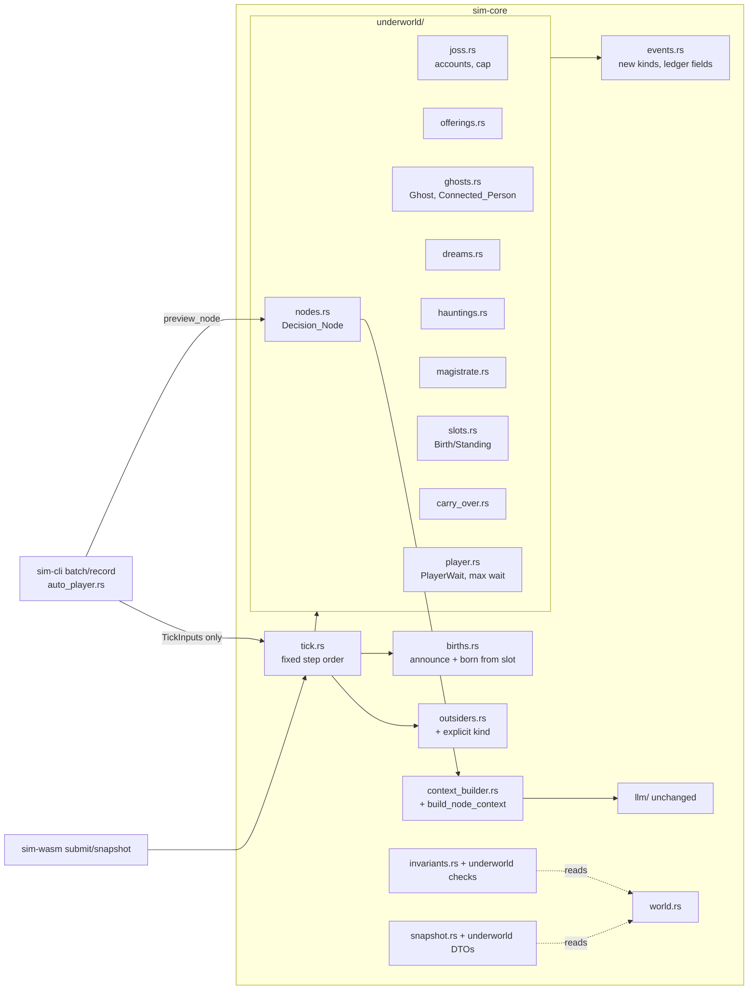

# Design Document: underworld

## Overview

Spec 5 adds a thin underworld to `sim-core` on top of the life-sim model: joss paper balances with a yearly cap, offerings by the living, dreams, hauntings, bribes to one fixed Magistrate, announced Birth_Slots and two Standing_Slots, a bounded Player_Soul wait, a one-trait carry-over, and the Decision_Node convention with two input-triggered families (`dream_interpretation`, `magistrate_ruling`). `sim-cli` gets a seeded Auto_Player and new report fields; the Snapshot shows the new state. There is no model call and no UI change.

The design keeps every life-sim convention: plain structs and functions, integers only with a stated rounding rule for every division, `BTreeMap`/`BTreeSet` in ID order, counter-based streams from `rng::draw`, monotonic IDs, a written tick order, per-tick checksums, and invalid states pushed into the types where it is cheap. Requirements are cited as `R<n>.<m>` (this spec) and `LS-R<n>.<m>` (life-sim).

Three ideas carry most of the design:

1. **The Event_Log is the joss ledger.** Every credit and spend is a field of exactly one Event (`Offering.credited`, `Dream.price`, ...), so a Soul's Joss_Balance must equal a fold over the log. The invariant checker verifies that every tick (R1.2, R1.3).
2. **A node is addressed by the input that fired it.** Both families fire from a player input in step 2 and resolve at the end of step 2 of the same tick (OP-U11). An External_Choice names its node by the trigger input's `seq`, which `Sim::submit` returns, so a caller never has to predict a Node ID (OP-U12).
3. **`Sim::preview_node` is the clef seam.** It returns the Frozen_Context, the option set and the Rules_Default that an input would produce, without changing the run. The later slow-think spec sends that context to the decision model, validates the answer with `validate_raw_choice`, and submits an External_Choice for the same tick. Replays read the choice from the stream and never call a model.

Every open point OP-U2 to OP-U13 and every design choice the steering and requirements leave open has an option block below. Each block marks one option **(Recommended)**. In the design review of 2026-11-12 the Author accepted every recommended option of OP-U1 to OP-U13 and OP-D1 to OP-D8; each block ends with its decision line, and the options stay as written. The Author also accepted that Birth_Slot claims are free, that the Snapshot keeps the `pending_nodes` field, and that all Params are calibrated by the 80-year acceptance batch. The same review changed Requirement 11 (R11.5, R11.9, R11.10, new R11.12); the Auto_Player and batch sections below follow the new text.

Update (Author, 2026-11-15). Task 10.1 stopped under step 6 of the calibration procedure: no offering or price lever produced a Rebuilt_Body claim, and the median Player_Wait credit stayed at 6.5 against the step-4 target of 160 (`docs/kiro-log.md`, "underworld — task 10.1 calibration runs"). Requirements now add R7.11, R11.13, R11.14, R12.4 to R12.6, OP-U14, OP-U15 and the Devoted_Branch, and change R11.9 and R11.12. This design keeps every earlier text and adds dated notes: "Rebuilt_Body scope" below, Kiro's corrections in "Parameters and calibration" and "Auto_Player", the new section "Offering diagnosis (H1–H5)", the gate split, the C1/C2 fault-injection contract, and a revised implementation order.

### Rebuilt_Body scope (Author, 2026-11-15; R7.11, Out of scope)

- In this spec a Rebuilt_Body has no unique benefit. A valid Rebuilt_Body claim creates the same body as a valid Imported_Vessel claim in the same World state would; only the Origin (`rebuilt`), the price (`rebuilt_price`) and the cap accounting (the spend counts against the Yearly_Cap, R2.6) differ (R7.11). `create_outsider(world, soul, origin, price)` already has this shape: the kind is a parameter, and no other field depends on it.
- Carry_Over applies on every exit path (claimed birth, either Standing_Slot, the R8.1 placement) and is not customization.
- Paid customization of part of the rebuilt body is the committed node of spec 6 (steering `structure.md`, "Specs (planned order)", item 6, acceptance targets a to d). Nothing in this spec designs its fields or bounds.
- The Auto_Player keeps its `RebuiltBody` strategy. It exercises the path whenever the balance and the spend cap allow a claim. Coverage of the path is no hard-gate requirement any more: the gate never lists Rebuilt_Body claims (R11.9), and the targeted test of R11.13 proves the path works ("Gate split" in "Auto_Player and batch report").

## Decisions for the Author

### OP-U1: the Magistrate (requirements fixed the role; design fixes the details) [`underworld/magistrate.rs`, `world.rs`]

Representation:
- **A. A separate `Magistrate` struct in `World` (Recommended).** It has a Person ID from the Person counter, a name, a sex, Traits and nothing else: no Soul, no Life, no household, no money. Every existing iteration over `World::persons` stays a Resident/dead-Person iteration, so R15.3 to R15.7 hold by construction. Cost: four lookup sites must accept the Magistrate's ID: `World::append` (actor check), the invariant checker (actor exists), the Context_Builder (people), the Snapshot.
- **B. A `Person` with a third `Life::Office { nominal_age }` variant.** The compiler finds every `match` on `Life`, but `Person.soul` is not optional, so the Magistrate would need a sentinel `SoulId(0)` that no Soul has (an invalid state the types allow).

Fixed details (the Author may change any value; none affects the structure):

| Item | Value | Reason |
|---|---|---|
| Person ID | next Person ID after the opening Residents (`N + 1`), allocated at the end of Opening_World generation | Residents keep IDs `1..=N` (OP-10 of life-sim, R12 tests unchanged) |
| Name | **Orrin Vell**, both words written for this project | "Orrin" is in neither first-name list, so the full name differs from every Resident's by construction (R15.10) |
| Sex | male, fixed | A fixed official reads the same in every seed |
| Nominal age | 600 years | Inside 200..=999 and the card range 0..=999 (R15.2) |
| Traits | `draw_trait(draw(seed, magistrate_id.rng_key(), Traits, Tick(0), i))` for `i` in 0..=6, card trait order | R15.1; the same shared weighted draw as every other body |
| Context Soul ID text | **`S-0000`** (option A); B: `S-9999` | Soul IDs start at 1 and Total_Souls <= 62, so `S-0000` is never a Soul's text (R15.12) |

Decision (Author, 2026-11-12): A, with the fixed details as listed (Orrin Vell, male, 600 years, `S-0000`, no Relations, `wealth` 0).

### OP-U2: Cap_Year and the Yearly_Cap [`underworld/joss.rs`, `params.rs`]

Cap_Year boundaries:
- **A. Calendar years from tick 0: `cap_year = T / 365` (floor) (Recommended).** One index for every Soul; Halloween (OP-U3) is day 0 of every Cap_Year.
- **B. Per Soul, from its latest death.** Fairer to a Soul that dies late in a year, but the cap counters then depend on the Soul's history.

Spend cap scope:
- **A. Hauntings and Rebuilt_Body claims only, as R2.6 requires (Recommended).** Dreams and Bribes are already bounded by price and by their effects.
- **B. Also dreams and Bribes.** Tighter, but the Auto_Player could then fail R11.10 in a year where hauntings used the cap.

Yearly_Cap value: 500 (see Params).

Decision (Author, 2026-11-12): A for the boundaries, A for the spend cap scope; Yearly_Cap 500, calibrated by the acceptance batch.

### OP-U3: offerings [`underworld/offerings.rs`]

Eligible offerers:
- **A. Every Resident aged 12+ with a Relation toward the Ghost whose affinity is at least `offer_min_affinity` (1), on every Offering_Occasion (Recommended).** The life-sim death step keeps living-to-dead Relations, so "how the player treated the living" is exactly those Relations.
- **B. Funeral and Halloween as A; anniversaries kin only** (a Kinship_Tag toward the Ghost). Fewer events, more family flavour.

Halloween:
- **A. `T % 365 == 0`: tick 0 is Halloween, the night of the clerical error (Recommended).**
- **B. Day 303 of a year that starts on 1 January at tick 0.**

"Household money" in the formula:
- **A. The offerer's own balance (Recommended).** Money is personal under life-sim OP-1 A.
- **B. The sum over the offerer's Household.**

Offering for a Ghost whose Soul has left the Waiting_Queue:
- **A. None: the dead Person is no longer a Ghost, so it has no Offering_Occasion (Recommended).** Matches "one soul, one place" and R1.4.
- **B. The offering Event is appended with `credited = 0`.** More log entries, no gain.

The formula (decided by requirements to cost no money, R2.8) is in Params.

Decision (Author, 2026-11-12): A for all four choices (eligible offerers, Halloween, the offerer's own balance, no offering for a reborn Soul's body).

### OP-U4: Connected_Person and the acting Ghost [`underworld/ghosts.rs`]

Connection rule:
- **A. A Resident with any Relation toward the Ghost (Recommended).** Includes rivals, so a grudge can continue as a haunting.
- **B. Only a Resident with a Kinship_Tag toward the Ghost.**
- **C. A Resident whose `|affinity|` toward the Ghost is at least 20.**

Which Ghost acts for the Player_Soul when it has several dead bodies (each is a Ghost by the Glossary):
- **A. The latest body: the dead Person with the Player_Soul's Soul ID and the highest death tick (ties: higher Person ID) (Recommended).** It is stored in `PlayerWait::ghost`.
- **B. Any of them; a dream or haunting names the Ghost.** More payload, more rules.

Offerings go to every Ghost of a Soul either way (R2.1 quantifies over Ghosts).

Decision (Author, 2026-11-12): A for the connection rule, A for the acting Ghost.

### OP-U5: prices, the haunting effect, rate limits [`underworld/dreams.rs`, `underworld/hauntings.rs`]

Prices: dream 20, haunting 40 (Params). The haunting Mood delta is -15 for the target, applied through the `haunting` row of `mood_delta` (LS-R14.2), so Mood still changes only through an Event.

Haunting `magnitude` (card intensity 1..=100):
- **A. A fixed intensity of 50 (Recommended).**
- **B. The price, clamped to 1..=100.**

Rate limits:
- **A. At most one applied dream and one applied haunting per tick (Recommended).** A second one in the same tick is rejected `rate_limited`.
- **B. At most one dream per dreamer and one haunting per target per 30 days.**
- **C. None beyond price and cap.**

Decision (Author, 2026-11-12): A for the haunting `magnitude`, A for the rate limits; prices as listed, calibrated by the acceptance batch.

### OP-U6: what the magistrate grants [`underworld/slots.rs`, `underworld/magistrate.rs`]

- **A. Register_Wait access (Recommended).** After each death the Player_Soul may claim a Birth_Slot only from `access_from = death tick + register_wait` (365 days). `grant_next_slot` sets `access_from = min(access_from, T)`; `grant_later_slot` sets `access_from = min(access_from, T + grant_later_delay)` (120 days). A claim before `access_from` is rejected `register_wait`. The Standing_Slots are never restricted, so the player always has a paid way out.
- **B. Queue rank.** The Player_Soul may claim the k-th open slot only if fewer than k non-player Souls waited longer; grants raise the rank. Closer to "fifth in the queue", harder to show and test.
- **C. Reserved slot.** A grant auto-claims the next (or the second next) announced Birth_Slot. Without another restriction, Birth_Slots are open to the player anyway, so the Magistrate matters little.

Clamp (R3.10): `access_from` never moves later and never earlier than the ruling tick.

Decision (Author, 2026-11-12): A.

### OP-U7: Birth_Slot lifecycle [`underworld/slots.rs`, `births.rs`]

Announcement lead time `birth_lead_days`:
- **A. 180 days (Recommended).** Visible long enough to plan; adds at most 180 days to an NPC Soul's wait.
- **B. 90 days.** Less wait pressure, shorter planning window.
- **C. 280 days.** Realistic pregnancy; adds the most wait pressure (more NPC releases).

Mother dies before the birth tick: the slot closes in her death tick with no birth, and a claim on it is released (no alternative keeps a valid parent; listed for completeness).

Claims:
- **A. Final: a claim stays until the birth or the automatic placement of R8.1 (Recommended).** Fewest states.
- **B. A new valid claim replaces the old one.**
- **C. A separate `WithdrawClaim` input.**

Decision (Author, 2026-11-12): A for the lead time, A for claims; Birth_Slot claims are free.

### OP-U8: Standing_Slot prices and rebirth bookkeeping [`underworld/slots.rs`]

Prices: Imported_Vessel 100, Rebuilt_Body 400 (Rebuilt <= Yearly_Cap so that it can be bought at all under R2.6).

Automatic placement (R8.1) when the balance is low:
- **A. Free: no spend, the `possession` Event has `price = 0` (Recommended).**
- **B. Spend `min(balance, imported_price)`.**

Joss_Balance left at rebirth:
- **A. Kept, unchanged while the Soul is in a body (R1.4: no credits), usable after the next death (Recommended).** Needs no forfeit Event.
- **B. Forfeited.** Needs an Event to carry the spend (R1.2); the card set has no fitting type except an offering to the Magistrate.

Decision (Author, 2026-11-12): A for the automatic placement, A for the balance at rebirth; prices as listed, calibrated by the acceptance batch.

### OP-U9: carry-over [`underworld/carry_over.rs`]

Rule:
- **A. Copy: the chosen Trait of the new body takes the previous body's value (Recommended).** One visible, explainable change.
- **B. Nudge: move the new body's value one step toward the previous value.**

Fallback with no valid Carry_Over input (R9.5):
- **A. No carry-over: all seven Traits as the body has them (Recommended).**
- **B. Carry the previous body's Trait with the largest `|value|`, ties in card trait order.**

Input:
- **A. A separate `CarryOver { trait_name }` input stored in `PlayerWait::carry_over`; a later valid input replaces it (Recommended).** Works for the automatic placement too, where there is no claim.
- **B. A field of the slot-claim input.** The automatic placement then always uses the fallback.

Decision (Author, 2026-11-12): A for the rule, A for the fallback, A for the input.

### OP-U10: Player_Max_Wait [`params.rs`]

- **A. Equal to Max_Wait, 1,095 days (Recommended).**
- **B. Separate, 730 days.** Shorter afterlife, fewer bribes and dreams per wait.

Decision (Author, 2026-11-12): A.

### OP-U11: `dream_interpretation` options, effects and defaults [`underworld/dreams.rs`]

Fixed by the Author: both families resolve in the tick they fire; an External_Choice applies on the firing tick; R3.11 stays as the fallback.

Option sets (always three, in this order):

| Intent | Reads as the intent states | Offering option | Dismisses |
|---|---|---|---|
| `warn` | `heed_warning` | `burn_offering` | `dismiss_dream` |
| `reassure` | `take_comfort` | `burn_offering` | `dismiss_dream` |
| `urge` | `follow_urging` | `burn_offering` | `dismiss_dream` |
| `reveal` | `believe_revelation` | `burn_offering` | `dismiss_dream` |
| `forbid` | `obey_ban` | `burn_offering` | `dismiss_dream` |
| `request_offering` | `burn_offering` (reads as intent) | `burn_small` | `dismiss_dream` |

Effects (R3.10 bounds in brackets):

| Option | Effect |
|---|---|
| heed / comfort / follow / believe / obey | dreamer-to-Ghost Relation: affinity +6, trust +4 [each <= +10] |
| `burn_offering` | one Offering from the dreamer to the Ghost of `max(1, offering_amount(dreamer, ghost, factor 1))`, credited as R2.2/R2.4 [<= 500]; affinity +3 |
| `burn_small` | one Offering of `max(1, offering_amount(..) / 3)` (floor) [<= 500]; affinity +1 |
| `dismiss_dream` | nothing |

Dream effects touch no Mood: Mood changes only through an Event that lists the Resident with a fixed delta (LS-R14.3), and the `dream` Event is appended at firing, before the option is known. Affinity changes without an Event already exist (relation decay), and R4.7 allows exactly the state the option names.

Rules_Default noise:
- **A. A seeded noise term per node (Recommended).** `noise = in_range(draw(seed, EntityId(node_id), Nodes, T, 0), -10, 10)`; the same personality usually gives the same reading, borderline cases vary.
- **B. No noise.** Fully trait-determined; identical situations always read the same.

The formula is in "Rules_Default formulas".

Decision (Author, 2026-11-12): A for the noise; option sets and effects as in the tables.

### OP-U12: input payloads, node addressing, option encoding, Auto_Player [`input.rs`, `underworld/nodes.rs`, `sim-cli/src/auto_player.rs`]

How an External_Choice names its node (the Node ID is assigned inside step 2, after submission):
- **A. By the trigger input: `NodeRef::Trigger { seq }`, the `seq` that `Sim::submit` returned for the dream or Bribe input of the same tick (Recommended).** Deterministic, recorded in the replay file, and robust when an earlier input in the tick is rejected. `NodeRef` is an enum so a later spec can add `NodeRef::Node(NodeId)` for rule-fired nodes that resolve on a later tick.
- **B. By a predicted Node ID: the caller reads `World::next_node_id()` and counts node-firing inputs before its own.** Breaks when an earlier input in the same tick is rejected (no ID is consumed), which the caller cannot know before the tick runs.
- (Two-tick resolution with the Node ID read from the Snapshot is excluded by the Author's OP-U11 default.)

Option encoding in the External_Choice:
- **A. A closed enum `NodeOption` of every option ID of both families, serialized as its snake_case ID (Recommended).** `InputPayload` stays `Copy`; an ID outside the node's set is a valid value that is rejected `option_not_in_set` (R3.4).
- **B. An option index `u8`.** Does not name the ID that `validate_raw_choice` returns.
- **C. A `String`.** Makes `InputPayload` non-`Copy` throughout `sim-core`, `sim-cli` and `sim-wasm`.

Auto_Player policy:
- **A. A per-wait plan with one fixed strategy per Player_Wait (Recommended),** as in "Auto_Player". It is greedy within the plan and meets R11.10 and R11.12.
- **B. Independent random inputs each waiting tick.** Simpler, cannot guarantee R11.10.

Decision (Author, 2026-11-12): A for node addressing, A for option encoding, A for the Auto_Player policy. Requirement 11 now uses the Bribe condition this design suggested (R11.10), so policy A meets it with no exception; the strategy is rotated over the Player_Waits so that every slot kind is exercised (R11.12, see "Auto_Player").

Note (Author, 2026-11-15): the rotation stays, but R11.12 now asks only that the counts on the OP-U14 list are non-zero, and that list never contains Rebuilt_Body claims. A `RebuiltBody` wait that ends without a Rebuilt claim is no failure. The Devoted_Branch strategy and budget of R11.14 are set in "Offering diagnosis (H1–H5)", H4.

### OP-U13: births under announced slots [`births.rs`]

Which mothers roll an announcement:
- **A. Female Residents aged 18..=45 without an open slot, while the number of waiting Souls (the Player_Soul included) exceeds the number of open Birth_Slots (Recommended).** Slots track the souls that need bodies, and a waiting Player_Soul can cause births.
- **B. As today: while a non-player Soul waits.** A Player_Soul waiting alone would never see a Birth_Slot.
- **C. Always.** More slots with no Soul at the birth tick (R7.5, LS-R10.2).

Re-calibration: see "Parameters and calibration".

Decision (Author, 2026-11-12): A.

### OP-U14: the zero-count list and the Devoted_Branch thresholds (Author, 2026-11-15) [`sim-cli/src/batch.rs`]

Open. The Author picks, after the offering diagnosis ("Offering diagnosis (H1–H5)"), which counts of R11.5 go on the zero-count list of R11.9 and R11.12, and the thresholds, if any, for the R11.14 Devoted_Branch figures. Fixed now: Rebuilt_Body claims are never on the list (R11.9); R8.1 placements never count as Imported_Vessel claims; the list is not assumed to require that the passive Auto_Player affords an Imported_Vessel or a haunting. Until the decision the design names no list (see "Gate split").

Decision (Author, 2026-11-15, after the 9.5 diagnosis): three duties, as in the requirements (OP-U14 note, R11.9 and R11.12 notes, R11.14 to R11.17).
- **Passive batch:** gates determinism, the invariants (R12.1) and the LS-R17 targets (R11.7) only. It has no zero-count list; every underworld count of the passive run is report-only.
- **Functional acceptance:** targeted tests, one per path: Rebuilt_Body (R11.13, task 6.16, exists), haunting, Imported_Vessel claim and Birth_Slot claim (R11.15).
- **Reachability acceptance:** the Devoted_Branch gate (R11.16) with `DEVOTED_ZERO_COUNT_LIST`, which includes `rebuilt_claims` and `imported_claims` and counts applied inputs only. Affordability is reported as candidates, apart from applied counts (R11.17). The R11.14 figures stay report-only with no thresholds.

The concrete gates are in "Gate split (decided)". The sentence above "Rebuilt_Body claims are never on the list" stays true for the passive run, which now has no list at all; it does not apply to the Devoted list.

### OP-U15: the offering mechanism (Author, 2026-11-15) [`underworld/offerings.rs`, `social.rs`, `params.rs`]

Open. The offering formula and life-sim relation decay stay unchanged for now. Candidates, chosen or combined by the Author after the diagnosis:
- **M-A. Kin decay floor.** Decay stops at a positive floor for Relations with a Kinship_Tag.
- **M-B. Slower or asymmetric decay.** For example one point per 90 days, or decay only above a value.
- **M-C. Kin duty base.** The offering formula adds a base amount for an offerer with a Kinship_Tag toward the Ghost, independent of affinity.

No option is recommended before the diagnosis; H1 to H5 are designed to tell them apart (H1 and H2 bear on M-A and M-B, H3b and H5 on M-C).

Decision (Author, 2026-11-15, after the 9.5 diagnosis): none of M-A, M-B or M-C is chosen. R2 is unchanged and every Params value is unchanged: zero or negative affinity gives no Offering, positive affinity and the other R2.1 terms set the amount, there is no kin minimum, and no price or formula changes. Basis: positive kin Relations first reach zero after a median 3.66 years (passive) against `initial / 12` = 4.17 years, and all ten unattributed-change files are empty, so decay works as written; the Devoted_Branch showed that a player who tends relations is paid (total credit 2,225, no zero-credit wait). Whether decay is too fast for play is observed in spec 6 (first playable), not tuned here.

### OP-D1: module layout [`crates/sim-core/src/underworld/`]

- **A. A directory module `underworld/` (Recommended)**, mirroring `llm/`: one file per mechanic, one `mod.rs` that owns the step functions called from `tick.rs`.
- **B. Flat files in `src/`.** Matches life-sim's layout, but adds ten files at the top level.

Decision (Author, 2026-11-12): A.

### OP-D2: node family representation [`underworld/nodes.rs`]

- **A. `enum NodeFamily` plus `match` in a few functions (`options`, `rules_default`, `apply`) (Recommended).** Two families, no dynamic dispatch, exhaustive matches show every site a new family must fill.
- **B. A `trait DecisionFamily` with one impl per family.** Extensible by addition, but trait objects in World state need boxing and a manual `Canon`/`Clone`/`Eq`.

Decision (Author, 2026-11-12): A.

### OP-D3: where credits and spends are recorded [`events.rs`]

- **A. In the Event fields (Recommended).** `Offering.credited`, `Dream.price`, `Haunting.price`, `BribeOffering.amount`, `Possession.price`, `Rebuild.price`. The log is the ledger; R1.2 and R1.3 become one fold.
- **B. A separate per-tick ledger in World.** The log stays card-shaped, but the checker must trust a second record.

Decision (Author, 2026-11-12): A.

### OP-D4: versions [`canon.rs`, `replay.rs`]

- **A. `CANON_VERSION` 2 to 3 and `REPLAY_VERSION` 3 to 4 (Recommended),** as the Author chose for life-sim (canonical layout and payloads both change).
- **B. `CANON_VERSION` only; replay v3 files keep parsing** (their checksums would not match anyway).

Decision (Author, 2026-11-12): A.

### OP-D5: events in node contexts [`context_builder.rs`]

- **A. A `focus` set: the last 12 Events listing the subject or the node's Ghost (Recommended).** A `magistrate_ruling` context then shows the Ghost's death, the bribe and the appeal, like the dev cards, instead of the Magistrate's appeals from all earlier waits.
- **B. Subject only, as `build_decision_context` does today.**

Decision (Author, 2026-11-12): A.

### OP-D6: the Parity_Fixture with an External_Choice (R14.6) [`scripts/regen-fixtures.sh`]

The Player_Soul rarely dies within the 2,000 ticks of the existing fixtures.
- **A. A fourth fixture `seedU-underworld` (Recommended).** The seed is the one with the earliest Player_Soul death found by a one-off `batch --seeds 1..=200 --ticks 7300` (the report lists death ticks); ticks = that death tick + 400, Auto_Player inputs. The seed and tick count are written into `regen-fixtures.sh` and the search is recorded in `docs/kiro-log.md`.
- **B. A 29,200-tick fixture of seed 1.** No search, but about 600 KB and 3 s of WASM parity per run.

Decision (Author, 2026-11-12): A.

### OP-D7: making the player die in property tests [`params.rs`, `tests/life_gen`]

- **A. A Params field `mortality_floor_ppm` (default 0) and `Params::stress_underworld()` (Recommended).** The floor of 4,000 ppm makes most Player_Souls die within about 250 ticks; it is an ordinary rate, so no code path is test-only.
- **B. A test-support `World::force_death(person)` hook.** Exact, but bypasses the mortality step.

Decision (Author, 2026-11-12): A.

### OP-D8: Auto_Player in `batch` and `record` [`sim-cli`]

- **A. Always on in `batch`; `record --auto-player` opt-in (Recommended).** The gates exercise the underworld without a flag; the existing three fixtures stay random-input only.
- **B. A `--auto-player` flag for both.** The gate command lines change.

Decision (Author, 2026-11-12): A.

## Architecture



### Module layout

| File | Status | Content |
|---|---|---|
| `underworld/mod.rs` | new | Step functions called by `tick.rs`; re-exports. |
| `underworld/joss.rs` | new | `JossAccount`, `credit`, `spend`, `capped_spend_allowed`, `cap_year`. |
| `underworld/ghosts.rs` | new | `ghosts(world) -> Vec<(PersonId, SoulId)>`, `is_connected(world, resident, ghost)`, `connected(world, ghost) -> Vec<PersonId>`. |
| `underworld/offerings.rs` | new | Step 5: occasions, eligibility, `offering_amount`, `append_offering`. |
| `underworld/dreams.rs` | new | Dream input, option sets, `dream_default`, effects. |
| `underworld/hauntings.rs` | new | Haunt input and effect. |
| `underworld/magistrate.rs` | new | `Magistrate`, generation, Bribe input, `magistrate_default`, grant effects, card rendering. |
| `underworld/slots.rs` | new | `BirthSlot`, `StandingKind`, claims, closing slots at a mother's death. |
| `underworld/carry_over.rs` | new | `TraitName`, `apply_carry_over`. |
| `underworld/player.rs` | new | `PlayerWait`, start of a wait at death, Player_Max_Wait placement. |
| `underworld/nodes.rs` | new | `NodeId`, `NodeFamily`, `NodeOption`, `NodeRef`, `PendingNode`, `NodeRecord`, `fire`, `attach_choice`, `resolve_pending`, `NodeSpec`, `Sim::preview_node`. |
| `events.rs` | changed | Kinds `Offering`, `BribeOffering`, `Dream`, `Haunting`, `Appeal`; `price` on `Possession`/`Rebuild`; `is_afterlife` extended; `mood_delta` haunting row. |
| `world.rs` | changed | New fields (Data Models); `append` accepts the Magistrate as second actor of `appeal`/`offering` only. |
| `input.rs` | changed | New payloads and reject reasons. |
| `tick.rs` | changed | Revised step order; `World::step_with_outcomes`, `Sim::last_outcomes`. |
| `births.rs` | changed | Announcement instead of an immediate birth; `bear_from_slot`. |
| `outsiders.rs` | changed | `create_outsider(world, soul, origin, price)` shared by NPC releases, Standing_Slot claims and R8.1. |
| `death.rs` | changed | Calls `slots::close_for_mother` and `player::start_wait`. |
| `opening.rs` | changed | Creates the Magistrate and one `JossAccount` per Soul. |
| `params.rs` | changed | New fields, `mortality_floor_ppm`, `stress_underworld()`. |
| `rng.rs` | changed | New permanent tags `Nodes = 15`, `Offerings = 16`, `AutoPlayer = 17` (tooling only, like `ToolingInputs`). |
| `context_builder.rs` | changed | `build_node_context` with a focus set and a Magistrate-capable subject; `build_decision_context` keeps its behaviour. |
| `snapshot.rs`, `invariants.rs`, `replay.rs`, `canon.rs`, `testing.rs` | changed | See sections below. |
| `llm/` | **unchanged** | R14.4; the builder still only constructs `llm` values. |

`sim-cli`: new `auto_player.rs`; `batch.rs` (report, zero-count check), `commands.rs` (`record --auto-player`), `args.rs`. `sim-wasm`: no new export; `submit` accepts the new payload JSON, `snapshot()` returns the extended JSON.

### The tick (revised, LS-R16.2)

`World::step(inputs)` for tick `T`:

1. **Reset flows** (money) as before.
2. **Apply inputs** in `(tick, seq)` order (2a), then **resolve nodes** (2b).
   - 2a. Each payload is validated and applied: `Act` (life-sim), `Dream` (spend, `dream` Event, fire node), `Haunt` (spend, `haunting` Event), `Bribe` (spend, `offering` to the Magistrate, `appeal`, fire node), `ClaimSlot` (Birth: record the claim; Standing: spend, leave the queue, outsider body, carry-over), `CarryOver` (store), `Choose` (attach to a pending node). Invalid inputs are recorded in `rejections`.
   - 2b. Every pending node resolves in Node ID order: the attached External_Choice or the Rules_Default is applied, clamped and recorded (R3.3 to R3.6, R3.11). After 2b no node is pending.
3. **Releases.** NPC outsider releases as before (LS-R11.1), then the Player_Soul placement of R8.1 if its wait exceeds Player_Max_Wait. Running after step 2 lets a claim in the same tick win over the forced placement.
4. **Deaths** as before. Additionally, in the settlement of each death: open Birth_Slots of the dying mother close and a claim on them is released; if the dead Person holds the Player_Soul, `player::start_wait` creates `PlayerWait`.
5. **Offerings** (new). For every Ghost in Person ID order whose Offering_Occasion is today, every eligible offerer in Person ID order: one amount, an `offering` Event if it is at least 1, the credit. The funeral is the death tick, so deaths in step 4 get their funeral offerings in step 5 of the same tick.
6. **Births from slots** (new). Every open Birth_Slot with `birth == T`, in slot ID order: claimed, the newborn holds the Player_Soul and the carry-over applies; unclaimed, the longest-waiting non-player Soul (LS-R10.1, OP-3 A), or no newborn if none waits (LS-R10.2). The slot closes either way.
7. **Birth announcements** (was step 5). Candidate mothers and the gate of OP-U13; a successful roll opens a Birth_Slot with `birth = T + birth_lead_days`.
8. to 12. **Marriage, loans, repayments, social events, economy, relation decay** as life-sim steps 6 to 11.
13. **Advance** `tick` to `T + 1`.
14. **Checksum.**

Why this order: inputs first, so the player acts on the state the Snapshot showed; nodes resolve inside step 2 so that External_Choices later in the same tick count; the forced placement comes after inputs so a claim wins; offerings follow deaths so funerals happen on the death day; births from slots run before announcements so a mother who gives birth today can be announced again tomorrow, not today.

## Components and Interfaces

### Decision_Node convention (`underworld/nodes.rs`, R3)

```rust
pub struct NodeId(pub u64);                   // dedicated counter, starts at 1 (R3.1)
pub enum NodeFamily { DreamInterpretation, MagistrateRuling }
pub enum NodeOption {                          // closed set, snake_case IDs (OP-U12 A)
    HeedWarning, TakeComfort, FollowUrging, BelieveRevelation, ObeyBan,
    BurnOffering, BurnSmall, DismissDream,
    GrantNextSlot, GrantLaterSlot, Deny,
}
pub enum NodeRef { Trigger { seq: InputSeq } } // the firing input of the same tick
pub enum ChoiceSource { External, RulesDefault }

pub struct PendingNode {
    pub id: NodeId, pub trigger: InputSeq, pub family: NodeFamily,
    pub subject: PersonId,                     // dreamer or Magistrate
    pub ghost: PersonId,                       // the acting Ghost
    pub options: Vec<NodeOption>,              // 2..=5, distinct, in context order
    pub rules_default: NodeOption,             // one of `options`
    pub context: FrozenContext,                // frozen at firing, never mutated (R3.8)
    pub external: Option<NodeOption>,          // at most one valid choice (R3.4)
    pub params: NodeParams,                    // Dream { intent } | Ruling { amount }
}
pub struct NodeRecord {                        // R3.6, in the Checksum
    pub id: NodeId, pub tick: Tick, pub family: NodeFamily, pub subject: PersonId,
    pub applied: NodeOption, pub source: ChoiceSource, pub rules_default: NodeOption,
}
pub struct Nodes { pub ids: IdCounter, pub pending: BTreeMap<NodeId, PendingNode>,
                   pub resolved: Vec<NodeRecord> }

/// What a caller (Auto_Player, later the clef bridge) sees before submitting.
pub struct NodeSpec { pub family: NodeFamily, pub trigger: InputSeq, pub context: FrozenContext,
                      pub options: Vec<NodeOption>, pub rules_default: NodeOption }

impl Sim {
    /// Clones the World, applies step 1 and step 2a for the inputs already submitted for
    /// the current tick, then `payload` with the next `seq`; returns the node it fires.
    /// The run is unchanged.
    pub fn preview_node(&self, payload: InputPayload) -> Result<NodeSpec, PreviewError>;
}
```

Life cycle, all inside one tick (R3.1 to R3.8, OP-U11):

1. **Fire** (`nodes::fire`, from the dream or Bribe handler, after that input's spend and Events). Take the next Node ID; build the option list (family table); build the Frozen_Context with `build_node_context` from the World at this point of step 2a; compute the Rules_Default from that context and the node's noise draw; insert a `PendingNode`.
2. **Attach** (`Choose { node: NodeRef::Trigger { seq }, option }`). Reject `unknown_node` if no pending node has that trigger in this tick (this covers resolved nodes, which are never pending in a later tick), `option_not_in_set` if `option` is not in the node's `options`, `already_chosen` if a valid choice is attached. Otherwise store it.
3. **Resolve** (`nodes::resolve_pending`, step 2b). In Node ID order: `applied = external.unwrap_or(rules_default)`; apply the family effect through `clamp_effect`; push the `NodeRecord`; remove the pending entry.
4. **Partial effects** (R3.11). Every effect part re-checks its state at resolution (the dreamer is a Resident; the Relation exists; the Ghost is still a Ghost; the Player_Soul still waits). A failed part is skipped, the rest applies, the record is written. With same-tick resolution only inputs earlier in step 2a can change that state (for example a Standing_Slot claim after a Bribe in the same tick, R6.7).

`clamp_effect` (R3.10) bounds every number the effect writes: affinity and trust deltas to the bracketed bounds of OP-U11 and then to -100..=100; offering amounts to 1..=500; `access_from` to `T..=current access_from`. The pure part of the convention (`options`, `rules_default`, `clamp_effect`, `validate` via `validate_raw_choice`) takes only the Frozen_Context and the noise draw, so the slow-think spec can call it unchanged.

**Seam for the decision model (no model call here).** The later bridge calls `preview_node(payload)`, renders `spec.context` with System_One_Mapping_v1, sends it to clef, runs `validate_raw_choice(&options_of(&spec.context), raw)`, and on a `Decision` submits the payload and then `Choose { node: Trigger { seq }, option }` for the same tick. On timeout or an `Illegal` verdict it submits nothing and the Rules_Default applies. The result is recorded as an ordinary TickInput, so replays never call a model (R14.2). The preview equals the real firing as long as no other input is submitted for that tick in between; if one is, the real node's context differs but its option set is the same fixed table, so the choice is still legal or rejected, never misapplied.

### Rules_Default formulas

Integer arithmetic only. `floor_div(a, b)` is `i64::div_euclid` (rounds toward minus infinity); all other divisions are on non-negative values and round down.

**`dream_default(ctx, noise)`** reads from the Frozen_Context only: the subject's traits, the subject's Relation toward the Ghost (the dead actor of the context's last `dream` Event; affinity 0 if absent) and `player_input.intent`.

```
b = 20*piety + floor_div(affinity, 4) + 5*warmth + noise          noise in -10..=10
score(as_intent) = b                       (for request_offering, burn_offering is as_intent)
score(burn_offering) = b + 10*piety - 10 + (20 if intent == request_offering)
score(burn_small)    = b + 10*greed - 5
score(dismiss_dream) = 0
```

The option with the highest score wins; ties go to the earlier option in the context's option order. Agreement with the dev cards, checked by `dream_default_agrees_with_dev_cards` for every noise value:

| Card | Facts | Scores | Default | Card grade |
|---|---|---|---|---|
| D-dream_interpretation-001 | warn, piety +2, warmth +1, affinity 75 | heed 63, offering 73, dismiss 0 (±10) | `burn_offering` | acceptable |
| D-dream_interpretation-002 | warn, piety -3, warmth +1, affinity 75 | heed -37, offering -77, dismiss 0 (±10) | `dismiss_dream` | acceptable |
| D-dream_interpretation-003 | request_offering, piety +1, warmth +2, affinity 70 | offering 67, small 42, dismiss 0 (±10) | `burn_offering` | acceptable |

The test maps the cards' option IDs to roles (`ignore_dream` to dismiss; `read_as_blessing`, `sell_house` to no role, never chosen).

**`magistrate_default(amount, traits, noise_next, noise_later)`**, with `amount` the `magnitude` of the context's `offering` Event from the Ghost to the Magistrate at the context tick (0 if absent):

```
v        = amount * (4 + greed)                                   4 + greed in 1..=7, u64 saturating
next_at  = 800 + 100*loyalty + noise_next                         noise_next in -100..=100, so 400..=1200
later_at = 200 +  40*loyalty + noise_later                        noise_later in -40..=40, so 40..=360
default  = grant_next_slot if v >= next_at, else grant_later_slot if v >= later_at, else deny
```

`next_at > later_at` always holds and neither depends on `amount`, and `v` is non-decreasing in `amount`, so R6.5 holds. Dev pair P006: card a (greed +3, 300 joss paper) gives `v = 2100 >= 1200`, `grant_next_slot` (expected a); card b (no offering) gives `v = 0`, `deny` (inside expected b). Noise draws: `draw(seed, EntityId(node_id), Nodes, T, 1)` and `(.., 2)`.

### Contexts and LS-R15 (`context_builder.rs`)

```rust
pub fn build_node_context(world: &World, subject: PersonId, focus: &[PersonId], family: Family,
    options: Vec<OptionDef>, situation: String, player_input: Option<PlayerInput>)
    -> Result<FrozenContext, BuildError>;
```

It is `build_decision_context` with three changes: the subject may be a Resident or the Magistrate (`BuildError::DeadSubject` still refuses a dead subject); step 2 takes the last 12 Events that list any `focus` Person (OP-D5 A); people and Events are resolved through `card_person_any(world, id)`, which renders the Magistrate with `origin: "official"`, `alive: true`, `age: 600`, `wealth: 0`, `soul_id: "S-0000"`, its Traits and its name (R15.12). `build_decision_context(..)` becomes `build_node_context(.., &[subject], .., None)`, so the life-sim test node is unchanged.

| | `dream_interpretation` | `magistrate_ruling` |
|---|---|---|
| subject | dreamer (Resident) | Magistrate |
| focus | dreamer, Ghost | Magistrate, Ghost |
| events include | the `dream` Event, the Ghost's `death`, offerings | the Ghost's `death`, the bribe `offering`, the `appeal` |
| `player_input` | `{ intent, content }` | none |
| situation (fixed template, <= 80 words) | `"{dreamer} is {age} years old. {ghost} died on day {death}. Tonight, day {T}, {dreamer} dreamed of {ghost}."` | `"{ghost} died on day {death}. The register lets {ghost} claim a newborn slot from day {access_from}. {ghost} burned {amount} joss paper for the magistrate and appeals for an earlier slot. The rules let the magistrate open the register now, open it on day {T + 120}, or deny."` |

Dream content texts (fixed template plus names, R4.4): `warn` "{ghost} stands at the foot of the bed and slowly shakes their head."; `reassure` "{ghost} sits by the window, calm, and smiles."; `urge` "{ghost} points at the door and beckons, again and again."; `reveal` "{ghost} opens an old ledger and taps one line."; `request_offering` "{ghost} sits beside an empty brazier in a thin coat, shivering."; `forbid` "{ghost} stands in the doorway with arms crossed." Option labels are fixed English text per option ID (for example `heed_warning` "Take the warning seriously and act on it", `grant_later_slot` "Open the register to {ghost} on day {T + 120}").

Why the contexts pass LS-R15.1 to LS-R15.7 unchanged: the Ghost is a dead Person rendered as life-sim already does (age at death, `wealth` 0); the Magistrate's values are inside the card ranges (`age` 0..=999, origin in the card list, Soul ID `S-` plus 4 digits, distinct from every Soul); there is no Relation from or to the Magistrate, so the relation block has none; `dream`, `offering`, `appeal` and `haunting` are card event types and Afterlife_Event_Types, so a dead Ghost as actor is legal in the card format; the event IDs are still context-local `e1..eN`; `player_input.intent` is one of the six card intents and `content` is non-empty. Property 7 checks round-trip, rendering for every permutation and `validate_raw_choice` on generated node contexts.

### Inputs (`input.rs`, OP-U12)

```rust
pub enum DreamIntent { Warn, Reassure, Urge, Reveal, RequestOffering, Forbid }
pub enum TraitName { Greed, Loyalty, Pride, Warmth, Temper, Vindictiveness, Piety } // card order
pub enum SlotRef { Birth(BirthSlotId), ImportedVessel, RebuiltBody }
pub enum InputPayload {
    Act { kind: SocialKind, actor: PersonId, target: PersonId, intensity: u8 },
    Dream { dreamer: PersonId, intent: DreamIntent },
    Haunt { target: PersonId },
    Bribe { amount: u64 },
    ClaimSlot { slot: SlotRef },
    CarryOver { trait_name: TraitName },
    Choose { node: NodeRef, option: NodeOption },
}
```

`DreamIntent` and `TraitName` are typed, so R4.2 and the "value outside the seven Traits" part of R9.2 hold by construction: such a payload fails to parse (`ReplayError::Malformed`, a WASM `JsError`) and never reaches the World. All other conditions are rejections at apply time, checked in the order listed:

| Payload | Checks (first failure wins) |
|---|---|
| any Person field | `official_person` if it names the Magistrate (R15.9), before any other check |
| `Dream` | `no_ghost`, `not_waiting`, `unknown_person`, `dead_person`, `not_connected`, `rate_limited`, `insufficient_joss` |
| `Haunt` | `no_ghost`, `not_waiting`, `unknown_person`, `dead_person`, `not_connected`, `rate_limited`, `insufficient_joss`, `yearly_cap` |
| `Bribe` | `no_ghost`, `not_waiting`, `bad_amount` (0), `insufficient_joss` (above balance), `node_pending` |
| `ClaimSlot` | `no_ghost`, `not_waiting`; Birth: `slot_closed`, `slot_claimed` (already the player's), `claim_held` (the player holds another claim, R7.3), `register_wait` (OP-U6); Standing: `insufficient_joss`, `yearly_cap` (Rebuilt only) |
| `CarryOver` | `no_ghost`, `not_waiting` |
| `Choose` | `unknown_node`, `option_not_in_set`, `already_chosen` |

"No Ghost" and "not waiting" differ only after a rebirth: before the first death the Player_Soul has no Ghost; after a rebirth it has dead bodies but is not waiting. `RejectReason` gains these 15 variants with the labels shown; `label()`, `Canon` tags (5..=19) and the batch report list extend in this order. `id_exhausted` stays for counter exhaustion.

**Input outcomes (for the batch report, R11.5).** `Rejections` keeps only counts per reason and the last rejection, which cannot tell an applied `CarryOver` or `ClaimSlot` from a rejected one when several inputs share a reason. `World::step` therefore also returns the outcome of every input of the tick: `World::step_with_outcomes(inputs) -> (Checksum, Vec<InputOutcome>)` with `InputOutcome { seq: InputSeq, result: Result<(), RejectReason> }` in `(tick, seq)` order; `World::step` keeps its signature and drops the vector. `Sim::step` stores the vector of the last step, readable through `Sim::last_outcomes()`. The vector is a return value, not World state: it is never encoded, never checksummed, and empty after loading a run, so R16.5 (life-sim) and the Checksum are unchanged.

Replay JSON (format version 4), one example per kind:

```json
{"tick":"812","seq":"64","payload":{"Dream":{"dreamer":"17","intent":"warn"}}}
{"tick":"812","seq":"65","payload":{"Choose":{"node":{"Trigger":{"seq":"64"}},"option":"heed_warning"}}}
{"tick":"813","seq":"66","payload":{"Bribe":{"amount":"120"}}}
{"tick":"813","seq":"67","payload":{"ClaimSlot":{"slot":{"Birth":"3"}}}}
{"tick":"813","seq":"68","payload":{"ClaimSlot":{"slot":"ImportedVessel"}}}
{"tick":"814","seq":"69","payload":{"CarryOver":{"trait_name":"piety"}}}
{"tick":"814","seq":"70","payload":{"Haunt":{"target":"9"}}}
```

`u64` values are decimal strings as before; `ReplayPayload` mirrors `InputPayload` with `deny_unknown_fields`.

### Mechanics in detail

**Offerings (`offerings.rs`, R2).** Ghosts: dead Persons whose Soul is waiting, in Person ID order. Occasion factor for Ghost `g` with death tick `d` at tick `T`: funeral (`T == d`) 2; anniversary (`T > d` and `(T - d) % 365 == 0`) 1; Halloween (`T % 365 == halloween_day`) 1; several on one tick take the largest. Eligible offerers per OP-U3 A. Amount:

```
a = affinity(offerer -> g)                      0 if a < offer_min_affinity
p = piety + 3                                    0..=6
m = min(money / offer_money_step, offer_money_max_steps)   floor, 0..=3
amount = a * p * (2 + m) * factor / 12           floor, 0..=500
```

An amount of at least 1 appends `Offering { offerer, ghost, amount, credited }` with tag `joss_paper`; `credited = min(amount, yearly_cap - credited_this_cap_year)`, so the Event keeps the full `magnitude` (R2.4, R2.7). No money moves (R2.8). Draws: none (the formula is deterministic); `StreamTag::Offerings` is reserved for OP-U3 variants and is otherwise unused.

**Dreams (`dreams.rs`, R4).** Valid input: spend `dream_price` (attributed to the `Dream { ghost, dreamer, price }` Event, magnitude 0, no tags), then fire the node. Effects per OP-U11.

**Hauntings (`hauntings.rs`, R5).** Valid input: spend `haunt_price` (counted against the cap), append `Haunting { ghost, target, intensity: 50, price }`; the `mood_delta` row for `haunting` gives the target -15 (clamped by `Mood::add_clamped`). Nothing else changes (R5.4).

**Bribes (`magistrate.rs`, R6).** Valid input: append `BribeOffering { ghost, magistrate, amount }` (tags `joss_paper`, `private`; the spend), then `Appeal { ghost, magistrate }` (magnitude 0), then fire the node. Effects: `grant_next_slot` and `grant_later_slot` change `PlayerWait::access_from` (OP-U6 A); `deny` changes nothing; no refund (R6.7). If the Player_Soul has left the queue at resolution (a Standing_Slot claim later in the same step 2a), the effect part is skipped (R3.11, R6.7).

Update (Author, 2026-11-15; Kiro's 6.15b review): the Bribe handler gets an Event-counter pre-check before its first write (F2), and every underworld append refusal gets a debug assertion (F1). See "Append refusals in the input handlers (F1, F2)" under "Error Handling".

**Birth_Slots (`slots.rs`, `births.rs`, R7).** Announcement as step 7 with the OP-U13 A gate; rolls as life-sim (`birth_ppm(married)` keyed by the mother). `BirthSlot { id, mother, announced, birth }`; the slot's Household is the mother's current Household, so it is always defined while the slot is open (the slot closes when she dies). At the birth tick the newborn is created by `bear(world, mother, soul)` (life-sim code, unchanged except that it takes the Soul and no longer chooses it); the second parent is the mother's living spouse at the birth tick. A claimed slot passes the Player_Soul and then applies the carry-over.

**Standing_Slots (R7.6, R7.7).** No state: they exist exactly while `player_wait` is `Some`. A claim spends the price (attributed to the `Possession`/`Rebuild` Event's `price`), calls `create_outsider(world, player_soul, origin, price)` (life-sim release code with the kind given instead of rolled), clears `player_wait` and applies the carry-over.

**Player wait (`player.rs`, R8).** `start_wait` at the Player_Soul's death: `PlayerWait { ghost, access_from: T + register_wait, claim: None, carry_over: None }`. Step 3: if `T - since > player_max_wait`, release the claim (R8.2) and `create_outsider(.., Possessed, 0)` (OP-U8 A). The life-sim check "a waiting Player_Soul stays waiting" (LS-R20.1) is replaced by the check that the Player_Soul leaves the queue only by a claimed birth, a Standing_Slot claim or this placement.

**Carry-over (`carry_over.rs`, R9).** At each of the three exits: if `carry_over` is `Some(t)`, set the new body's Trait `t` to the ghost's value of `t` (OP-U9 A); otherwise nothing (fallback A). Values are already in -3..=3, so R9.3 holds; only one Trait is written (R9.4).

## Data Models

```rust
// ids.rs additions
pub struct BirthSlotId(pub u64);   // counter starts at 1
pub struct NodeId(pub u64);        // counter starts at 1

// underworld/joss.rs
pub struct JossAccount {
    pub balance: u64,        // R1.1; <= yearly_cap * (years + 1) in practice (< 50,000)
    pub cap_year: u64,       // the Cap_Year the two counters below belong to
    pub credited: u64,       // 0..=yearly_cap, credits in `cap_year`
    pub capped_spent: u64,   // 0..=yearly_cap, haunting + Rebuilt_Body spends in `cap_year`
}
// The counters reset lazily: a credit or capped spend in a later Cap_Year first sets
// `cap_year = T / 365, credited = 0, capped_spent = 0`.

// underworld/magistrate.rs
pub struct Magistrate { pub id: PersonId, pub traits: Traits } // name, sex, age, soul text are constants

// underworld/slots.rs
pub struct BirthSlot { pub id: BirthSlotId, pub mother: PersonId, pub announced: Tick, pub birth: Tick }
pub enum StandingKind { ImportedVessel, RebuiltBody }

// underworld/player.rs
pub struct PlayerWait {
    pub ghost: PersonId,             // the acting Ghost (OP-U4 A)
    pub access_from: Tick,           // OP-U6 A
    pub claim: Option<BirthSlotId>,  // the only claim store: R7.3 by construction
    pub carry_over: Option<TraitName>,
}

// world.rs additions (all in the Checksum)
pub struct World { /* life-sim fields */
    magistrate: Magistrate,
    joss: BTreeMap<SoulId, JossAccount>,          // exactly one per Soul (R1.1)
    slot_ids: IdCounter,
    slots: BTreeMap<BirthSlotId, BirthSlot>,      // open slots only; closed slots are removed
    player_wait: Option<PlayerWait>,              // Some exactly while the Player_Soul waits with a Ghost
    nodes: Nodes,                                 // pending is empty at every tick boundary
}
```

`player_wait.is_some()` and "the Player_Soul's Soul_Place is `Waiting`" must change together. Putting the wait state into `SoulPlace` would change a type every life-sim step matches on, so the design keeps the two fields and the invariant checker asserts the equivalence every tick (check U-PW below).

New Event kinds (card type, actors, magnitude, ledger field):

| Kind | Card type | Actors | Magnitude | Credit / spend |
|---|---|---|---|---|
| `Offering { offerer, ghost, amount, credited }` | `offering` | offerer, Ghost | `amount` | credit `credited` to the Ghost's Soul |
| `BribeOffering { ghost, magistrate, amount }` | `offering` | Ghost, Magistrate | `amount` | spend `amount` from the Ghost's Soul |
| `Dream { ghost, dreamer, price }` | `dream` | Ghost, dreamer | 0 | spend `price` |
| `Haunting { ghost, target, intensity, price }` | `haunting` | Ghost, target | `intensity` | spend `price` (capped) |
| `Appeal { ghost, magistrate }` | `appeal` | Ghost, Magistrate | 0 | none |
| `Possession { person, price }`, `Rebuild { person, price }` | unchanged | unchanged | 0 | spend `price` from `person`'s Soul (0 for NPC releases and R8.1) |

`is_afterlife` adds `Offering`, `BribeOffering`, `Dream`, `Haunting`, `Appeal` (LS Afterlife_Event_Types). `World::append` accepts the Magistrate's ID only as the second actor of `BribeOffering` and `Appeal` (R15.8) and refuses it anywhere else (`AppendRefused::UnknownActor`).

**Canonical encoding.** `CANON_VERSION` 3; after the life-sim fields: `magistrate`, `joss`, `slot_ids`, `slots`, `player_wait`, `nodes` (`ids`, `pending` with each context encoded as its `frozen_context_to_json` text, `resolved`). `derived` stays out. Size: one `JossAccount` per Soul (62 x 32 bytes), a few slots, a few dozen `NodeRecord`s per run: under 3 KB, a few µs of checksum time.

**Derived_State.** Unchanged (`last_grievance`, `living_names`); the Magistrate's name is not in `living_names`, since its first name is outside the lists. Ghost and connection lists are computed on demand; they are small (at most a few dozen dead Persons with waiting Souls) and the offering step runs one cheap occasion test per Ghost per tick.

### Snapshot (`snapshot.rs`, R13, R15.13)

The life-sim DTO gains, after `souls`:

```json
"magistrate": { "id": 51, "name": "Orrin Vell", "age": 600, "sex": "male", "alive": true,
                "origin": "official", "traits": { ... }, "wealth": 0, "soul_id": "S-0000" },
"joss": [ { "soul_id": "S-0001", "balance": "0" } ],
"birth_slots": [ { "id": "4", "household": "12", "birth": "9310", "price": "0", "claimant": null } ],
"standing_slots": [ { "kind": "imported_vessel", "price": "100" }, { "kind": "rebuilt_body", "price": "400" } ],
"player_wait": { "ghost": 7, "access_from": "9100", "claim": null, "carry_over": null },
"pending_nodes": []
```

`standing_slots` and `player_wait` are present (non-empty / non-null) exactly while the Player_Soul waits (R13.3). A Birth_Slot claim costs nothing (R1.2 lists no such spend), so its `price` is always `"0"`; the two Standing_Slots give R7.9 its two different prices. `pending_nodes` is always empty between ticks under OP-U11 and is kept for a later multi-tick family (R13.4). `claimant` is the Player_Soul's Soul ID text when `player_wait.claim` names the slot.

## Parameters and calibration

New `Params` fields (all integers, in the canonical encoding):

| Parameter | Initial value | Rationale |
|---|---|---|
| `yearly_cap` | 500 | The largest single offering (100 affinity, piety +3, rich, funeral) is exactly 500 |
| `offer_min_affinity` | 1 | Any warm Relation offers; life-sim decay pulls kin affinity toward 0 over decades, so a higher floor would starve old Ghosts (corrected below, Kiro, 2026-11-15) |
| `offer_money_step`, `offer_money_max_steps` | 10,000 dollars, 3 | Wealth raises offerings by up to 2.5x |
| `funeral_factor`, `anniversary_factor`, `halloween_factor` | 2, 1, 1 | Funerals are the main income |
| `halloween_day` | 0 | OP-U3 A |
| `dream_price`, `haunt_price`, `haunt_intensity` | 20, 40, 50 | A funeral of four warm relatives (~100) pays for a dream, a haunting and a Bribe |
| `imported_price`, `rebuilt_price` | 100, 400 | Rebuilt is 4x and fits under the cap (R2.6) |
| `birth_lead_days` | 180 | OP-U7 A |
| `player_max_wait` | 1,095 | OP-U10 A |
| `register_wait`, `grant_later_delay` | 365, 120 | OP-U6 A |
| magistrate `next_base`, `next_per_loyalty`, `next_noise`, `later_base`, `later_per_loyalty`, `later_noise` | 800, 100, 100, 200, 40, 40 | Typical Bribes (50 to 250) at greed 0 earn `grant_later_slot`; greed +2 or more earns `grant_next_slot` |
| `dream_noise` | 10 | OP-U11 A |
| dream effect sizes | +6/+4, +3, +1 | OP-U11 table |
| `mortality_floor_ppm` | 0 | OP-D7 A; `stress_underworld()` sets 4,000 |

Correction (Kiro, 2026-11-15), `offer_min_affinity` rationale. "Over decades" is wrong. Life-sim step 11 (`social::process_relation_decay`, `social.rs:622-628`) runs when `T % 30 == 29` and moves every Relation whose `from` is a Resident one point toward 0, Relations toward the dead included; only negative affinity held by a `from` with `vindictiveness >= 2` is exempt. That is 12 points a year, so a kin Relation that starts at 30 to 60 reaches 0 in about 2.5 to 5 years unless social events refresh it. A rough estimate, not measured: social events touch each directed Relation about once per decade, so most kin Relations are at 0 long before a death. The conclusion of the original note (a higher floor would starve old Ghosts) still holds; the time scale does not. H1 and H2 of the offering diagnosis measure both figures.

`Params::stress_underworld()` (test-support): `Params::stress()` plus `mortality_floor_ppm 4_000`, `birth_lead_days 10`, `register_wait 5`, `grant_later_delay 3`, `player_max_wait 40`, `yearly_cap 120`, prices 5/10/20/60, so caps, auto placement, slot births and every rejection occur within 400 ticks.

**Re-calibration (OP-U13).** Announcement moves the Soul choice from the decision tick to the birth tick, so each NPC Soul waits up to `birth_lead_days` longer and more of them pass Max_Wait. The hard gate is the 80-year acceptance batch with Auto_Player inputs: LS-R17.1, LS-R17.8 and LS-R17.9 must pass on seeds 1..=5 (R11.7, R11.8), and every R11.9 total must be non-zero (R11.9, R11.12). Procedure, one parameter at a time, recorded in `docs/kiro-log.md`:

1. Run `cargo run --release -p sim-cli -- batch --seeds 1..=5 --ticks 29200` and `--seeds 1..=20` (not gated) with the initial values.
2. `birth_ppm_married` / `birth_ppm_unmarried` against `outsiders_le_births` and `max_wait_npc` (the life-sim primary metrics): raise both by the same factor if `max_wait_npc` sits at Max_Wait on most seeds or arrivals approach births.
3. `birth_lead_days` (180, then 90) only if step 2 cannot meet R17.8.
4. Offering scale (`offer_min_affinity`, factors) against the report-only per-life credit figures and the R11.9 counts: the median Player_Wait credit should cover `dream_price + haunt_price + imported_price` (160), and NPC Souls should rarely reach `yearly_cap`.
5. **R11.12 check.** The `batch: totals` line of the acceptance batch (seeds 1..=5, 29,200 ticks, Auto_Player inputs) must show all nine R11.9 totals non-zero. If one stays at zero after step 4, adjust only the lever of that count, in this order, re-running the batch after each change: `rebuilt_claims`: the offering scale first (step 4), then `rebuilt_price`, keeping `imported_price < rebuilt_price <= yearly_cap - haunt_price` (460 with the initial values); `birth_claims`: `register_wait`, then the plan's `since + 900` fallback tick, then `birth_lead_days`; `hauntings`, `dreams`, `bribes` and the node counts: `haunt_price` / `dream_price`, then the offering scale. The rotation formula is never changed to target particular seeds.
6. If a total is still zero after step 5, stop and report to the Author; the gate stays red and no check is weakened.

Params defaults change only together with a fixture regeneration. Every calibration run, its totals line and the chosen change go into `docs/kiro-log.md`.

Note (Author, 2026-11-15): task 10.1 ran steps 1 to 5 and stopped under step 6 (`docs/kiro-log.md`, "underworld — task 10.1 calibration runs"). Steps 1 to 3 hold: the paired birth-rate change (1,000/100 to 2,000/200 ppm) met R17.8 with `max_wait_npc` at Max_Wait on one seed instead of three, so step 3 was not triggered. Steps 4 to 6 are suspended until the Author decides OP-U15: with funeral factor 40, anniversary factor 40, `offer_min_affinity` 0 or `rebuilt_price` 101, the median Player_Wait credit stayed at 6.5, two waits stayed at 0 and `rebuilt_claims` stayed at 0. The experimental Params were restored. Step 5's "all nine totals" is superseded by the OP-U14 list, which never contains `rebuilt_claims`. After OP-U15, steps 4 to 6 resume against the target the Author sets with it; the 160-credit median of step 4 is not assumed to stand.

Decision (Author, 2026-11-15, after the 9.5 diagnosis): task 10.1 closes with no Params change. OP-U15 chose no mechanism and left every Params value as it is, so steps 4 to 6 are cancelled, not suspended: there is no offering-scale target and no zero-count lever to tune. `Params::DEFAULT` stays exactly as committed (at the time of writing `birth_ppm_married` 1,000 and `birth_ppm_unmarried` 100); the passive gate of 10.2 confirms LS-R17 on it, and if it does not, the agent stops and reports instead of changing a Params value. The Parity_Fixtures are unaffected by this decision (no tick logic or default changes with it); the "resume" sentence of the note above no longer applies.

## Offering diagnosis (H1–H5), Author-approved 2026-11-15

Purpose: find out why Relations toward the dead are at affinity 0 at the Offering_Occasions, so that the Author can choose OP-U15 (the mechanism) and OP-U14 (the zero-count list and the Devoted_Branch thresholds) on measured facts. The diagnosis is bounded: the five hypotheses below, one run setup, one report, then a stop.

**Status rules.**
- It is no calibration. No Params value changes, no gate changes, no committed source changes.
- Diagnostic code is isolated: a scratch program outside the committed tree, or a throwaway file that is removed after the run. It reads the simulation only through public `sim-core` and `sim-cli` APIs (the `test-support` feature is allowed) and submits inputs only as TickInputs.
- `docs/kiro-log.md` records the sha256 of the diagnostic source, the commit it ran on, the exact commands and the output paths. The output files stay outside the repository (as the 10.1 runs used `/tmp/...`).
- The external agent runs it; Kiro and the Author read the result.

**Run setup.** `Params::DEFAULT` at the commit it runs on, Acceptance_Seeds 1..=5, 29,200 ticks each, two branches per seed:
- **Passive branch**: the current Auto_Player inputs, exactly as `batch` submits them.
- **Devoted_Branch** (control): the passive inputs plus the H4 social acts, nothing else changed.

Sanity check: the per-tick Checksums of the passive branch equal those of the committed baseline (`batch` at the same commit with the same seeds and ticks; comparing the final digest per seed is enough when `batch` prints it). A mismatch invalidates the run; the agent stops and reports it.

**H1: natural decay to zero.** At every Offering_Occasion and at every death (every Person, not only the Player_Soul):
- count the incoming Relations of the Ghost or the dying Person by sign (negative, zero, positive) and by kin (a Kinship_Tag toward that Person) or non-kin;
- for every zero or negative Relation, decompose its changes since its creation: initial value; sum of positive social deltas; sum of negative social deltas; sum of decay steps; other writes (marriage, kin setup, dream effects, any other); the peak value and its tick; the tick it first reached its current value;
- classify each zero Relation as **never warm** (peak below 10), **decayed from warm** (peak at least 10 and decay is the largest negative source) or **netted to zero by events** (peak at least 10 and negative social deltas are the largest negative source);
- for kin Relations, report the time from creation to the first zero next to the arithmetic expectation `initial / 12` years.

Reading rule: a Relation reaching 0 faster than `initial / 12` is a fact to report, not a bug by itself (negative events also lower it). A bug is a change whose source the decomposition cannot attribute; any unattributed change is listed with its Relation, ticks and size.

The decomposition needs every write to a Relation. The scratch program gets it by diffing each tick's Relations against the previous tick and attributing the difference to that tick's Events (social acts, marriages, births, dream effects) and to decay ticks (`T % 30 == 29`); a difference left over is "unattributed".

**H2: refresh rate.** Social events per directed Relation per year, as a distribution over all directed Relations alive at least one year (median, quartiles, share with zero events), split kin / non-kin.

**H3: real feuds.** For each negative Relation found by H1, the share of its negative value attributable to negative social events versus other sources (decay cannot make a value negative; initial values and other writes can). A past negative event does not by itself mean the current value is justified; the report gives the shares and leaves the judgement to the Author.

**H3b: offerers lost by death.** At each Offering_Occasion, the Relations toward the Ghost whose `from` Person died before the occasion: count, split kin / non-kin. This is a separate cause from zero affinity and is reported separately.

**H4: Devoted_Branch.** Strategy and budget, fixed in advance:
- While the Player_Soul's body is a living Resident, submit at most one legal `Act` every 30 days: the first on the body's first living day with a valid target, then every 30 days after that. A scheduled day with no valid target submits nothing; the schedule keeps its 30-day step.
- Kind alternates per submitted act, `Help` first for each body, then `Gift`; intensity 100.
- Target: round-robin, in Person ID order, over the living Residents holding a Kinship_Tag toward the player's body; if there is none, the living Resident with the highest affinity toward the player's body (ties: lower ID).
- Inputs go through the normal TickInput path; the underworld part of the Auto_Player is unchanged.
- This is a diagnostic budget, not a game rule.
- Record per seed: acts submitted, applied and rejected (by reason), and any money the applied acts moved.

**H5: affordability and spending.** Per Player_Wait, in both branches:
- the absolute joss paper credited and a zero-credit flag;
- spends by kind (dream, haunting, Bribe, Imported_Vessel, Rebuilt_Body);
- for each of dream, haunting, Bribe, Imported_Vessel and Rebuilt_Body, whether it was affordable at some start-of-tick state of the wait (balance at least the price, and the spend cap allows it for the haunting and the Rebuilt_Body; the Bribe is affordable at balance 1);
- for NPC Ghosts: the distribution of credited joss paper per wait (median, share with zero, share that reached `yearly_cap` in some Cap_Year).

**Output.** Per-seed lines and totals over the five seeds for H1 to H5 and both branches, plus the passive-branch Checksum sanity result. No thresholds, no pass/fail, and no "X times" improvement target: the report states what was measured.

**STOP rule.** After the run the agent logs it (source hash, commit, commands, output paths, a summary of the figures) and stops for Kiro and the Author. No Params, mechanism or gate change follows from the diagnosis without the Author's decision on OP-U15 and OP-U14.

**Relation to R11.14.** R11.14 asks the Sim_Cli itself to report Devoted_Branch figures. The scratch run of H4 and H5 is the first measurement; the committed Sim_Cli Devoted_Branch (see "Gate split") uses the same H4 strategy and the same H5 per-wait fields, so the two agree by construction, and is implemented only after OP-U14.

## Auto_Player and batch report (`sim-cli`, R11)

`auto_player.rs` owns `AutoPlayer { waits_seen: u64, per_wait: Option<WaitPlan> }` and `fn plan(&mut self, sim: &Sim) -> Vec<InputPayload>`, called before every `sim.step()`; the returned payloads are submitted for the current tick in the order of the steps below, so the claim always has the highest `seq` of the tick. Draws: `d(i) = draw(seed, player_soul.rng_key(), StreamTag::AutoPlayer, T, i)`. Nothing is drawn from a simulation stream, and nothing outside the world seed, stable IDs and the World's public accessors is read (R11.1). The plan reads the World only through public accessors and `preview_node`.

**Reading R11.10.** "The Joss_Balance at some tick of that Player_Wait" and "a living Connected_Person exists" are read on the state at the start of the tick, which is the state the Snapshot showed and the only state an input of that tick can act on. A credit in step 5 of the tick in which the Player_Soul is born from a claimed slot (step 6) can never be spent in that wait, so a reading on end-of-tick state would be unmeetable. The first waiting tick is the tick after the death (the wait starts in step 4 of the death tick).

**Strategy rotation (R11.12).** Each Player_Wait gets one strategy, fixed for the whole wait:

```
STRATEGIES = [ImportedVessel, Birth, RebuiltBody]
k          = number of earlier Player_Waits in this run (0 for the first)
strategy   = STRATEGIES[(world_seed % 3 + k) % 3]
```

The strategy is a pure function of the world seed and the Player_Soul's death count, so it is reproducible (R11.2) and any three consecutive waits of a seed cover all three kinds. On the five Acceptance_Seeds the first waits alone use Birth (seeds 1 and 4), RebuiltBody (seeds 2 and 5) and ImportedVessel (seed 3); later waits add further coverage. Imported_Vessel is the easiest kind to reach and is also the fallback of the two others, so the order gives the two harder kinds two seeds each.

While the Player_Soul waits, at each tick, with `B` the start-of-tick balance minus the spends already planned this tick, and `C` the living Connected_Persons of the Ghost at the start of the tick:

1. **Start of a wait** (first waiting tick): set the strategy, then always submit `CarryOver` with the Ghost's Trait of largest `|value|` (ties card trait order). The input is valid on that tick (the Player_Soul has a Ghost and waits, and it is the first input of the tick), so every Player_Wait applies exactly one Carry_Over input, and the carry-over applies at whichever exit ends the wait (claimed birth, Standing_Slot claim or R8.1 placement).
2. **Dream** if none applied in this wait, `B >= dream_price` and `C` is not empty: dreamer `C[below(d(1), n)]`, intent `INTENTS[below(d(2), 6)]`. If `d(3)` is odd, `preview_node` and then `Choose` with `options[below(d(4), len)]`.
3. **Bribe** if none applied in this wait and `B >= 1` (after step 2's spend): amount `max(1, B / 2)` under `Birth` (the grant matters there), `1` under `ImportedVessel` and `RebuiltBody` (the grant is irrelevant and the balance is saved for the claim); External_Choice as in 2 with `d(5)`, `d(6)`.
4. **Haunt** if none applied in this wait, `C` is not empty, `B >= haunt_price + reserve` and the spend cap allows `haunt_price` (plus `rebuilt_price` under `RebuiltBody`): the Connected_Person with the lowest affinity toward the Ghost (ties lower ID). `reserve` is `imported_price` under `ImportedVessel`, `rebuilt_price` under `RebuiltBody`, 0 under `Birth`.
5. **Claim**, last input of the tick.
   - `Birth`: once `T >= access_from` and no claim is held, the open slot with the earliest birth tick not after `since + player_max_wait` (ties lower ID). If no slot has been claimed by `since + 900`, the wait falls back to the `ImportedVessel` rule below.
   - `ImportedVessel`: from `since + 180`, `ImportedVessel` if `B >= imported_price`.
   - `RebuiltBody`: from `since + 180`, `RebuiltBody` as soon as `B >= rebuilt_price` and the spend cap allows it. On the last waiting tick before the R8.1 placement (`T == since + player_max_wait`), if still unclaimed, `ImportedVessel` if `B >= imported_price`.
   - If no claim is possible by the end, the R8.1 placement ends the wait (counted as `auto_placed`, never as a claim).

Why the policy meets R11.10 exactly. Dream: if at some start-of-tick state `balance >= dream_price` and `C` is not empty and no dream has been applied yet, step 2 submits one, and it is valid: the Player_Soul waits (no earlier input of the tick can end the wait, the claim is last), the dreamer is a living Connected_Person, no other dream is planned this tick (`rate_limited`), and `B` accounts for every earlier spend (`insufficient_joss`). Bribe: if `balance > dream_price`, then after at most one dream `B >= 1`; if `balance >= 1` and `C` is empty, no dream is planned and `B >= 1`; in both cases step 3 submits a Bribe with `1 <= amount <= B`, and `node_pending` cannot occur because nodes resolve in the tick they fire. The plan's other guesses can be wrong only for haunt targets and slot claims (for example a slot whose mother died in step 4 of the previous tick is already closed, so it is not offered); such an input is rejected and counted like any other.

**Reachability of every kind (R11.12).** Per offerer and occasion, `amount = a * p * (2 + m) * factor / 12`. A Player_Soul that dies with four Relations at affinity 40 and piety 0 (`p = 3`, `m = 0`) receives about 160 at the funeral (factor 2) and about 160 a year from anniversaries and Halloween (factor 1 each), below the 500 cap. A `RebuiltBody` wait spends 20 (dream) and 1 (Bribe), skips the haunting unless the balance covers both prices, and reaches 400 in about the second year of a 1,095-day wait. A balance left from an earlier wait is kept (OP-U8 A) and helps later waits. The capped spend of a Rebuilt claim is at most 440 (haunting plus claim), under the 500 cap. A Birth wait needs `T >= access_from` (365 days, earlier with a grant) and an announced slot that is born before `since + player_max_wait`; a waiting Player_Soul raises the announcement gate of OP-U13 A, so slots are announced while it waits. These are estimates; the acceptance batch measures them, and the calibration procedure (step 5) handles a kind that stays at zero.

Correction (Kiro, 2026-11-15). The estimate above is unfounded. It assumed four Relations at affinity 40 toward the Player_Soul at its death without checking life-sim decay, which moves affinity 12 points a year toward 0 ("Parameters and calibration", correction of `offer_min_affinity`). The 10.1 trials measured the real figures: at default Params the six Player_Wait credits were 0, 0, 34, 0, 0 and 3 (the 9.2 baseline); with funeral factor 40 they were 0, 20, 500, 0, 0 and 13, a median of 6.5. The paragraph stays as written; the offering diagnosis measures the real figures, and Rebuilt_Body reachability is no gate requirement ("Rebuilt_Body scope").

**Batch report additions (R11.3 to R11.6),** appended to each `ok` line before `invariants=`:

```text
offerings=412 dreams=2 hauntings=1 bribes=2 claims=birth:1,imported:0,rebuilt:1 auto_placed=0 carry_overs=2 nodes=dream_interpretation:external:1,rules:1;magistrate_ruling:external:0,rules:2 max_wait_player=730 player_lives=1:death=21450,age_days=27012,joss=388;2:death=28010,age_days=6380,joss=95;3:alive
```

Sources of the counts:

| Field | Source |
|---|---|
| `offerings` | `offering` Events in the log (all, including Bribe offerings) |
| `dreams`, `hauntings` | `dream`, `haunting` Events |
| `bribes` | `appeal` Events |
| `claims=birth` | applied `ClaimSlot { slot: Birth(..) }` inputs, from `Sim::last_outcomes()` |
| `claims=imported`, `claims=rebuilt` | applied `ClaimSlot { slot: ImportedVessel }` / `RebuiltBody` inputs, from `Sim::last_outcomes()`; cross-checked against `Possession`/`Rebuild` Events of the Player_Soul with `price > 0` |
| `auto_placed` | `Possession` Events of the Player_Soul with `price == 0` (R8.1); never counted as an Imported_Vessel claim |
| `carry_overs` | applied `CarryOver` inputs, from `Sim::last_outcomes()` |
| `nodes` | node records per family and source |
| `max_wait_player` | the longest Player_Soul wait in days |
| `player_lives` | each body of the Player_Soul in Person ID order: the death tick, the age at death in days, and the joss paper credited to the Player_Soul from that death to the next rebirth or the end of the run; a living body prints `alive` (R11.4) |

The `rejections=` field lists all 20 reasons. These figures are deterministic (R11.6).

After the per-seed lines `batch` prints the totals over all seeds of the run:

```text
batch: totals dreams=.. hauntings=.. bribes=.. birth_claims=.. imported_claims=.. rebuilt_claims=.. carry_overs=.. nodes_dream_interpretation=.. nodes_magistrate_ruling=..
```

With `--require-targets`, `batch` checks exactly these nine totals (R11.9): `dreams`, `hauntings`, `bribes`, `birth_claims`, `imported_claims`, `rebuilt_claims`, `carry_overs`, `nodes_dream_interpretation`, `nodes_magistrate_ruling`. Any zero total prints `batch: FAIL zero counts: <names>` (all zero names, in this order) and the exit status is 1. `auto_placed` is not in the list. The check is a pure function `zero_count_failures(&Totals) -> Vec<&'static str>` so it can be tested on its own. `player_lives` and `max_wait_player` never affect the exit status (R11.11): the exit-status code reads only the invariant results, the life-sim targets of R11.7 and `zero_count_failures`.

**Gate split (Author, 2026-11-15; R11.9, R11.12 to R11.14).** The zero-count gate is split into what is fixed now and what waits for OP-U14:
- **List pending.** The nine-name list above is superseded. The R11.9 zero-count list is a design-defined constant, `ZERO_COUNT_LIST: &[&str]` in `crates/sim-cli/src/batch.rs`, set by a dated design note after the Author decides OP-U14. `zero_count_failures(&Totals) -> Vec<&'static str>` keeps its signature and returns the zero names of `ZERO_COUNT_LIST`, in list order.
- **Fixed now.** `rebuilt_claims` is never on the list; it stays in `Totals` and in the `batch: totals` line as a report-only figure. `auto_placed` is never on the list and never counts as an Imported_Vessel claim. Until OP-U14, the constant holds the eight remaining names in the order above (`dreams`, `hauntings`, `bribes`, `birth_claims`, `imported_claims`, `carry_overs`, `nodes_dream_interpretation`, `nodes_magistrate_ruling`) only so that the code and Property 23 have a value; it is not wired into the exit status before OP-U14 (task 10.2).
- **R11.13 targeted test (function-only).** `a_rebuilt_claim_creates_an_imported_shaped_body` in `crates/sim-core/tests/underworld.rs`. It builds a test-support world with the Player_Soul waiting and its Joss_Balance set to at least `rebuilt_price` (with cap room), clones it, applies `ClaimSlot { RebuiltBody }` to one copy and `ClaimSlot { ImportedVessel }` to the other in the same tick, and checks R7.7 (the price is spent and attributed to the `Rebuild` Event, the Player_Soul left the Waiting_Queue, the outsider body holds it) and R7.11 (the two new bodies are equal in every field except the Origin; the spends differ only by price; only the Rebuilt spend raises `capped_spent`). The test's doc comment and its `docs/kiro-log.md` record say: "proves the Rebuilt_Body path works; says nothing about whether a Rebuilt_Body is affordable through normal play".
- **R11.14 Devoted_Branch report (report-only).** `batch --devoted` runs each seed a second time as the Devoted_Branch with the H4 strategy of "Offering diagnosis" and prints, per seed, one `devoted` line with per-Player_Wait fields `joss=<credited>`, `zero=<0|1>`, `acts=<applied social acts during the preceding Player_Life>`, `affordable=<subset of dream,haunting,bribe,imported,rebuilt>`, plus the share of zero-credit waits. The flag never changes the exit status; thresholds, if any, come with OP-U14. Whether a Rebuilt_Body is affordable is reported here; whether its customization is worth the price is spec 6.

**Gate split (decided).** Decision (Author, 2026-11-15, after the 9.5 diagnosis; OP-U14, R11.9 and R11.12 notes, R11.14 to R11.17). The bullets above stay for the record; where they differ, this block holds. Corrections to them are listed at the end.

*Passive batch (existing `scripts/gates.sh` step).* `cargo run -q --release -p sim-cli -- batch --seeds 1..=5 --ticks 29200 --require-targets`, unchanged command and unchanged Auto_Player.
- Exit status reads only the invariant results (R12.1, R12.2) and the LS-R17 targets of R11.7 (LS-R17.1, LS-R17.8, LS-R17.9), exactly as before the underworld counts existed.
- Every underworld count (`offerings`, `dreams`, `hauntings`, `bribes`, `claims`, `auto_placed`, `carry_overs`, `nodes`, `max_wait_player`, `player_lives`) and the `batch: totals` line are printed and report-only.
- `ZERO_COUNT_LIST` no longer applies to the passive run. It is replaced by the explicit empty constant `PASSIVE_ZERO_COUNT_LIST: &[&str] = &[]` in `crates/sim-cli/src/batch.rs`; the passive exit-status code does not call `zero_count_failures`, and a unit test asserts the constant is empty, so a later addition is a visible, reviewed change.

*Devoted reachability gate (R11.16, new `scripts/gates.sh` step).* `cargo run -q --release -p sim-cli -- batch --seeds 1..=5 --ticks 29200 --devoted --require-reachability`.
- `--devoted` runs each seed once, as the Devoted_Branch only (the passive run is the other step), and prints the usual per-seed `ok` line with all report fields, the per-seed `devoted` line (R11.14) and the totals.
- **Devoted strategy**, exactly the 9.5 H4 strategy (copied from "Offering diagnosis (H1–H5)", H4), now committed as `DevotedLiving` in `crates/sim-cli/src/auto_player.rs`:
  - While the Player_Soul's body is a living Resident, submit at most one legal `Act` every 30 days: the first on the body's first living day with a valid target, then every 30 days after that. A scheduled day with no valid target submits nothing; the schedule keeps its 30-day step.
  - Kind alternates per submitted act, `Help` first for each body, then `Gift`; intensity 100; the actor is the player's body.
  - Target: round-robin, in Person ID order, over the living Residents holding a Kinship_Tag toward the player's body; if there is none, the living Resident with the highest affinity toward the player's body (ties: lower ID).
  - Inputs go through the normal TickInput path. The Devoted inputs are the passive inputs of the tick (generated inputs and `AutoPlayer` payloads, unchanged and in the same order) followed by the `DevotedLiving` act. The underworld part of the Auto_Player is unchanged; `DevotedLiving` reads the World only through public accessors and draws nothing.
  - This is a test budget, not a game rule. Where this text leaves an encoding detail open (for example how the round-robin cursor moves when the kin set changes), the 9.5 scratch source (`src/engine.rs`, SHA-256 `e29a2d4a…fde9fca`, `docs/kiro-log.md` 9.5 entry) is the reference, and the reproduction check below decides.
- Exit status reads only the invariant results (R12.1, R12.2) and `zero_count_failures(&totals, DEVOTED_ZERO_COUNT_LIST)` over the five seeds. A non-empty result prints `batch: FAIL zero counts: <names>` (list order) and exits 1.
- `DEVOTED_ZERO_COUNT_LIST` (Kiro's proposal, applied counts only, based on what 9.5 observed non-zero in the Devoted_Branch): `dreams`, `hauntings`, `bribes`, `imported_claims`, `rebuilt_claims`, `carry_overs`, `nodes_dream_interpretation`, `nodes_magistrate_ruling`, in that order. Every name is an applied count: `dreams`, `hauntings`, `bribes` from the Events applied inputs append, the two claim kinds and `carry_overs` from applied inputs in `Sim::last_outcomes()`, the node counts from resolutions. `auto_placed` is not on it and never counts as an Imported_Vessel claim.
- `birth_claims` is report-only in the Devoted run: R11.15's targeted test covers the Birth_Slot path, and the 9.5 log does not show the Devoted birth-claim count, so there is no observation to gate on.
- The LS-R17 targets are computed and printed for the Devoted run (`=ok` / `=fail`) but do not affect its exit status; the passive step gates them.
- Flag rules: `--require-reachability` without `--devoted`, and `--devoted` together with `--require-targets`, are usage errors (`EXIT_USAGE_OR_MALFORMED`). `--devoted` alone is report-only (exit status from invariants only).

*`zero_count_failures` with an explicit list.* The signature becomes `pub fn zero_count_failures(t: &Totals, list: &[&'static str]) -> Vec<&'static str>`: it returns, in list order, the names in `list` whose `Totals` field is zero. A name outside the nine `Totals` field names is a programming error (`debug_assert!` and a unit test that every name of both constants is a known field). Both lists are explicit constants in `batch.rs`: `PASSIVE_ZERO_COUNT_LIST` (empty) and `DEVOTED_ZERO_COUNT_LIST` (eight names above). The test in `crates/sim-cli/tests/batch_gate.rs` is updated in the same step (task 9.6).

*Reproduction check (when implementing, task 10.3).* The agent confirms that the committed `--devoted` run reproduces the 9.5 Devoted figures: per-seed Player_Wait credits 124, 500, 331, 770 and 500 (seeds 1 to 5, one wait each), 4,829 applied social acts (961, 968, 968, 964, 968) with none rejected, and 2 applied Rebuilt_Body claims (seeds 2 and 5) and 1 applied Imported_Vessel claim (seed 3). It also confirms the passive batch's final Checksums are unchanged: seed 1 `b7d43807a7b10c1c`, 2 `60aac25e66d04ee4`, 3 `d42c8597714be26a`, 4 `8827a29693a6db43`, 5 `24761c26dae6c515`. If any figure differs, the agent stops and reports the difference; it does not adjust the strategy to hit the numbers. If any `DEVOTED_ZERO_COUNT_LIST` total is zero, the agent stops and reports; it changes neither Params nor the list.

*Report: candidates apart from successes (R11.17).* The `devoted` line field `affordable=` is renamed `afford_candidates=` (same subset of `dream,haunting,bribe,imported,rebuilt`, same start-of-tick reading: balance at least the price, with spend-cap room for the haunting and the Rebuilt_Body, balance at least 1 for the Bribe). The Devoted totals line prints the candidate counts in their own labelled field, for example `afford_candidates=dream:5,haunting:5,bribe:5,imported:4,rebuilt:3` (waits with that candidate), separate from the applied counts. No candidate is read by any exit-status code or counted as a success.

Correction (Kiro, 2026-11-15). The 9.5 log's "H5 affordability counts by wait" (passive `[1,0,2,0,0]`, Devoted `[5,5,5,4,3]`) are candidates, not successes: they say a price was covered at some start-of-tick state, not that the action applied. Mechanism success is counted from applied inputs only; in the Devoted_Branch that is 2 Rebuilt_Body claims and 1 Imported_Vessel claim, not the 3 Rebuilt_Body and 4 Imported_Vessel candidate waits.

Corrections (Kiro, 2026-11-15) to the earlier bullets of this section: "List pending" and the eight-name placeholder are replaced by the two constants above. "`rebuilt_claims` is never on the list" now holds for the passive run only (which has no list); the Devoted list includes it, as R11.16 requires. The R11.14 bullet's "runs each seed a second time" becomes "runs each seed once, as the Devoted_Branch", and its "never changes the exit status" holds for `--devoted` alone, not with `--require-reachability`; its `affordable=` field is `afford_candidates=`.

*Functional acceptance (R11.15).* Targeted example tests in `crates/sim-core/tests/underworld.rs`, next to the existing R11.13 test `a_rebuilt_claim_creates_an_imported_shaped_body` (task 6.16). Each builds a test-support World with the Player_Soul waiting, sets the state the path needs directly, applies one valid input and checks its outcomes; each doc comment and `docs/kiro-log.md` record says "proves the path works; says nothing about whether it is affordable through normal play".
- `a_haunting_applies_and_changes_only_mood` (R5.2, R5.4): a Connected_Person target and a balance of at least `haunt_price` with cap room; after the tick the price is spent and attributed to one `haunting` Event with actors (Ghost, target), the target's Mood moved by `haunt_intensity` within its range, and, compared with a clone of the World without the input, no other field of the target differs.
- `an_imported_claim_creates_the_vessel` (R7.7): a balance of at least `imported_price`; the price is spent and attributed to the `Possession` Event with `price > 0`, the Player_Soul left the Waiting_Queue, and a new outsider body with Origin imported holds it.
- `a_birth_slot_claim_places_the_player_at_birth` (R7.2, R7.4): an open, unclaimed Birth_Slot and `access_from` reached; the claim is recorded on the slot; at the slot's birth tick the newborn holds the Player_Soul's Soul ID, the Player_Soul left the Waiting_Queue and one `birth` Event names the newborn.

## Correctness Properties

*A property is a characteristic or behavior that should hold true across all valid executions of a system-essentially, a formal statement about what the system should do. Properties serve as the bridge between human-readable specifications and machine-verifiable correctness guarantees.*

"Generated underworld run" means: a seed, `opening_residents` in 40..=60, `Params::stress_underworld()` in 3 cases of 4 and `Params::DEFAULT` otherwise, 400 ticks, and per tick a state-aware mix of underworld inputs from `tests/underworld_gen/mod.rs` (valid ones built from the World, plus invalid ones: wrong dreamer, Magistrate ID, zero or excessive Bribe, closed slot, Choose with a wrong trigger or option) besides the life-sim `Act` inputs. Every generated run runs the extended `InvariantChecker` after every tick. Several criteria hold by type and have no own property: R1.1 non-negativity (`u64`), R4.2 and the type part of R9.2 (typed enums), R6.3 (fixed table), R7.3 (one claim store), R15.4 (the Magistrate has no Household, money, property or Soul fields). R12.1 to R12.3 are exercised by every property, because each generated run runs the extended checker and fails at the first violation with its tick and label.

### Property 1: The log is the joss ledger

*For any* generated underworld run, at the end of every tick, every Soul has exactly one Joss_Balance equal to the sum of the `credited` fields of `Offering` Events to its Ghosts minus the `price`/`amount` fields of its `Dream`, `Haunting`, `BribeOffering`, `Possession` and `Rebuild` Events; each Event carries at most one such field; no `Offering` with `credited > 0` names a Ghost whose Soul was in a body at that tick; and no NPC_Soul's balance ever decreases.

**Validates: Requirements 1.1, 1.2, 1.3, 1.4, 10.2**

### Property 2: The Yearly_Cap holds

*For any* generated underworld run and any Soul and Cap_Year, the sum of `credited` over that Soul's `Offering` Events in the Cap_Year is at most `yearly_cap`, each `credited` equals `min(magnitude, yearly_cap - earlier credits that year)`, and the sum of haunting and Rebuilt_Body spends is at most `yearly_cap`.

**Validates: Requirements 2.4, 2.5, 2.6, 10.1**

### Property 3: Offerings follow the occasions and the formula

*For any* generated underworld run and any tick, the `Offering` Events from living offerers appended in step 5 are exactly one per pair (Ghost with an occasion today, eligible offerer) whose `offering_amount` is at least 1, with actors (offerer, Ghost), `magnitude` equal to that amount and the tag `joss_paper`; and no money balance changes in step 5.

**Validates: Requirements 2.1, 2.2, 2.3, 2.7, 2.8**

### Property 4: Every Decision_Node fires, resolves once and is recorded

*For any* generated underworld run and any tick, every node fired in the tick has a Node ID greater than every earlier one, 2..=5 distinct options equal to the context's options, a Rules_Default in the set and a context unchanged from firing to resolution; it is resolved exactly once in the same tick, no node is pending at the end of the tick, and its record names the option applied, which is the External_Choice if a valid one was attached and the Rules_Default otherwise, with the matching source.

**Validates: Requirements 3.1, 3.2, 3.3, 3.5, 3.6, 3.8**

### Property 5: Rules_Defaults depend only on the context and the node's draws

*For any* generated node, recomputing the Rules_Default from the stored Frozen_Context and the node's noise draws gives the recorded Rules_Default, and changing any World field that the context does not contain leaves it unchanged.

**Validates: Requirements 3.7, 6.4**

### Property 6: The magistrate ruling is monotone in the amount

*For any* Magistrate traits, any noise values and any amounts `a <= b`, `magistrate_default(b, ..)` is at least as favourable as `magistrate_default(a, ..)` in the order `deny < grant_later_slot < grant_next_slot`.

**Validates: Requirements 6.5**

### Property 7: Node contexts are valid cards

*For any* generated underworld run and any fired node, the Frozen_Context includes the subject (the dreamer, or the Magistrate rendered as `official`, alive, age 600, wealth 0, `S-0000`), takes every value from the World inside the card ranges, has a situation of at most 80 words, has `player_input` with the dream's intent exactly for `dream_interpretation`, survives `frozen_context_from_json(frozen_context_to_json(ctx)) == ctx`, renders with System_One_Mapping_v1 for every permutation, and `validate_raw_choice` returns `Decision` for each option ID and `Illegal(OutOfSetOption)` for any other generated string; and no other node has the Magistrate as subject.

**Validates: Requirements 3.9, 4.4, 15.11, 15.12**

### Property 8: Dreams spend, fire and change only what the option names

*For any* generated underworld run and any applied dream, the tick shows the dream price spent, one `dream` Event with actors (acting Ghost, dreamer), one `dream_interpretation` node with the dreamer as subject whose options include an as-intent option, `dismiss_dream` and, for `request_offering`, `burn_offering`; and the World differs from the same tick without that dream (and its Choose) only in the spend, the Event, the node record and the effect of the applied option.

**Validates: Requirements 4.1, 4.5, 4.6, 4.7, 3.10**

### Property 9: Hauntings change only the target's Mood

*For any* generated underworld run and any applied haunting, the tick shows the haunting price spent and attributed to one `haunting` Event with actors (acting Ghost, target), and the World differs from the same tick without the haunting only in that spend, that Event and the target's Mood, which moved by the documented delta within -100..=100.

**Validates: Requirements 5.1, 5.2, 5.4**

### Property 10: Bribes and rulings change only access

*For any* generated underworld run and any applied Bribe, the tick shows the amount spent and attributed to one `offering` Event (Ghost, Magistrate) with `magnitude` equal to the amount and tag `joss_paper`, one `appeal` Event (Ghost, Magistrate) and one `magistrate_ruling` node with the Magistrate as subject; a grant applied while the Player_Soul waits moves `access_from` as documented and never later; `deny`, or any ruling after the Player_Soul left the queue, leaves access unchanged and credits nothing back.

**Validates: Requirements 6.1, 6.6, 6.7, 3.10**

### Property 11: Slots open, are claimed and are born correctly

*For any* generated underworld run: every Birth_Slot opens in the tick of its announcement with a fresh ID and `birth = announced + birth_lead_days`, naming a Resident mother; it closes at its birth tick or at the mother's death; a claimed slot's newborn holds the Player_Soul, which stays waiting until then, and an unclaimed slot's newborn holds the longest-waiting non-player Soul (or no newborn exists when none waits); while the Player_Soul waits both Standing_Slots are open with `rebuilt_price > imported_price`; a Standing_Slot claim spends its price, removes the Player_Soul from the queue and creates an outsider body of the claimed kind holding it.

**Validates: Requirements 7.1, 7.2, 7.4, 7.5, 7.6, 7.7, 7.10, 8.4**

### Property 12: The Player_Soul's wait is bounded

*For any* generated underworld run, at the end of every tick the Player_Soul's wait is at most `player_max_wait`; in a tick where it would exceed it, the Player_Soul is placed in a new Imported_Vessel at no cost and any claim it held is released, leaving that slot open and unclaimed.

**Validates: Requirements 8.1, 8.2, 8.3**

### Property 13: The carry-over changes at most one Trait

*For any* generated underworld run and any exit of the Player_Soul from the queue, the new body's Traits equal the Traits the body would have without a carry-over, except that the stored Carry_Over Trait (if any) equals the previous body's value; all Traits stay in -3..=3.

**Validates: Requirements 9.1, 9.3, 9.4, 9.5**

### Property 14: Invalid underworld inputs are skipped and recorded

*For any* generated underworld run and any underworld input that is invalid at its tick by one of the documented checks, the World after the tick equals the World of the same run without that input in every field except `rejections`, which holds one more count for the first failing reason and `last = (tick, seq, reason)`.

**Validates: Requirements 3.4, 4.3, 5.3, 6.2, 7.8, 9.2, 15.9**

### Property 15: The Magistrate stays fixed and outside the town

*For any* generated underworld run, at every tick the Magistrate equals its Opening_World value, is in no Household, Relation, Debt, property or Soul_Place, is counted in no Resident count, appears only as the second actor of `appeal` and `offering` Events, and has a full name distinct from every Resident's.

**Validates: Requirements 15.1, 15.2, 15.3, 15.5, 15.6, 15.7, 15.8, 15.10, 15.14**

### Property 16: Replays with External_Choices reproduce every Checksum

*For any* generated underworld run that applied at least one External_Choice, `record` then `verify` succeeds without calling any model, applies the same option at every node, and `verify` reports a divergence at the first tick whose recorded Checksum is altered.

**Validates: Requirements 14.1, 14.2**

### Property 17: The extended Snapshot is faithful and read-only

*For any* generated underworld run and any tick, the Snapshot lists every Joss_Balance in Soul ID order, exactly the open Birth_Slots in slot ID order with the documented fields, both Standing_Slots (Imported first) if and only if the Player_Soul waits, no pending node, and the Magistrate in its own field and in no other list; and taking Snapshots after every tick leaves every Checksum unchanged.

**Validates: Requirements 13.1, 13.2, 13.3, 13.4, 13.5, 15.13, 7.9**

### Property 18: Every new state field reaches the Checksum

*For any* generated underworld World and any single-field mutation from the extended `testing::Mutation` (a Joss_Balance, a cap counter, a slot, `player_wait`, a node record, the Magistrate's traits), the Checksum changes.

**Validates: Requirements 1.1, 3.6, 14.1**

### Property 19: Life-sim properties keep holding

*For any* generated underworld run, life-sim Properties 1, 2, 4, 6 and 7 hold unchanged; Property 3 holds with "a waiting Player_Soul stays waiting" replaced by "leaves only by a claimed birth, a Standing_Slot claim or the R8.1 placement"; Property 5 holds with the Soul chosen at the slot's birth tick.

**Validates: Requirements 7.10, 14.3, 10.3**

### Property 20: The Auto_Player is reproducible and meets R11.10 exactly

*For any* seed, running the Auto_Player twice gives byte-identical input streams; it submits inputs only as TickInputs and draws only from `StreamTag::AutoPlayer` streams keyed by the world seed and the Player_Soul's ID; and every Player_Wait gets at least one applied dream if at the start of some tick of it the Joss_Balance was at least the dream price and a living Connected_Person of the Ghost existed, and at least one applied Bribe if at the start of some tick of it the Joss_Balance exceeded the dream price, or was at least 1 while no living Connected_Person of the Ghost existed. There is no exception.

**Validates: Requirements 11.1, 11.2, 11.10**

### Property 21: The strategy rotation covers every slot kind and every wait applies one Carry_Over

*For any* world seed and any wait index `k`, the strategies of waits `k`, `k + 1` and `k + 2` are a permutation of `ImportedVessel`, `Birth` and `RebuiltBody`; and *for any* generated underworld run driven by the Auto_Player, every Player_Wait applies exactly one `CarryOver` input, on its first waiting tick.

Correction (Kiro, 2026-11-15). The rotation covers the three kinds as strategies, not as outcomes: a wait whose strategy is `RebuiltBody` may end in an Imported_Vessel claim or the R8.1 placement when the balance never covers `rebuilt_price`, and that is no failure. The property is unchanged; only its reference to R11.12 is narrowed to the plan half (the outcome half is the OP-U14 list, checked by the acceptance batch). The earlier Validates line read "Requirements 11.12, 11.5, 9.1".

**Validates: Requirements 11.5, 11.12, 9.1**

### Property 22: The batch report counts equal the recorded facts

*For any* generated underworld run driven by the Auto_Player, the report's `offerings`, `dreams`, `hauntings`, `bribes`, `claims` (per kind), `auto_placed`, `carry_overs`, `nodes` (per family and source) and `max_wait_player` equal the same counts recomputed independently from the Event_Log, the node records and the per-tick input outcomes; no R8.1 placement is counted as an Imported_Vessel claim; `player_lives` lists every body of the Player_Soul, with `alive` exactly for a living body; and the report line is byte-identical on a second run.

Addition (Kiro, 2026-11-15). The same holds for the R11.14 `devoted` line: *for any* generated underworld run driven by the Auto_Player with the H4 Devoted_Branch acts, each Player_Wait's `joss`, `zero`, `acts` and `affordable` fields equal the values recomputed from the Event_Log, the input outcomes and the start-of-tick balances and cap counters, and the line is byte-identical on a second run. This half applies once `batch --devoted` exists (after OP-U14). The earlier Validates line read "Requirements 11.3, 11.4, 11.5, 11.6".

Correction (Kiro, 2026-11-15, after the 9.5 diagnosis): the `affordable` field is now `afford_candidates` (R11.17), and the Devoted strategy is `DevotedLiving` ("Gate split (decided)"); the recomputation is otherwise unchanged.

**Validates: Requirements 11.3, 11.4, 11.5, 11.6, 11.14**

### Property 23: The zero-count gate fails exactly on a zero total

*For any* `Totals` value (nine non-negative counts plus arbitrary `player_lives`, `auto_placed` and `max_wait_player` figures), `zero_count_failures` returns exactly the names of the zero counts among the nine checked totals, in the documented order, and its result does not change when `player_lives`, `auto_placed` or `max_wait_player` change.

Correction (Kiro, 2026-11-15). "The nine checked totals" becomes `ZERO_COUNT_LIST` ("Gate split"). Revised statement: *for any* `Totals` value, `zero_count_failures` returns exactly the names in `ZERO_COUNT_LIST` whose count is zero, in list order, and its result does not change when `rebuilt_claims`, `player_lives`, `auto_placed` or `max_wait_player` change. The test reads the constant, so it stays valid when OP-U14 changes the list. The existing nine-name test in `crates/sim-cli/tests/batch_gate.rs` is updated in the same step that changes the constant.

Decision (Author, 2026-11-15, after the 9.5 diagnosis); restated by Kiro. The property is now over the Devoted list ("Gate split (decided)"): *for any* `Totals` value, `zero_count_failures(&t, DEVOTED_ZERO_COUNT_LIST)` returns exactly the names of `DEVOTED_ZERO_COUNT_LIST` whose count is zero, in list order, and its result does not change when `birth_claims`, `player_lives`, `auto_placed`, `max_wait_player`, the LS-R17 target results or any `afford_candidates` figure change. Two example tests sit next to it: `PASSIVE_ZERO_COUNT_LIST` is empty, and `DEVOTED_ZERO_COUNT_LIST` equals the eight names in the documented order. The test reads the constants (task 9.6). The previous Validates line read "Requirements 11.9, 11.11".

**Validates: Requirements 11.16, 11.17, 11.11**

### Invariant checker additions (R12.1)

`InvariantChecker` keeps, besides its life-sim state, the previous Joss_Balances, per-Soul cap counters folded from the log, the opening Magistrate, and the previous Player_Soul place. Criterion labels are `U` plus this spec's number, so they never collide with life-sim labels.

| Label | Check at the end of every tick |
|---|---|
| `U1.3` | For every Soul: balance = previous balance + this tick's credits - spends, folded from the new Events (also `U1.2`: every new ledger field belongs to one Event and one Soul) |
| `U2.5`, `U2.6` | Cap counters folded from the log stay at or below `yearly_cap` per Soul per Cap_Year |
| `U4.3`, `U5.3` | Each new `dream`/`haunting` names a target that was a Resident at the append (no `death` Event with a lower ID) and is connected to the acting Ghost, or whose non-kin Relation was removed by its own death later in the same tick |
| `U7.10` | `player_wait` is `Some` exactly while the Player_Soul waits; a claim names an open slot; the Player_Soul left the queue only with a `birth`, `possession` or `rebuild` Event for it in this tick (replaces life-sim check `20.1`) |
| `U8.3` | The Player_Soul's wait is at most `player_max_wait` |
| `5.8` | Unchanged code, with the extended Afterlife set |
| `U15.1`, `U15.4` to `U15.8` | Magistrate unchanged, in no Household/Relation/Debt/property/Soul_Place, only as second actor of `appeal`/`offering` |

### Fault injections (R12.4)

Superseded (Author, 2026-11-15) by "Checker and fault evidence (C1/C2, R12.4 to R12.6)" below. The original text and table stay for the record.

Each is a temporary edit, run against the property suite and `sim-cli batch`, then reverted; the fault, the failure and the revert go into `docs/kiro-log.md`.

| Check | Injected fault | Expected failure |
|---|---|---|
| `U1.3` ledger | `spend` subtracts the price twice | `U1.3` |
| `U2.5` cap | `credit` ignores the cap | `U2.5` |
| `U2.6` spend cap | Rebuilt claim skips `capped_spent` | `U2.6` |
| `U4.3` | Dream validation skips `is_connected` | `U4.3` |
| `U5.3` | Haunt accepts a dead target and the append check is disabled | `U5.3` (and `5.8`) |
| `U7.10` | A claimed birth leaves `player_wait` as `Some` | `U7.10` |
| `U8.3` | Step 3 compares with `>=` twice the bound | `U8.3` |
| `U15.8` | Bribe appends the appeal with actors swapped | `U15.8` |
| `5.8` extended | `is_afterlife` drops `Dream` | `5.8` via append refusal path (debug assert) and Property 8 |
| R11.9 zero-count gate | Auto_Player never haunts | `batch --require-targets` prints `FAIL zero counts: hauntings` and `gates.sh` stops |
| R11.9 per-kind claim count | Auto_Player rotation drops `RebuiltBody` (two-entry table) | `batch --require-targets` prints `FAIL zero counts: rebuilt_claims` |
| R11.9 carry-over count | Auto_Player skips the `CarryOver` input | `batch --require-targets` prints `FAIL zero counts: carry_overs` |

### Checker and fault evidence (C1/C2, R12.4 to R12.6), Author 2026-11-15

Every check of R12.1 that this spec adds gets two kinds of evidence, recorded separately:

- **C1, checker recognition (R12.4).** A test builds the illegal state or tick transition directly, without changing production code, runs the checker on it and asserts the exact criterion label. It lives in the new file `crates/sim-core/tests/underworld_checker.rs` (through the `test-support` feature, for example `testing::apply(world, Mutation::..)` or a hand-built Event list) or, where the check needs private state, as a unit test in `invariants.rs` next to the existing `U15.x` tests.
- **C2, system detection (R12.5).** The listed production fault is injected as a temporary edit; the property suite runs, and so does the 80-year `sim-cli batch --seeds 1..=5 --ticks 29200` where the table marks the fault reachable. A run counts when it fails and the failure is caused by the fault. The first guard to fire may be another check, an assertion or an append refusal, as listed per row. Compile errors, timeouts, interrupted runs and failures unrelated to the fault do not count. No other production guard is disabled or weakened to reach a particular label. The edit is reverted before any commit.
- **Records (R12.6).** Each C1 and C2 result goes into `docs/kiro-log.md` with the label or guard observed and the causal link to the fault. Batch reachability is recorded as observed, never as a claim of general unreachability from a shorter run.

| Check | C1 constructed illegal input | C2 production fault | Guards allowed to fire first | Batch reachable before / after Auto_Player |
|---|---|---|---|---|
| `U1.3` ledger | `u1_3_flags_a_balance_that_differs_from_the_log` (a Joss_Balance changed by mutation with no Event) | `joss::spend` subtracts the price twice | `U1.3` | before: no (no spends in 2,000-tick random batches); after: expected, since the 80-year batch applies dreams and Bribes; to be observed |
| `U1.2` ledger field | `u1_2_flags_a_credit_with_no_owning_soul` (an `Offering` whose Ghost has no waiting Soul, with `credited > 0`) | none listed; covered by the U1.3 fault | n/a | n/a |
| `U2.5` credit cap | `u2_5_flags_credits_over_the_cap` (a log whose `credited` fields sum above `yearly_cap` in one Cap_Year, with matching balances) | `joss::credit` ignores the remaining cap | the `offerings.rs:165` `debug_assert_eq!` ("the credit changed between read and write"), `U1.3`, `U2.5` | before: no; after: only if some Soul reaches the cap at default Params; to be observed |
| `U2.6` spend cap | `u2_6_flags_capped_spends_over_the_cap` (haunting and Rebuild spends above `yearly_cap` in one Cap_Year) | the Rebuilt claim calls `spend` instead of `spend_capped` | `U2.6`, `U1.3` | before: no; after: no at default Params (`rebuilt_claims` 0 in every 10.1 trial) |
| `U4.3` dream target | `u4_3_flags_a_dream_naming_a_disconnected_person` | dream validation skips `is_connected` | `U4.3` | before and after: no; the Auto_Player only names Connected_Persons, so the batch never submits the faulty input |
| `U5.3` haunting target | `u5_3_flags_a_haunting_naming_a_dead_target` (a `haunting` Event whose target has an earlier `death`) | the haunt handler skips its `dead_person` and `not_connected` checks; `World::append` and the checker stay intact | `U5.3`; an append refusal | before: no; after: no at default Params (`hauntings` 0 in the 9.2 baseline); to be observed |
| `U7.10` wait state | `u7_10_flags_a_wait_while_the_player_is_in_a_body` (`player_wait` set by mutation while the Player_Soul has a body); the existing unit test `a_departure_without_an_event_is_caught_as_u7_10` covers another part of `U7.10` | a claimed birth leaves `player_wait` as `Some` | `U7.10` | before: no; after: expected (`birth_claims` 2 in the 80-year batch); to be observed |
| `U8.3` wait bound | `u8_3_flags_a_wait_over_the_bound` (`player_wait` with `since` older than `player_max_wait`) | step 3 compares with twice the bound | `U8.3` | before: no; after: expected (three R8.1 placements in the 9.2 baseline); to be observed |
| `U15.8` Magistrate position | existing unit test `an_appeal_naming_the_magistrate_first_is_caught_as_u15_8` (`invariants.rs`) | the Bribe appends the `Appeal` with actors swapped | the `World::append` refusal `UnknownActor` (`world.rs:541-547`) and the tests that fail because the Appeal is missing (Property 10, Property 14) | before: no; after: expected (`bribes` 2); to be observed |
| `5.8` extended | `five_8_flags_a_dead_actor_in_a_non_afterlife_event` (a non-afterlife Event with a dead actor); the existing unit test `a_dead_actor_outside_afterlife_events_is_caught` (`invariants.rs`) may already serve if it asserts `5.8` on such an Event | the `is_afterlife` change drops `Dream` | the `World::append` refusal for a dead actor; tests that fail because the Dream is missing (Property 8, the mechanic smoke test) | before: no; after: expected (`dreams` 1 to 2); to be observed |
| `U15.1`, `U15.4` to `U15.7` | existing unit tests in `invariants.rs` (`a_changed_magistrate_is_caught_as_u15_1` and the four next to it) | none listed | n/a | n/a |

The test names in the C1 column are proposals; the agent may rename them and records the names used. The C1 rows marked "existing" need no new test, only a log line naming the test and its label.

Auto_Player faults (the last three rows of the superseded table):
- **Never haunts.** C2 evidence for the zero-count gate only if OP-U14 keeps `hauntings` on the list; otherwise dropped.
- **Rotation drops `RebuiltBody`.** Moved out of the zero-count gate (R11.9 never lists Rebuilt claims). It becomes C2 evidence for strategy coverage: the rotation half of Property 21 must fail (three consecutive waits no longer form a permutation). No batch run is needed. It is no evidence for R11.13, which the targeted test covers.
- **Skips `CarryOver`.** C2 evidence for Property 21 (every wait applies exactly one Carry_Over), and for the zero-count gate only if OP-U14 keeps `carry_overs` on the list.

Decision (Author, 2026-11-15, after the 9.5 diagnosis): the three Auto_Player rows are C2 evidence on the Devoted reachability gate (R11.16), task 10.2. Each fault is injected as a temporary edit in `crates/sim-cli/src/auto_player.rs`, the gate command `cargo run -q --release -p sim-cli -- batch --seeds 1..=5 --ticks 29200 --devoted --require-reachability` runs, and the edit is reverted before any commit; the result goes into `docs/kiro-log.md`.

| Auto_Player fault | Expected failure on `--devoted --require-reachability` |
|---|---|
| The Auto_Player never haunts | `batch: FAIL zero counts: hauntings`, exit 1 |
| The rotation drops `RebuiltBody` (two-entry table) | `batch: FAIL zero counts: rebuilt_claims`, exit 1 |
| The Auto_Player skips the `CarryOver` input | `batch: FAIL zero counts: carry_overs`, exit 1 |

This replaces the bullets above (kept as written). In particular the earlier move of the `RebuiltBody` row to Property 21 is withdrawn as its C2 evidence: since the Devoted list includes `rebuilt_claims`, the gate itself catches the fault. Property 21's rotation half still fails under that fault, which may be logged as an extra observation. The passive `--require-targets` step gates no underworld count, so it is not expected to catch these faults; the agent records what it observes there, if it runs it. A FAIL line naming other counts as well (for example `rebuilt_claims` together with a claim-related count) still counts if the expected name is on it and the fault explains the others.

**Earlier 6.15 records, re-judged one by one.** The 6.15 entries in `docs/kiro-log.md` (2026-11-14 and 2026-11-15) were made under the superseded contract, which demanded the expected label. Under C2 each is judged on its own. The table below is Kiro's provisional reading for the agent to confirm against the saved logs; none is marked passed until the agent confirms it and logs the confirmation.

| Row | What the existing log shows | Provisional reading under C2 |
|---|---|---|
| `U1.3` | Prescribed double spend: property suite exit 101, checker `U1.3` (tick 160 on 2026-11-14; tick 86 in the later evidence entry). The batch exit 0 in `/tmp/audit-u1.3-batch.log` ran after the revert | Property part meets C2. The batch record is a baseline, not fault evidence; the 80-year faulted batch is still to run |
| `U2.5` | Prescribed cap-ignoring credit: property suite exit 101 at the `offerings.rs:165` `debug_assert_eq!` (`applied=68`, `credited=60`, stress seed 0); release build first violation `U1.3` at tick 3. Faulted 2,000-tick batch exit 0 | Acceptable C2: the assertion compares exactly the capped and the applied credit, so it is a guard caused by the fault. The `credited = yearly_cap + 1` alternate is no evidence (it is a different fault) |
| `U2.6` | Property suite exit 101, checker `U2.6` at tick 98 | Meets C2 (property part). Batch: not reachable at default Params, record as observed |
| `U4.3` | Property suite exit 101, checker `U4.3` at tick 9 | Meets C2 (property part). Batch: not reachable (see table) |
| `U5.3` | First attempt did not bypass the guard (exit 0): no evidence. Rerun bypassed `dead_person` and `not_connected` with `World::append` intact: exit 101, checker `U5.3` at tick 265; faulted batch exit 0 with zero hauntings | The rerun meets C2 (property part) and already follows the new row (no append check disabled). The first attempt does not count |
| `U7.10` | First run invalid (the U5.3 restore had removed an append; minimized case `U1.3`). Continuation run: exit 101, checker `U7.10` at tick 45; faulted 2,000-tick batch exit 0 with zero birth claims | The continuation run meets C2 (property part). The first run does not count. The 80-year faulted batch is still to run |
| `U8.3` | Exit 101, checker `U8.3` at tick 306; faulted 2,000-tick batch exit 0 | Meets C2 (property part). The 80-year faulted batch is still to run |
| `U15.8` | First run interrupted (exit 143): no evidence. Later runs: exit 101, `World::append` refused the swapped Appeal (`UnknownActor`), Property 14 failed with `event logs differ` | Acceptable C2 if the agent confirms the Property 14 failure comes from the refused Appeal (the only difference between the two compared runs being the missing Event). The refusal is a guard caused by the fault |
| `5.8` extended | Exit 101 after 559 s; first failures Property 11 (lost Birth_Slot claim, tick 298) and the mechanic smoke test (`no dream applied`); no `5.8` label | The Property 11 failure is unrelated and does not count. The smoke-test failure may be causal (the append refuses a `dream` Event with a dead Ghost once `Dream` is not afterlife, so no dream applies); acceptable C2 only if the agent confirms that refusal. Otherwise rerun |

The agent records each confirmation or rejection as its own log line.

Note (Author, 2026-11-15; Kiro's review of the 6.15b C2 verdicts). Effects of the F1 and F2 fixes ("Append refusals in the input handlers (F1, F2)" under "Error Handling") on this evidence: the accepted 6.15b C2 verdicts stand and need no re-run. After F1, the `U15.8` fault (swapped `Appeal` actors, refused `UnknownActor`) and the extended `5.8` fault (`Dream` dropped from `is_afterlife`, refused `DeadActor`) trip the F1 `debug_assert!` first in debug builds, before the Property 10, Property 14 or smoke-test failures recorded so far. The F1 assertion matches exactly the refusal the fault causes, so it is an allowed causal guard under C2; read it as added to the "Guards allowed to fire first" column of both rows (the table stays as written). F2 changes no row: its pre-check only rejects on a near-exhausted Event counter, which none of the listed faults produces.

Decision (Author, 2026-11-15). Task 10.2 adds extra C2 re-runs of the `U2.5` and `U2.6` production faults (the rows above, injected as written) on `cargo run -q --release -p sim-cli -- batch --seeds 1..=5 --ticks 29200 --devoted --require-reachability`. Reason: the passive batch never reaches the Yearly_Cap, while the Devoted run does (9.5: Player_Wait credits 500 on seeds 2 and 5). This is extra evidence only. It does not change the main gates or the zero-count rules, and it changes no Params value, no seed and no injection. Each run is judged under the C2 rules above and recorded in `docs/kiro-log.md` as observed, whether it fails or passes; a pass is logged as a pass, not as unreachability. The edit is reverted before any commit.

## Error Handling

| Situation | Behaviour |
|---|---|
| Invalid underworld input | Skipped, recorded in `rejections` with the first failing reason (R1.5 of life-sim); never an error to the caller |
| Malformed payload JSON (unknown intent, unknown trait name, unknown option ID) | `ReplayError::Malformed` / WASM `JsError`; nothing is submitted |
| `preview_node` for an input that would be rejected or fires no node | `PreviewError::Rejected(reason)` or `PreviewError::NoNode`; the run is unchanged |
| Context build fails inside `fire` | Unreachable: the subject, the options and the Ghost are checked before the input's spend and Events. `fire` builds the context first and returns `BuildError` before any state changes; the handler then rejects the input `id_exhausted` (the only reason that already means "the World could not take it") and a `debug_assert!` flags the bug in tests. Property 7 covers it |
| Effect part names state that changed (R3.11) | That part is skipped; the rest applies; the record is written |
| Counter exhaustion (slots, nodes) | The announcement or the input is skipped / rejected `id_exhausted` |
| Arithmetic | Every product in the formulas is bounded (offering <= 6,000 before division; `v <= amount * 7` with `saturating_mul`); balances use `checked_add`, a credit that would overflow is skipped whole (unreachable) |
| Invariant violated in `batch` | `seed N FAIL tick=T criterion=U.. detail: ..`, exit 1 (R12.2) |

### Append refusals in the input handlers (F1, F2), Author 2026-11-15

Source: Kiro's review of the 6.15b C2 verdicts (`docs/kiro-log.md`, "Kiro's review of the 6.15b C2 verdicts"). The Author decided to fix both findings now. Both are implementation-level fixes: they keep R6.2 and LS-R1.5 as written, add no `RejectReason`, and change no requirement.

**F2, Bribe atomicity (`underworld/magistrate.rs`, `magistrate::apply`).** Today the handler appends `BribeOffering`, spends the joss paper and only then appends `Appeal`. If the `Appeal` append is refused, the input is reported as rejected (`IdExhausted`) while the World already holds the `BribeOffering` Event and the spend. Fix: after the existing validation and before any append or spend, the handler confirms that the Event ID counter has room for both Events; if it has not, it rejects `IdExhausted` and writes nothing. This follows the pattern `slots.rs` already uses with `outsiders::can_create` before its spend. The Event counter is private to the Event_Log (`events.rs`), so the check needs a small crate-private query there (for example "room for `n` more IDs"). It must match `IdCounter::next`, which refuses when the issued value is `u64::MAX`: room for two Events means `peek() + 2` does not overflow. With valid inputs the counter never comes near `u64::MAX`, so no accepted input, Event or Checksum changes and no fixture is regenerated. A unit test with a near-exhausted Event counter (`IdCounter::starting_at`, as the existing exhaustion test in `events.rs` does) shows the rejected Bribe leaves the log length, the balance and the `rejections` entry as specified: no new Event, no spend, one `id_exhausted` rejection.

**F1, refusal mapping (`dreams.rs`, `hauntings.rs`, `magistrate.rs`, and any other underworld handler that maps `world.append(..).is_err()` to `RejectReason::IdExhausted`).** The mapping stays: every append refusal in these handlers is still reported as `IdExhausted`, so the report format, the rejection records and the Checksums do not change. Each such site matches on the error and adds a `debug_assert!` that the refusal is `AppendRefused::IdExhausted` (`world.rs`). A refusal for any other reason (`UnknownActor`, `DeadActor`, `BadCause`) means the handler's validation missed a case; in debug builds it now fails at the site instead of being reported as ID exhaustion. A precise mapping of the other refusals to their own reasons is a later, separate design if it is wanted. Sites outside this rule keep their current behaviour: the `slots.rs` "no joss account" branch is not an append refusal, and the Offering append in `offerings.rs` skips the Offering silently and maps to no `RejectReason`.

**Residual.** In release builds (including the `--release` batches in `scripts/gates.sh`) a non-ID refusal is still reported as `IdExhausted`, and in the Bribe a non-ID refusal of the `Appeal` still leaves the `BribeOffering` and the spend, because F2 only pre-checks the counter. The guards for this case are the F1 assertion in the debug-build test suite and the per-tick invariant checks. The per-tick checks do not see the Bribe residual by themselves: the leftover spend is attributed to the `BribeOffering` Event, so the ledger still agrees with the log; the debug-build F1 assertion is what catches it.

**Correction (Author, 2026-11-15): F2 requires full atomicity.** This note supersedes the F2 fix above (the ID-room-only pre-check) and the Bribe half of the "Residual" paragraph (a non-ID refusal of the `Appeal` leaving the `BribeOffering` and the spend). Both paragraphs stay as written for the record. It also supersedes the order "append `BribeOffering`, spend, append `Appeal`" in the Bribes paragraph under "Components and Interfaces", and the reasoning of the sentence "F2 changes no row: its pre-check only rejects on a near-exhausted Event counter" in the note under "Checker and fault evidence (C1/C2)" (its conclusion, no changed row, still holds; see the last point below). F1 is unchanged.

*Contract.* Before any write or spend, `magistrate::apply` checks the complete append preconditions of both Events, `BribeOffering { ghost, magistrate, amount }` and `Appeal { ghost, magistrate }`: every actor exists, with the Magistrate accepted only as the recipient (position 1) of these two kinds (R5.7, R15.8); the dead-actor rule, which both kinds pass only because they are afterlife kinds (`EventKind::is_afterlife`, R5.8, R6.4); every `caused_by` entry is an earlier Event no later than the current tick (R5.6; both batches use `CausedBy::default()`); and room in the Event ID counter for both Events. `World::append` makes no tag check today, so there is no tag precondition to check; the two tag sets stay the fixed constants they are now (`joss_paper` + `private`, and empty). Only when both Events are known to succeed are they appended and the joss paper spent, and then the node fires. If either check fails, the handler writes no Event, spends nothing, fires no node and changes no Checksum-relevant state, and the input is rejected. The reason stays as today: `IdExhausted` for the ID case, and for a non-ID refusal the existing `IdExhausted` mapping guarded by the F1 `debug_assert!`. The rejection is atomic in both cases, in debug and release builds.

*Helper (chosen).* `World::append` is split, with no change to what it accepts or refuses:

- `fn check_append(&self, kind: &EventKind, caused_by: &CausedBy) -> Result<(), AppendRefused>` in `world.rs`, read-only. It holds the actor loop (`UnknownActor`, with the Magistrate-as-recipient exception), the dead-actor loop (`DeadActor`) and the cause loop (`BadCause`) that `append` runs today, moved verbatim and in the same order. It has no `tags` parameter because `append` checks no tags; an unused parameter would also fail `cargo clippy -- -D warnings`. A future tag rule goes here and gets the parameter then.
- `EventLog::has_room(&self, n: u64) -> bool` in `events.rs`, crate-private: `self.ids.peek().checked_add(n).is_some()`. This matches `IdCounter::next`, which issues `peek()` and refuses when `peek() + 1` overflows, so `has_room(1)` holds exactly when one more `EventLog::push` succeeds and `has_room(n)` exactly when `n` more do.
- `World::append` becomes `check_append`, then the existing write (Mood deltas, grievance index, `EventLog::push`, mapping `IdExhausted` to `AppendRefused::IdExhausted`). Its refusal order (`UnknownActor`, `DeadActor`, `BadCause`, `IdExhausted`) and its effects are unchanged, so every other handler is untouched.
- `pub(crate) fn append_all(&mut self, events: &[(EventKind, CausedBy, EventTags)]) -> Result<Vec<EventId>, AppendRefused>` in `world.rs`, built on the same pieces: run `check_append` on every Event in order and return the first refusal; then require `self.log.has_room(n)` for `n = events.len()` or return `IdExhausted`; only then write each Event through the same write path as `append`, in order. Because room was checked and nothing between the checks and the writes issues an Event ID, a write cannot fail; the code treats a write failure after a passed check as a bug (`debug_assert!` plus returning the error, never a panic in release), as `fire`'s `BuildError` is treated.

Why `append_all` and not `check_append` plus `has_room` called from the handler: the "check all, then write all" rule then lives in one place in `world.rs`, next to the checks it relies on, and a handler cannot pre-check one Event and forget the other or write between the checks. The handler keeps a single append call. Both options share `check_append`, so actor validation exists once, in the code `append` itself runs.

*Batch independence.* `append_all` checks every Event against the World as it was before the batch. A later Event's check therefore cannot depend on an earlier Event of the same batch, and this holds by construction: an append changes no Person's existence or `Life` (Mood deltas apply only to living actors and are not read by the checks), so the actor and dead-actor checks give the same answer before and after earlier writes; a `caused_by` entry pointing into the batch is at or above the pre-batch `next_id` and is refused `BadCause`. The doc comment of `append_all` states that a batch's Events may not reference each other. For `BribeOffering` then `Appeal` neither Event references the other (`CausedBy::default()` for both), so nothing changes for the Bribe.

*Order inside `magistrate::apply`.* (1) Validate the input as today (`no_ghost`, `not_waiting`, `bad_amount`, `insufficient_joss`, `node_pending`, R6.2). (2) and (3) `world.append_all(&[(BribeOffering { .. }, CausedBy::default(), joss_paper + private), (Appeal { .. }, CausedBy::default(), EventTags::empty())])`, which checks both Events and then appends both; on `Err(refusal)` the handler applies the F1 rule (`debug_assert!(refusal == AppendRefused::IdExhausted)`) and returns `Err(RejectReason::IdExhausted)`. (4) Spend the amount with `joss::spend`, attributed to the `BribeOffering` Event as today. (5) Build the plan and call `nodes::fire`. To let a test drive steps (2) to (5) with a chosen batch, `apply` passes the validated `ghost`, `amount` and the built batch to a crate-private `fn commit_bribe(world: &mut World, trigger: InputSeq, ghost: PersonId, amount: u64, events: [(EventKind, CausedBy, EventTags); 2]) -> Result<(), RejectReason>`; production code calls it only from `apply`, with the batch above.

*No change for valid inputs.* With valid inputs both Events get the same IDs as before (the spend issues no Event ID, so moving it after the second append changes no ID), in the same log order, with the same Mood effects (the Ghost is dead and the Magistrate is not in `World::persons`, so neither gets a Mood delta in either order). The spend still happens before `nodes::fire`, so the context, the balances and the end-of-tick Checksum are unchanged. Batch Checksums and `fixtures/parity/*` stay unchanged and no fixture is regenerated.

*Tests* (unit tests, `crates/sim-core/src/underworld/magistrate.rs` and `crates/sim-core/src/world.rs`):

1. `a_bribe_on_a_near_exhausted_event_counter_is_rejected_atomically` (`magistrate.rs`). The `#[cfg(test)]` helper `EventLog::exhaust_ids` gains a sibling `exhaust_ids_leaving(room: u64)` (`IdCounter::starting_at(u64::MAX - room)`; `exhaust_ids` is `room = 0`). For `room` in `0` and `1` (room for no Event, and for the `BribeOffering` but not the `Appeal`, the case the old code wrote halfway), on `waiting_world` with a positive balance: `magistrate::apply` returns `Err(RejectReason::IdExhausted)`; the log length, `EventLog::digest` and `next_id`, the Player_Soul's balance, `nodes.pending` and `nodes.resolved` are unchanged; `Checksum::of(&world)` equals its value before the call. A second half drives the same World through `step` with one `Bribe` input and checks the `rejections` entry is `id_exhausted` and that no Bribe Event is in the log.
2. `append_all_refuses_a_swapped_appeal_and_writes_nothing` (`world.rs`). A dead Ghost, the Magistrate, a valid `BribeOffering` and an `Appeal { ghost: magistrate, magistrate: ghost }` (the `U15.8` swap): `append_all` returns `Err(AppendRefused::UnknownActor)`; the log length, digest and `next_id` are unchanged; `Checksum::of(&world)` is unchanged. The same test checks that the valid pair alone appends two Events with consecutive IDs.
3. `a_bribe_with_a_swapped_appeal_spends_nothing_and_fires_no_node` (`magistrate.rs`). Calls `commit_bribe` with the swapped batch on `waiting_world`, inside `std::panic::catch_unwind` on the World by `AssertUnwindSafe`. With `cfg!(debug_assertions)` the call must panic (the F1 assertion, which runs after `append_all` returned and before any spend); otherwise it must return `Err(RejectReason::IdExhausted)`. In both builds, afterwards: no new Event, the balance unchanged, no pending or resolved node, `Checksum::of(&world)` unchanged.

The existing `a_bribe_appends_the_offering_and_the_appeal_and_fires_the_node` stays and covers the valid path (two Events, the spend, one ruling record).

*F1.* F1 stays a diagnostic guard only: it makes a non-ID refusal fail loudly in debug builds and does not provide atomicity. Atomicity comes from `append_all` alone, in every build.

*Effect on the 6.15b `U15.8` verdict.* Unchanged. Its evidence was recorded before the fix and stands as accepted. After this fix the `U15.8` fault (swapped `Appeal` actors) yields an atomic rejection: `append_all` refuses with `UnknownActor` before anything is written or spent, and in debug builds the F1 `debug_assert!` fires first, as the note under "Checker and fault evidence (C1/C2)" already reads it. No row of that table changes.

## Testing Strategy

### Tools

- `proptest` for Properties 1 to 19 in `crates/sim-core/tests/underworld.rs`, one `proptest!` per property, at least 100 cases, each tagged `// Feature: underworld, Property <n>: <title>`. The generator lives in `crates/sim-core/tests/underworld_gen/mod.rs` and reuses `life_gen`. Property 6 is a pure-function test and runs 1,000 cases.
- Property 20 in `crates/sim-cli/tests/auto_player.rs`: proptest over seeds, 100 cases, on `stress_underworld` worlds of 400 ticks (built through the `sim-core` `test-support` feature, which `sim-cli` enables for its tests), plus 3 fixed seeds on `Params::DEFAULT` over 29,200 ticks as an example test. Default-Params proptest runs would take minutes per case.
- Properties 21 and 22 in `crates/sim-cli/tests/auto_player.rs` on the same `stress_underworld` runs (100 cases each); the rotation half of Property 21 is a pure-function proptest over `(world_seed, k)`. Property 23 in `crates/sim-cli/tests/batch_gate.rs`, a pure-function proptest over generated `Totals` (1,000 cases).
- Example test `rotation_covers_every_kind_on_acceptance_seeds` (in `auto_player.rs`): the first-wait strategies of seeds 1..=5 include each of the three kinds (the plan half of R11.12). The outcome half of R11.12 (every total non-zero over the five Acceptance_Seeds at default Params) is checked by the acceptance batch in `scripts/gates.sh`, not by a unit test, because it needs the full 29,200-tick runs.
- Property 4, 8 and 10 cover R3.10 (clamping) inside the effect checks; R3.11 (partial effects) has an example test, because with same-tick resolution only a Standing_Slot claim after a Bribe in the same tick reaches it.
- The `InvariantChecker` extension is shared by `batch` and the properties, as in life-sim.
- Addition (Author, 2026-11-15). C1 checker-recognition tests (R12.4) in the new file `crates/sim-core/tests/underworld_checker.rs`, or as `invariants.rs` unit tests where private state is needed; one example test per row of "Checker and fault evidence (C1/C2)", each asserting the exact label. These are example tests, not properties: the illegal state is built once per check.
- Addition (Author, 2026-11-15). Example test `a_rebuilt_claim_creates_an_imported_shaped_body` in `crates/sim-core/tests/underworld.rs` for R7.7, R7.11 and R11.13 ("Gate split"), labelled function-only in its doc comment and log record.
- Addition (Author, 2026-11-15, after the 9.5 diagnosis). Example tests `a_haunting_applies_and_changes_only_mood`, `an_imported_claim_creates_the_vessel` and `a_birth_slot_claim_places_the_player_at_birth` in the same file (R11.15), also function-only. Unit tests in `sim-cli` for the `--devoted` flag rules, the `afford_candidates=` field and the two constants. The reachability outcome (R11.16) is checked by the Devoted gate in `scripts/gates.sh`, not by a unit test, because it needs the full 29,200-tick runs; the passive half of the `rotation_covers_every_kind_on_acceptance_seeds` paragraph above ("every total non-zero ... checked by the acceptance batch") is superseded accordingly.

### Example and unit tests

- `underworld/dreams.rs`: `dream_default_agrees_with_dev_cards` (reads `eval/cards/cards/dev.jsonl`, never the locked set), one option-set test per intent.
- `underworld/magistrate.rs`: `magistrate_default_agrees_with_dev_pair_p006`; `magistrate_is_created_once_with_fixed_fields`.
- `underworld/offerings.rs`: formula at its bounds (0, 1, 500), funeral and Halloween on the same tick count once, a reborn Soul's dead body gets no offering.
- `underworld/slots.rs`: mother dies with a claimed slot (closed, claim released); claim before `access_from` (`register_wait`); second claim (`claim_held`).
- `underworld/player.rs`: forced placement at exactly `player_max_wait + 1`; carry-over fallback.
- `underworld/nodes.rs`: `Choose` before its trigger (`unknown_node`), twice (`already_chosen`), wrong option (`option_not_in_set`); `preview_node` equals the fired node and leaves the Checksum unchanged.
- `replay.rs`: one round trip per new payload kind; a version 3 file is rejected.
- `sim-cli`: report format (including `carry_overs` and the three claim kinds) and byte-identical repeat; `FAIL zero counts` lists every zero total; `record --auto-player` writes Choose inputs.
- Source guard: `crates/sim-core/src/llm/` and `eval/probe/templates/decision.system_one.v1.txt` hash-equal to their committed contents (R14.4).

### Fixtures (R14.5 to R14.7)

- All four `fixtures/parity/*.replay.json` and `seed1-pairwise.snapshot-500.json` are regenerated with `scripts/regen-fixtures.sh` in the commit that changes the tick logic; the message says so.
- New `seedU-underworld.replay.json` (OP-D6 A) recorded with `record --auto-player`; `crates/sim-wasm/tests/parity.rs` adds it to the native and WASM parity list, and a native test asserts that at least one `NodeRecord` in it has `source == External` (R14.6).
- The web Smoke_Test keeps using `seed1-pairwise`; `web/src` is unchanged (R14.7).

### Gates

Unchanged list; the acceptance batch now runs the Auto_Player and the zero-count check over the nine totals (R11.8, R11.9, R11.12). Expected cost: the Auto_Player plans in O(connected persons) per waiting tick and previews a node a few times per wait, so the acceptance step should stay near the measured 20 s; the task measures it.

Note (Author, 2026-11-15): "the zero-count check over the nine totals" becomes the check over `ZERO_COUNT_LIST`, wired into the exit status only after OP-U14 ("Gate split"). Until then the acceptance batch gates the invariants and the life-sim targets of R11.7 only, as it does today. `batch --devoted` (R11.14) is not part of `scripts/gates.sh`; the H1–H5 diagnosis never is.

Decision (Author, 2026-11-15, after the 9.5 diagnosis): `scripts/gates.sh` gets one new step, the Devoted reachability gate `cargo run -q --release -p sim-cli -- batch --seeds 1..=5 --ticks 29200 --devoted --require-reachability` (R11.16), placed directly after the passive 80-year acceptance batch (`--require-targets`) and before `scripts/wasm-build.sh`. The passive step stays as it is and gates the invariants and LS-R17 only. The sentence above that `batch --devoted` is not part of `scripts/gates.sh` no longer holds for the `--require-reachability` form; the H1–H5 diagnosis still never runs in the gates. Expected extra cost: about 20 s (one more 80-year batch over five seeds, the same work as the passive step plus one act per 30 living days); task 10.2 measures it and records the figure in `docs/kiro-log.md`. Per the tech.md rule on new gates, 10.2 also shows the new step failing once (the Auto_Player rows of "Checker and fault evidence") before the injection is reverted.

Decision (Author, 2026-11-15, after CI run 43730516957 was cancelled at the 45-minute job timeout): option B. The CI job timed out inside `cargo test --workspace`: `sim-core` `tests/underworld.rs` ran 33 minutes in CI against 635 s locally. No test failed and nothing was deployed. The fix has two parts:

- The workspace `Cargo.toml` gets a per-package dev-profile override:

  ```toml
  [profile.dev.package.sim-core]
  opt-level = 2
  ```

  `[profile.dev.package.proptest] opt-level = 2` is added as well only if a measurement shows that it shortens the test run; otherwise it is left out.
- `timeout-minutes` of the job in `.github/workflows/deploy.yml` goes from 45 to 60.

Must stay unchanged: every other setting of the dev/test profile; `debug-assertions` and `overflow-checks` on for `sim-core`; every proptest case count; every Checksum; the Parity_Fixtures; R14.4. Evidence for the assertions: the `rustc` command lines from `cargo build -v` or `cargo test -v` show `-C debug-assertions=on` and `-C overflow-checks=on` for `sim-core`, or, if Cargo omits the flags, the documented Cargo default for the dev profile (both on, independent of `opt-level`) proves it; and the debug-only F1 test `a_bribe_with_a_swapped_appeal_spends_nothing_and_fires_no_node` still takes its debug-assertion branch. Integer semantics do not depend on `opt-level`, so Checksums and fixtures cannot change. Rejected: A (raise the timeout only) and C (run the tests in release mode, or cut proptest case counts).

### Measured gate time (2026-11-15)

After 10.2 added the Devoted step immediately after the unchanged passive acceptance step, independently timed release `cargo run` commands over seeds 1..=5 and 29,200 ticks exited 0 in 25.518 s wall (passive `--require-targets`) and 22.575 s wall (Devoted `--devoted --require-reachability`). Both ran on already-built release artifacts, although the timed command includes Cargo invocation; each stayed below the 60 s decision threshold. Passive stdout was byte-identical to the 9.6 baseline, and Devoted stdout was byte-identical to the 10.3 reproduction. The complete restored `scripts/gates.sh` exited 0 in 1217.344 s wall (20 min 17.344 s), including Rust/WASM compilation and tests plus the web/probe gates and Chrome smoke test. Relative to the life-sim ~20 s acceptance step, the measured passive step is ~5.5 s longer; the second 80-year step adds ~22.6 s of standalone work, near the predicted ~20 s. The script's full wall time is not a sum of the standalone timings. The gate still checks only invariants and LS-R17 on the passive branch; the Devoted gate checks invariants and the eight applied-success totals, reports LS-R17, and never promotes affordability candidates or birth claims into hard counts. The five temporary C2 faults and their individual outcomes, patch fingerprints and reverts are recorded under `docs/kiro-log.md` task 10.2.

### Requirements without an automated test

R10.3 (the outsider kind reads no joss) by review of `create_outsider`'s signature, which takes no balance; R11.11 by review of the exit-status code, in addition to Property 23 for `zero_count_failures`; R12.4 and R14.5 (process).

Note (Author, 2026-11-15): R12.4 now has automated C1 tests. R12.5 and R12.6 (C2 runs and their records) and R14.5 are process. The R11.13 record wording ("function-only") is checked by review.

## Implementation notes

Tasks will run in an external agent workbench, one step at a time. To keep steps small and checkable:

- Order: (1) ids, params, rng tags, event kinds and `is_afterlife`, versions; (2) `JossAccount`, Magistrate and opening changes; (3) slots and the births rewrite; (4) offerings; (5) inputs and rejections; (6) dreams, hauntings, Bribes, nodes, `build_node_context`, `preview_node`; (7) player wait, Standing_Slots, carry-over; (8) invariant checks and fault injections; (9) Snapshot; (10) Auto_Player and batch; (11) calibration; (12) fixtures, gates, audit.
- Each step ends with `cargo test --workspace` green. A step that changes per-tick checksums regenerates the fixtures with `scripts/regen-fixtures.sh` in the same commit and says so in the message (R14.5); no test is disabled to get past a checksum change.
- Function names to use: `underworld::process_offerings`, `underworld::resolve_pending`, `underworld::place_player_if_overdue`, `births::process_slot_births`, `births::process_announcements`, `outsiders::create_outsider`, `slots::close_for_mother`, `player::start_wait`, `nodes::fire`, `nodes::attach_choice`, `dreams::dream_default`, `magistrate::magistrate_default`, `context_builder::build_node_context`, `Sim::preview_node`.
- Test file names: `crates/sim-core/tests/underworld.rs`, `crates/sim-core/tests/underworld_gen/mod.rs`, `crates/sim-cli/tests/auto_player.rs`, `crates/sim-cli/tests/batch_gate.rs`.
- Step (5) also adds `World::step_with_outcomes` and `Sim::last_outcomes`; step (10) adds the strategy rotation, `zero_count_failures` and the nine-total check, and its acceptance command is the 80-year acceptance batch with `--require-targets`.
- `structure.md` gets the `underworld/` module row and the new fixture in the same commit as the code.

**Next order (Author, 2026-11-15).** Status per `docs/kiro-log.md`: task 6.15 is partial, task 9.4 tests the nine-name list, the zero-count gate is not wired into the exit status, and step (11) stopped under calibration step 6. The agent continues in this order, one step at a time:

1. **R11.13 test.** `a_rebuilt_claim_creates_an_imported_shaped_body` ("Gate split"), with its function-only record in `docs/kiro-log.md`. No production change is expected; if the test finds a difference between the two bodies other than Origin, price and cap accounting, stop and report.
2. **6.15 under C1/C2.** Write the C1 tests, confirm or reject each earlier record of the re-judging table one by one, run the missing C2 injections (including the 80-year faulted batch where the table expects reach), and log each result.
3. **Offering diagnosis H1–H5, then STOP.** Run it as specified in "Offering diagnosis (H1–H5)", log it, and stop for Kiro and the Author. The Author then decides OP-U15 and OP-U14.
4. **After OP-U14 and OP-U15:** task 9.4 revisited (introduce `ZERO_COUNT_LIST` without `rebuilt_claims`, keep the `zero_count_failures` signature, update Property 23's test to read the constant), task 10.1 (calibration steps 4 to 6 against the target set with OP-U15, including any mechanism change OP-U15 picks, with fixture regeneration), task 10.2 (wiring the zero-count gate and the Auto_Player gate faults that OP-U14 keeps), and `batch --devoted` for R11.14.

**Next order after the 9.5 diagnosis (Author, 2026-11-15).** OP-U14 and OP-U15 are decided; item 4 of the order above is replaced (kept as written). The agent continues one step at a time:

1. **6.15b** (C2 and re-judging the earlier records). Independent of the steps below; continues under C1/C2 as specified.
2. **R11.15 functional tests**: `a_haunting_applies_and_changes_only_mood`, `an_imported_claim_creates_the_vessel`, `a_birth_slot_claim_places_the_player_at_birth` in `crates/sim-core/tests/underworld.rs` ("Gate split (decided)"), with function-only doc comments and log records. No production change is expected; if a test finds one is needed, stop and report.
3. **9.6**: `zero_count_failures(&Totals, list)`, the constants `PASSIVE_ZERO_COUNT_LIST` (empty) and `DEVOTED_ZERO_COUNT_LIST`, and Property 23 restated over the Devoted list in `crates/sim-cli/tests/batch_gate.rs`.
4. **10.1 close**: log that 10.1 ends with no Params change and that calibration steps 4 to 6 are cancelled ("Parameters and calibration", decision note). No code or fixture change.
5. **10.3**: `DevotedLiving` and `batch --devoted` with the `devoted` line, `afford_candidates=` and the Devoted totals (R11.14, R11.17), then the reproduction check against the 9.5 figures and the passive Checksums. Stop and report on any difference.
6. **10.2**: wire both gates (passive exit from invariants and LS-R17 only; the new `--devoted --require-reachability` step in `scripts/gates.sh`), run the three Auto_Player fault injections on the Devoted gate, measure the added gate time, and log all of it. Stop and report if any Devoted list total is zero.
7. **11.x**, then **12.1**, as in tasks.md.

Update (Author, 2026-11-15; Kiro's review of the 6.15b C2 verdicts). The F1 and F2 fixes ("Append refusals in the input handlers (F1, F2)" under "Error Handling") run as one step after step 2 (6.17) and before step 5 (10.3), so the Devoted batch work starts on the fixed handlers. Expected: no Checksum change, no fixture regeneration, `cargo test --workspace` green; if any Checksum or fixture changes, stop and report. Step 6 (10.2) also runs the extra `U2.5` and `U2.6` C2 re-runs on the Devoted batch ("Checker and fault evidence", decision note of 2026-11-15).
