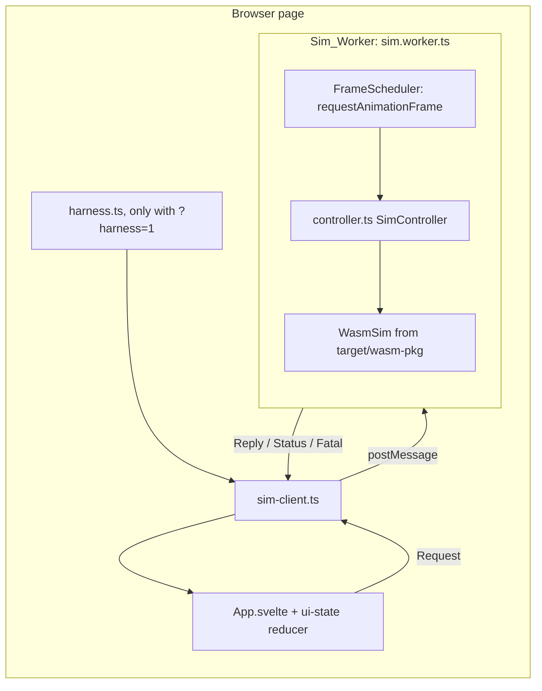
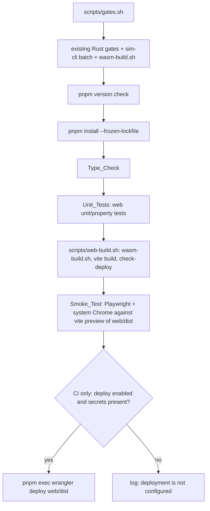

# Design Document: web-shell

## Overview

This spec adds the first browser front end. A Svelte 5 + Vite page in `web/` starts a dedicated Web Worker; the worker loads the `sim-wasm` build and owns the only `WasmSim`. The page shows tick, checksum, Run_State and Ticks_Per_Second, and offers create, run, pause, step and a Speed selector. A build script turns the WASM package and the web app into `web/dist` (the Deploy_Directory), checks every file against the 25 MiB limit, and a Playwright test drives the built page in the system Chrome and compares the worker's checksums with `fixtures/parity/seedbig-pairwise.replay.json`. A GitHub Actions workflow runs `scripts/gates.sh` and, when the gates pass and the author has enabled it, uploads the same `web/dist` to a Cloudflare Worker with Static Assets only.

The design keeps the simulation logic out of the web layer. The worker is a thin loop around four `WasmSim` calls (`new`, `submit`, `step`, `run_ticks`) plus the read-only `tick()`. Wall-clock time is used only to pace frames and compute Ticks_Per_Second.

### Resolution of the open points

| Point | Resolution | Kind |
|---|---|---|
| D-open-1 deploy tool and config | Wrangler as a pnpm dev dependency of `web/`, config `web/wrangler.jsonc` (assets only), deploy with `pnpm exec wrangler deploy`. See [DA-1](#da-1-deploy-tool-d-open-1). | Decided: DA-1 A |
| D-open-2 pnpm version | `10.33.1` (the version already installed). See [DA-2](#da-2-pnpm-version-d-open-2). | Decided: DA-2 A |
| D-open-3 `.wasm` URL and package visibility | The worker imports `sim-wasm/sim_wasm_bg.wasm?url` and passes the URL to the glue's `init`. A Vite alias and a TypeScript `paths` entry map `sim-wasm` to `../target/wasm-pkg`. | Mechanical (see [D3](#d3-wasm-url-and-package-visibility)) |
| D-open-4 Deploy_Directory and build script | `web/dist`, built by `scripts/web-build.sh`. | Mechanical (see [D4](#d4-deploy-directory-and-build-script)) |
| D-open-5 COOP/COEP | Not added now. Spec 3 adds `web/public/_headers`, and the preview script applies the same rule locally. | Mechanical (see [D5](#d5-coopcoep-left-for-spec-3)) |
| D-open-6 smoke-test access and pacing | Pacing: one `requestAnimationFrame` callback per batch inside the worker. Test access: a `window` hook that exists only when the page URL has `?harness=1`. See [DA-3](#da-3-smoke-test-access-to-the-worker_protocol-d-open-6). | Pacing mechanical; test access decided: DA-3 A |
| D-open-7 Speed list | `[1, 7, 30, 90, 365]` ticks per Frame (one day, week, month, quarter, year). | Mechanical |

One new question came up during design: where the web unit and property tests run in the gates. Decided: DA-4 A, a separate Unit_Tests gate between Type_Check and Web_Build. See [DA-4](#da-4-gate-for-web-unit-and-property-tests).

### Research findings used here

- Latest npm versions observed on 2026-11-05 from the npm registry `dist-tags` endpoints: `svelte` 5.57.3, `vite` 8.3.5, `@sveltejs/vite-plugin-svelte` 7.3.1 (peer `svelte ^5.46.4`, `vite ^8`), `svelte-check` 4.7.8 (peer `typescript ^5 || ^6`), `typescript` 7.0.2 latest, `@playwright/test` 1.64.1, `wrangler` 4.157.0, `fast-check` 4.10.2, `pnpm` 12.16.1 latest with `10.34.9` the latest 10.x. Two registry endpoints returned different "latest" values for `vite` and `pnpm` during the same session, so every version is to be confirmed when the lockfile is created. Because `svelte-check` does not accept TypeScript 7 as a peer, the project pins the latest TypeScript 6.x. Sources: [svelte-check](https://registry.npmjs.org/svelte-check/4.7.8), [vite-plugin-svelte](https://registry.npmjs.org/@sveltejs/vite-plugin-svelte/7.3.1), [typescript dist-tags](https://registry.npmjs.org/-/package/typescript/dist-tags), [pnpm dist-tags](https://registry.npmjs.org/-/package/pnpm/dist-tags).
- Cloudflare Static Assets: a Worker config with `name`, `compatibility_date` and `assets.directory` and no `main` serves only assets; a request that matches no file returns 404 when no Worker script exists ([Static Assets](https://developers.cloudflare.com/workers/static-assets/)). Custom headers go in a `_headers` file in the assets directory; the file itself is not served, and its rules apply only to asset responses ([Headers](https://developers.cloudflare.com/workers/static-assets/headers/)).
- The `cf` CLI (beta) has no `assets.directory` field in `cloudflare.config.ts`; for Vite projects the assets are the output of its own Vite client build, and CI deploys a Build Output made by `cf build` ([cf configuration](https://developers.cloudflare.com/cf/projects/cloudflare-config/), [cf in CI](https://developers.cloudflare.com/cf/ci/)). Wrangler deploys from `CLOUDFLARE_API_TOKEN` and `CLOUDFLARE_ACCOUNT_ID` and has the official `cloudflare/wrangler-action` ([GitHub Actions](https://developers.cloudflare.com/workers/ci-cd/external-cicd/github-actions/)).
- API token: Cloudflare's "Edit Cloudflare Workers" template includes the zone-level permission "Workers Routes" and KV, R2 and Tail permissions ([templates](https://developers.cloudflare.com/fundamentals/api/reference/template/)), so it breaks R11.6. A custom token with only **Account → Workers Scripts → Edit** on one account is the starting point; whether Wrangler additionally needs **Account Settings → Read** when the account ID is set is confirmed during the first deploy (see [Error Handling](#deploy-workflow)). As built (2026-11-06): not needed. The first deploy succeeded with only Account → Workers Scripts → Edit; on 2026-11-06 the Author rotated to an account API token from the Worker panel's CI/CD option, scoped to editing only the Worker `back-in-the-family`, and a re-run deployed with it without a missing-permission error. Account tokens are verified at `/accounts/<account_id>/tokens/verify`, not `/user/tokens/verify`.
- GitHub runner image `ubuntu-24.04` (image 20261026) ships Google Chrome 156, rustup 1.29.2 and Node 22 ([runner image readme](https://github.com/actions/runner-images/blob/main/images/ubuntu/Ubuntu2404-Readme.md)). The same readme announces that `ubuntu-latest` moves to Ubuntu 26.04 in November 2026, so the workflow pins `ubuntu-24.04`.

## Architecture





### Threads and ownership

- The Main_Thread holds UI state only. Its bundle never imports `sim-wasm` (checked after every build, see `check-deploy.ts`).
- The Sim_Worker holds the one `WasmSim`, the Run_State, the Speed, the latest Checksum and the Ticks_Per_Second samples. All of it is plain worker memory; none of it enters the simulation.
- Messages are handled one at a time on the worker's event loop. A batch runs inside one `requestAnimationFrame` callback, so a request that arrives during a batch is handled right after it.

### Worker loop (pacing, D-open-6)

1. `run` sets Run_State `running`, records the run start time and a sample `(now, tick)`, and requests one animation frame.
2. The frame callback returns at once if Run_State is not `running`. Otherwise it runs one batch: `step()` when Speed is 1, else `run_ticks(Speed)`. Both return the checksum of the last tick. It stores the checksum, reads `tick()`, adds a Ticks_Per_Second sample, sends a `status` message if at least 100 ms have passed since the last one, and requests the next frame.
3. Only one frame request is outstanding at any time, and it is requested after the batch ends. A slow batch therefore delays the next batch and never causes catch-up batches (R4.3). With the measured 10.9k ticks/s, a Speed-365 batch takes about 33 ms, so the effective rate at Speed 365 is roughly one batch every two to three frames.
4. `pause` sets Run_State `paused`, cancels the frame request and replies at once. No batch starts after that. The longest wait for the pause reply is one batch in progress (about 33 ms at Speed 365), within the 200 ms bound of R4.6.
5. `set-speed` only changes the stored Speed, so a batch in progress finishes at the old Speed and the next one uses the new Speed (R4.5).
6. `create-world` with a valid seed constructs the new `WasmSim` first; only on success does it stop the loop (as in `pause`), replace the old instance and increment `worldId`. The old instance is dropped and released by wasm-bindgen's finalizer; the worker does not call `free()`, because R6.1 limits calls on an instance to the listed methods.

Dedicated workers in Chrome expose `requestAnimationFrame` ([MDN](https://developer.mozilla.org/en-US/docs/Web/API/DedicatedWorkerGlobalScope/requestAnimationFrame)). If it is missing, the scheduler falls back to `setTimeout(cb, 16)`. When the tab is hidden Chrome stops animation frames, so the simulation stops advancing while the tab is hidden; this is accepted.

The 200 ms pause bound depends on a batch at Speed 365 staying well under 200 ms. Later specs that make ticks heavier must re-measure it; the responsiveness smoke check (R5.5) and the pause check (R9.9) will show a regression.

## Components and Interfaces

### Layout

```
web/
  package.json            # "type": "module", packageManager "pnpm@<pinned>", scripts below
  pnpm-lock.yaml
  wrangler.jsonc          # Static Assets config (DA-1 A)
  vite.config.ts
  playwright.config.ts
  tsconfig.app.json       # Main_Thread + shared modules (lib DOM)
  tsconfig.worker.json    # Sim_Worker + shared modules (lib WebWorker)
  tsconfig.node.json      # configs, scripts, tests (Node types)
  index.html
  public/                 # copied into dist as is (empty now; spec 3 adds _headers)
                          # As built (2026-11-06): the empty web/public/ and its .gitkeep were removed,
                          # so web/dist no longer ships an empty .gitkeep; the directory is recreated
                          # when the first public file (e.g. _headers) is added.
  src/
    main.ts               # mounts App, installs harness when ?harness=1
    App.svelte            # fields, controls, status, error area
    shared/
      protocol.ts         # Worker_Protocol types (used by both sides)
      seed.ts             # parseSeed
      speeds.ts           # SPEEDS = [1, 7, 30, 90, 365]
    main/
      sim-client.ts       # starts the worker, request ids, 30 s timeouts, event fan-out
      ui-state.ts         # pure reducer: messages and user actions -> display state
      harness.ts          # window.__simHarness (DA-3)
    worker/
      sim.worker.ts       # entry: init wasm, wire SimController to postMessage
      controller.ts       # SimController: all request handling and the run loop
      tps.ts              # Ticks_Per_Second window
  scripts/
    preview.ts            # Local_Preview: checks dist, runs vite preview
    check-deploy.ts       # size limit, wasm byte identity, main-bundle boundary
    typecheck.ts          # declaration check, then svelte-check and tsc
  tests/
    unit/*.test.ts        # node:test + fast-check
    smoke/fixture.spec.ts # protocol run vs native fixture, page controls
    smoke/responsive.spec.ts  # long-task check at every Speed
    smoke/global-setup.ts # system Chrome check, fixture load
  dist/                   # Deploy_Directory (already gitignored by `dist/`)
scripts/
  web-build.sh            # Web_Build
  check-pnpm-version.sh   # pnpm pin check (R1.2, R1.3)
  gates.sh                # extended
.github/workflows/deploy.yml
```

Scripts and tests are TypeScript run directly by Node 26, which strips types natively. All web TypeScript uses only erasable syntax (`erasableSyntaxOnly: true`), so the same files work under Vite and Node without a compile step, and `node --test` needs no extra test runner.

### `web/package.json` scripts

| Script | Command | Used by |
|---|---|---|
| `build` | `vite build` | `scripts/web-build.sh` |
| `check-deploy` | `node scripts/check-deploy.ts` | `scripts/web-build.sh` |
| `typecheck` | `node scripts/typecheck.ts`: checks that `target/wasm-pkg/sim_wasm.d.ts` exists, then runs `svelte-check --tsconfig tsconfig.app.json`, `tsc -p tsconfig.worker.json` and `tsc -p tsconfig.node.json` (all `noEmit`) and exits non-zero if any reports an error; warnings do not change the status | gates |
| `test:unit` | `node --test tests/unit/` | gates (Unit_Tests, DA-4 A) |
| `preview` | `node scripts/preview.ts` | developer, Playwright `webServer` |
| `test:smoke` | `playwright test` | gates |

Dev dependencies (exact versions fixed in the lockfile at implementation): `svelte`, `vite`, `@sveltejs/vite-plugin-svelte`, `svelte-check`, `typescript` (6.x), `@types/node`, `@playwright/test`, `fast-check`, and `wrangler` (DA-1 A). `svelte` is the only package whose code is bundled into `dist`; its runtime may pull in small helper packages, and those are found from the build (see R1.8 under Testing Strategy).

### Worker_Protocol (`src/shared/protocol.ts`)

```ts
export type RunState = 'no-world' | 'paused' | 'running' | 'failed';

export type Request =
  | { type: 'create-world'; id: number; seed: string; config: string }
  | { type: 'run'; id: number }
  | { type: 'pause'; id: number }
  | { type: 'step'; id: number }
  | { type: 'set-speed'; id: number; speed: number }
  | { type: 'submit'; id: number; input: string };

export interface Snapshot {
  worldId: number;          // 0 = no world; +1 per successful create-world
  runState: RunState;
  tick: string | null;      // decimal string; null when no world
  checksum: string | null;  // 16 lowercase hex; null before the first tick of a world
  tps: number | null;       // null unless running for at least 1,000 ms
  speed: number;
}

export type ErrorKind =
  | 'sim-error'       // WasmSim constructor or submit threw
  | 'invalid-seed'
  | 'invalid-speed'
  | 'no-world'
  | 'invalid-state'   // step while running
  | 'load-failed';    // WASM did not load

export type WorkerMessage =
  | { type: 'reply'; id: number; ok: true; snapshot: Snapshot }
  | { type: 'reply'; id: number; ok: false; kind: ErrorKind; error: string; snapshot: Snapshot }
  | { type: 'status'; snapshot: Snapshot }
  | { type: 'fatal'; error: string };
```

Rules:

- Each `Request` gets exactly one `reply` with the same `id`, in the order received (R2.7). Requests that arrive while the WASM is still loading are queued and answered in order after loading ends.
- A failure reply carries the snapshot as it was before the request; the worker changes no state on failure (R2.10, R2.11, R4.11, R6.4).
- `status` is sent while running, at most every 100 ms and at least once per batch-end after 100 ms, which keeps updates far more frequent than the 250 ms of R5.4 and the 1,000 ms of R2.12.
- `fatal` is sent when a `step` or `run_ticks` call throws (a Rust panic leaves the instance unusable), or from the worker's global `error` handler. The worker then sets Run_State `failed` and answers every later request with `invalid-state`.
- The seed and tick values are decimal strings; the checksum is 16 lowercase hex characters or `null` before the first tick (R2.5).

Request handling (worker side):

| Request | `no-world` | `paused` | `running` | `failed` |
|---|---|---|---|---|
| `create-world` | validate seed; construct; on success `paused`, tick 0, checksum null | same, replaces world | same; the loop stops only once the new world exists | `invalid-state` |
| `run` | `no-world` | start loop → `running` | ok, no change | `invalid-state` |
| `pause` | `no-world` | ok, no change | stop loop → `paused` | `invalid-state` |
| `step` | `no-world` | one `step()` | `invalid-state` | `invalid-state` |
| `set-speed` | `no-world` | validate, store | validate, store | `invalid-state` |
| `submit` | `no-world` | `WasmSim.submit(input)` | same | `invalid-state` |

If the WASM failed to load, every request gets `load-failed` with the load error text, and a `fatal` message tells the Main_Thread to set `failed` (R2.8).

`create-world` while `running` is invalid only if the seed is invalid or the constructor throws; in that case the old world keeps its Run_State. The loop is stopped only after the new `WasmSim` was constructed successfully, so a failed create leaves a running world running (R2.10, R3.6).

### `seed.ts`

```ts
export const SEED_MAX = 18_446_744_073_709_551_615n;
export type SeedProblem = 'empty' | 'non-digit' | 'too-large';
export type SeedResult = { ok: true; value: bigint } | { ok: false; problem: SeedProblem };
export function parseSeed(text: string): SeedResult;
export function seedProblemMessage(p: SeedProblem): string;
```

`parseSeed` checks, in this order: empty string → `empty`; any character outside `0`–`9` → `non-digit`; `BigInt(text) > SEED_MAX` → `too-large`. It never goes through `Number`. Leading zeros are accepted (`"007"` is 7), and the request still carries the string as entered (R3.2). The Main_Thread uses it to show the message (R3.3); the worker uses it again before calling `new WasmSim` (R2.10, R6.4).

### `SimController` (`worker/controller.ts`)

```ts
export interface SimHandle {          // WasmSim satisfies this structurally
  submit(input_json: string): void;
  step(): string;
  run_ticks(n: number): string;
  tick(): bigint;
}
export interface FrameScheduler { request(cb: () => void): number; cancel(handle: number): void; }
export interface Clock { now(): number; }   // performance.now in the worker

export class SimController {
  constructor(deps: {
    createSim: (seed: bigint, config: string) => SimHandle;
    scheduler: FrameScheduler;
    clock: Clock;
    post: (m: WorkerMessage) => void;
  });
  handle(req: Request): void;   // posts exactly one reply
  fail(error: string): void;    // load failure or uncaught error -> fatal
}
```

`sim.worker.ts` is about twenty lines: it awaits `init({ module_or_path: wasmUrl })`, builds a `SimController` with `createSim: (s, c) => new WasmSim(s, c)`, the real scheduler and clock, and `post: m => self.postMessage(m)`, and drains the queue of early requests. Because the entry calls `new WasmSim(seed, config)` directly, the Type_Check checks that call against the generated `sim_wasm.d.ts` (R8.4).

The controller validates every argument before it reaches `SimHandle`: the seed through `parseSeed`, the Speed by membership in `SPEEDS` (all values are within `u32`, R6.3), and the config and input as strings passed unchanged. No clock value or random value is ever an argument (R6.5); the clock is only read for pacing and `tps.ts`.

### `tps.ts`

Keeps samples `(time, tick)` taken at the run start and after each batch, dropping samples older than the one just before `now − 1000`. `ticksPerSecond(now)` returns `null` if `now − runStart < 1000`, otherwise `tickNow − tickAt(now − 1000)`, where `tickAt(t)` is the tick of the latest sample at or before `t`. Ticks are counted as `bigint` and converted to `number` (the value is bounded by ticks per second, far below 2^53).

### Main_Thread client and UI state

`sim-client.ts` creates the worker with `new Worker(new URL('../worker/sim.worker.ts', import.meta.url), { type: 'module' })`, numbers requests, keeps a map of pending replies with a 30 s timeout, and forwards `status`, `fatal`, the worker `error` event and `messageerror` to `ui-state.ts`.

`ui-state.ts` is a pure reducer:

```ts
interface UiState {
  worldId: number; runState: RunState;
  tick: string | null; checksum: string | null; tps: number | null; speed: number;
  error: string | null;           // error area (R5.8)
  seedMessage: string | null;     // validation message (R3.3)
  createPending: boolean;         // R3.8
  stepPending: boolean;           // R4.10
}
type UiEvent =
  | { type: 'reply'; request: Request; message: ReplyMessage }
  | { type: 'status'; snapshot: Snapshot }
  | { type: 'fatal' | 'worker-error'; error: string }
  | { type: 'seed-invalid'; problem: SeedProblem }
  | { type: 'request-sent'; request: Request };
function reduce(s: UiState, e: UiEvent): UiState;
function controls(s: UiState): { create: boolean; run: boolean; pause: boolean; step: boolean };
```

- A successful reply copies the snapshot and clears `error`. A failure reply sets `error` and keeps tick and checksum (R5.9, R3.6).
- A `status` whose `worldId` differs from the current `worldId` is ignored, so a status from a replaced world is never shown (R3.7).
- `fatal` and `worker-error` set `runState: 'failed'` and `error`, keep tick and checksum.
- `controls`: run, pause and step disabled in `no-world` and `failed`; in `running` only pause enabled; in `paused` run and step enabled, step disabled while `stepPending`; create disabled while `createPending` or `failed` (R3.8, R4.7–R4.10).
- Display: tick and checksum as `—` when `null`; Ticks_Per_Second as `—` when `null` (R5.1–R5.3, R5.6).

`App.svelte` binds this state to: a seed `<input>`, a config `<textarea>` prefilled from `fixtures/configs/pairwise.json` (imported with Vite's `?raw`, so the text is identical to the file, R3.1), Create, Run, Pause and Step buttons, a Speed `<select>` built from `SPEEDS` with 1 selected (R4.4), four status fields with `data-testid` attributes, and an error area. It has no control for inputs, replays or verification (R9.11).

### Test access (`harness.ts`, DA-3 A)

When `location.search` contains `harness=1`, `main.ts` installs:

```ts
window.__simHarness = {
  request(req: Omit<Request, 'id'>): Promise<WorkerMessage & { type: 'reply' }>;
};
```

It sends through the same `sim-client.ts` and the same worker as the page controls, so the protocol run and the page-control checks exercise one worker and one `WasmSim`. Replies also go through `ui-state.ts`, so the page shows what the harness does. Without the query parameter nothing is added to `window`. The harness gives no capability beyond the existing protocol, which already runs entirely in the visitor's own tab.

### D3: WASM URL and package visibility

- `vite.config.ts`: `resolve.alias: { 'sim-wasm': fileURLToPath(new URL('../target/wasm-pkg', import.meta.url)) }`, `worker.format: 'es'`, and `build.assetsInlineLimit` as a function that never inlines `.wasm` files (the current file is 232 KB and would not be inlined, but the rule must not depend on size).
- `sim.worker.ts`: `import init, { WasmSim } from 'sim-wasm/sim_wasm.js'` and `import wasmUrl from 'sim-wasm/sim_wasm_bg.wasm?url'`. Vite copies the file into `dist/assets/` under a content hash, unchanged, so it is byte-identical to the `wasm-build.sh` output (R7.3). The glue's own default `new URL('sim_wasm_bg.wasm', import.meta.url)` may also be detected by Vite; identical content produces the same hashed file, and `check-deploy.ts` requires exactly one `.wasm` file.
- TypeScript: `tsconfig.worker.json` has `"paths": { "sim-wasm/*": ["../target/wasm-pkg/*"] }` and `vite/client` types for `?url` and `?raw`. `tsconfig.app.json` covers `src/main`, `src/shared` and `App.svelte`; `tsconfig.worker.json` covers `src/worker` and `src/shared`; `tsconfig.node.json` covers `scripts/`, `tests/`, `vite.config.ts` and `playwright.config.ts` (R8.1). The split exists because the DOM and WebWorker libs conflict in one program. If `target/wasm-pkg/sim_wasm.d.ts` is missing, `tsc` reports TS2307 for the import, and the `typecheck` wrapper first prints `Sim_Wasm declarations missing at target/wasm-pkg/sim_wasm.d.ts; run scripts/wasm-build.sh` and exits non-zero (R8.5). The glue `sim_wasm.js` is excluded from checking (`skipLibCheck` covers the `.d.ts`; the `.js` is never in `include`).

Alternative considered: copying `target/wasm-pkg` into `web/src/generated/` in `wasm-build.sh`. Rejected because it duplicates build output into the source tree and needs another ignore rule.

### D4: Deploy_Directory and build script

`web/dist` is Vite's default output directory and is already ignored by the root `.gitignore` (`dist/`). `scripts/web-build.sh`:

```sh
set -euo pipefail
cd "$(dirname "$0")/.."
step() { local name=$1; shift; echo "==> web-build: $name"; "$@" || { echo "web-build: step '$name' failed" >&2; exit 1; }; }
step wasm-build scripts/wasm-build.sh
rm -rf web/dist
step vite-build pnpm --dir web run build
step check-deploy pnpm --dir web run check-deploy
```

`check-deploy.ts` walks `web/dist` recursively and fails (exit 1) when:

1. any file is larger than 26,214,400 bytes; it prints each such file as `<path relative to dist> <size> bytes > 26214400` (R7.4, R7.5). Exactly 26,214,400 bytes passes. The existing `sim-cli check-size` treats a file at the limit as too big and prints paths with the directory prefix, so it is not reused here;
2. the number of `.wasm` files is not exactly one, or its SHA-256 differs from `target/wasm-pkg/sim_wasm_bg.wasm` (R7.3);
3. any `.js` file other than the worker chunk contains the wasm-bindgen marker `__wbindgen` or the hashed `.wasm` file name (R2.3). The worker chunk is the one file that contains both.

The checks run in this order; the size check result is printed even if a later check fails. `web-build.sh` exits 0 only if all pass (R7.9).

### Local_Preview (`scripts/preview.ts`)

Exits 1 with `Deploy_Directory web/dist is missing or empty; run scripts/web-build.sh first` when `web/dist` is absent or has no files (R7.10). Otherwise it runs `vite preview --outDir dist --port 4173 --strictPort` with the same `vite.config.ts`. `vite preview` serves the built files unchanged, contacts no remote host, and sends `Content-Type: application/wasm` for `.wasm` (it uses the `mrmime` type table); the smoke test checks the header (R7.6, R7.7).

Alternative considered: `wrangler dev` as Local_Preview, which would apply `_headers` like production. Rejected for now: it starts the local Workers runtime and is heavier, and nothing in this spec uses `_headers`. Spec 3 can revisit it.

### D5: COOP/COEP left for spec 3

Nothing is added now. When spec 3 needs cross-origin isolation, it adds `web/public/_headers`:

```
/*
  Cross-Origin-Opener-Policy: same-origin
  Cross-Origin-Embedder-Policy: require-corp
```

Vite copies it into `web/dist`, Cloudflare applies it, and `scripts/preview.ts` reads the `/*` block of `dist/_headers` and passes it to `vite preview` as `preview.headers`, so the smoke test sees the same headers. No other file moves. Spec 3 must check that its model download hosts send CORS or CORP headers, because `require-corp` blocks cross-origin resources without them.

### Static Assets config (`web/wrangler.jsonc`, DA-1 A)

```jsonc
{
  "$schema": "./node_modules/wrangler/config-schema.json",
  "name": "back-in-the-family",
  "compatibility_date": "<implementation date>",
  "assets": { "directory": "./dist" },
  "workers_dev": true
}
```

No `main`, no bindings, no routes (R11.1). Unknown paths return 404, which is right for a single page without client routing.

### Deploy_Workflow (`.github/workflows/deploy.yml`)

```yaml
on: { push: { branches: [main] } }
permissions: { contents: read }
concurrency: { group: deploy-main, cancel-in-progress: false }
jobs:
  gates-and-deploy:
    runs-on: ubuntu-24.04
    timeout-minutes: 45
    env:
      PLAYWRIGHT_SKIP_BROWSER_DOWNLOAD: "1"
      WRANGLER_SEND_METRICS: "false"
    steps:
      - uses: actions/checkout@<sha>            # v-tag in a comment
      - run: rustup toolchain install          # reads rust-toolchain.toml
      - uses: jdx/mise-action@<sha>             # installs mise.toml tools, no upgrades
      - run: scripts/gates.sh
      - name: Check deploy configuration
        id: cfg
        env:
          HAS_TOKEN: ${{ secrets.CLOUDFLARE_API_TOKEN != '' }}
          HAS_ACCOUNT: ${{ secrets.CLOUDFLARE_ACCOUNT_ID != '' }}
          ENABLED: ${{ vars.DEPLOY_ENABLED == 'true' }}
        run: |
          if [ "$HAS_TOKEN$HAS_ACCOUNT$ENABLED" = "truetruetrue" ]; then echo "deploy=true" >> "$GITHUB_OUTPUT"
          else echo "Deployment is not configured (token: $HAS_TOKEN, account: $HAS_ACCOUNT, enabled: $ENABLED); skipping deploy."; fi
      - name: Deploy web/dist
        if: steps.cfg.outputs.deploy == 'true'
        working-directory: web
        env:
          CLOUDFLARE_API_TOKEN: ${{ secrets.CLOUDFLARE_API_TOKEN }}
          CLOUDFLARE_ACCOUNT_ID: ${{ secrets.CLOUDFLARE_ACCOUNT_ID }}
        run: pnpm exec wrangler deploy
```

- One job, so the deploy uploads the `web/dist` that `gates.sh` built and checked in the same run; `wrangler deploy` with an assets-only config uploads the directory and runs no build (R11.3).
- A failed gates step stops the job before the deploy step (R11.4). A failed deploy fails the job; there is no retry step (R11.10).
- Missing or empty secrets, or `DEPLOY_ENABLED` not set to `true`, print the message and leave the job result to the gates (R11.7). `DEPLOY_ENABLED` is a repository variable the author sets when approving the deploy step (R11.8).
- Concurrency: one group for the whole job, never cancelling a running job. Runs execute in push order; GitHub keeps at most one pending run and replaces it with a newer one, and a replaced run never ran its gates. The last run to finish is therefore the latest pushed commit whose gates ran, and it is deployed last when it passes (R11.11).
- The secrets reach only the deploy step as environment variables. GitHub masks them in logs; no step echoes them (R11.5).
- Third-party actions are pinned to full commit SHAs with the release tag in a comment. Only two are used: `actions/checkout` and `jdx/mise-action`. Rust needs no action because rustup is preinstalled and reads `rust-toolchain.toml`; Chrome is preinstalled.
- Caching (cargo, pnpm store) is left out for now; it can be added later without changing the gates.

### Gates (`scripts/gates.sh`)

After the existing `run scripts/wasm-build.sh` line, the script gains, in R10.1 order:

```sh
run scripts/check-pnpm-version.sh
run pnpm --dir web install --frozen-lockfile
run pnpm --dir web run typecheck
run pnpm --dir web run test:unit
run scripts/web-build.sh
run pnpm --dir web run test:smoke
```

`run` is changed to print `gate failed: <command>` before exiting with the command's status, so the failing gate is named (R10.2). With `set -e`, a missing `pnpm` gives exit 127 and the gate is reported as failed, never skipped (R10.4). `PLAYWRIGHT_SKIP_BROWSER_DOWNLOAD=1` is exported at the top of the script.

`scripts/check-pnpm-version.sh` reads the `pnpm` line of `mise.toml` and the `packageManager` field of `web/package.json` (with `node -p`), requires both to be present and of the form `major.minor.patch` (`pnpm@x.y.z` in `packageManager`), and on any mismatch prints both values (or `missing`) and exits 1 (R1.2, R1.3). It runs before `pnpm install`.

## Data Models

### Parity fixture (input to the smoke test)

The replay format version 2 file, as read from `fixtures/parity/seedbig-pairwise.replay.json`:

```ts
interface ReplayFixture {
  format: 'back-in-the-family/replay';
  version: 2;
  seed: string;                              // "18446744073709551557"
  config: { entity_count: number; workload: string };
  ticks: string;                             // "2000"
  inputs: { tick: string; seq: string; payload: unknown }[];   // 120, in seq order
  checksums: string[];                       // 2000 entries
}
```

Mapping used everywhere in this design: after the `n`-th tick has run, `WasmSim.tick()` is `n` and the checksum returned by that tick is `checksums[n − 1]`. "Tick N and the Checksum of tick N" on the page means the same pair. The protocol run submits each input as `JSON.stringify({ tick: input.tick, payload: input.payload })` in file order before the first step, exactly as `crates/sim-wasm/tests/parity.rs` does, so the stream assigns the same `seq` values. The config is passed as `JSON.stringify(fixture.config)`, which yields `{"entity_count":50,"workload":"Pairwise"}`.

### Worker state

| Field | Type | Notes |
|---|---|---|
| `sim` | `{ handle: SimHandle; worldId: number } \| null` | world and its id change together (one field) |
| `runState` | `RunState` | `no-world` iff `sim === null`, unless `failed` |
| `speed` | one of `SPEEDS` | starts at 1, kept across create, run and pause |
| `lastChecksum` | `string \| null` | reset to `null` on create |
| `frame` | `number \| null` | the one outstanding frame request; non-null only while `running` |
| `tps` | `TpsWindow` | reset on each `run` |
| `queue` | `Request[]` | requests received before the WASM finished loading |

### UI state

As in `UiState` above. `tick`, `checksum` and `worldId` change only together from one snapshot, so the displayed pair always belongs to one completed tick (R5.4).

### Speed list

`SPEEDS = [1, 7, 30, 90, 365] as const`. All values are positive and within `u32`.

## Correctness Properties

*A property is a characteristic or behavior that should hold true across all valid executions of a system-essentially, a formal statement about what the system should do. Properties serve as the bridge between human-readable specifications and machine-verifiable correctness guarantees.*

The properties below test the logic that this spec writes: seed parsing, the `SimController` request handling and run loop, the UI reducer, the Ticks_Per_Second window and the deploy-directory size check. Most controller properties run the real `WasmSim` in Node (loaded with the glue's `initSync` from `target/wasm-pkg/sim_wasm_bg.wasm`), a fake `FrameScheduler` that the test fires by hand, and a fake `Clock`. Browser behaviour (real frames, timing, headers, Chrome) is covered by the smoke test instead.

Several acceptance criteria collapse into one property where one implies the others (see the reflection in the prework): all "a rejected request changes nothing" criteria are Property 3, and all "the reported checksum is the right one" criteria are Property 4.

### Property 1: Seed parsing classifies every string and round-trips every u64

*For any* string `s`, `parseSeed(s)` returns `empty` iff `s` is empty, otherwise `non-digit` iff `s` contains a character outside `0`–`9`, otherwise `too-large` iff its decimal value exceeds 2^64 − 1, and otherwise `ok` with `value === BigInt(s)`. *For any* `bigint` `n` in [0, 2^64 − 1] (generator biased to 0, 2^53 ± 1 and 2^64 − 1) and any number of leading zeros `z`, `parseSeed("0".repeat(z) + n.toString())` is `ok` with value `n`, and the create-world request built from that text carries the text unchanged.

**Validates: Requirements 2.10, 3.2, 3.3, 3.4, 6.3, 6.4**

### Property 2: Exactly one well-formed reply per request, in order

*For any* sequence of requests (valid and invalid create-world, run, pause, step, set-speed with arbitrary integers, submit with arbitrary strings), interleaved with any number of fired frames and issued in any Run_State including `no-world`, the controller posts exactly one `reply` per request, the reply ids equal the request ids in the same order, and every snapshot in every posted message has `tick` either `null` (only when no world exists) or a decimal string without leading zeros, and `checksum` either `null` or 16 lowercase hexadecimal characters.

**Validates: Requirements 2.4, 2.5, 2.7**

### Property 3: Rejected requests change nothing and never reach Sim_Wasm with bad arguments

*For any* reachable controller state and any request that is rejected (seed that `parseSeed` rejects, Speed not in `SPEEDS`, a request in `no-world`, a step while `running`, a config the `WasmSim` constructor rejects, an input `WasmSim.submit` rejects), the failure reply's snapshot equals the snapshot before the request, the next snapshot equals it too, and a recording wrapper around `SimHandle` shows no call for a rejected seed or Speed. Across all requests, every recorded `createSim` seed is a `bigint` in [0, 2^64 − 1] and every `run_ticks` argument is a member of `SPEEDS`.

**Validates: Requirements 2.10, 2.11, 3.6, 4.11, 6.3, 6.4**

### Property 4: Reported checksums are independent of speed and pacing (model conformance)

*For any* seed, small World_Config (entity count 1–20, any workload), list of inputs, and sequence of commands drawn from create-world, run, pause, step, set-speed, submit and "fire k frames", with total ticks per case capped at 3,000: every snapshot the controller reports with tick `N ≥ 1` has the checksum that a reference run returns from its `N`-th `step()` call, where the reference run uses the same seed, config and inputs, each input submitted before the same tick; every snapshot with tick 0 has checksum `null`; after a successful create-world every later snapshot carries the new `worldId` and Run_State `paused` until a run; and Speed is unchanged by run, pause and create-world.

**Validates: Requirements 3.5, 3.7, 4.1, 4.2, 4.5, 5.4, 6.6**

### Property 5: Frame discipline

*For any* command sequence as in Property 4, at most one frame request is outstanding at any time; it is outstanding only while Run_State is `running`; each fired frame callback while `running` advances the tick by exactly the Speed that was current when the callback started; and after a pause reply (or a successful create-world) firing any number of frames leaves the tick unchanged.

**Validates: Requirements 4.3, 4.5, 4.6**

### Property 6: Clock and frame timing never reach the simulation

*For any* request sequence, running it twice with two different fake clocks (arbitrary monotonic times) and the same frame firing order produces identical recorded `SimHandle` call sequences, including every argument.

**Validates: Requirements 6.5**

### Property 7: UI reducer keeps the display honest

*For any* sequence of UI events (replies for any request, statuses with any `worldId`, fatal and worker-error events, seed-invalid events): a failure reply, a fatal or a worker-error event never changes the displayed `tick`, `checksum` or `worldId`; a status whose `worldId` differs from the current one changes nothing; the error area is non-empty iff the most recent reply-or-fatal event was a failure; and a successful reply clears it.

**Validates: Requirements 2.9, 3.6, 3.7, 5.8, 5.9**

### Property 8: Status formatting

*For any* `UiState`, the formatted tick is a dash when `tick` is `null` and otherwise the decimal string with no separators; the formatted checksum is a dash when `checksum` is `null` and otherwise exactly 16 lowercase hexadecimal characters; Ticks_Per_Second is a dash when `tps` is `null` and otherwise a non-negative decimal integer; and Run_State is one of the four names.

**Validates: Requirements 5.1, 5.2, 5.3, 5.6**

### Property 9: Ticks_Per_Second window

*For any* run start time, sequence of batch samples with non-decreasing times and ticks, and query time `now`, `ticksPerSecond(now)` is `null` iff `now − runStart < 1000`, and otherwise equals the tick of the last sample minus the tick of the latest sample at or before `now − 1000` (the run-start sample if none is later).

**Validates: Requirements 5.6**

### Property 10: Size check flags exactly the files above the limit

*For any* list of (relative path at any depth, size) entries, with sizes biased to 26,214,399, 26,214,400 and 26,214,401, the size check reports exactly the entries whose size is greater than 26,214,400, prints each as its path relative to the Deploy_Directory with its size, and returns success iff that set is empty.

**Validates: Requirements 7.4, 7.5, 7.9**

## Error Handling

### In the page

| Situation | Worker | Main_Thread |
|---|---|---|
| Seed field invalid | not contacted | validation message naming the problem; no request; state unchanged (R3.3) |
| Seed invalid at the worker (protocol caller) | `invalid-seed` reply, no Sim_Wasm call | error area |
| `new WasmSim` throws (bad config) | `sim-error` reply with the JsError message; old world kept, still running if it was | error area; tick, checksum, Run_State unchanged (R3.6) |
| `submit` throws (bad JSON, past tick) | `sim-error` reply, stream unchanged (sim-core guarantees this) | error area |
| Speed not in list | `invalid-speed` reply | error area |
| Request in `no-world` | `no-world` reply | error area; controls were disabled anyway |
| WASM fails to load | `fatal` + `load-failed` for every request | Run_State `failed`, error text shown (R2.8) |
| `step` / `run_ticks` throws (Rust panic) | `fatal`; Run_State `failed` | `failed`, error text; tick and checksum stay at the last completed tick |
| Worker `error` or `messageerror` event | — | `failed`, error text (R2.9) |
| No reply within 30 s | — | the client rejects the pending request with a timeout error, shown in the error area; the harness turns it into a test failure naming the request (R9.13) |

`failed` is final for the page; reloading starts over. A Rust panic message reaches the page through the `RuntimeError` text; adding `console_error_panic_hook` for better messages is out of scope.

### In the build and gates

- `web-build.sh` names the failed step (`wasm-build`, `vite-build`, `check-deploy`) and exits 1 (R7.8).
- `check-deploy.ts` prints every offender for each check it runs, then exits 1.
- `preview.ts` exits 1 with the "run scripts/web-build.sh first" message (R7.10).
- `gates.sh` prints `gate failed: <command>` and exits with that command's status (R10.2).
- `check-pnpm-version.sh` prints `mise.toml: <value|missing>` and `web/package.json packageManager: <value|missing>` (R1.3).
- `pnpm install --frozen-lockfile` fails with pnpm's outdated-lockfile error and does not write the lockfile (R1.6).

### In the smoke test

- `global-setup.ts` reads and parses the fixture first; on failure it throws `cannot read fixture seedbig-pairwise.replay.json: <reason>` before any page opens (R9.12).
- It then launches Chrome with `channel: 'chrome'`; if that throws, it rethrows `system Chrome not found (Playwright channel 'chrome'): <original message>` (R9.3).
- The page's `console` errors and every `reply` with `ok: false` during the fixture run fail the test with the error text (R9.10).
- A checksum mismatch reports `seedbig-pairwise.replay.json: first difference at tick N: expected X, actual Y` (or `missing`) (R9.6).
- `context.route('**/*')` aborts and records any request whose origin is not the preview origin; a recorded request fails the test (R9.4).
- Timeouts: Playwright `webServer.timeout` 30 s, per-request harness timeout 30 s, global `timeout`/`globalTimeout` 180 s; each failure names its step (R9.13).

### Deploy workflow

- Gates fail: the job stops before the deploy step; the previous deployment keeps serving (R11.4).
- Secrets missing or `DEPLOY_ENABLED` unset: message and skip (R11.7).
- `wrangler deploy` fails (for example a missing permission): the job fails, no retry (R11.10). If the first deploy reports that the token lacks a permission, the author adds only the permission named in the error (expected candidate: Account Settings Read), and `docs/kiro-log.md` records it. Before the first deploy the account must have a `workers.dev` subdomain; Cloudflare asks to register one once in the dashboard if it does not.

## Testing Strategy

### Libraries and runners

- Property tests: `fast-check` with Node's built-in `node:test` runner, at least 100 runs per property (`fc.assert(prop, { numRuns: 100 })`). Each property is implemented by exactly one test, tagged with a comment `// Feature: web-shell, Property N: <title>`.
- Browser tests: `@playwright/test` with `channel: 'chrome'`, `workers: 1`, against `scripts/preview.ts` as `webServer`.
- No test framework beyond these two; Node 26 runs the `.ts` test files directly.

### Unit and property tests (`web/tests/unit/`)

| File | Content |
|---|---|
| `seed.test.ts` | Property 1; examples for `""`, `" 1"`, `"-1"`, `"1e3"`, `"18446744073709551616"` and their messages |
| `controller.test.ts` | Properties 2–6 with real WASM in Node and fake scheduler/clock; examples: load failure answers queued requests with `load-failed` (R2.8), status gap ≤ 1,000 ms with a fake 60 Hz clock (R2.12), Speed persists across create (R4.5) |
| `ui-state.test.ts` | Properties 7 and 8; exhaustive table of `controls()` over every Run_State × `stepPending` × `createPending` (R3.8, R4.7–R4.10) |
| `tps.test.ts` | Property 9 |
| `check-deploy.test.ts` | Property 10; examples: one oversized file at depth 3; two `.wasm` files fail; a main chunk containing `__wbindgen` fails |
| `pnpm-version.test.ts` | runs `check-pnpm-version.sh` against temporary copies with missing, different and range values (R1.3) |

The controller properties use small configs (1–20 entities) and cap a case at 3,000 ticks, so 100 runs of Property 4 stay within a few seconds.

### Smoke test (`web/tests/smoke/`)

`fixture.spec.ts`, one page at `/?harness=1`:

1. Fetch the `.wasm` URL found in `web/dist` and check `Content-Type: application/wasm` (R7.7).
2. Check the config field equals `fixtures/configs/pairwise.json` (R3.1) and that no element offers replay or verification (R9.11).
3. Protocol run through `window.__simHarness`: create from the fixture seed and config, submit the 120 inputs in file order, step 2,000 times, compare each checksum with `checksums[n − 1]`, and require exactly 2,000 checksums (R9.5, R9.6).
4. Reference run: create again, step at least 2,000 times with no inputs, keep the checksums (R9.7).
5. Page controls: enter seed and config, click Create, click Step, expect tick `1` and reference checksum 1 within 5 s (R9.8).
6. Select Speed 365, click Run, wait until tick ≥ 365 or 10 s, click Pause; expect the displayed tick > 1, the same tick and checksum 500 ms later, and the checksum equal to the reference checksum for that tick, extending the reference through the harness if the tick is past its end (R9.9, R4.6, R5.7).

`responsive.spec.ts`: for each Speed, create a world, run for 10 s, collect `PerformanceObserver({ type: 'longtask' })` entries on the main thread, and fail on any entry over 50 ms (R5.5). This adds about 50 s; the whole Smoke_Test stays under the 180 s limit.

### Examples and checks outside the test files

- Static check in `check-deploy.ts` after every build: one `.wasm`, byte-identical; no wasm-bindgen marker outside the worker chunk (R2.3, R7.3).
- R1.8 and R12.7: a Vite plugin in `vite.config.ts` writes the list of `node_modules` packages that ended up in the bundle to `web/.bundle-report.json` (gitignored, outside `dist`). The README table is written from that list, `package.json` and the lockfile when dependencies change; this is a documentation step, not a gate.
- R12.6: run the four README command sequences once on a fresh clone at the end of the spec.

### Fault injections (R10.5–R10.8)

Each one is done alone, followed by a full `scripts/gates.sh` run that must fail naming the gate, then reverted and re-run to exit 0, and logged in `docs/kiro-log.md` at that time.

| Gate | Injected fault | Expected failure |
|---|---|---|
| pnpm version check | `packageManager` set to a different patch version than `mise.toml` | `check-pnpm-version.sh` prints both values; `gate failed: scripts/check-pnpm-version.sh` |
| Type_Check | in `sim.worker.ts`, pass `Number(seed)` instead of the `bigint` to `new WasmSim` | TS2345 at that file and line; `gate failed: pnpm --dir web run typecheck` |
| Unit_Tests | in `controller.ts`, run `Speed + 1` ticks per batch | Property 5 counterexample; `gate failed: pnpm --dir web run test:unit` |
| Size check | `truncate -s 26214401 web/public/oversize.bin` (copied into `dist` by Vite) | `oversize.bin 26214401 bytes > 26214400`; `web-build: step 'check-deploy' failed` |
| Smoke_Test | in `fixture.spec.ts`, overwrite the in-memory expected checksum for tick 42 with `0000000000000000` (the fixture file is never edited, per `fixtures/parity/README.md`) | `first difference at tick 42`; `gate failed: pnpm --dir web run test:smoke` |

## Decisions (resolved 2026-11-05)

The author accepted the recommended option for DA-1 to DA-4 on 2026-11-05.

### DA-1: Deploy tool (D-open-1)

| Option | How | For | Against |
|---|---|---|---|
| **A. Wrangler as a pnpm dev dependency (recommended)** | `web/wrangler.jsonc` with `assets.directory: "./dist"`; the workflow runs `pnpm exec wrangler deploy` | Config names the Deploy_Directory directly (R11.1); deploys the checked directory with no build (R11.3); version pinned by the lockfile (R1.7); mature; same tool the author already uses locally | Adds a large dev dependency (Wrangler pulls the `workerd` binary) to every `pnpm install`, including in the gates |
| B. Wrangler through `cloudflare/wrangler-action` | Same config; the action installs Wrangler in CI only | Official action; keeps Wrangler out of `web/package.json` | Another third-party action to pin; the Wrangler version is set in the workflow, not the lockfile; local deploys would need a separate Wrangler install |
| C. `cf` CLI (beta) | `cloudflare.config.ts`; `cf build` then `cf deploy --prebuilt` | Cloudflare's guidance prefers `cf` for new projects without a Wrangler config | Beta; its config has no `assets.directory` field, and Vite projects get their assets from `cf`'s own build, so the deployed files would come from a second build rather than the Deploy_Directory that the gates checked (conflicts with R11.1 and R11.3) |

### DA-2: pnpm version (D-open-2)

| Option | For | Against |
|---|---|---|
| **A. `10.33.1` (recommended)** | Already installed through user-level mise, so pinning it downloads nothing; known to work here | Not the newest 10.x |
| B. Latest 10.x (`10.34.9` observed) | Latest fixes on the same major | One download; no concrete need |
| C. Latest major (`12.16.1` observed) | Newest | Two majors ahead of the installed one; lockfile format and defaults may differ; nothing in this spec needs it |

Changing later means editing `mise.toml` and `packageManager` together; the version check enforces it.

### DA-3: Smoke-test access to the Worker_Protocol (D-open-6)

| Option | For | Against |
|---|---|---|
| **A. `window.__simHarness`, installed only with `?harness=1` (recommended)** | Drives the page's own worker and `WasmSim`, so the protocol run and the page-control checks test the shipped code path; nothing on `window` for normal visitors; about 20 lines | The harness code ships in the production bundle (dormant); anyone can enable it, but it offers only what the protocol already does in the visitor's own tab |
| B. Same hook, always installed | Simplest | A permanent global in production for no user benefit |
| C. Test-only build (`vite build --mode harness`) | Production bundle has no harness | The tested bundle would not be the Deploy_Directory (conflicts with R9.4); two builds to keep in sync |

A fourth idea, the test starting its own Worker from the shipped worker chunk, was dropped: it needs the hashed chunk name and creates a second `WasmSim` in the page, against R2.1.

### DA-4: Gate for web unit and property tests

R10.1 lists the new gates and does not mention web unit tests, but Properties 1–10 need to run somewhere.

| Option | For | Against |
|---|---|---|
| **A. New gate `pnpm --dir web run test:unit` between Type_Check and Web_Build (recommended)** | Fast feedback before the build; failures named separately | Requires amending R10.1 (gate list) and R10.5 (one more fault injection, already planned above) |
| B. Run them inside the Smoke_Test gate | No requirement change | One gate checks two unrelated things; a property failure is reported as a smoke failure |
| C. Run them only by hand | No change to gates | Properties can silently break; against the quality-gate rule in `tech.md` |

### Notes that do not need a decision

- API token: a custom account token with only Account → Workers Scripts → Edit for the one account (R11.6). The author creates it and the two GitHub secrets after approving (R11.8). (As built 2026-11-06: replaced by a token scoped to the single Worker; see the research note above.)
- `compatibility_date` is set to the implementation date.
- The Worker name `back-in-the-family` gives `back-in-the-family.<account-subdomain>.workers.dev`; the author can choose another name before the first deploy.

## Implementation notes (built 2026-11-05)

Added in the final check (task 9.5). The design above is left as written; this section records where the implementation (tasks 1–8) differs from or adds to it, and why. The requirement-by-requirement check is in `docs/web-shell-audit.md`; every item below is also in `docs/kiro-log.md` under the dated task entries. Nothing here reopens a requirement.

### Resolved tool versions (pinned in the lockfile)

The design left every version "to be confirmed when the lockfile is created". As built, the committed versions are:

| Package | Pinned version | Note |
|---|---|---|
| `svelte` | 5.57.3 | |
| `vite` | 8.3.5 | |
| `@sveltejs/vite-plugin-svelte` | 7.3.1 | |
| `svelte-check` | 4.7.8 | |
| `typescript` | 6.0.3 | pinned on 6.x because `svelte-check` 4.7.8 rejects TypeScript 7 as a peer (the design foresaw this) |
| `@types/node` | 26.6.6 | |
| `@playwright/test` | 1.64.1 | |
| `fast-check` | 4.10.2 | |
| `wrangler` | 4.157.0 | |
| `pnpm` | 10.33.1 | DA-2 A; pinned in `mise.toml` and `packageManager` |
| `node` | 26.7.0 | from `mise.toml` |

### `.ts` import specifiers, not `.js`

The design's example code imported sibling modules with `.js` specifiers (the TypeScript-emit convention). As built, the controller/shared modules and the Node tests import with explicit **`.ts`** specifiers, because Node 26 strips types and resolves the specifier literally, so a `.js` specifier would not find the `.ts` file at test time. All three tsconfigs set `allowImportingTsExtensions` (with `noEmit`, which Vite and `node --test` both satisfy). Vite resolves `.ts` specifiers too, so the same source works in the browser build. No behavior changed; only the specifier text differs from the design snippets.

### New module: `web/src/main/bridge.ts`

Not in the design's module list. `bridge.ts` holds a small `EventBridge`: the `SimClient` is created in `main.ts` with its worker-initiated event handlers (`onStatus`, `onFatal`, `onError`) fixed at construction, but `App.svelte` and its reducer mount afterwards. The bridge is the holder those fixed handlers call into, and `App.svelte` registers the reducer dispatch with it on mount. This keeps the worker-event wiring out of `App.svelte` and lets the handlers exist before the component does. It is Main_Thread-only and touches no simulation state.

### `ui-state.ts` derives `ReplyMessage` from the shared union

So the pure reducer and its Node tests stay DOM-free, `ui-state.ts` derives the `ReplyMessage` type from the shared `WorkerMessage` union in `src/shared/protocol.ts` rather than importing it from the DOM-only `sim-client.ts`. `tsconfig.node.json` (which compiles the reducer tests) therefore pulls in no DOM lib through the reducer.

### `SimController.ready()` for the load queue

The design has `sim.worker.ts` "drain the queue of early requests" after `init()` resolves. As built, `SimController` exposes a `ready()` method that models the not-yet-loaded state: `createSim` is injected synchronously at construction, requests that arrive before `ready()` are queued, and the worker entry calls `ready()` once `init()` resolves, which drains the queue in order. This makes the load-queue behavior (R2.8 ordering) testable in Node without a real async load.

### WASM loading: `initSync` in tests, default `init` in the worker

The `sim-wasm` glue is wasm-bindgen 0.2.130 `--target web`. The Node property/controller tests load it with `initSync({ module: bytes })` (bytes read from `target/wasm-pkg/sim_wasm_bg.wasm`), which gives a synchronous `createSim` for the fake-scheduler tests. The worker loads it the way the design specifies — the default `init({ module_or_path: wasmUrl })` with a `?url` import and the Vite `sim-wasm` alias. Both paths construct the same `WasmSim`.

### `check-deploy.ts` replaces `sim-cli check-size` for `web/dist`

The design already noted that `sim-cli check-size` treats a file at the limit as too big and is not reused. As built, `check-deploy.ts` is the sole size check for `web/dist`: a file of **exactly** 26,214,400 bytes passes (R7.4), which `sim-cli check-size` would fail. `check-deploy.ts` also performs the two other deploy-directory checks from the design — `.wasm` SHA-256 byte-identity with the `wasm-build.sh` output (R7.3) and the main-bundle boundary that keeps `__wbindgen`/the hashed `.wasm` name out of every `.js` chunk except the worker chunk (R2.3).

### R5.4 / R5.5 verified by `responsive.spec.ts` via the page controls, not the harness

Display cadence (R5.4) and Main_Thread responsiveness (R5.5) are verified by the page-control-driven `responsive.spec.ts` smoke test rather than through the `__simHarness`. The page reducer ignores `status` messages for a world it did not itself create (R3.7), so a harness-created world would not drive the page's status display; running through the page controls is what exercises the displayed-cadence path.

### Deploy tool: DA-1 A as built (accepted cost)

DA-1 A was taken: `wrangler` is a `web/` dev dependency. Accepted cost observed at install time: Wrangler pulls `workerd` and `esbuild` binaries, adding roughly 220 MiB to `web/node_modules` on every `pnpm install`, including in the gates. This was the known trade-off in the DA-1 table and is accepted.

### CI action pins (as written in `.github/workflows/deploy.yml`)

- `actions/checkout@3d3c42e5aac5ba805825da76410c181273ba90b1` # v7.0.1
- `jdx/mise-action@f5be966e4a917d54244728e6a5fdcd1d93a35e6c` # v5.2.6
- runner `ubuntu-24.04` (pinned, not `ubuntu-latest`).

### Deploy enablement deferred to task 10

R11.6 (the custom API token), R11.8 (the author creating the token and the two GitHub secrets) and R11.9 (the first deploy and `workers.dev` subdomain registration) are deferred to task 10, pending the author's approval. The Deploy_Workflow's live CI behavior — the gates running on a GitHub runner and the deploy step — is therefore **unverified until the first push to `main`**. The workflow was validated by read-through and local `scripts/gates.sh` runs only (see the task 8 log entry).

**As built (2026-11-06).** Task 10 completed on 2026-11-05. `main` was pushed; CI run `41992180587` on `ubuntu-24.04` ran the gates green with deploy disabled and logged the not-configured message. The Author then created the two GitHub secrets and set `DEPLOY_ENABLED=true`. The first deploy served commit `76ab0bb` at <https://back-in-the-family.2290698778.workers.dev> (Cloudflare Version ID `eb14eb1e-9f35-44e3-ba8d-467f09d3e0a0`), and every green push to `main` now deploys. The live CI behaviour is therefore verified on the happy path; the gate-failure, deploy-failure and concurrency-ordering branches remain verified by inspection only.
